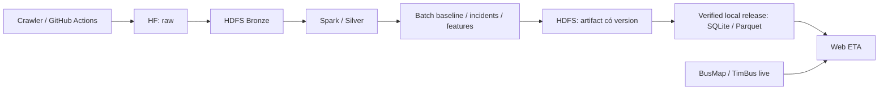

# Theo dõi xe buýt Hà Nội, lưu trữ lịch sử và dự báo ETA

Bài tập lớn của nhóm sinh viên môn Lưu trữ và xử lý dữ liệu lớn. Nhóm mô phỏng
cơ chế lưu trữ/xử lý phân tán trên laptop; không vận hành máy chủ 24/7.

GitHub Actions/crawler thu dữ liệu vào Hugging Face. Theo từng phiên, nhóm nhập
byte gốc vào HDFS, xử lý Silver bằng Spark, tạo baseline/incidents/features rồi
publish và tải local release. **Web đọc SQLite/Parquet local; request không query
HDFS.** GPS live đến từ BusMap và TimBus tùy tuyến/chiều và trạng thái nguồn.



## Chạy demo

```powershell
# Nguồn local hiện có, không cần Docker
.\run_demo.ps1 -LocalData -NoBrowser

# Hoặc release đã tải và kiểm tra, không cần HDFS lúc phục vụ
.\run_demo.ps1 -ReleasePointer runtime/eta_demo_active.json -NoBrowser
```

Mở `http://127.0.0.1:8000`. Dùng `-Port` nếu cần cổng riêng. Hai lệnh là hai lựa
chọn; không chạy cùng cổng. `/api/health` công bố nguồn serving/model, không chứng
minh upstream đang hoạt động hay model chính xác. Release hiện baseline-only khi
chưa có model/mapping tương thích được nghiệm thu. Local dùng model ứng viên;
tuyến ngoài mapping ML phải fallback, không gán thành tuyến đầu tiên.

API chính: `/api/routes`, `/api/route-shape`, `/api/route-stations`,
`/api/live-vehicles`, `/api/station-eta`; schema tham số tại `/docs` khi app chạy.
Demo không tự ingest/export hoặc hỏi lưu dữ liệu lúc thoát. Logging phục vụ
thực nghiệm chỉ được bật rõ ràng qua phiên thu chuyên dụng.

## Đọc và kiểm chứng

- [HDFS: vai trò, phạm vi và bằng chứng](docs/HDFS_README.md)
- [Chạy batch HDFS và tải release](docs/HDFS_RUNBOOK.md)
- [Checklist đang thực hiện và tiêu chí nghiệm thu](docs/specs/41_REMAINING_COMPLETION_AND_TESTING_ISSUES_SPEC.md)
- [Hợp đồng dữ liệu HDFS](docs/specs/HDFS_DATA_CONTRACTS.md)
- [Chỉ mục đặc tả](docs/specs/README.md)

Model có train/eval code và metrics nhưng chưa mặc định được nghiệm thu. Cần
kiểm toán nhãn/split/leakage, pin artifact/mapping và đánh giá live có ground
truth phù hợp. Chạy được hoặc predict hữu hạn không thay thế các bằng chứng ấy.

## Các module

| Module | Vai trò |
|---|---|
| `module_1_data_ingestion_and_preprocessing` | Crawler, ingest và projection dùng chung |
| `module_2_big_data_storage_and_lakehouse/step_2_4_hdfs_history` | Raw/receipts, snapshot Silver, artifact/release và lineage |
| Module 2 `step_2_1`, `step_2_2` | Operational SQLite và Parquet local hiện hữu |
| `module_3_bus_eta_prediction` | Baseline, features, train/eval, serving và web |
| `experiments/timbus` | Client/protocol TimBus và anchor được serving sử dụng |
| `scripts`, `tests` | CLI thực thi, thực nghiệm và kiểm tra tự động |

Không suy ra coverage từ số tuyến catalog: tuyến có baseline, dữ liệu train,
GPS live và TimBus có thể thuộc các tập khác nhau. Xem manifest/bằng chứng của
từng lần chạy; không dùng số liệu cũ như trạng thái hiện tại.
