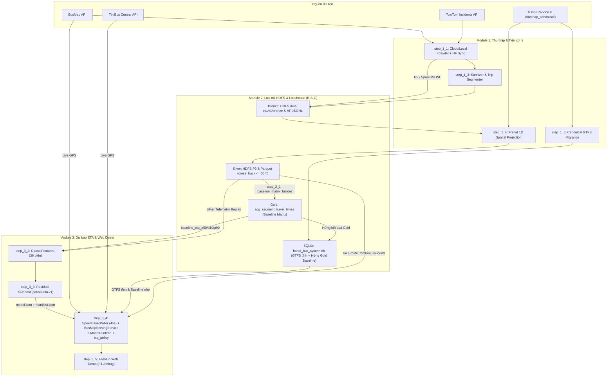

# Hệ thống Theo dõi Xe buýt Hà Nội, Lưu trữ Lakehouse & Dự báo ETA

- **Phiên bản kiến trúc:** Kiến trúc Lambda (Batch Layer + Speed Layer + Serving Layer)
- **Đầu vào:** BusMap API, TimBus Central API (`experiments/timbus/`), TomTom Incidents API, dữ liệu GTFS chuẩn (`data/ground_truth/busmap_canonical/`)
- **Đầu ra:** SQLite (`data/hanoi_bus_system.db`), Medallion Lakehouse Parquet (`data/lakehouse/`), HDFS (`step_2_4_hdfs_history/`), mô hình `causal-eta.v1` (`data/models/causal_eta_v1/`), Web Demo FastAPI (`step_3_5_web_demo/`)

## Sơ đồ Luồng Dữ liệu Tổng quan (Data Flow)



## Cấu trúc thư mục & Tài liệu chi tiết

| Thành phần | Tài liệu |
| --- | --- |
| Luồng Batch Layer | [docs/BATCH_LAYER_PIPELINE.md](docs/BATCH_LAYER_PIPELINE.md) |
| Luồng Speed Layer (Poller 45s) | [docs/SPEED_LAYER_PIPELINE.md](docs/SPEED_LAYER_PIPELINE.md) |
| Tầng Serving Layer ETA & TimBus | [docs/SERVING_LAYER_PIPELINE.md](docs/SERVING_LAYER_PIPELINE.md) |
| Thu thập dữ liệu (Crawler) | [docs/CRAWLER.md](docs/CRAWLER.md) |
| Tiền xử lý & Chiếu Frenet 1D | [docs/PREPROCESSING.md](docs/PREPROCESSING.md) |
| Lưu trữ HDFS & Lakehouse (B-S-G) | [docs/HDFS_LAKEHOUSE.md](docs/HDFS_LAKEHOUSE.md), [docs/HDFS_RUNBOOK.md](docs/HDFS_RUNBOOK.md) |
| Mô hình dự báo ETA | [docs/ETA_MODEL.md](docs/ETA_MODEL.md) |
| Web Demo & Tích hợp TimBus | [docs/DEMO_APP.md](docs/DEMO_APP.md), [experiments/timbus/README.md](experiments/timbus/README.md) |
| Module 1, 2, 3 | [Module 1](module_1_data_ingestion_and_preprocessing/README.md), [Module 2](module_2_big_data_storage_and_lakehouse/README.md), [Module 3](module_3_bus_eta_prediction/README.md) |
| CLI Entrypoints & Ops Runners | [scripts/README.md](scripts/README.md) |
| Đề xuất học thuật | [academic_proposal/](academic_proposal/) |

## Tham số SSOT (`config/system_config.py`)

- `DEFAULT_DB_PATH = "data/hanoi_bus_system.db"`, `DEFAULT_LAKEHOUSE_ROOT = "data/lakehouse"`
- `HANOI_BBOX`: `19.50..22.50` lat, `104.50..107.50` lon (bao phủ vùng liên tỉnh miền Bắc)
- `MAX_CORRIDOR_CROSS_TRACK_M = 35.0`, `TERMINAL_STATIONARY_TOL_M = 15.0`
- `GPS_DRIFT_MAX_SPEED_KMPH = 80.0`, `GPS_DRIFT_MIN_DIST_M = 250.0`, `BATCH_HMM_HORIZON_SEC = 300.0`
- `SESSION_DURATION_SEC = 540` (phiên cloud crawler 9 phút), `BUS_POLL_INTERVAL_SEC = 75`

## Cách chạy & Kiểm thử

```bash
# Chạy Web Demo (khởi động ngầm trước demo ~15 phút để SpeedLayerPoller làm ấm trước)
scripts\start_demo_bg.bat
# Hoặc chạy trực tiếp (Trang Hành khách: /, Trang Debug: /debug)
python -m uvicorn module_3_bus_eta_prediction.step_3_5_web_demo.app:app --host 127.0.0.1 --port 8000 --workers 1

# Thử nghiệm Cloud Crawler cục bộ (1 vòng, không đẩy Hugging Face)
python -m module_1_data_ingestion_and_preprocessing.step_1_1_busmap_crawler_and_relay.cloud_crawler_runner --test --no-tomtom

# Chạy toàn bộ bộ kiểm thử
python -m pytest tests/ --basetemp=runtime/pytest_tmp -q
```
