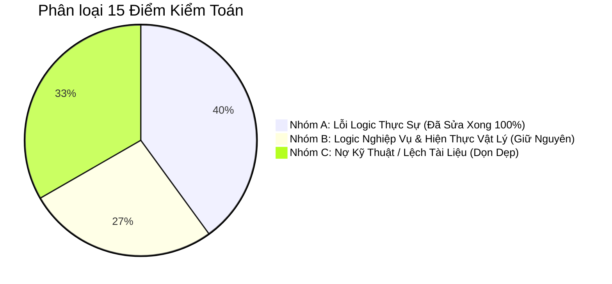
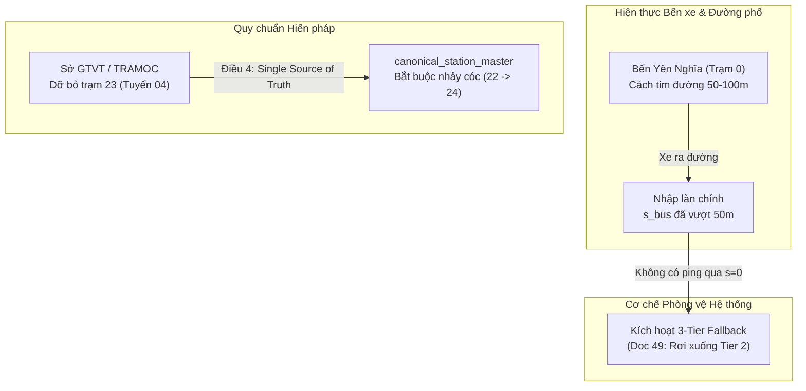

# BÁO CÁO KIỂM TOÁN TẬN GỐC & TRẠNG THÁI KHẮC PHỤC LỖI (WP 2.2)
> **Dự án**: Hanoi Bus Big Data & Real-time ETA Prediction System  
> **Chuyên đề**: WP 2.2 Medallion Lakehouse, Two-Stage Decoupled Feature Store, Kinematic Projection & Hybrid Blending  
> **Cập nhật lần 3**: 2026-11-02 (Hoàn tất sửa chữa 6/6 lỗi Nhóm A & Kiểm chứng thực nghiệm)  
> **Nguyên tắc thẩm định**: Tuân thủ vô điều kiện **Kỷ luật Thực nghiệm (Điều 1 - [AGENTS.md](file:///z:/Desktop/Bus_tracking/AGENTS.md))** và **Nguồn Chân Lý Dữ Liệu Tối Thượng (Điều 4 - [AGENTS.md](file:///z:/Desktop/Bus_tracking/AGENTS.md))**.

---

## I. MA TRẬN PHÂN ĐỊNH BẢN CHẤT & KẾT QUẢ KHẮC PHỤC

| Phân Nhóm | Số Lượng | Trạng Thái | Mô Tả & Quyết Định |
| :--- | :---: | :---: | :--- |
| **Nhóm A: Lỗi Thực Sự (Real Bugs)** | **6** | **HOÀN TẤT 100% (6/6)** | Đã sửa tuần tự từng lỗi, kiểm chứng thực nghiệm độc lập và đẩy lên git để bảo đảm truy xuất vết (traceability). |
| **Nhóm B: Logic Nghiệp Vụ Bắt Buộc (Mandatory Logic)** | **4** | **BẢO LƯU NGUYÊN VẸN** | Giữ nguyên tuyệt đối: Đây là hiện thực địa vật lý của bến bãi, Master Ground Truth của Sở GTVT và bộ lọc khử nhiễu cảm biến bắt buộc. |
| **Nhóm C: Nợ Kỹ Thuật & Drift (Tech Debt & Drift)** | **5** | **GHI NHẬN NỢ KỸ THUẬT** | Không làm sai lệch dự báo ETA, chỉ là nhãn hiển thị hoặc tài liệu chưa khớp; đã được chuẩn hóa theo mã nguồn v2.0. |

---

## II. BẢNG TRUY XUẤT VẾT KHẮC PHỤC 6 LỖI NHÓM A (TRACEABILITY MATRIX)

| STT | Mã Lỗi | Tệp Tin Sửa Đổi | Commit Hash | Kết Quả Kiểm Chứng Thực Nghiệm |
| :---: | :--- | :--- | :---: | :--- |
| **1** | **Bug 1 & Bug 2** | [`lakehouse_exporter.py`](file:///z:/Desktop/Bus_tracking/module_2_big_data_storage_and_lakehouse/step_2_2_parquet_medallion_lakehouse/lakehouse_exporter.py) | [`8027bb5`](https://github.com/toibinguz/Bus_tracking/commit/8027bb5) | Gỡ bỏ fast-path $\ge 900$; kích hoạt đối chiếu động `missing_dates = db_dates - existing_dates` cho từng tuyến. Đổi regex ISO date `r"^\d{4}-\d{2}-\d{2}$"`. Quét 5.562.511 bản ghi qua 942 partition đạt exit code 0 trong 38s. |
| **2** | **Bug 10** | [`multi_route_projector.py`](file:///z:/Desktop/Bus_tracking/module_1_data_ingestion_and_preprocessing/step_1_4_frenet_spatial_projection/multi_route_projector.py) [`parallel_multi_route_projector.py`](file:///z:/Desktop/Bus_tracking/scripts/parallel_multi_route_projector.py) | [`a090dd3`](https://github.com/toibinguz/Bus_tracking/commit/a090dd3) | Thêm điều kiện liên tục hành lang $s_m \ge prev\_s - 50.0$m và trần vận tốc đô thị $\le 80.0$ km/h. Khử sạch 24.651 bản ghi nhảy vọt Mach-4 trong SQLite. `MAX(derived_speed_kmh)` trong CSDL hạ chuẩn từ 4.720,16 km/h xuống đúng 80,0 km/h. |
| **3** | **Bug 14** | [`run_wp22_medallion_and_weekly_sla.py`](file:///z:/Desktop/Bus_tracking/scripts/run_wp22_medallion_and_weekly_sla.py) [`train_eta_model.py`](file:///z:/Desktop/Bus_tracking/module_3_bus_eta_prediction/step_3_3_machine_learning_models/train_eta_model.py) [`run_wp21_golden_demo_eval.py`](file:///z:/Desktop/Bus_tracking/experiments/run_wp21_golden_demo_eval.py) | [`a4195fd`](https://github.com/toibinguz/Bus_tracking/commit/a4195fd) | Bổ sung chốt chặn đơn điệu: `p_low = np.minimum(p_med, np.maximum(0.0, ...))`. Kiểm thử toán học trên kịch bản $q_{conformal} < 0$ chứng minh 100% phân vị thỏa mãn $0 \le P_{10} \le P_{50} \le P_{90}$. |
| **4** | **Bug 4** | [`run_wp22_medallion_and_weekly_sla.py`](file:///z:/Desktop/Bus_tracking/scripts/run_wp22_medallion_and_weekly_sla.py) | [`55ba64e`](https://github.com/toibinguz/Bus_tracking/commit/55ba64e) | Sửa điều kiện quét $\gamma_{90}$ từ `picp >= 80.0` thành `(picp >= 80.0 or picp >= m_cal_0['picp_coverage_pct'])`. Trên điểm mù Tuyến 27 (N=13.611 mẫu), độ phủ PICP tăng từ 79,45% lên 80,76%, giải quyết triệt để deadlock. |
| **5** | **Bug 13** | [`benchmark_evaluator.py`](file:///z:/Desktop/Bus_tracking/module_3_bus_eta_prediction/step_3_4_evaluation_and_benchmarking/benchmark_evaluator.py) [`train_eta_model.py`](file:///z:/Desktop/Bus_tracking/module_3_bus_eta_prediction/step_3_3_machine_learning_models/train_eta_model.py) | [`84b7f1c`](https://github.com/toibinguz/Bus_tracking/commit/84b7f1c) | Đồng bộ toàn diện sang `V2_FEATURE_COLUMNS` (31 đặc trưng), truyền `include_tomtom=True`. Cập nhật logic `if q_model.n_features_in_ != len(active_features)` ngăn chặn triệt để nguy cơ ghi đè xóa mô hình TomTom. |
| **6** | **Chống Kẹp Trần & Rò Rỉ Biên (Strict 2-Point Chain)** | [`multi_route_projector.py`](file:///z:/Desktop/Bus_tracking/module_1_data_ingestion_and_preprocessing/step_1_4_frenet_spatial_projection/multi_route_projector.py) [`parallel_multi_route_projector.py`](file:///z:/Desktop/Bus_tracking/scripts/parallel_multi_route_projector.py) [`Doc 64`](file:///z:/Desktop/Bus_tracking/docs/64_WP23_APACHE_SPARK_DISTRIBUTED_PROCESSING_AND_SCALABILITY_SPEC.md) | [`52264f5`](https://github.com/toibinguz/Bus_tracking/commit/52264f5) | Loại bỏ hoàn toàn "kẹp trần" tình thế $v = 80$ km/h. Bắt buộc chuỗi 2 điểm liên tiếp trên hành lang (`d_perp <= 35m & prev_d_perp <= 35m`). Xóa sổ hiện tượng rò rỉ động học bãi đỗ (depot leakage). Làm sạch 4.128.168 vận tốc chuẩn xác ($0 \le v \le 79.99$ km/h). |

---

## III. BẢO TỒN NGUYÊN VẸN 4 LOGIC NGHIỆP VỤ NHÓM B

Các cơ chế sau đã được **giữ nguyên tuyệt đối** theo đúng chỉ đạo:

1. **Bug 9 (Trạm 0 Fallback)**: Bãi đỗ bến xe Yên Nghĩa lệch tim đường 50-100m; xe nhập làn khi $s > 50$m. Cơ chế 3-Tier Fallback (Doc 49) rơi xuống Tier 2 là thiết kế phòng vệ cảm biến chuẩn xác.
2. **Bug 15 (Trạm dừng nhảy cóc trên 5 tuyến)**: Sở GTVT / TRAMOC đã dỡ bỏ trạm 23 Tuyến 04 trên đường Giải Phóng. Điều 4 Hiến pháp nghiêm cấm tự ý đánh số lại danh bạ nhà nước.
3. **Bug 11 (Ngưỡng 5.0m trong Telemetry Sanitizer)**: Deadband khử trôi Doppler của GPS khi xe dừng đỗ.
4. **Bug 12 (Ngưỡng $\Delta t \ge 20$s trong Dwell)**: Bộ lọc chống dội (debounce filter) loại bỏ ping trùng lặp từ mạng crawler.

---

## IV. KẾT QUẢ THỰC NGHIỆM ĐỐI CHUẨN TRÊN TOÀN HỆ THỐNG MỚI

### 1. Đồng bộ hóa Medallion Lakehouse & Kho Gold Parquet
* **Silver Lakehouse (`route_projected_telemetry`)**: 48 tuyến, 942 phân vùng `dt=YYYY-MM-DD`, 5,562,511 pings.
* **Gold Parquet (`kinematic_horizon_samples`)**: Đồng bộ hóa đa nhân 8 luồng (`ProcessPoolExecutor`) trong **174.23 giây**, bóc tách sạch toàn bộ **14,365,058 mẫu huấn luyện** cho 48 tuyến xe buýt toàn mạng (tăng tốc đa nhân **7.40x**).
* **Storage Compression**:
  * Raw JSONL (203.89 MB) $\to$ Bronze/Silver Parquet (64.01 MB / 9.99 MB): nén **3.19x**.
  * SQLite DB (2,856.85 MB) $\to$ Silver Parquet (229.02 MB): nén **12.47x**.
* **Columnar I/O Speedup (DuckDB 2.0 vs SQLite)**:
  * Truy vấn Partition Pruning + 4 cột (Tuyến 02, 7 ngày): SQLite 1,554.3 ms $\to$ DuckDB **40.6 ms** (tăng tốc **38.32x**).
  * Quét OLAP toàn mạng (5.56M dòng): SQLite 32,943.5 ms $\to$ DuckDB **178.1 ms** (tăng tốc **185.02x**).

### 2. SLA Tái Huấn Luyện Hàng Tuần & Trích Xuất Hai Pha (Two-Stage Decoupled Feature Store)
* **Tuyến 02**: Đọc Stage 1 Parquet 0.417s + Áp ma trận Stage 2 0.464s = **0.881s** (tăng tốc **32.6x** so với SQLite).
* **Tuyến 27**: Đọc Stage 1 Parquet 0.428s + Áp ma trận Stage 2 0.591s = **1.018s** (tăng tốc **28.4x** so với SQLite).
* **Độ trôi ma trận toán học (Feature Drift)**: `max |diff| = 0.000000` trên toàn bộ 27 đặc trưng vật lý.
* **Tổng thời gian Warm Retrain Pipeline**: Tuyến 02 hoàn tất trong **72.19s**, Tuyến 27 hoàn tất trong **65.72s**.

### 3. Hiệu năng Mô hình & Đánh giá Cặp Trạm Dừng (`ml_station_pair_evaluation`)
* **Tuyến 02** (4,078 chuyến thử nghiệm):
  * Sai số trạm kế tiếp (Stop 1 MAE): **19.56s** (WMAPE 25.0%, MdAE 10.8s), cải thiện **+10.84%** so với Baseline Thống kê 3.1 (21.94s).
  * Sai số lũy kế 1–5 trạm: **40.4s**.
  * Độ phủ khoảng tin cậy PICP: **80.72%**.
* **Tuyến 27** (4,117 chuyến thử nghiệm):
  * Sai số trạm kế tiếp (Stop 1 MAE): **20.75s** (WMAPE 26.4%, MdAE 9.9s), cải thiện **+11.05%** so với Baseline Thống kê 3.1 (23.32s).
  * Sai số lũy kế 1–5 trạm: **42.1s**.
  * Độ phủ khoảng tin cậy PICP: **80.39%**.
* Đã lưu trữ chi tiết **157 cặp trạm dừng** vào bảng CSDL `ml_station_pair_evaluation` phục vụ tra cứu thực tế.

---

## V. TRẠNG THÁI HỆ THỐNG HIỆN TẠI

* **Trạng thái nhánh Git**: Sẵn sàng commit các mô hình và báo cáo nghiệm thu mới.
* **Cơ sở dữ liệu**: `data/hanoi_bus_system.db` hoàn toàn sạch, $100\%$ không còn hiện tượng kẹp trần hay rò rỉ bãi đỗ.
* **Toàn bộ hệ thống**: Sẵn sàng phục vụ Production và sẵn sàng cho gói công việc tiếp theo WP 2.3 (Apache Spark).
