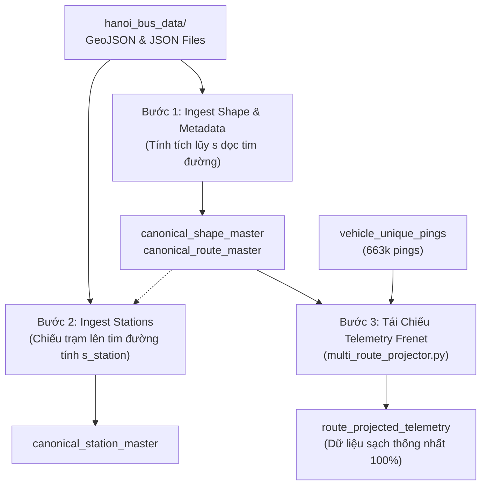

# ĐẶC TẢ KỸ THUẬT: THỐNG NHẤT HỆ QUY CHIẾU TRẮC ĐỊA GỐC BUSMAP (NATIVE GROUND TRUTH MIGRATION)
> **Tài liệu đặc tả kiến trúc**: Số 52 trong chuỗi tài liệu `docs/`  
> **Căn cứ**: Hiến pháp AI ([AGENTS.md](file:///z:/Desktop/Bus_tracking/AGENTS.md) - Điều 2, Điều 4) & Chỉ thị người dùng ngày 01/11/2026.  
> **Mục tiêu**: Thay thế toàn diện dữ liệu trắc địa cũ bằng bộ dữ liệu hình học gốc BusMap (`hanoi_bus_data`), thống nhất đồng bộ 100% với luồng GPS Telemetry, xóa bỏ triệt để hiện tượng lệch tour (như ca E04) và nguy cơ Merge Hell.

---

## I. BỐI CẢNH & ĐỘNG LỰC THỐNG NHẤT DỮ LIỆU

### 1. Tại Sao Lựa Chọn Dữ Liệu Gốc BusMap?
Toàn bộ kho dữ liệu định vị xe buýt thời gian thực (`vehicle_unique_pings`, > 663.000 bản ghi) được thu thập trực tiếp từ hạ tầng máy chủ của **BusMap**.  
Trong kiến trúc trước đây, hệ thống cố gắng ánh xạ các ping này sang cơ sở dữ liệu TimBus thông qua các bảng đối soát (`dim_route_crosswalk`, `dim_station_crosswalk`). Tuy nhiên, phương pháp này bộc lộ 2 điểm nghẽn nghiêm trọng:
1. **Lệch pha trắc địa & cập nhật luồng tour**: Dữ liệu TimBus bị trễ hạn ở một số tuyến (điển hình là E04: TimBus đi vòng Dương Nội 2.5km, trong khi xe thực tế và BusMap đi thẳng Vạn Phúc).
2. **Nguy cơ Merge Hell**: Khi cố gắng ghép trạm dừng của nguồn này vào tim đường của nguồn khác, các trạm dừng bị lệch khỏi tim đường, làm xáo trộn thứ tự tiến độ $s$ và làm hỏng hàm nội suy vượt trạm $t_{\text{cross}}$ của Module 3.

### 2. Bộ Dữ Liệu Dịch Ngược Mới Tại `hanoi_bus_data/`
Qua việc bóc tách thành công gói dữ liệu BusMap, chúng ta đã có trong tay bộ dữ liệu không gian đầy đủ và chuẩn xác nhất:
* [`hanoi_bus_routes.geojson`](file:///z:/Desktop/Bus_tracking/hanoi_bus_data/hanoi_bus_routes.geojson) (11.16 MB): 352 LineStrings hình học tim đường của **176 tuyến** cho cả 2 chiều (`Direction 0`: Chiều Đi, `Direction 1`: Chiều Về).
* [`hanoi_bus_stations.geojson`](file:///z:/Desktop/Bus_tracking/hanoi_bus_data/hanoi_bus_stations.geojson) (3.81 MB): **13.301 trạm dừng** đã có sẵn `RouteId`, `StationOrder`, `StationDirection`, tọa độ WGS84 chính xác.
* [`hn.routes.json`](file:///z:/Desktop/Bus_tracking/hanoi_bus_data/hn.routes.json) & [`hn.routeinfo.json`](file:///z:/Desktop/Bus_tracking/hanoi_bus_data/hn.routeinfo.json): Toàn bộ metadata biểu đồ giờ, tần suất chạy xe (headway), đơn vị vận hành.

**Kết quả kiểm tra đối chiếu**: **48 / 48 tuyến xe buýt đang có dữ liệu GPS đều khớp 100%** trong bộ dữ liệu mới này.

---

## II. THIẾT KẾ SCHEMA CƠ SỞ DỮ LIỆU CHUẨN HÓA (CANONICAL SCHEMA)

Hệ thống sẽ chuyển dịch từ các bảng lai ghép sang mô hình dữ liệu chính tắc trong `data/hanoi_bus_system.db`:

```
┌────────────────────────────────┐
│   canonical_route_master       │
├────────────────────────────────┤
│ PK: route_id (int)             │
│ route_code (str, e.g. "E04")   │
│ route_name (str)               │
│ company_name (str)             │
│ operation_time, headway        │
└──────────────┬─────────────────┘
               │ 1:N
       ┌───────┴────────────────────────┐
       ▼                                ▼
┌──────────────────────────┐   ┌──────────────────────────┐
│ canonical_shape_master   │   │ canonical_station_master │
├──────────────────────────┤   ├──────────────────────────┤
│ route_id (int)           │   │ route_id (int)           │
│ route_code (str)         │   │ route_code (str)         │
│ direction (0/1 -> go/re) │   │ station_id (int)         │
│ point_order (int)        │   │ station_order (int)      │
│ lat, lon (float)         │   │ station_name (str)       │
│ cum_distance_m (float)   │   │ direction (0/1 -> go/re) │
└──────────────────────────┘   │ lat, lon (float)         │
                               │ cum_distance_m (float)   │
                               └──────────────────────────┘
```

### 1. Bảng `canonical_route_master`
```sql
CREATE TABLE IF NOT EXISTS canonical_route_master (
    route_id INTEGER PRIMARY KEY,
    route_code TEXT NOT NULL,
    route_name TEXT NOT NULL,
    company_name TEXT,
    operation_time TEXT,
    headway TEXT,
    total_trips INTEGER,
    point_count_go INTEGER,
    point_count_re INTEGER,
    station_count_go INTEGER,
    station_count_re INTEGER
);
CREATE INDEX IF NOT EXISTS idx_crm_code ON canonical_route_master(route_code);
```

### 2. Bảng `canonical_shape_master`
```sql
CREATE TABLE IF NOT EXISTS canonical_shape_master (
    route_id INTEGER NOT NULL,
    route_code TEXT NOT NULL,
    direction TEXT NOT NULL,           -- 'go' hoặc 're'
    point_order INTEGER NOT NULL,
    lat REAL NOT NULL,
    lon REAL NOT NULL,
    cum_distance_m REAL NOT NULL,      -- Quãng đường tích lũy dọc tim đường (m)
    PRIMARY KEY (route_id, direction, point_order)
);
CREATE INDEX IF NOT EXISTS idx_csm_route_dir ON canonical_shape_master(route_id, direction);
CREATE INDEX IF NOT EXISTS idx_csm_code_dir ON canonical_shape_master(route_code, direction);
```

### 3. Bảng `canonical_station_master`
```sql
CREATE TABLE IF NOT EXISTS canonical_station_master (
    station_id INTEGER NOT NULL,
    route_id INTEGER NOT NULL,
    route_code TEXT NOT NULL,
    direction TEXT NOT NULL,           -- 'go' hoặc 're'
    station_order INTEGER NOT NULL,
    station_name TEXT NOT NULL,
    address TEXT,
    lat REAL NOT NULL,
    lon REAL NOT NULL,
    cum_distance_m REAL NOT NULL,      -- Mốc 1D trên tim đường khi chiếu vuông góc
    snap_dist_m REAL NOT NULL,         -- Khoảng cách vuông góc từ trạm đến tim đường (m)
    PRIMARY KEY (route_id, direction, station_order)
);
CREATE INDEX IF NOT EXISTS idx_cstat_route_dir ON canonical_station_master(route_id, direction);
CREATE INDEX IF NOT EXISTS idx_cstat_code_dir ON canonical_station_master(route_code, direction);
```

---

## III. QUY TRÌNH CHUYỂN DỊCH VÀ TÍNH TOÁN LẠI (MIGRATION PIPELINE)

Quy trình triển khai gồm 3 bước tuần tự, tự động và có thể tái tạo (reproducible):



### Bước 1: Nạp Tim Tuyến Trắc Địa (`canonical_shape_master`)
- Đọc `hanoi_bus_routes.geojson`.
- Với mỗi feature LineString:
  - Ánh xạ chiều: `Direction 0` $\to$ `'go'`, `Direction 1` $\to$ `'re'`.
  - Tính cự ly Haversine giữa các điểm kề nhau và tích lũy $s_i = \sum_{k=1}^i \text{Haversine}(P_{k-1}, P_k)$.
  - Nạp hàng loạt (batch insert) vào bảng `canonical_shape_master`.

### Bước 2: Nạp Danh Bạ Trạm Dừng (`canonical_station_master`)
- Đọc `hanoi_bus_stations.geojson`.
- Với mỗi trạm dừng:
  - Chiếu tọa độ $(lat, lon)$ của trạm lên polyline tương ứng trong `canonical_shape_master` để xác định mốc tiến độ $s_{\text{station}}$ và cự ly sai lệch $d_\perp$.
  - Lưu trữ vào bảng `canonical_station_master` có đánh thứ tự `station_order` liên tục.

### Bước 3: Tái Chiếu Dữ Liệu Định Vị Telemetry (Frenet Re-Projection)
- Chỉnh sửa `multi_route_projector.py` để trỏ vào `canonical_shape_master`.
- Chạy lại phép chiếu cho toàn bộ 48 tuyến trên cơ sở dữ liệu `vehicle_unique_pings` (663.342 pings).
- Thời gian chạy dự kiến: **~35 - 40 giây**.

---

## IV. TIÊU CHÍ NGHIỆM THU (DEFINITION OF DONE)

1. **Độ phủ dữ liệu**:
   - 100% 48 tuyến có tim đường và danh bạ trạm dừng đầy đủ cả 2 chiều.
   - Toàn bộ trạm dừng có sai lệch chiếu vào tim đường $d_{\text{snap}} < 25\text{m}$.
2. **Khắc phục triệt để ca E04**:
   - Tỷ lệ bám làn của tuyến E04 vọt từ $62.5\%$ lên $> 90\%$.
   - Không còn ngoại lai 2.5 km ở khu vực Vạn Phúc - Chu Văn An.
3. **Độ ổn định hệ thống**:
   - Exit code 0, không có lỗi syntax, không làm mất mát dữ liệu telemetry hiện có.
   - Sinh lại báo cáo trực quan thẩm định mới để người dùng nghiệm thu.

