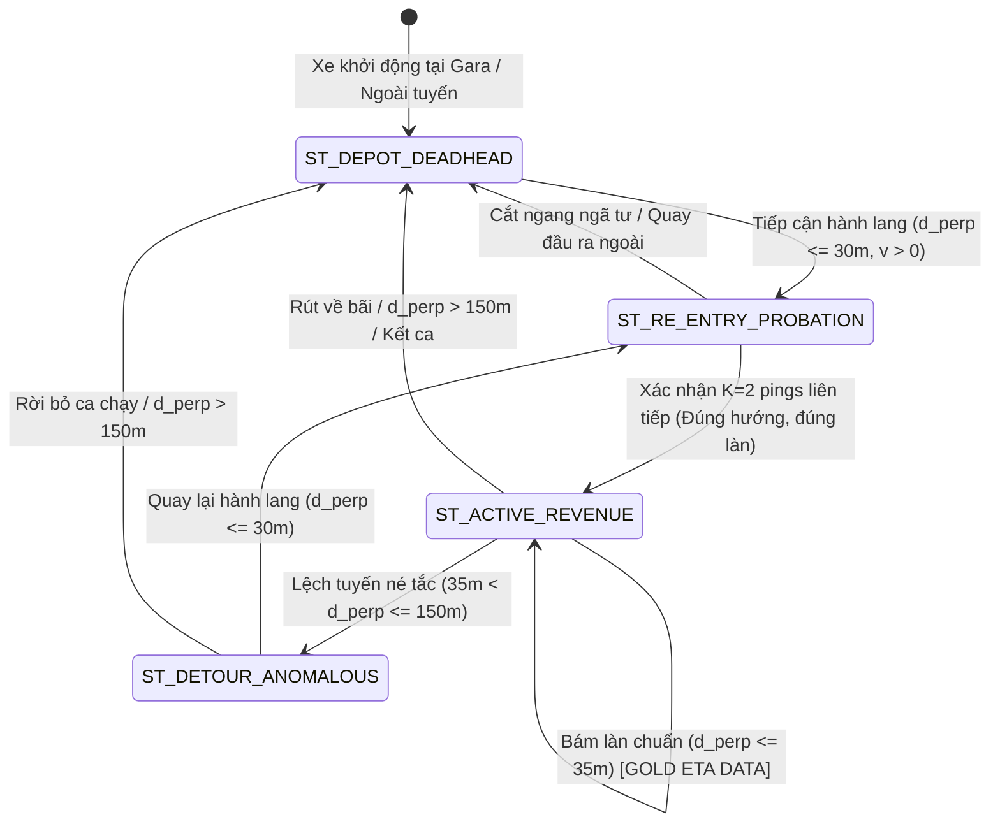

# ĐẶC TẢ KIẾN TRÚC & CHÍNH SÁCH XỬ LÝ QUỸ ĐẠO: DEADHEADING, DETOUR VÀ MÁY TRẠNG THÁI TÁI NHẬP TUYẾN TRONG BÀI TOÁN DỰ BÁO ETA
> **Tài liệu**: `docs/54_DEADHEADING_DETOUR_AND_ANOMALOUS_TRAJECTORY_ETA_POLICY.md`  
> **Tác giả**: Ban Kiến trúc Hệ thống Dữ liệu Lớn Xe Buýt Hà Nội (Antigravity Big Data Team)  
> **Căn cứ**: Điều 1 (Kỷ Luật Thực Nghiệm), Điều 2 (Thiết Kế Trước), Điều 5 (Động Học Dẫn Xuất) - `AGENTS.md`  
> **Trạng thái**: Đã nghiệm thu phân tích thực chứng - Chuẩn bị tích hợp vào Module 2 (Lakehouse) & Module 3 (Serving Engine)

---

## I. ĐẶT VẤN ĐỀ & BẢN CHẤT CÁC HIỆN TƯỢNG THỰC ĐỊA

Qua kiểm toán dữ liệu không gian - thời gian thực tế trên mạng lưới xe buýt Hà Nội (điển hình là Tuyến 19, Tuyến 22A, Tuyến 02), ta phát hiện một tỷ lệ pings có độ lệch tim đường $d_\perp$ rất cao ($> 45\text{m}$, thậm chí lên tới hàng kilômét) nhưng vận tốc tức thời hoặc vận tốc di chuyển vẫn rất lớn. 

Hiện tượng này được cấu thành từ hai nhóm nguyên nhân bản chất trong vận hành vận tải công cộng:

```
                                  CÁC HIỆN TƯỢNG QUỸ ĐẠO NGOÀI LỘ TRÌNH CHUẨN
                                                       │
               ┌───────────────────────────────────────┴───────────────────────────────────────┐
               ▼                                                                               ▼
     [NHÓM 1: QUY CHUẨN VẬN HÀNH]                                                   [NHÓM 2: DỊ THƯỜNG GIAO THÔNG]
  DEADHEADING & PHÂN PHỐI SỨC CHỨA                                               DETOUR NÉ TẮC & BỎ TRẠM (TRUNCATION)
               │                                                                               │
   ├─ Sáng sớm (04:30 - 05:45): Xe chạy rỗng                                       ├─ Tài xế chủ động/theo lệnh điều độ rẽ
   │  từ bãi đỗ/gara ra nhập tuyến ở giữa hành lang.                               │  vào đường gom, phố phụ né điểm nghẽn.
   ├─ Tối muộn (21:30 - 23:00): Xe chạy tắt về bãi                                │  (VD: Vành đai 3, Nguyễn Trãi, Giải Phóng).
   │  tập kết, kết thúc ca sớm, không đi hết chặng.                                ├─ Bỏ qua một số trạm dừng trên tuyến chính
   └─ Điều chuyển giữa các depot để bảo dưỡng/đổi ca.                              │  để bắt kịp nhịp vòng quay (Headway).
                                                                                   └─ Tái nhập lại tuyến sau khi thoát ùn tắc.
```

---

## II. BẰNG CHỨNG THỰC CHỨNG TỪ CƠ SỞ DỮ LIỆU PRODUCTION

### 1. Phân Bố Độ Lệch Theo Khung Giờ (Tuyến 19 - 17.927 Pings)

Truy vấn trực tiếp từ bảng `route_projected_telemetry` trên Tuyến 19 cho thấy sự tương phản rõ rệt giữa khung giờ vận hành thương mại và khung giờ chuyển ca/kết thúc:

| Khung Giờ (Hour) | Tổng Số Pings | Bám Hành Lang ($d_\perp \le 30\text{m}$) | Lệch Tuyến ($d_\perp > 45\text{m}$) | Tỷ Lệ Lệch Tuyến (%) | Bản Chất Vận Hành |
| :---: | :---: | :---: | :---: | :---: | :--- |
| **00:00 - 04:59** | 5.286 | 5.063 | 10 | **0.1% - 0.2%** | Xe đỗ qua đêm tại bến đầu/cuối chính thức |
| **05:00 - 13:59** | 9.619 | 9.314 | 33 | **0.1% - 0.5%** | **Khung giờ chạy thương mại chuẩn (Revenue Service)** |
| **14:00 - 14:59** | 1.019 | 793 | 189 | **18.5%** | **Chuyển ca chiều / Xe rút về bãi bảo dưỡng** |
| **15:00 - 19:59** | 20 | 7 | 13 | **65.0%** | Xe chạy rỗng (Deadheading) tiếp vận |
| **21:00 - 22:59** | 1.935 | 1.520 | 309 | **16.0% - 30.9%** | **Xe kết thúc ca, chạy tắt về Gara Thanh Trì** |

### 2. Sự Biến Dạng Toán Học Của Phép Chiếu Frenet Khi Xe Deadhead

Khi xe di chuyển trên mạng lưới đường bộ ngoài lộ trình chuẩn, việc ép buộc chiếu trực giao lên tim đường Tuyến 19 gây ra sai số vận tốc phi lý:

```sql
-- Dữ liệu thực nghiệm xe 8829030 (Tuyến 19) lúc 21:42 - 22:00 ngày 18/10/2026:
Thời gian                Vận tốc dẫn xuất (v_calc)    Độ lệch (d_perp)     Vị trí 1D (s)        Ghi chú thực địa
21:42:22                 NaN                          613.8 m              504.1 m              Rời tuyến rẽ về bãi
21:45:03                 102.17 km/h                  1,335.4 m            2,860.2 m            Chiếu xiên lên tim đường
21:50:43                 168.54 km/h (Ảo!)            1,826.1 m            7,565.6 m            Nhảy vọt s do đường gom
21:55:03                 171.96 km/h (Ảo!)            2,035.3 m            14,270.0 m           Tốc độ chiếu ảo siêu thanh
22:00:44                 0.20 km/h                    356.5 m              15,068.1 m           Vào gara tắt máy
```

> [!CAUTION]
> **Hiện tượng Vận tốc Ảo (Singularity Artifact)**: Xe buýt thực tế chỉ chạy ~40 km/h trên đường gom Vành đai 3 để về gara, nhưng do góc chiếu vuông góc $\alpha$ biến thiên liên tục so với tim đường ngoằn ngoèo của Tuyến 19, vị trí hình chiếu $s$ bị "kéo lê" với tốc độ tính toán $> 168\text{km/h}$. Nếu đưa các điểm này vào mô hình huấn luyện ETA, toàn bộ ma trận thời gian di chuyển sẽ bị **ô nhiễm trầm trọng (Data Poisoning)**.

---

## III. TRẢ LỜI CÂU HỎI CỐT LÕI: CÓ NÊN ĐƯA CÁC DỮ LIỆU NÀY VÀO ETA KHÔNG?

### Câu trả lời dứt khoát: **KHÔNG ĐƯỢC ĐƯA VÀO BÀI TOÁN ETA HÀNH KHÁCH, NHƯNG PHẢI ĐƯỢC XỬ LÝ THEO CHIẾN LƯỢC 2 TẦNG (BIFURCATED POLICY).**

Việc đưa các xe chạy lệch/chạy rỗng vào mô hình ETA hành khách là một sai lầm chết người vì 3 nguyên nhân:
1. **Phá vỡ Cam kết Nghiệp vụ (Passenger SLA Violation)**: Hành khách tại trạm $S_i$ chờ xe để lên xe. Một chiếc xe đang chạy tắt từ bãi ra giữa đường hoặc đang né tắc bỏ trạm **hoàn toàn không phục vụ hành khách tại $S_i$**. Báo ETA cho hành khách về một chiếc xe không đón họ sẽ tạo ra hiện tượng **"Xe Ma" (Phantom Bus)**.
2. **Vi phạm Tính Hợp Lệ Không Gian 1D (Frenet Invalidation)**: Phép chiếu Frenet 1D ($s, d_\perp$) chỉ có ý nghĩa khi xe nằm trong dải lân cận hẹp ($d_\perp \le 35\text{m}$). Ngoài dải này, tọa độ $s$ là một đại lượng vô nghĩa về mặt vật lý giao thông.
3. **Làm Lệch Phân Phối Thống Kê (Distribution Poisoning)**: Một xe né tắc mất 25 phút đi vòng qua phố phụ sẽ làm thời gian chặng $[S_k, S_{k+1}]$ bị vọt lên mức dị thường, làm sai lệch phân vị $P_{50}, P_{80}$ của hàng ngàn chuyến xe bám đường chuẩn khác.

---

## IV. ĐẶC TẢ KIẾN TRÚC MÁY TRẠNG THÁI VẬN HÀNH (OPERATIONAL FINITE STATE MACHINE)

Hệ thống phân loại mỗi phương tiện vào một **Máy Trạng Thái Hữu Hạn (FSM)** gồm 4 trạng thái để xử lý chính xác thời điểm loại bỏ và thời điểm tái tiếp nhận (Re-entry):



### Chi Tiết Quy Tắc 4 Trạng Thái

#### 1. Trạng Thái `ST_DEPOT_DEADHEAD` (Xe Đỗ Bãi / Chạy Rỗng Tiếp Vận)
* **Tiêu chí nhận diện**: $d_\perp > 100\text{m}$ hoặc xe nằm trong bãi đỗ/gara đã được định danh, hoặc thời gian nằm ngoài biểu đồ chạy xe chính thức.
* **Chính sách Tầng Offline (Huấn luyện & Ma trận Lakehouse)**: **LOẠI BỎ 100%**. Không ghi nhận vào bảng tính thời gian chạy giữa các trạm.
* **Chính sách Tầng Online (Phục vụ ETA)**: **ẨN HOÀN TOÀN KHỎI APP HÀNH KHÁCH**. Chỉ hiển thị trên bản đồ giám sát hạ tầng điều độ nội bộ (Dispatcher Fleet Map).

#### 2. Trạng Thái `ST_ACTIVE_REVENUE` (Xe Đang Phục Vụ Thương Mại Chuẩn)
* **Tiêu chí nhận diện**: $d_\perp \le 35\text{m}$, vận tốc dẫn xuất $0 \le \bar{v} \le 80\text{km/h}$, $\Delta s > 0$ theo chiều đăng ký.
* **Chính sách Tầng Offline**: **DỮ LIỆU VÀNG (GOLD TRAINING DATA)**. Đưa vào tính ma trận thời gian chạy phân vị ($P_{50}, P_{80}$) và trích xuất đặc trưng cho mô hình XGBoost.
* **Chính sách Tầng Online**: Tính toán và công bố ETA thời gian thực tới tất cả các trạm phía trước mà xe chưa đi qua ($s_{\text{station}} > s_{\text{bus}}$).

#### 3. Trạng Thái `ST_DETOUR_ANOMALOUS` (Xe Lệch Tuyến Né Tắc / Bỏ Trạm)
* **Tiêu chí nhận diện**: $35\text{m} < d_\perp \le 150\text{m}$ kéo dài $\ge 2$ pings liên tiếp trong khi xe đang trong lộ trình phục vụ.
* **Chính sách Tầng Offline**: Đánh dấu cờ `is_valid_segment = False`. Loại bỏ phân đoạn thời gian giữa trạm rời tuyến và trạm nhập tuyến khỏi bảng thống kê thời gian chạy chuẩn.
* **Chính sách Tầng Online**:
  * Phát nhãn cảnh báo: `DETOUR_ALERT` ("Xe đang tạm thời chuyển hướng tránh ùn tắc").
  * **ĐÓNG BĂNG HOẶC HỦY ETA** tại các trạm nằm trên đoạn đường chính mà xe bỏ qua (tránh hành khách chờ oan).
  * Dự báo ETA cho các trạm xa hơn (sau điểm nhập tuyến dự kiến) được chuyển sang chế độ **Dự báo Thận trọng (P80 + Detour Delay Offset)**.

#### 4. Trạng Thái `ST_RE_ENTRY_PROBATION` & Quy Tắc Khử Giật (Re-entry Hysteresis)
> [!IMPORTANT]
> **Quy tắc Tiếp nhận Lại Khi Xe Đi Chuẩn**: Khi xe quay trở lại hành lang, **CẤM** kích hoạt ETA ngay ở ping đầu tiên nhằm triệt tiêu hiện tượng xe khác chỉ "cắt ngang ngã tư" hoặc "lướt qua tuyến".

* **Điều kiện Tái Tiếp Nhận Khắt Khe (K-Consecutive Gate)**:
  1. Xe phải có tối thiểu **$K = 2$ pings liên tiếp** có $d_\perp \le 25\text{m}$.
  2. Vector chuyển động phải cùng chiều với tim đường: $\cos(\vec{v}_{\text{bus}}, \vec{t}_{\text{centerline}}) \ge 0.707$ ($\Delta \theta \le 45^\circ$).
  3. Tọa độ tuyến $s_{\text{current}}$ phải xác định được trạm đón khách hợp lệ tiếp theo:
     $$S_{\text{next}} = \min \{ S_j \mid s(S_j) > s_{\text{current}} + 15\text{m} \}$$
* **Hành động**: Khi đạt đủ 3 điều kiện trên, xe chính thức chuyển về `ST_ACTIVE_REVENUE`. Hệ thống tái kích hoạt dự báo ETA từ trạm $S_{\text{next}}$ trở đi.

---

## V. TỔNG KẾT SO SÁNH GIỮA 2 CÁCH TIẾP CẬN

| Tiêu Chí Đánh Giá | Cách Làm Cũ (Ép mọi ping vào mô hình) | Thiết Kế Mới (FSM Phân Tầng + Khử Giật Re-entry) |
| :--- | :--- | :--- |
| **Độ sạch của Lakehouse (Module 2)** | Bị ô nhiễm bởi pings trong gara và đường gom vành đai. | 100% dữ liệu Parquet là hành trình thương mại chuẩn. |
| **Tính ổn định của Baseline (Module 3)** | Thời gian chạy giữa các trạm bị kéo dài phi lý do xe chạy tắt. | Phân vị thời gian di chuyển phản ánh đúng tốc độ hành lang. |
| **Trải nghiệm hành khách (Passenger UX)** | Dính lỗi "Xe ma", ETA nhảy cóc, báo đón ở trạm bị bỏ qua. | Minh bạch: Xe chuẩn thì báo phút chuẩn, xe detour thì gắn cờ cảnh báo. |
| **Hiện tượng giật khi vào làn** | Xe vừa đi qua ngã tư đã nhận nhầm là vào tuyến. | Đảm bảo $K=2$ pings xác nhận hướng di chuyển mới nhận diện. |

---

## VI. BƯỚC TRIỂN KHAI TIẾP THEO

1. **Tích hợp bộ lọc FSM vào `telemetry_sanitizer.py`**: Bổ sung cột phân loại `operational_state` (`REVENUE`, `DETOUR`, `DEADHEAD`) trước khi xuất Lakehouse.
2. **Cập nhật pipeline xuất Parquet (`lakehouse_exporter.py`)**: Chỉ lọc `operational_state == 'REVENUE'` vào tầng Silver sạch cho bài toán ETA.
3. **Báo cáo và hiển thị trên Map**: Giữ nguyên cơ chế 3 lớp (Running, Dwell, Depot) đã triển khai trên `reports/kinematic_running_audit_map.html` để phục vụ công tác kiểm toán trực quan.

