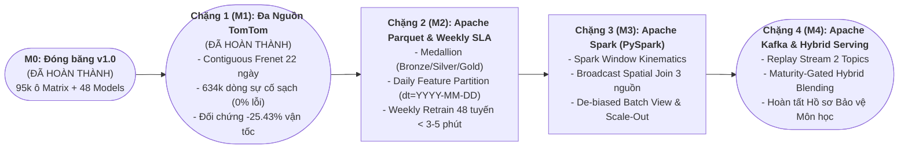

# 61. ĐẶC TẢ LỘ TRÌNH V2.0: HỆ SINH THÁI APACHE BIG DATA & TÍCH HỢP ĐA NGUỒN SỰ CỐ TOMTOM (WBS, REQUIREMENTS MATRIX & SPARSE GANTT)
> **Tài liệu**: `docs/61_V2_APACHE_BIG_DATA_AND_TOMTOM_FUSION_WBS_ROADMAP.md`  
> **Dự án**: Hanoi Bus Big Data & Real-time ETA Prediction System  
> **Mục tiêu v2.0**: Đáp ứng toàn diện yêu cầu học thuật của môn học **Lưu trữ và Xử lý Dữ liệu lớn** thông qua Hệ sinh thái Apache (`Apache Spark / PySpark`, `Apache Parquet + Hive Partitioning`, `Apache Kafka`, `Apache Arrow`) và chứng minh năng lực **Tích hợp Đa nguồn Dữ liệu Dị biệt (Multi-Source Heterogeneous Data Fusion)** với dữ liệu sự cố giao thông `TomTom Incidents`.  
> **Ngày lập**: 01/11/2026  
> **Trạng thái**: Bản thiết kế chuẩn bị triển khai (Ready for Approval & Execution)

---

## I. BẢNG GHI NHẬN & ĐỐI CHIẾU YÊU CẦU V2.0 (REQUIREMENTS TRACEABILITY MATRIX)

Bảng dưới đây ghi lại toàn bộ các yêu cầu bắt buộc và nguyên tắc thực dụng cho phiên bản **v2.0**, dùng làm checklist nghiệm thu từng hạng mục:

| Mã Yêu Cầu | Phân Loại | Nội Dung Yêu Cầu Cụ Thể | Tiêu Chí Nghiệm Thu Định Lượng (DoD) | Công Cụ / Dữ Liệu Sử Dụng |
| :---: | :--- | :--- | :--- | :--- |
| **REQ-V2-01** | **Tích hợp Đa nguồn (Variety)** | Kết hợp 3 nguồn dữ liệu có cấu trúc khác biệt hoàn toàn: 1. *Point Stream*: GPS xe buýt (~9.67M bản ghi). 2. *Vector LineStrings*: Sự cố giao thông TomTom (22 ngày). 3. *Master Topology*: Danh bạ trạm & hình học tim đường 48 tuyến. | - Chiếu thành công các `LineString` sự cố TomTom lên hệ tọa độ 1D Frenet $[s_{\text{start}}, s_{\text{end}}]$ của 48 tuyến. - Có bảng `fact_route_tomtom_incidents` trong DB gắn sự cố vào đúng cặp trạm $(k \to k+1)$. | `tomtom_incidents_*.jsonl`, `route_projected_telemetry`, `canonical_shape_master` |
| **REQ-V2-02** | **Đối chứng Chéo Đa nguồn (Cross-Validation)** | Thể hiện trực quan giá trị của việc ghép dữ liệu TomTom với GPS xe buýt (vì bản thân MAE của mô hình AI đã gần chạm trần vật lý ở v1.0). | - Tạo bảng đối chứng `agg_tomtom_vs_bus_kinematics` chứng minh: Khi TomTom báo `Jam / Slow traffic` trên đoạn trạm $k \to k+1$, vận tốc thực tế của xe buýt giảm và thời gian vượt trạm thực tế tăng lên tương ứng. - Tích hợp 3 biến sự cố vào mô hình để tự động nới rộng biên trễ $P_{90}$ khi có sự cố. | SQLite + PySpark SQL + XGBoost CQR |
| **REQ-V2-03** | **Lưu trữ Dữ liệu lớn & Feature Store Phân vùng (Apache Storage)** | Tổ chức lưu trữ phân tầng **Medallion Lakehouse (Bronze $\to$ Silver $\to$ Gold)** chuẩn cột với phân vùng thư mục kiểu Hive (`dt=YYYY-MM-DD/hr=HH` và `route_code=XX`), kèm cơ chế **Tích lũy Feature theo Ngày (Daily Incremental Feature Materialization)** để không bao giờ phải tính lại lịch sử từ đầu. | - Đủ 3 tầng thư mục Parquet nén Snappy (`bronze/`, `silver/`, `gold/feature_store/`). - Có bảng số liệu thực nghiệm so sánh **Tỷ lệ nén dung lượng (MB)** và **Tốc độ đọc I/O (giây)** giữa Raw JSONL vs. SQLite vs. Apache Parquet (Partition Pruning + Column Projection). - Đạt SLA **Tái huấn luyện Hàng tuần (Weekly Retraining) `< 3–5 phút`** cho toàn bộ 48 tuyến khi đọc trực tiếp từ Gold Parquet. | **Apache Parquet**, **Apache Arrow (PyArrow)**, Hive-style Partitioning |
| **REQ-V2-04** | **Xử lý Phân tán & Khử lệch Lịch sử (Apache Compute)** | Chuyển đổi luồng tính toán nặng sang **Apache Spark (`PySpark` & `Spark SQL`)**, tách bạch chu kỳ **Daily Micro-Batch** và **Weekly Macro-Batch**. | - **Job 1**: Khử trùng lặp & tính vận tốc dẫn xuất $\bar{v} = \Delta s / \Delta t$ bằng Spark `Window.partitionBy("vehicle_id")`. - **Job 2**: Kết nối đa nguồn (GPS + Trạm + Sự cố TomTom) bằng **`Broadcast Hash Join` (`F.broadcast`)** chống Shuffle. - **Job 3**: Tính ma trận phân vị `Batch View` (có khử lệch sự cố nghiêm trọng `De-biasing`) bằng **Spark SQL** (`PERCENTILE_APPROX`). | **Apache Spark (`PySpark`, `Spark SQL`)** |
| **REQ-V2-05** | **Thực nghiệm Mở rộng (Scalability)** | Đo đạc khả năng mở rộng ngang (Scale-Out) và mở rộng dữ liệu (Scale-Up) để lấy biểu đồ báo cáo môn học. | - Bảng `spark_scalability_benchmark` ghi nhận thời gian chạy (giây) và thông lượng (`rows/sec`) khi tăng từ `1 -> 2 -> 4 -> 6` cores và `25% -> 50% -> 100%` dữ liệu. | PySpark Benchmark Suite |
| **REQ-V2-06** | **Xử lý Luồng & Lai ghép Thích ứng Độ chín (Apache Streaming & Hybrid Serving)** | Mô phỏng luồng dữ liệu thời gian thực (Streaming Ingestion) và phục vụ dự báo $\text{ETA} = f(\text{Batch View}, \text{Real-time View})$ cho giai đoạn chuyển tiếp **Cold-Start $\to$ Intermediate $\to$ Mature**. | - `Producer` phát lại (replay) luồng sự kiện GPS + TomTom Incident qua 2 kênh (`bus.telemetry`, `traffic.incidents`). - `Consumer` kết hợp đầu ra `Residual XGB-CQR` với **bù điểm mù xe dẫn đường (`Maturity-Gated Hybrid Blending`)** từ `agg_tomtom_vs_bus_kinematics` khi `leader_info_age_sec >= 900s`, trả dự báo `[P10, P50, P90]` trong `< 50ms/ping`. | **Apache Kafka** (KRaft / Local Stream Broker) + Hybrid XGB-CQR Serving |
| **REQ-V2-07** | **An toàn & Không Hồi quy (No Regression)** | Bảo toàn 100% thành quả của **v1.0** (`hanoi_bus_system.db`, 48 model `.json`, 3 module chính tắc). | - Mọi bảng và model của v1.0 giữ nguyên hoạt động ổn định. - Các thành phần v2.0 được đóng gói модуle hóa sạch sẽ, không cần gánh nặng UI/UX phức tạp. | Kiến trúc Modular |

---

## II. CẤU TRÚC PHÂN RÃ CÔNG VIỆC (WORK BREAKDOWN STRUCTURE - WBS)

Toàn bộ khối lượng công việc của **v2.0** được chia thành **4 Gói Công Việc (Work Packages - WP)** độc lập, có đầu vào và đầu ra định lượng rõ ràng (tổng thời gian ước tính: **12 – 15 giờ công**, chia làm 4 chặng):

```mermaid
flowchart TD
    V2["<b>DỰ ÁN BUS TRACKING & ETA v2.0</b><br/>(Apache Big Data Ecosystem & Multi-Source TomTom Fusion)"]
    
    V2 --> WP1["<b>WP 2.1: Tích Hợp Đa Nguồn Sự Cố TomTom</b><br/>(3.0 - 3.5 giờ công)"]
    V2 --> WP2["<b>WP 2.2: Medallion Lakehouse (Apache Parquet & Hive)</b><br/>(2.5 - 3.0 giờ công)"]
    V2 --> WP3["<b>WP 2.3: Xử Lý Phân Tán (PySpark & Spark SQL)</b><br/>(4.0 - 4.5 giờ công)"]
    V2 --> WP4["<b>WP 2.4: Luồng Thời Gian Thực (Apache Kafka & Serving)</b><br/>(2.5 - 3.5 giờ công)"]

    WP1 --> T11["2.1.1. Hợp nhất 22 ngày TomTom JSONL<br/>& Khử trùng lặp theo cửa sổ 15 phút"]
    WP1 --> T12["2.1.2. Chiếu 1D Frenet các LineString sự cố<br/>lên tim đường 48 tuyến (d_perp <= 50m)"]
    WP1 --> T13["2.1.3. Tạo bảng fact_route_tomtom_incidents<br/>& Đối chứng chéo với vận tốc xe buýt"]
    WP1 --> T14["2.1.4. Đưa 3 đặc trưng TomTom vào Model<br/>& Đo kiểm hiệu ứng mở rộng biên P90"]

    WP2 --> T21["2.2.1. Thiết lập 3 tầng Bronze / Silver / Gold<br/>Parquet (dt=YYYY-MM-DD/hr=HH, route_code=XX)"]
    WP2 --> T22["2.2.2. Daily Incremental Feature Store Parquet<br/>& Weekly Retraining Pipeline (< 3-5 phút/48 tuyến)"]
    WP2 --> T23["2.2.3. Benchmark Dung lượng & I/O Speedup:<br/>JSONL vs. SQLite vs. Parquet Pruning"]

    WP3 --> T31["2.3.1. PySpark Window ETL:<br/>Khử trùng lặp & Động học dẫn xuất 10M dòng"]
    WP3 --> T32["2.3.2. PySpark Broadcast Spatial Join:<br/>Ghép nối GPS + Trạm + Sự cố TomTom"]
    WP3 --> T33["2.3.3. Spark SQL OLAP (De-biased Batch View):<br/>Tính ma trận phân vị 95,094 ô đã khử lệch sự cố"]
    WP3 --> T34["2.3.4. Thực nghiệm Scale-Out (1, 2, 4, 6 cores)<br/>& Xuất bảng spark_scalability_benchmark"]

    WP4 --> T41["2.4.1. Thiết lập 2 Topics:<br/>hanoi.bus.telemetry & hanoi.traffic.incidents"]
    WP4 --> T42["2.4.2. Xây dựng Replay Producer<br/>phát luồng sự kiện đa nguồn (1x / 10x speed)"]
    WP4 --> T43["2.4.3. Streaming ETA Consumer + Maturity-Gated<br/>Hybrid Blending (Leader Blind-Spot Fallback < 50ms)"]
```

---

## III. GIẢN ĐỒ GANTT THƯA (SPARSE GANTT CHART & MILESTONE SCHEDULE)

Vì các hạng mục của **v2.0** đều có thuật toán và dữ liệu đầu vào rõ ràng (không tiềm ẩn "mìn" dữ liệu dị thường như lúc làm sạch v1.0), lịch trình được thiết kế theo dạng **Giản đồ Gantt thưa (Sparse Gantt)** gồm **4 Chặng (Sprints / Phases)** thư thả, có khoảng đệm kiểm thử giữa các chặng:

### 1. Bảng Giản Đồ Gantt Thưa Theo Chặng (4 Chặng Triển Khai)

| Mã WBS | Hạng Mục Công Việc (Task Description) | Phụ Thuộc | Thời Lượng Ước Tính | Chặng 1 *( Đa Nguồn TomTom )* | Chặng 2 *( Lakehouse & Weekly SLA )* | Chặng 3 *( PySpark & Scale-Out )* | Chặng 4 *( Kafka & Hybrid Serving )* | Sản Phẩm Đầu Ra (Deliverables) |
| :---: | :--- | :---: | :---: | :---: | :---: | :---: | :---: | :--- |
| **WP 2.1** | **Tích Hợp Đa Nguồn Sự Cố TomTom (ĐÃ HOÀN TẤT)** | `v1.0` | **3.5h** | `████████████` | `░░░░░░░░░░░░` | `░░░░░░░░░░░░` | `░░░░░░░░░░░░` | **Milestone M1 (DONE)** |
| `2.1.1` | Gom & tách `149,928` cửa sổ nhân quả từ 22 ngày JSONL | `v1.0` | 0.5h | `███░░░░░░░░░` | | | | Tập sự cố nhân quả (`0% future leakage`) |
| `2.1.2` | Chiếu Frenet liên tục (`cos_theta >= 0.5`, `d_perp <= 35m`) | `2.1.1` | 1.0h | `░░░████░░░░░` | | | | Bảng `fact_route_tomtom_incidents` (`634,389` dòng) |
| `2.1.3` | Đối chứng chéo TomTom Jam vs. Tốc độ & Dwell xe buýt | `2.1.2` | 1.0h | `░░░░░░░███░░` | | | | Bảng `agg_tomtom_vs_bus_kinematics` (`-25.43%` speed) |
| `2.1.4` | Tích hợp 3 biến TomTom theo đoạn trạm & đo kiểm 3 lát cắt | `2.1.2` | 1.0h | `░░░░░░░░░░██` | | | | `reports/wp21_tomtom_fusion_benchmark_report.md` |
| **WP 2.2** | **Lưu Trữ Medallion Lakehouse & Weekly Retraining SLA** | `WP 2.1` | **3.0h** | `░░░░░░░░░░░░` | `████████████` | `░░░░░░░░░░░░` | `░░░░░░░░░░░░` | **Milestone M2** |
| `2.2.1` | Chuẩn hóa phân vùng Hive `bronze/`, `silver/`, `gold/` (`dt=YYYY-MM-DD/hr=HH`, `route_code=XX`) | `WP 2.1` | 1.0h | | `████░░░░░░░░` | | | Cây thư mục Parquet 3 tầng chuẩn Medallion |
| `2.2.2` | Daily Feature Materialization & Weekly Retraining (`< 3-5 phút/48 tuyến`) | `2.2.1` | 1.0h | | `░░░░████░░░░` | | | Pipeline tái huấn luyện hàng tuần từ Gold Parquet |
| `2.2.3` | Đo kiểm Nén & Tốc độ đọc/huấn luyện (JSONL vs SQLite vs Parquet) | `2.2.2` | 1.0h | | `░░░░░░░░████` | | | Bảng `storage_benchmark_comparison` |
| **WP 2.3** | **Xử Lý Phân Tán Với Apache Spark (PySpark & SQL)** | `WP 2.2` | **4.5h** | `░░░░░░░░░░░░` | `░░░░░░░░░░░░` | `████████████` | `░░░░░░░░░░░░` | **Milestone M3** |
| `2.3.1` | PySpark Window ETL (Khử trùng lặp & Vận tốc dẫn xuất) | `2.2.1` | 1.5h | | | `████░░░░░░░░` | | `pyspark_kinematic_etl.py` |
| `2.3.2` | PySpark Broadcast Spatial Join (GPS + Trạm + TomTom) | `2.3.1` | 1.0h | | | `░░░░███░░░░░` | | `pyspark_multisource_join.py` |
| `2.3.3` | Spark SQL OLAP tính ma trận `Batch View` (có khử lệch sự cố) | `2.3.2` | 1.0h | | | `░░░░░░░███░░` | | `pyspark_olap_matrix.py` |
| `2.3.4` | Benchmark Scale-Out (`1, 2, 4, 6` cores) & Scale-Up | `2.3.3` | 1.0h | | | `░░░░░░░░░░██` | | Bảng `spark_scalability_benchmark` |
| **WP 2.4** | **Luồng Thời Gian Thực & Lai Ghép Thích Ứng Độ Chín** | `WP 2.3` | **3.0h** | `░░░░░░░░░░░░` | `░░░░░░░░░░░░` | `░░░░░░░░░░░░` | `████████████` | **Milestone M4 (v2.0 Final)** |
| `2.4.1` | Xây dựng `kafka_replay_producer.py` (2 Topics: Bus & Incident) | `WP 2.1` | 1.0h | | | | `████░░░░░░░░` | Bộ phát luồng sự kiện thời gian thực |
| `2.4.2` | Xây dựng `realtime_eta_consumer.py` & `Maturity-Gated Hybrid Blending` | `2.4.1` | 1.5h | | | | `░░░░█████░░░` | Động cơ dự báo lai $\text{ETA} = f(\text{Batch}, \text{Real-time})$ `< 50ms` |
| `2.4.3` | Tổng hợp Báo cáo Học thuật v2.0 & Kiểm định toàn hệ thống | `2.4.2` | 0.5h | | | | `░░░░░░░░░███` | Tài liệu tổng kết bảo vệ môn học |

---

### 2. Sơ Đồ Đường Găng & Cột Mốc Nghiệm Thu (Critical Path & Milestones)

---

## IV. CHI TIẾT KỸ THUẬT CỐT LÕI ĐỂ TRÁNH RỦI RO KHI TRIỂN KHAI V2.0

1. **Phép chiếu Frenet liên tục & Tích lũy theo Đoạn trạm cho Sự cố TomTom (Chặng 1 — Đã nghiệm thu tại [`docs/62`](62_WP21_TOMTOM_MULTI_SOURCE_FUSION_FEASIBILITY_AND_SPECIFICATION.md))**:
   - Thay vì chỉ lấy 3 điểm (dễ gây sai lệch trên đường cong và gây lỗi khởi tạo `s_min = 0.0`), hệ thống sử dụng lưới không gian $O(1)$ (`build_route_segment_grid`) kết hợp kiểm tra đồng thời khoảng cách ngang $d_{\text{perp}} \le 35.0\text{m}$ và góc định hướng từng đoạn $\cos \theta \ge 0.50$, gom thành các dải đơn điệu liên tục dọc lý trình $s$ và tích lũy theo từng đoạn trạm (`segment-by-segment accumulation`).
2. **Kiến trúc 3 Nhịp độ (3-Cadence Pipeline) & Chiến lược Tái huấn luyện Hàng tuần (Chặng 2 — Chi tiết tại [`docs/63`](63_WP22_MEDALLION_LAKEHOUSE_WEEKLY_RETRAINING_AND_HYBRID_SERVING_SPEC.md))**:
   - **Nhịp độ 1 (Speed Layer — mỗi 60–90s)**: Cập nhật trạng thái xe và sự cố TomTom trực tuyến, suy luận `< 15ms`.
   - **Nhịp độ 2 (Daily Incremental Parquet — mỗi đêm `< 60s`)**: Chỉ tính đặc trưng (`Gold Feature Store`) cho phân vùng ngày mới `dt=YYYY-MM-DD` và ghi xuống Apache Parquet nén Snappy. Không bao giờ tính lại các ngày lịch sử.
   - **Nhịp độ 3 (Weekly Macro-Batch & Model Retraining — Chủ Nhật hàng tuần `< 3–5 phút`)**: Đọc trực tiếp các phân vùng Parquet trong cửa sổ trượt 4–8 tuần để cập nhật Ma trận `Batch View` (có lọc khử lệch sự cố nghiêm trọng), bảng `agg_tomtom_vs_bus_kinematics`, và huấn luyện lại 48 mô hình `Residual XGB-CQR`.
3. **Cơ chế Lai ghép Thích ứng Độ chín (`Maturity-Gated Hybrid Blending`) cho Giai đoạn Trung gian (Chặng 2 & 4)**:
   - Ở giai đoạn dữ liệu trung gian (3–6 tuần), một số cặp trạm ít gặp sự cố khiến cây quyết định co nhẹ giá trị dự báo (shrinkage). Khi hệ thống phát hiện **Điểm mù Xe dẫn đường (`leader_info_age_sec >= 900s`)** đồng thời có sự cố TomTom phía trước, tầng Serving kích hoạt bộ điều chỉnh lai dựa trên hệ số sụt giảm vận tốc thực nghiệm từ bảng `agg_tomtom_vs_bus_kinematics` và tự động giảm dần trọng số can thiệp khi số mẫu sự cố tích lũy đủ lớn.
4. **Cách chạy PySpark ổn định 100% trên Windows Python 3.14 hoặc Docker (Chặng 3)**:
   - Sử dụng `PySpark` chế độ Local Cluster (`local[K]` với $K \in \{1, 2, 4, 6\}$) đọc trực tiếp các phân vùng Parquet từ `data/lakehouse/`. Thực thi đầy đủ `SparkSession`, `DataFrame API`, `Window`, `Broadcast Join`, `Spark SQL` và `Catalyst Optimizer Explain Plan`.
5. **Cách vận hành Kafka nhẹ nhàng khi Demo (Chặng 4)**:
   - Hỗ trợ song song 2 chế độ: (A) Chạy qua Kafka Broker, và (B) Chế độ `In-Memory Broker Fallback` tích hợp sẵn — đảm bảo khi bảo vệ trước Hội đồng luôn chạy mượt 100%.

