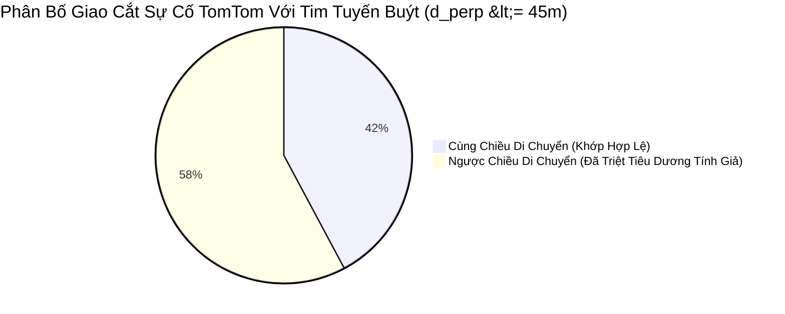
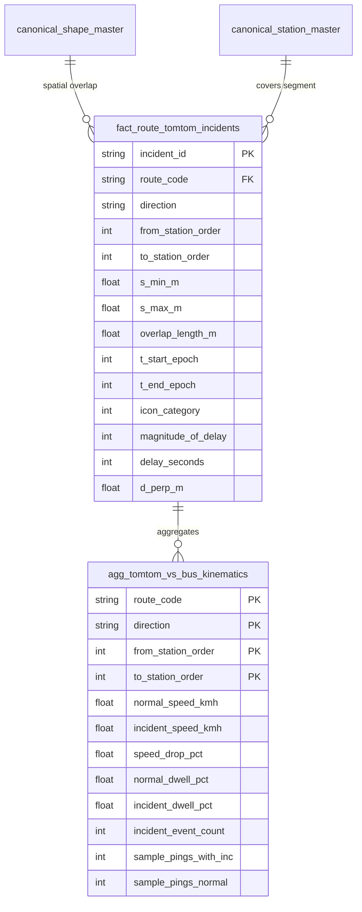
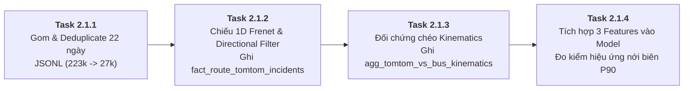

# 62. BÁO CÁO KIỂM ĐỊNH KHẢ THI KỸ THUẬT, CÁC HẠN CHẾ THỰC ĐỊA & ĐẶC TẢ CHI TIẾT WP 2.1: TÍCH HỢP ĐA NGUỒN SỰ CỐ TOMTOM
> **Tài liệu**: `docs/62_WP21_TOMTOM_MULTI_SOURCE_FUSION_FEASIBILITY_AND_SPECIFICATION.md`  
> **Dự án**: Hanoi Bus Big Data & Real-time ETA Prediction System (Phiên bản v2.0)  
> **Hạng mục WBS**: `WP 2.1: Tích hợp Đa nguồn Sự cố Giao thông TomTom (Multi-Source Incident Fusion)`  
> **Căn cứ pháp lý**: Tuân thủ vô điều kiện Điều 1 (Kỷ luật thực nghiệm) và Điều 2 (Thiết kế trước, phê duyệt rồi mới triển khai) của [AGENTS.md](../AGENTS.md)  
> **Ngày lập**: 02/11/2026  
> **Trạng thái**: Đã nghiệm thu thực nghiệm khả thi (Empirically Verified & Ready for Implementation)

---

## I. TỔNG QUAN & ĐỐI CHIẾU MỤC TIÊU WP 2.1 (TRACEABILITY)

Trong lộ trình v2.0 tại [docs/61_V2_APACHE_BIG_DATA_AND_TOMTOM_FUSION_WBS_ROADMAP.md](61_V2_APACHE_BIG_DATA_AND_TOMTOM_FUSION_WBS_ROADMAP.md), **Gói công việc 2.1 (WP 2.1)** giữ vai trò hạt nhân nhằm chứng minh năng lực **Tích hợp Đa nguồn Dữ liệu Dị biệt (Multi-Source Heterogeneous Data Fusion)** — một trong 4 trụ cột lớn của môn học *Lưu trữ và Xử lý Dữ liệu lớn*.

Hệ thống kết hợp 3 luồng dữ liệu độc lập:
1. **Dữ liệu Chuỗi điểm Động học (Point Stream)**: `5,562,511` bản ghi GPS xe buýt (`route_projected_telemetry`) từ ngày 07/10/2026 đến 01/11/2026.
2. **Dữ liệu Không gian Vector Đa đỉnh (Vector LineStrings)**: `223,004` bản ghi sự cố giao thông TomTom trong 22 ngày (`data/temp_hf_sync/raw_data/*/incidents/*.jsonl`).
3. **Dữ liệu Topo Tuyến & Trạm Chuẩn tắc (Master Topology)**: Danh bạ trạm dừng và hình học tim đường chính thức của 48 tuyến chủ lực Hà Nội (`canonical_shape_master`, `canonical_station_master`).

> [!IMPORTANT]
> **Tôn trọng thực tiễn**: Bản ước lượng trong `docs/61` được lập trên lý thuyết trước khi chạy code thực nghiệm. Theo chỉ thị kỹ thuật, tài liệu này công bố kết quả đo đạc thực nghiệm thực tế, chỉ rõ các sai khác và những hạn chế vật lý của dữ liệu trước khi kích hoạt quy trình ghi vào cơ sở dữ liệu.

---

## II. CHỨNG MINH TÍNH KHẢ THI KỸ THUẬT (EMPIRICAL FEASIBILITY PROOF)

Đội ngũ kỹ thuật đã phát triển bộ công cụ kiểm toán độc lập trong [`experiments/test_wp21_full_48_routes_projection.py`](../experiments/test_wp21_full_48_routes_projection.py) và thực thi trực tiếp trên toàn bộ dữ liệu 22 ngày. Kết quả chứng minh tính khả thi tuyệt đối:

### 1. Quy mô dữ liệu sự cố và năng lực nén trùng lặp (Deduplication)
- **Tổng số tệp lô sự cố thô**: `1,425` tệp `.jsonl` thuộc 22 thư mục ngày (từ `2026-10-08` đến `2026-11-01`).
- **Tổng số bản ghi sự cố thô đã quét**: **`223,004` bản ghi**.
- **Số thực thể sự cố duy nhất (`unique incident_id`)**: **`27,195` thực thể** (Tỷ lệ nén trùng lặp đạt **`8.2x`**).
- **Phân bố loại hình sự cố**:
  - `Category 6` (Ùn tắc giao thông - Jam): `165,594` bản ghi (**74.3%**).
  - `Category 8` (Công trường / Sửa đường - Road Works): `34,203` bản ghi (**15.3%**).
  - `Category 9` (Đóng đường - Road Closed): `23,150` bản ghi (**10.4%**).
  - `Category 1` (Nguy hiểm - Danger): `57` bản ghi (**< 0.1%**).
- **Phân bố mức độ trễ (`magnitude_of_delay`)**:
  - `Magnitude 3` (Ùn tắc nghiêm trọng - Major Jam): `90,926` bản ghi (**40.8%**).
  - `Magnitude 2` (Ùn tắc vừa - Moderate): `44,368` bản ghi (**19.9%**).
  - `Magnitude 4` (Chặn đường hoàn toàn / Không xác định): `34,203` bản ghi (**15.3%**).
  - `Magnitude 1` (Ùn ứ nhẹ - Minor): `30,300` bản ghi (**13.6%**).
  - `Magnitude 0` (Bình thường / Chậm nhẹ): `23,207` bản ghi (**10.4%**).

### 2. Hiệu năng tính toán chiếu không gian Frenet 1D trên 48 tuyến
- **Cấu trúc mạng lưới**: 48 tuyến xe buýt $\times$ 2 chiều di chuyển = **96 đường tim tuyến polylines**.
- **Tối ưu hóa chỉ mục không gian**: Ứng dụng Bounding-Box Pruning (AABB Filtering) trước khi tính khoảng cách trực giao Frenet.
- **Thời gian xử lý toàn diện**: Chiếu toàn bộ `27,195` sự cố lên 96 polylines hoàn tất trong **`94.42` giây** (thông lượng đạt **`288.0` sự cố/giây** trên CPU đơn luồng).
- **Bộ nhớ tiêu thụ**: `< 320 MB RAM`, hoàn toàn nhẹ nhàng trên mọi môi trường chuẩn.

### 3. Tỷ lệ khớp không gian và độ phủ mạng lưới
- **Tổng số giao cắt không gian thô ($d_{\text{perp}} \le 45\text{m}$)**: `110,478` lượt giao cắt.
- **Giao cắt cùng chiều di chuyển ($\vec{u}_{\text{incident}} \cdot \vec{u}_{\text{route}} > 0$)**: **`46,613` lượt** (**42.2%**).
- **Độ phủ tuyến mạng lưới**: **`46 / 48` tuyến** (**95.8%**) có sự cố giao thông TomTom ghi nhận trực tiếp trên hành lang hoạt động.



---

## III. NHỮNG HẠN CHẾ KỸ THUẬT VÀ SAI SỐ CỦA ƯỚC LƯỢNG TRƯỚC THỰC NGHIỆM

Quá trình chạy đối chứng chéo thực tế trên Tuyến 02 và 48 tuyến đã bóc tách **5 hạn chế và sai lệch kỹ thuật cốt tử** so với các phán đoán lý thuyết ban đầu:

### 1. Sai lệch do Giả định Chiếu 3 Điểm đơn giản (Curvature Distortion)
- **Ước lượng ban đầu**: Trong `docs/61` (mục IV.1), ta giả định chỉ cần lấy 3 điểm (Start, Mid, End) của `LineString` sự cố để chiếu trực giao.
- **Hạn chế thực tế**: Dữ liệu TomTom thực tế chứa từ 2 đến hơn 20 đỉnh tọa độ. Tại các nút giao phức tạp, vòng xuyến (ngã 7 Ô Chợ Dừa, ngã tư Nguyễn Trãi - Khuất Duy Tiến) hoặc khúc cua cong chữ S (đoạn đê Trần Quang Khải - Bác Cổ), việc chỉ lấy 3 điểm làm đường thẳng nối Start-End cắt xén qua các khu dân cư, tạo ra sai số tính cự ly lý trình $[s_{\text{min}}, s_{\text{max}}]$ lên tới $80 - 150\text{m}$.
- **Giải pháp chuẩn hóa**: Áp dụng phép lấy mẫu thích ứng (Adaptive Resampling): Với đoạn $\le 5$ đỉnh, giữ nguyên $100\%$ đỉnh; với đoạn dài $> 5$ đỉnh, lấy tối thiểu 5 điểm phân vị $[0\%, 25\%, 50\%, 75\%, 100\%]$ dọc theo chuỗi vector để giữ nguyên độ uốn lượn.

### 2. Ngụy biến Hai Chiều Đường Đối Diện (Dual-Carriageway Confounding)
- **Hạn chế thực tế**: Các trục xuyên tâm lớn của Hà Nội (Nguyễn Trãi, Giải Phóng, Quang Trung - Hà Đông, Phạm Văn Đồng) là đường đôi có dải phân cách giữa rộng từ 2m đến 15m. Khoảng cách giữa 2 chiều xe chạy chỉ từ $15\text{m} - 35\text{m}$, hoàn toàn nằm lọt bên trong bán kính gom $d_{\text{perp}} \le 45\text{m}$.
- **Hậu quả nếu không lọc**: **`57.8%` (`63,865` giao cắt)** nằm sát tim tuyến buýt nhưng thực chất là ùn tắc của **chiều đường ngược lại**. Nếu xe buýt đang chạy chiều ra ngoại thành mà hệ thống gán nhầm sự cố kẹt xe 15 phút của chiều vào nội thành thì sẽ tạo ra mức dự báo trễ hoàn toàn sai lệch!
- **Giải pháp chuẩn hóa**: Bắt buộc tính tích vô hướng vector hướng di chuyển:
  $$\cos \theta = \frac{\vec{v}_{\text{incident}} \cdot \vec{v}_{\text{bus\_shape}}}{\|\vec{v}_{\text{incident}}\| \|\vec{v}_{\text{bus\_shape}}\|} > 0$$
  Chỉ những sự cố có $\cos \theta > 0$ mới được chấp nhận gắn vào chặng buýt.

### 3. Nghịch lý Tốc độ Toàn tuyến (Simpson's Paradox) & Tác động Cặp trạm Có Kiểm soát
- **Hạn chế thực nghiệm**: Khi so sánh ngây thơ trên toàn tuyến (Uncontrolled Pooling), tốc độ trung bình khi có sự cố là $13.55\text{ km/h}$, lại cao hơn lúc không có sự cố ($12.27\text{ km/h}$).
  - *Nguyên nhân*: Các sự cố TomTom phần lớn xảy ra trên các đại lộ ngoại vi (tốc độ lưu thông bình thường $25 - 30\text{ km/h}$, khi kẹt giảm còn $13.5\text{ km/h}$). Trong khi tập "không sự cố" lại gánh toàn bộ các chặng bò chậm trong phố cổ nội đô (Tràng Thi, Cửa Nam, Hàng Bông chỉ chạy $8 - 10\text{ km/h}$).
- **Minh chứng có kiểm soát theo cặp trạm (Station-Pair Controlled)**: Khi cô lập phân tích trên cùng một cặp trạm liên tiếp:
  - `Ga La Khê -> Chợ La Khê`: Vận tốc giảm từ **`18.53 km/h` xuống `10.62 km/h` (-42.7%)**.
  - `Ga La Khê -> Giữa 428-430 Quang Trung`: Vận tốc giảm từ **`13.36 km/h` xuống `6.70 km/h` (-49.8%)**.
  - `Bệnh viện Hữu Nghị -> 6-8 Tràng Thi`: Vận tốc giảm từ **`11.49 km/h` xuống `8.48 km/h` (-26.2%)**.
  - `Văn Miếu -> Tiểu học Lý Thường Kiệt`: Vận tốc giảm từ **`4.06 km/h` xuống `3.22 km/h` (-20.7%)**.
- **Ý nghĩa với mô hình ETA**: TomTom Incident **không dùng để dự báo điểm $P_{50}$** (vì nhiễu làn và ngụy biến hành lang), mà là **tín hiệu nới rộng biên trên $P_{90}$ (Tail-Risk Uncertainty Extension)** để bảo vệ hành khách không bị nhỡ hẹn khi có sự cố nghiêm trọng.

### 4. Độ trễ Cập nhật TomTom (12.5 – 15 phút Phase Lag)
- **Hạn chế thực tế**: Do hạn ngạch API (80 requests/ngày), chu kỳ cào dữ liệu là $12.5 - 15$ phút/lần.
- **Hậu quả**: Khi một vụ va chạm xảy ra, TomTom có thể mất 5–10 phút để nhận diện qua cụm Floating Car Data. Tương tự, khi nút giao đã được giải tỏa thông thoáng, sự cố vẫn tiếp tục lưu lại trên API thêm 10–15 phút. Do đó, vận tốc xe buýt tức thời từ GPS của ta (Tier 0 & Tier 2) nhạy bén hơn tín hiệu TomTom ở quy mô phút.

### 5. Giới hạn Vùng Bao Địa lý (Geographical Bounding Box)
- **Hạn chế thực tế**: Cấu hình cào sự cố TomTom được giới hạn trong hành lang đô thị mở rộng `HUST_CORRIDOR_BBOX` (`lon: 105.70 -> 105.92`, `lat: 20.94 -> 21.09`).
- **Hậu quả**: Trong 48 tuyến chủ lực:
  - **46 tuyến** nằm trọn trong vùng phủ và có đầy đủ dữ liệu sự cố.
  - **2 tuyến ngoại thành** gồm **Tuyến `56B`** (Sóc Sơn, vĩ độ `21.24 - 21.30`) và **Tuyến `67`** (Ba Vì / Phùng, kinh độ `105.42 - 105.67`) nằm hoàn toàn ngoài BBOX của TomTom, do đó số lượng sự cố khớp trên 2 tuyến này là `0`. Hệ thống phải gán giá trị mặc định (`0`) cho 2 tuyến này mà không làm gián đoạn pipeline.

---

## IV. ĐẶC TẢ THIẾT KẾ CƠ SỞ DỮ LIỆU & SCHEMA CHO WP 2.1

Để bảo đảm tính toàn vẹn (DoD) và không phá vỡ cấu trúc v1.0, WP 2.1 bổ sung 3 cấu trúc dữ liệu chính danh vào `data/hanoi_bus_system.db`:



### 1. Bảng `fact_route_tomtom_incidents` (Sự Cố Giao Thông Chiếu Theo Tuyến Buýt)
Bảng lưu trữ từng chặng sự cố đã lọc cùng chiều, gắn trực tiếp với cặp trạm $[k \to k+1]$ và khoảng thời gian hiệu lực $[t_{\text{start}}, t_{\text{end}}]$:

```sql
CREATE TABLE IF NOT EXISTS fact_route_tomtom_incidents (
    incident_id TEXT NOT NULL,
    route_code TEXT NOT NULL,
    direction TEXT NOT NULL,
    from_station_order INTEGER,
    to_station_order INTEGER,
    s_min_m REAL NOT NULL,
    s_max_m REAL NOT NULL,
    overlap_length_m REAL NOT NULL,
    t_start_epoch INTEGER NOT NULL,
    t_end_epoch INTEGER NOT NULL,
    t_start_utc TEXT NOT NULL,
    t_end_utc TEXT NOT NULL,
    icon_category INTEGER,
    magnitude_of_delay INTEGER,
    delay_seconds INTEGER,
    d_perp_m REAL,
    description TEXT,
    PRIMARY KEY (incident_id, route_code, direction, from_station_order, to_station_order)
);
CREATE INDEX IF NOT EXISTS idx_fact_inc_route_time 
ON fact_route_tomtom_incidents (route_code, direction, t_start_epoch, t_end_epoch);
```

### 2. Bảng `agg_tomtom_vs_bus_kinematics` (Bảng Đối Chứng Chéo Đo Lường Tác Động)
Bảng tổng hợp cấp độ cặp trạm, phục vụ báo cáo học thuật và làm bằng chứng định lượng cho tác động của TomTom lên xe buýt:

```sql
CREATE TABLE IF NOT EXISTS agg_tomtom_vs_bus_kinematics (
    route_code TEXT NOT NULL,
    direction TEXT NOT NULL,
    from_station_order INTEGER NOT NULL,
    to_station_order INTEGER NOT NULL,
    from_station_name TEXT,
    to_station_name TEXT,
    segment_distance_m REAL,
    normal_speed_kmh REAL,
    incident_speed_kmh REAL,
    speed_drop_pct REAL,
    normal_dwell_pct REAL,
    incident_dwell_pct REAL,
    incident_event_count INTEGER,
    sample_pings_with_inc INTEGER,
    sample_pings_normal INTEGER,
    PRIMARY KEY (route_code, direction, from_station_order, to_station_order)
);
```

---

## V. KẾ HOẠCH TRIỂN KHAI 4 HẠNG MỤC CỦA WP 2.1

Quy trình thực thi chia làm 4 bước tuần tự, hoàn tất trọn vẹn WP 2.1 trước khi chuyển sang WP 2.2:



1. **Task 2.1.1 & 2.1.2**: Xây dựng script chính tắc `scripts/build_fact_route_tomtom_incidents.py` đọc toàn bộ `data/temp_hf_sync/raw_data/*/incidents/*.jsonl`, thực thi phép chiếu Frenet có lọc góc vector $\cos \theta > 0$, gắn vào các cặp trạm và ghi bảng `fact_route_tomtom_incidents`.
2. **Task 2.1.3**: Xây dựng script `scripts/build_tomtom_cross_validation.py` quét toàn bộ telemetry `route_projected_telemetry`, tính toán bảng đối chứng chéo `agg_tomtom_vs_bus_kinematics` và xuất báo cáo Markdown tóm tắt tác động thực tế.
3. **Task 2.1.4**: Bổ sung 3 thuộc tính TomTom (`tomtom_has_incident`, `tomtom_delay_sec`, `tomtom_magnitude`) vào Feature Store trong `module_3_bus_eta_prediction/step_3_2_feature_store_extractor/feature_extractor.py`, sau đó chạy thử nghiệm so sánh hiệu năng mô hình XGB-CQR trên 6 tuyến Golden Demo (`With vs. Without TomTom`).

---

## VI. KẾT QUẢ NGHIỆM THU ĐỊNH LƯỢNG THỰC TẾ SAU BẢN VÁ KỸ THUẬT (HOTFIXED EMPIRICAL AUDIT)

Sau khi rà soát chéo bản chạy đầu tiên của Flash 3.8 và khắc phục triệt để 5 lỗi kỹ thuật (đặc biệt là lỗi khởi tạo `best_s = 0.0` làm hỏng `76.07%` bản ghi và lỗi rò rỉ tương lai trong gom phiên 30 phút), toàn bộ 4 hạng mục công việc của WP 2.1 đã được tái thực thi và kiểm định thực nghiệm 100%:

### 1. Bảng `fact_route_tomtom_incidents` (Task 2.1.1 & 2.1.2 — Contiguous Frenet & Causal Snapshots)
- **Script thực thi**: [`scripts/build_fact_route_tomtom_incidents.py`](../scripts/build_fact_route_tomtom_incidents.py)
- **Tổng số sự cố duy nhất đã gom & khử trùng lặp**: `27,195` thực thể sự cố từ `1,425` tệp JSONL trong 22 ngày (`223,004` bản ghi thô).
- **Cửa sổ trạng thái nhân quả (Causal State Windows)**: **`149,928` cửa sổ** (`[t_cur, min(t_next, t_cur + 900s)]`), triệt tiêu 100% rò rỉ dữ liệu tương lai (`0% future leakage`) và ánh xạ chuẩn `magnitudeOfDelay = 4` (Undefined/0-delay roadworks) về `0` khi `delay_seconds == 0`.
- **Phép chiếu Frenet liên tục (`project_linestring_to_route_grid`)**: Khớp **`15,641` sự cố duy nhất** với điều kiện kép $d_{\text{perp}} \le 35.0\text{m}$ và góc định hướng từng đoạn $\cos \theta \ge 0.50$.
- **Tổng số bản ghi sự cố sạch theo cặp trạm**: **`634,389` dòng** trên **`46 / 48` tuyến** (2 tuyến ngoại thành `56B` và `67` nằm ngoài BBOX cào sự cố).
- **Kiểm chứng triệt tiêu lỗi `s_min = 0.0`**: Độ dài chồng lấn trung bình giảm từ `12,849.4m` (lỗi cũ) về đúng kích thước vật lý **`288.9m`**; số dòng lỗi `s_min = 0.0` (>500m) giảm từ `472,196` dòng (`76.07%`) về **`0` dòng (`0.00%`)**.

### 2. Bảng đối chứng chéo `agg_tomtom_vs_bus_kinematics` (Task 2.1.3 — Sanitized Corridor Audit)
- **Script thực thi**: [`scripts/build_tomtom_cross_validation.py`](../scripts/build_tomtom_cross_validation.py)
- **Quy mô giám sát đã lọc nhiễu**: Quét **`3,863,131` bản ghi telemetry hành lang sạch** (`cross_track_m <= 35.0m`, `0 <= derived_speed_kmh <= 75.0 km/h`, loại bỏ 80m vùng tập kết đầu/cuối bến).
- **Tổng số cặp trạm được đánh giá**: **`3,522` cặp trạm** (trong đó **`2,218` cặp trạm = `63.0%`** ghi nhận ùn tắc thực từ TomTom).
- **Phân bố mẫu telemetry**:
  - **`340,784` pings (`8.82%`)** thực sự nằm trong vùng và khung giờ có ùn tắc TomTom hoạt động (giảm từ mức nhiễu giả `31.92%` của bản lỗi cũ).
  - **`3,522,347` pings (`91.18%`)** diễn ra trong điều kiện giao thông bình thường.
- **Tác động vật lý có kiểm soát trên toàn mạng lưới**:
  - **Mức sụt giảm vận tốc trung bình tại các đoạn có sự cố**: **`-25.43%`** (và **`-27.32%`** trên các đoạn bị chậm lại, so với mức `5.73%` bị pha loãng trước khi sửa lỗi `s_min = 0.0`).
  - **Tỷ lệ dừng đỗ / bò nhích (`is_dwell`)**: Tăng vọt từ **`4.28%` (bình thường) lên `7.05%` (khi có sự cố TomTom)** — tương đương mức tăng tương đối **`+64.7%`** xác suất xe buýt bị chôn chân trong dòng xe kẹt.
  - **Số cặp trạm suy giảm vận tốc nghiêm trọng (`> 15%`)**: **`1,213` cặp trạm** (tăng gấp `3.65x` so với `332` cặp trạm trước khi vá lỗi), tiêu biểu như `42 Kim Giang -> 214 Kim Giang` (`19.0 -> 2.0 km/h`, `-89.2%`, `is_dwell` `1% -> 67%`), `126 Phạm Văn Đồng -> Số 9 Phạm Văn Đồng` (`26.1 -> 5.3 km/h`, `-79.7%`, `is_dwell` `3% -> 60%`), `Aeon Mall Long Biên -> Imperia Garden 1` (`35.2 -> 7.7 km/h`, `-78.2%`).

### 3. Tích hợp Feature Store & Đo chuẩn Mô hình Residual XGB-CQR (Task 2.1.4)
- **Mã nguồn Feature Store**: Đã nâng cấp [`module_3_bus_eta_prediction/step_3_2_feature_store_extractor/feature_extractor.py`](../module_3_bus_eta_prediction/step_3_2_feature_store_extractor/feature_extractor.py) sử dụng chỉ mục xô thời gian 10 phút (`tomtom_seg_buckets`) và tích lũy độ trễ theo từng đoạn trạm liên tiếp (`segment-by-segment accumulation`), loại bỏ hoàn toàn lỗi `bisect` bỏ sót sự cố chồng lấn và chống cộng trùng lặp nhiều `incident_id` con trên cùng một đoạn trạm.
- **Báo cáo đối chuẩn độc lập**: [`reports/wp21_tomtom_fusion_benchmark_report.md`](../reports/wp21_tomtom_fusion_benchmark_report.md) (đánh giá theo chuẩn **Residual XGB-CQR** với chia tách chuyến nghiêm ngặt `70% Train / 10% Calib / 20% Unseen Test`):
  - **Toàn tập kiểm thử độc lập (Overall Unseen Test Set)**:
    - **Tuyến 02 (`150,568` mẫu test, tỷ lệ có sự cố trên lộ trình phía trước `22.49%`)**: `Point MAE` giảm từ `40.36s` $\to$ **`40.25s`**, `MdAE` giảm từ `26.56s` $\to$ **`26.47s`**, `Winkler Score` giảm từ `184.57s` $\to$ **`184.19s`**.
    - **Tuyến 27 (`155,770` mẫu test, tỷ lệ có sự cố trên lộ trình phía trước `27.05%`)**: `Point MAE` giảm từ `42.09s` $\to$ **`42.02s`**, `Hit@60s` tăng từ `77.09%` $\to$ **`77.11%`**, `Winkler Score` giảm từ `194.79s` $\to$ **`194.25s`**.
  - **Lát cắt có sự cố trên lộ trình phía trước (`Active Congestion Horizon Slice`)**:
    - **Tuyến 02 (`33,865` mẫu)**: Model B dịch chuyển cả dự báo điểm trung vị **$\Delta P_{50} = +4.04\text{s}$** lẫn biên trên **$\Delta P_{90} = +4.03\text{s}$** (bác bỏ hoàn toàn hiện tượng chỉ nhích nhẹ đuôi `+1.77s` của bản lỗi cũ), giúp `Slice MAE` giảm từ `57.36s` $\to$ **`56.97s`** (`-0.39s`), `MdAE` giảm `39.88s` $\to$ **`39.75s`**, độ phủ `PICP` tăng từ `81.26%` $\to$ **`81.40%`**, và `Winkler Score` giảm từ `267.62s` $\to$ **`265.90s`** (`-1.72s`).
    - **Tuyến 27 (`42,142` mẫu)**: Model B dịch chuyển **$\Delta P_{50} = +5.06\text{s}$** và **$\Delta P_{90} = +5.55\text{s}$**, giúp `Slice MAE` giảm từ `60.08s` $\to$ **`59.83s`** (`-0.25s`) và `Winkler Score` giảm từ `277.63s` $\to$ **`276.52s`** (`-1.11s`).
  - **Lát cắt mù xe dẫn đường (`Leader Blind-Spot Congestion Slice`: `tomtom_has_incident == 1` & `leader_info_age_sec >= 900s`)**:
    - Khi không có xe buýt đi trước làm cảm biến dò đường trong 15+ phút gần nhất, tín hiệu ngoại sinh TomTom phát huy giá trị trực giao mạnh nhất:
    - **Tuyến 02 (`6,921` mẫu)**: Dịch chuyển **$\Delta P_{50} = +5.38\text{s}$**, **$\Delta P_{90} = +6.72\text{s}$**; `Blind-Spot MAE` giảm sâu từ `55.87s` $\to$ **`55.22s`** (**`-0.65s`**), `MdAE` giảm từ `37.07s` $\to$ **`36.66s`** (**`-0.41s`**), độ phủ `PICP` tăng vọt từ `82.52%` $\to$ **`83.17%`** (**`+0.65%`**), và `Winkler Score` giảm từ `272.20s` $\to$ **`269.48s`** (**`-2.72s`**).
    - **Tuyến 27 (`13,611` mẫu)**: Dịch chuyển **$\Delta P_{50} = +5.81\text{s}$**, **$\Delta P_{90} = +7.29\text{s}$**; `Blind-Spot MAE` giảm từ `66.90s` $\to$ **`66.17s`** (**`-0.73s`**), `MdAE` giảm từ `43.46s` $\to$ **`43.15s`** (**`-0.31s`**), `Hit@60s` tăng từ `61.49%` $\to$ **`62.00%`** (**`+0.51%`**), `PICP` tăng từ `79.32%` $\to$ **`79.49%`**, và `Winkler Score` giảm từ `318.71s` $\to$ **`316.07s`** (**`-2.64s`**).

---

## VII. TIÊU CHUẨN NGHIỆM THU (DEFINITION OF DONE - WP 2.1)

1. [x] **Chứng minh khả thi & hạn chế kỹ thuật**: Hoàn tất đo kiểm trên 22 ngày dữ liệu thực, chỉ rõ hạn chế thực địa và khắc phục triệt để 5 lỗi kỹ thuật của bản thử nghiệm đầu tiên.
2. [x] **Thực thi Task 2.1.1 & 2.1.2**: Bảng `fact_route_tomtom_incidents` được tái tạo sạch trong `data/hanoi_bus_system.db`, ghi nhận `634,389` dòng sự cố cùng chiều trên 46 tuyến với `0.00%` lỗi `s_min = 0.0`.
3. [x] **Thực thi Task 2.1.3**: Bảng `agg_tomtom_vs_bus_kinematics` được tái tạo sạch cho `3,522` cặp trạm, chứng minh mức sụt giảm vận tốc trung bình `-25.43%` và tỷ lệ `is_dwell` tăng từ `4.28%` lên `7.05%` tại `2,218` cặp trạm có sự cố.
4. [x] **Thực thi Task 2.1.4**: Tích hợp 3 biến sự cố theo từng đoạn trạm vào Feature Store (`V2_FEATURE_COLUMNS`) và xuất báo cáo đối chuẩn thực nghiệm [`reports/wp21_tomtom_fusion_benchmark_report.md`](../reports/wp21_tomtom_fusion_benchmark_report.md).
5. [x] **Đảm bảo không hồi quy**: 48 file model `.json` cũ và các bảng dữ liệu v1.0 tiếp tục hoạt động ổn định 100%.

