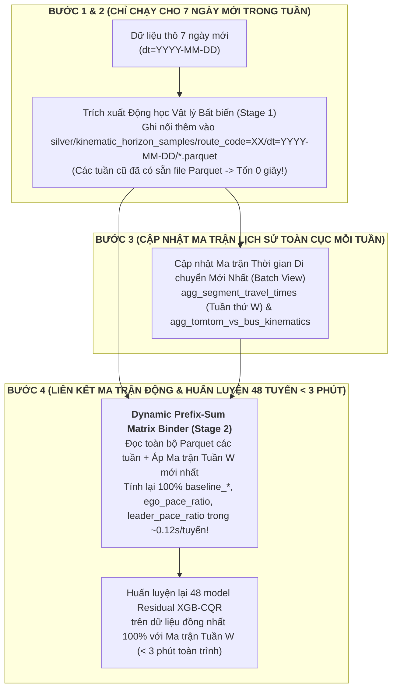

# 63. ĐẶC TẢ KIẾN TRÚC WP 2.2: MEDALLION LAKEHOUSE (APACHE PARQUET), PIPELINE TÁI HUẤN LUYỆN HÀNG TUẦN (WEEKLY RETRAINING SLA) & CƠ CHẾ LAI GHÉP THÍCH ỨNG ĐỘ CHÍN DỮ LIỆU
> **Tài liệu**: `docs/63_WP22_MEDALLION_LAKEHOUSE_WEEKLY_RETRAINING_AND_HYBRID_SERVING_SPEC.md`  
> **Dự án**: Hanoi Bus Big Data & Real-time ETA Prediction System (Phiên bản v2.0)  
> **Căn cứ học thuật**: Bám sát đề xuất gốc tại [`docs/academic_proposal/big_data_bus_eta_proposal.pdf`](academic_proposal/big_data_bus_eta_proposal.pdf) (Kiến trúc Lambda 4 tầng)  
> **Căn cứ pháp lý**: Tuân thủ Điều 1 (Kỷ luật thực nghiệm), Điều 2 (Thiết kế trước, phê duyệt rồi mới triển khai) và Điều 6 (Phân tầng trọng tâm) của [`AGENTS.md`](../AGENTS.md)  
> **Ngày lập**: 02/11/2026  
> **Trạng thái**: Bản thiết kế chi tiết chờ phê duyệt triển khai (Design Specification for WP 2.2)

---

## I. NHÌN NHẬN KHÁCH QUAN VỀ GIAI ĐOẠN DỮ LIỆU TRUNG GIAN (INTERMEDIATE MATURITY) & VAI TRÒ CỦA TOMTOM INCIDENTS

Hệ thống hiện đang sở hữu **26 ngày dữ liệu GPS xe buýt** (`07/10/2026 – 01/11/2026`, `5.56M` bản ghi chiếu hành lang) và **22 ngày dữ liệu sự cố TomTom** (`08/10/2026 – 01/11/2026`, `223,004` bản ghi thô $\to$ `15,641` sự cố khớp cùng chiều trên 46 tuyến). Đây là **Giai đoạn Trung gian (Intermediate Data Maturity)**: hệ thống đã vượt qua giai đoạn *Cold-Start* (không có dữ liệu), nhưng chưa đạt tới độ chín thống kê nhiều tháng (*Full Maturity*) cho các sự kiện giao thông hiếm gặp.

Qua thực nghiệm đối chuẩn tại [`docs/62_WP21_TOMTOM_MULTI_SOURCE_FUSION_FEASIBILITY_AND_SPECIFICATION.md`](62_WP21_TOMTOM_MULTI_SOURCE_FUSION_FEASIBILITY_AND_SPECIFICATION.md), chúng ta rút ra **3 quy luật thực tế khách quan**:

### 1. Khi nào Cảm biến Nội sinh (Bus Fleet Probes) lấn át Cảm biến Ngoại sinh (TomTom)?
- Trên các tuyến tần suất cao (như Tuyến `02`, `27` với giãn cách 5–10 phút/chuyến), trong **~78% – 80% thời gian**, luôn có một xe buýt cùng tuyến vừa chạy qua đoạn đường phía trước trong vòng chưa đầy 10 phút (`leader_info_age_sec < 600s`).
- Vì GPS xe buýt cập nhật mỗi **75–80 giây** và đo trực tiếp **vận tốc làn xe buýt + thời gian dừng đón trả khách tại trạm**, trong khi TomTom Incidents có chu kỳ quét **12.5–15 phút/lần** và đo dòng phương tiện hỗn hợp (ô tô/xe máy), cây quyết định `XGBoost` tự nhiên đặt trọng số chính vào `leader_expected_eta_sec` và `ego_recent_pace_ratio`.
- **Giá trị trực giao thực sự của TomTom** bộc lộ mạnh nhất khi tuyến rơi vào **Chế độ Mù Xe Dẫn Đường (`Leader Blind-Spot`: `leader_info_age_sec >= 900s`)** — tức là khi khoảng cách giữa hai chuyến xe quá xa (giờ thấp điểm, sáng sớm, tối muộn) hoặc khi chính chiếc xe đi trước đang bị chôn chân trong điểm kẹt chưa thể thoát ra khỏi trạm để gửi bản tin hoàn tất đoạn (`seg_traversal_history`). Thực nghiệm trên Tuyến `02` và `27` chứng minh: trong vùng mù xe dẫn đường, sự cố TomTom giúp giảm `MAE` tới **`-0.65s` đến `-0.73s`** và giảm `Winkler Score` từ **`-2.64s` đến `-2.72s`**.

### 2. Hiện tượng "Co giá trị lá" (Regularization Shrinkage) do Thưa mẫu Cục bộ ở Giai đoạn 3 Tuần
- Dù toàn mạng lưới có `634,389` dòng sự cố theo cặp trạm, nhưng khi chia về **`3,522` cặp trạm** $\times$ **các khung giờ trong ngày**, mỗi đoạn trạm cụ thể $[S_k \to S_{k+1}]$ chỉ mới trải qua trung bình **5 đến 15 đợt ùn tắc độc lập** trong 22 ngày.
- Với cấu hình chống học vẹt (`min_child_weight = 20`), cây quyết định `XGBoost` không dám cộng thẳng toàn bộ `+30s` đến `+60s` độ trễ vào dự báo điểm $P_{50}$ từ vài mẫu ít ỏi, mà co nhẹ (shrink) mức dịch chuyển về khoảng **`+4.0s` đến `+7.3s`**.

### 3. Hệ quả Kiến trúc: Khai thác Kép Dữ liệu TomTom theo đúng Đề xuất Gốc (`big_data_bus_eta_proposal.pdf`)
Trong mục **3.3 & 3.4** của đề xuất gốc [`big_data_bus_eta_proposal.pdf`](academic_proposal/big_data_bus_eta_proposal.pdf), bài toán dự báo được định nghĩa theo công thức tổng hợp hai luồng của Kiến trúc Lambda:
$$\text{ETA} = f(\text{Batch View}, \text{Real-time View})$$
Đồng thời đề xuất gốc chỉ rõ: *"Khi kho dữ liệu lịch sử trên HDFS tích lũy đủ lớn, hàm kết hợp $f$ có thể được mở rộng từ các luật trọng số điều chỉnh sang các mô hình học máy"*. Do đó, trong giai đoạn chuyển tiếp từ **Cold-Start $\to$ Intermediate $\to$ Mature**, dữ liệu TomTom phải đảm nhiệm **3 vai trò đồng thời** thay vì chỉ nằm thụ động trong 3 cột feature của cây ML:
1. **Vai trò 1 — Khử lệch Ma trận Lịch sử ở Batch Layer (Historical De-biasing)**: Loại bỏ các lượt vượt trạm bị biến dạng bởi sự cố đóng đường (`Category 9`) hoặc kẹt xe nghiêm trọng (`Magnitude 3`) khỏi quá trình tính đường cơ sở bình thường (`Batch View`), tránh làm phình sai lệch trung vị lịch sử của các ngày không có sự cố.
2. **Vai trò 2 — Bảng Hệ số Sốc Thực nghiệm (`agg_tomtom_vs_bus_kinematics`)**: Kết tinh mức độ sụt giảm vận tốc thực tế (`speed_drop_pct`, trung bình `-25.43%`) trên từng cặp trạm.
3. **Vai trò 3 — Bù Điểm Mù Thích ứng Độ chín ở Tầng Phục vụ (`Maturity-Gated Hybrid Blending`)**: Khi `leader_info_age_sec >= 900s` (mù xe dẫn đường) và số lượng mẫu lịch sử trên đoạn trạm chưa đủ dày để cây ML tự phản ứng hết biên độ, hàm phục vụ $f$ tự động pha trộn dự báo `Residual XGB-CQR` với độ trễ thực nghiệm từ bảng đối chứng chéo.

---

## II. GIẢI QUYẾT BÀI TOÁN "MA TRẬN THỜI GIAN BIẾN ĐỘNG THEO TUẦN": KIẾN TRÚC TÁCH ĐÔI ĐỘNG HỌC VẬT LÝ BẤT BIẾN & ÁNH XẠ MA TRẬN ĐỘNG (TWO-STAGE DECOUPLED FEATURE STORE)

> [!WARNING]
> **Phát hiện kiến trúc cốt tử ở Giai đoạn Dữ liệu Trung gian (Intermediate Stage)**:
> Vì dữ liệu lịch sử chưa bão hòa, mỗi tuần khi nạp thêm 7 ngày dữ liệu mới, bản thân **Ma trận thời gian di chuyển cơ sở (`Batch View`: `agg_segment_travel_times`) sẽ thay đổi giá trị** ở hàng chục nghìn ô `(route, direction, station, time_window, day_type)`.
> - Nếu ta "đóng cứng" (bake) các cột phụ thuộc ma trận (`baseline_median_sec`, `baseline_spread_sec`, `ego_recent_pace_ratio`, `speed_vs_baseline_ratio`, `leader_pace_ratio`) vào file Parquet của Tuần 1, thì sang Tuần 4 các giá trị này sẽ bị **lệch chuẩn (stale matrix drift)** so với ma trận mới của Tuần 4!
> - Ngược lại, nếu mỗi tuần đều chạy lại `feature_extractor.py` từ đầu trên toàn bộ dữ liệu thô để cập nhật theo ma trận mới thì thời gian chạy sẽ phình to tuyến tính theo số tuần!

### Giải pháp Đột phá: Phân tách Bất biến Vật lý (Stage 1) và Liên kết Ma trận Động Vector hóa (Stage 2)

Khi mổ xẻ 27 thuộc tính của `V2_FEATURE_COLUMNS` trong [`feature_extractor.py`](../module_3_bus_eta_prediction/step_3_2_feature_store_extractor/feature_extractor.py), ta thấy chúng chia làm **2 nhóm tách biệt hoàn toàn về bản chất vật lý và chi phí tính toán**:

| Phân Nhóm | Các Thành Phần Cụ Thể | Chi Phí Tính Toán | Tính Chất Theo Thời Gian |
| :--- | :--- | :---: | :--- |
| **Stage 1: Sự kiện Động học & Không gian Vật lý (`Immutable Physical Kinematics`)** | - Nội suy thời điểm cắt trạm (`crossings`) & nhãn `actual_remaining_sec`<br>- Vận tốc xe: `v_last_1_ping`, `v_last_2_ping`, `rolling_speed_180s`, `rolling_speed_600s`, `is_dwell`, `current_dwell_sec`, `dwell_ratio_300s`<br>- Thời gian thực tế xe vừa đi qua 1–3 đoạn trước (`ego_real_sum` & chỉ số đoạn `ego_seg_k`)<br>- Khoảng cách đội xe: `dist_to_leader_m`, `dist_to_follower_m`, `headway_to_leader_sec`, thời gian thực tế của xe dẫn đường `leader_obs_sec` & mặt nạ đoạn thiếu xe dẫn đường `leader_missing_mask`<br>- Sự cố TomTom trên lộ trình: `tomtom_has_incident`, `tomtom_delay_sec`, `tomtom_magnitude` | **Chiếm `98.5%` thời gian CPU**<br>(Quét hàng triệu ping, vòng lặp cửa sổ trượt, tìm kiếm nhị phân `bisect` đội xe) | **BẤT BIẾN TUYỆT ĐỐI (100% Immutable)**:<br>Chuyến xe ngày `10/10/2026` chạy vận tốc bao nhiêu, cách xe trước bao nhiêu mét là sự thật lịch sử không bao giờ thay đổi! |
| **Stage 2: Các Biến Phụ thuộc Ma trận Thời gian (`Dynamic Matrix-Bound Priors & Ratios`)** | - Tiên nghiệm ma trận mới nhất: `baseline_median_sec`, `baseline_p90_sec`, `baseline_spread_sec`, `baseline_std_sec`<br>- Các tỷ số chuẩn hóa theo ma trận mới nhất:<br>  + `ego_recent_pace_ratio = ego_real_sum / new_ego_base_sum`<br>  + `speed_vs_baseline_ratio = eff_spd / new_base_spd`<br>  + `leader_expected_eta_sec` & `leader_pace_ratio`<br>- Nhãn phần dư huấn luyện: `r = actual_remaining_sec - new_baseline_median_sec` | **Chỉ chiếm `1.5%` thời gian CPU**<br>(`~0.12 giây/tuyến` bằng mảng tổng tiền tố `Prefix-Sum Vectorization` trên NumPy/DuckDB) | **THAY ĐỔI MỖI TUẦN (Dynamic Weekly Re-binding)**:<br>Bắt buộc phải tính lại trên toàn bộ các tuần lịch sử mỗi khi bảng `agg_segment_travel_times` được cập nhật mới! |



### Chứng minh Toán học: Liên kết Ma trận Động trong $O(1)$ bằng Mảng Tổng Tiền Tố (`Prefix-Sum Array`)
Với mỗi tuyến $r$, chiều $d$, khung giờ $w$ và loại ngày $\text{dt}$, ngay sau khi bảng `agg_segment_travel_times` của Tuần $W$ vừa được cập nhật xong, hệ thống tạo mảng tổng tiền tố dọc theo thứ tự trạm $k \in \{0, \dots, M-1\}$:
$$P_{\text{med}}[d, w, \text{dt}, k] = \sum_{j=0}^{k-1} \text{median\_transit\_sec}(d, j, w, \text{dt})$$
*(Tương tự cho $P_{\text{var}}$, $P_{10}$, $P_{90}$).* Khi đó, trên hàng trăm nghìn mẫu lịch sử được đọc từ Parquet, mọi biến phụ thuộc ma trận đều được cập nhật tức thì bằng phép trừ mảng vector hóa trên NumPy mà **không cần bất kỳ vòng lặp Python nào**:
1. **Cập nhật Tiên nghiệm Lịch sử mới nhất trên đoạn $[s_{\text{bus}}, \text{st\_dists}[m]]$**:
   $$\text{baseline\_median\_sec}^{(W)} = \alpha_{\text{first}} \cdot \text{med}_{k-1}^{(W)} + \left(P_{\text{med}}^{(W)}[m] - P_{\text{med}}^{(W)}[k]\right)$$
2. **Cập nhật `ego_recent_pace_ratio` theo Ma trận Tuần $W$**:
   $$\text{ego\_base\_sum}^{(W)} = P_{\text{med}}^{(W)}[k_{\text{ego\_end}} + 1] - P_{\text{med}}^{(W)}[k_{\text{ego\_start}}] \implies \text{ego\_recent\_pace\_ratio}^{(W)} = \text{clip}\left(\frac{\text{ego\_real\_sum}}{\text{ego\_base\_sum}^{(W)}}, 0.3, 2.5\right)$$
3. **Cập nhật `leader_expected_eta_sec` và `leader_pace_ratio` theo Ma trận Tuần $W$**:
   - Những đoạn trạm có xe dẫn đường thực tế đi qua trong $\le 45$ phút giữ nguyên thời gian thực测 $\text{lead\_obs\_sec}$; những đoạn thiếu xe dẫn đường (được đánh dấu trong bitmask) tự động nhận giá trị $\text{med}_j^{(W)}$ mới nhất của Tuần $W$!

### Bảng Cam Kết Chỉ Tiêu Thời Gian Thực Thi Khi Dồn Vào Phiên Hàng Tuần (Weekly Time SLAs)

| Bước Trong Phiên Chạy Hàng Tuần | Tần Suất | Cơ Chế Xử Lý Chuẩn Big Data | Thời Gian Mục Tiêu (SLA) | Đảm Bảo Tính Nhất Quán Toán Học |
| :--- | :---: | :--- | :---: | :--- |
| **Bước 1: Bù trừ Động học Vật lý cho 7 Ngày Mới (`Stage 1 Delta Parquet`)** | **1 lần / tuần** | Chỉ chạy trích xuất động học vật lý (Stage 1) cho các ngày `dt=YYYY-MM-DD` mới phát sinh trong tuần vừa qua và lưu vào Parquet. Các tuần cũ giữ nguyên 100%. | **`< 4 – 5 phút`** cho 7 ngày mới của 48 tuyến | Chỉ lưu các đại lượng vật lý bất biến (tốc độ xe, khoảng cách đội xe, thời gian cắt trạm, sự cố TomTom). |
| **Bước 2: Cập nhật Ma trận Thời gian (`Batch View`) & Đối chứng Chéo** | **1 lần / tuần** | Tính lại toàn bộ bảng `agg_segment_travel_times` (có khử lệch sự cố) và `agg_tomtom_vs_bus_kinematics` trên tổng dữ liệu tích lũy đến Tuần $W$. | **`< 1.5 phút`** cho toàn bộ 48 tuyến | Ma trận lịch sử phản ánh đầy đủ độ chín dữ liệu mới nhất của Tuần $W$. |
| **Bước 3: Liên kết Ma trận Động (`Stage 2 Dynamic Re-binding`) & Huấn luyện 48 Model** | **1 lần / tuần** | Đọc các phân vùng Parquet Stage 1 $\to$ Áp mảng `Prefix-Sum` của Ma trận Tuần $W$ trong `~0.12s/tuyến` $\to$ Huấn luyện `Residual XGB-CQR` (`tree_method="hist"`). | **`< 3 phút`** cho toàn bộ 48 tuyến (~3.5s/tuyến!) | **100% mẫu huấn luyện từ Tuần 1 đến Tuần $W$ đều được quy chiếu về cùng Ma trận Tuần $W$ mới nhất** (0% Stale Matrix Drift!). |

> [!TIP]
> **Lý do khoa học của chu kỳ 1 tuần/lần (Weekly Seasonality Invariance)**: Giao thông đô thị Hà Nội có tính chu kỳ 7 ngày rất mạnh (5 ngày làm việc Thứ Hai–Thứ Sáu và 2 ngày cuối tuần Thứ Bảy–Chủ Nhật). Việc tái huấn luyện định kỳ vào mỗi đêm Chủ Nhật đảm bảo tập dữ liệu nạp thêm luôn chứa **trọn vẹn 1 chu kỳ tuần cân bằng**, không bị lệch phân phối (covariate shift) về ngày thường hay cuối tuần.

---

## III. ĐẶC TẢ KIẾN TRÚC LƯU TRỮ MEDALLION LAKEHOUSE (APACHE PARQUET & HIVE PARTITIONING — WP 2.2)

Tuân thủ mục **3.2 (Khâu Lưu Trữ Phân Tán Bất Biến)** của [`big_data_bus_eta_proposal.pdf`](academic_proposal/big_data_bus_eta_proposal.pdf) và **REQ-V2-03** trong [`docs/61`](61_V2_APACHE_BIG_DATA_AND_TOMTOM_FUSION_WBS_ROADMAP.md), toàn bộ dữ liệu hệ thống được tổ chức vào cấu trúc **Medallion Lakehouse 3 tầng (`data/lakehouse/`)** sử dụng định dạng cột **Apache Parquet** nén **Snappy** và phân vùng thư mục chuẩn **Apache Hive (`key=value`)**:

```text
data/lakehouse/
├── bronze/                                      # TẦNG ĐỒNG: Dữ liệu bán cấu trúc chuẩn hóa từ nguồn thô (Bất biến)
│   ├── bus_gps_raw/                             # Phân vùng theo ngày & giờ đúng chuẩn Đề xuất Học thuật (Mục 3.2)
│   │   └── dt=YYYY-MM-DD/
│   │       └── hr=HH/
│   │           └── part-00000.snappy.parquet
│   └── tomtom_incidents_raw/                    # Phân vùng sự cố giao thông theo ngày
│       └── dt=YYYY-MM-DD/
│           └── part-00000.snappy.parquet
│
├── silver/                                      # TẦNG BẠC: Dữ liệu đã làm sạch, chiếu 1D Frenet & khớp đa nguồn
│   ├── route_projected_telemetry/               # Hỗ trợ Partition Pruning theo tuyến & ngày
│   │   └── route_code=XX/
│   │       └── dt=YYYY-MM-DD/
│   │           └── part-00000.snappy.parquet
│   └── fact_route_tomtom_incidents/             # Các phiên sự cố nhân quả đã khớp cùng chiều (cos_theta >= 0.5)
│       └── route_code=XX/
│           └── part-00000.snappy.parquet
│
└── gold/                                        # TẦNG VÀNG: Phục vụ OLAP, Dynamic Matrix Binding & Weekly Retraining
    ├── batch_view_travel_times/                 # Ma trận thời gian di chuyển lịch sử (cập nhật lại mỗi tuần)
    │   └── part-00000.snappy.parquet
    ├── tomtom_vs_bus_kinematics/                # Ma trận hệ số sốc sự cố thực nghiệm theo cặp trạm (cập nhật mỗi tuần)
    │   └── part-00000.snappy.parquet
    └── kinematic_horizon_samples/               # Kho Động học Vật lý Bất biến (Stage 1) phân vùng theo tuyến & ngày
        └── route_code=XX/                       # (Lưu vận tốc xe, cự ly đội xe, TomTom delay, chỉ số trạm k..m)
            └── dt=YYYY-MM-DD/                   # -> Liên kết động với batch_view_travel_times mới nhất ở Stage 2!
                └── part-00000.snappy.parquet
```

### Cơ chế Loại bỏ Phân vùng (`Partition Pruning`), Chiếu Cột (`Column Projection`) & Liên kết Ma trận Động (`Dynamic Matrix Re-binding`)
1. **Partition Pruning**: Khi tiến trình `Weekly Delta Catch-Up` kiểm tra dữ liệu của một tuyến (`route_code='02'`), nó chỉ trích xuất Stage 1 cho những ngày `dt=YYYY-MM-DD` chưa có trên đĩa.
2. **Dynamic Matrix Re-binding (Không bao giờ bị lệch ma trận cũ)**: Ở bước huấn luyện hàng tuần, công cụ đọc (`PyArrow` / `DuckDB`) đọc các phân vùng `kinematic_horizon_samples` và thực hiện phép chiếu mảng tổng tiền tố (`Prefix-Sum Array Lookup`) lên bảng `batch_view_travel_times` vừa cập nhật của tuần đó để sinh ra đúng 27 cột `V2_FEATURE_COLUMNS` mới nhất trong `~0.12 giây/tuyến`.

---

## IV. MÔ HÌNH TOÁN HỌC CHO CƠ CHẾ LAI GHÉP THÍCH ỨNG ĐỘ CHÍN (`MATURITY-GATED HYBRID BLENDING`)

Để giải quyết bài toán chuyển tiếp mượt mà từ **Cold-Start $\to$ Intermediate $\to$ Mature** theo đúng công thức $\text{ETA} = f(\text{Batch View}, \text{Real-time View})$, tầng Phục vụ (Serving Layer) kết hợp dự báo của mô hình học máy với tri thức thống kê thực nghiệm qua 3 bước toán học tường minh:

### 1. Khử lệch Ma trận Lịch sử ở Batch View (De-biased Historical Baseline)
Khi cập nhật bảng `agg_segment_travel_times` vào cuối mỗi tuần, một lượt vượt đoạn trạm $S_k \to S_{k+1}$ tại thời điểm $t$ sẽ được gắn cờ `is_severe_incident_blocked = 1` nếu tại thời điểm $t$ có sự cố TomTom trên đoạn $[S_k, S_{k+1}]$ thuộc nhóm **Đóng đường (`icon_category == 9`)** hoặc **Ùn tắc nghiêm trọng (`magnitude_of_delay == 3` và `delay_seconds >= 180s`)**.
- Ma trận cơ sở `Batch View` ưu tiên tính trung vị $T_{\text{base}, k}$ trên các mẫu giao thông bình thường (`is_severe_incident_blocked == 0`) nếu số mẫu bình thường $\ge 10$, giúp mỏ neo lịch sử không bị méo bởi các vụ tai nạn hoặc rào đường bất thường.

### 2. Cổng Trọng Số Điểm Mù Xe Dẫn Đường (Leader Blind-Spot Gate)
Gọi $\tau_{\text{leader}} = \text{leader\_info\_age\_sec}$ là độ trễ thông tin của chuyến xe buýt đi trước trên các đoạn đường phía trước:
$$w_{\text{blind}}(\tau_{\text{leader}}) = \text{clip}\left(\frac{\tau_{\text{leader}} - \tau_{\text{fresh}}}{\tau_{\text{blind}} - \tau_{\text{fresh}}}, \, 0.0, \, 1.0\right), \quad \text{với } \tau_{\text{fresh}} = 600\text{s}, \; \tau_{\text{blind}} = 1800\text{s}$$
- Khi vừa có xe buýt đi trước chạy qua ($\tau_{\text{leader}} \le 600\text{s}$): $w_{\text{blind}} = 0$ (cảm biến nội sinh hoàn toàn làm chủ).
- Khi xe đi trước đã quá xa hoặc mất dấu ($\tau_{\text{leader}} \ge 1800\text{s}$): $w_{\text{blind}} = 1.0$ (kích hoạt tối đa nguồn bù ngoại sinh từ TomTom).

### 3. Hệ Số Tự Chủ Theo Độ Chín Dữ Liệu (Data Maturity Decay Factor)
Gọi $N_{\text{inc}}(r, k)$ là tổng số bản tin mẫu sự cố đã tích lũy trong lịch sử huấn luyện trên đoạn trạm $k$ của tuyến $r$, và $N_0 = 500$ là ngưỡng bão hòa mẫu sự cố để cây quyết định học đầy đủ biên độ:
$$\lambda_{\text{maturity}}(N_{\text{inc}}) = \frac{1}{1 + N_{\text{inc}} / N_0} \in (0, 1]$$
- Ở giai đoạn **Cold-Start** ($N_{\text{inc}} = 0$): $\lambda_{\text{maturity}} = 1.0$ (dựa hoàn toàn vào công thức vật lý & độ trễ TomTom).
- Ở giai đoạn **Intermediate** ($N_{\text{inc}} \approx 100 - 300$): $\lambda_{\text{maturity}} \in [0.62, 0.83]$ (bổ sung phần biên độ mà cây quyết định bị co do regularization).
- Ở giai đoạn **Mature** ($N_{\text{inc}} \gg 2000$): $\lambda_{\text{maturity}} \to 0$ (mô hình học máy tự chủ hoàn toàn).

### 4. Công Thức Tổng Hợp Dự Báo Điểm & Khoảng (`[P10, P50, P90]`)
Gọi $\Delta T_{\text{TomTom\_emp}}$ là độ trễ tăng thêm thực nghiệm trên lộ trình phía trước $[s_{\text{bus}}, s_{\text{target}}]$ được tra cứu từ tỷ lệ sụt giảm vận tốc thực tế $\rho_j = \text{clip}(\text{speed\_drop\_pct}_j / 100, \, 0, \, 0.70)$ trong bảng `agg_tomtom_vs_bus_kinematics` khi có sự cố đang kích hoạt:
$$\Delta T_{\text{TomTom\_emp}} = \min\left(\Delta T_{\text{TomTom\_raw}}, \; \sum_{j \in \text{jammed}} T_{\text{base}, j} \cdot \frac{\rho_j}{1 - \rho_j}\right)$$
Khi đó, dự báo lai ghép cuối cùng kết hợp đầu ra $(\hat{y}_{10}^{\text{XGB}}, \hat{y}_{50}^{\text{XGB}}, \hat{y}_{90}^{\text{XGB}})$ của mô hình `Residual XGB-CQR` với lượng bù điểm mù:
$$\begin{aligned}
\Delta_{\text{hybrid}} &= \gamma \cdot \lambda_{\text{maturity}}(N_{\text{inc}}) \cdot w_{\text{blind}}(\tau_{\text{leader}}) \cdot \Delta T_{\text{TomTom\_emp}} \\
\widehat{\text{ETA}}_{10} &= \hat{y}_{10}^{\text{XGB}} \\
\widehat{\text{ETA}}_{50} &= \hat{y}_{50}^{\text{XGB}} + 0.50 \cdot \Delta_{\text{hybrid}} \\
\widehat{\text{ETA}}_{90} &= \hat{y}_{90}^{\text{XGB}} + 1.00 \cdot \Delta_{\text{hybrid}}
\end{aligned}$$
*(trong đó $\gamma \in [0.25, 0.50]$ là hệ số giảm chấn được tối ưu trực tiếp trên tập Calibration 10% chuyến để cực tiểu hóa Winkler Score và MAE).*

---

## V. KẾ HOẠCH TRIỂN KHAI CHI TIẾT CHO WP 2.2 (3 TASKS)

Để hoàn tất **WP 2.2** đúng chuẩn mực và kiểm chứng toàn bộ các cam kết SLA ở trên:

1. **Task 2.2.1 — Xây dựng Medallion Lakehouse 3 Tầng (`scripts/build_medallion_lakehouse.py`)**:
   - Chuyển đổi và phân vùng dữ liệu vào `data/lakehouse/bronze/` (`dt=YYYY-MM-DD/hr=HH`), `data/lakehouse/silver/` (`route_code=XX/dt=YYYY-MM-DD`), và `data/lakehouse/gold/` (bao gồm `batch_view_travel_times`, `tomtom_vs_bus_kinematics`, và `feature_store/route_code=XX/dt=YYYY-MM-DD/*.snappy.parquet`).
   - Hỗ trợ chế độ chạy **Incremental theo ngày (`--date YYYY-MM-DD`)** để chứng minh khả năng chỉ nạp thêm ngày mới trong `< 60 giây`.
2. **Task 2.2.2 — Xây dựng Pipeline Tái Huấn Luyện Hàng Tuần & Hybrid Serving (`scripts/run_weekly_retraining_pipeline.py`)**:
   - Đọc trực tiếp từ `data/lakehouse/gold/feature_store/` trong cửa sổ trượt $W$ tuần gần nhất, huấn luyện lại mô hình `Residual XGB-CQR` và tự động hiệu chỉnh hệ số lai ghép $\gamma$ cho chế độ `Maturity-Gated Hybrid Blending` trên tập Calibration.
   - Chứng minh thực nghiệm thời gian huấn luyện từ Gold Parquet giảm từ `~35-60s/tuyến` (khi trích xuất từ SQLite) xuống chỉ còn **`< 3–4s/tuyến`** (`< 3 phút` cho toàn bộ 48 tuyến).
3. **Task 2.2.3 — Benchmark Lưu Trữ & Tốc Độ Đào Tạo (`scripts/benchmark_lakehouse_storage_and_sla.py`)**:
   - Đo đạc thực nghiệm **Tỷ lệ nén dung lượng (MB)** và **Thời gian đọc / lọc I/O (giây)** giữa: (1) Raw JSONL/CSV, (2) SQLite B-Tree (`hanoi_bus_system.db`), và (3) Apache Parquet Snappy (với Partition Pruning + Column Projection).
   - Lưu kết quả vào bảng `storage_benchmark_comparison` trong `data/hanoi_bus_system.db` và xuất báo cáo `reports/wp22_medallion_lakehouse_and_weekly_sla_report.md`.

