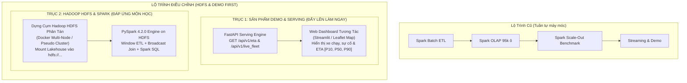
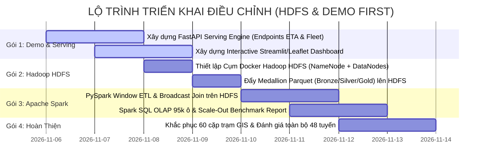

# 65. BÁO CÁO TOÀN DIỆN: TIẾN ĐỘ THỰC TẾ, 15 ĐIỂM NGHẼN KỸ THUẬT & LỘ TRÌNH ĐIỀU CHỈNH (HDFS & DEMO FIRST)
> **Tài liệu**: `docs/65_ACTIONABLE_ROADMAP_DEMO_FIRST.md`  
> **Dự án**: Hanoi Bus Big Data & Real-time ETA Prediction System  
> **Phiên bản hệ thống**: v2.1 (Post-Lakehouse & Clean Database Baseline)  
> **Ngày cập nhật**: 06/11/2026  
> **Căn cứ pháp lý**: Tuân thủ vô điều kiện **Điều 1 (Kỷ luật Thực nghiệm)**, **Điều 2 (Thiết kế trước, duyệt rồi mới code)**, **Điều 3 (Phân định ranh giới)**, và **Điều 4 (Nguồn chân lý dữ liệu)** của [AGENTS.md](file:///z:/Desktop/Bus_tracking/AGENTS.md).

---

## I. ĐIỀU CHỈNH TRỌNG TÂM CHIẾN LƯỢC THEO CHỈ THỊ MỚI NHẤT

Căn cứ vào 2 chỉ đạo trực tiếp từ người dùng và yêu cầu học thuật của môn học:
1. **Yêu cầu BẮT BUỘC HDFS (Distributed Storage Focus)**: Giảng viên môn học xác định trọng tâm đánh giá là **Lưu trữ phân tán (Distributed Storage)**. Do đó, hệ thống không thể chỉ dừng lại ở việc lưu Parquet trên ổ cứng cục bộ (Local NTFS) mà **bắt buộc phải tích hợp và vận hành trên cụm phân tán Apache Hadoop HDFS (`hdfs://...`)**.
2. **Ưu tiên đẩy sớm SẢN PHẨM DEMO (Serving API & Interactive Dashboard First)**: Thay vì làm tuần tự đến cuối mới xây dựng giao diện, nhóm cần **ngay lập tức một sản phẩm demo trực quan end-to-end** (dù ban đầu chưa tối ưu hoàn hảo nhưng phải thể hiện được toàn bộ năng lực hệ thống: bản đồ luồng xe, sự cố TomTom và dự báo ETA đa phân vị $[P_{10}, P_{50}, P_{90}]$).



---

## II. KIỂM KÊ TOÀN BỘ 15 ĐIỂM NGHẼN KỸ THUẬT & NỢ CÔNG NGHỆ ĐÃ TẠM HOÃN

Qua rà soát chuyên sâu toàn bộ mã nguồn từ `module_1` đến `module_3`, các script vận hành và chuỗi tài liệu từ `docs/00` đến `docs/64`, dưới đây là **15 điểm nghẽn kỹ thuật, sự đánh đổi và nợ công nghệ (Technical Debt)** mà hệ thống đã tạm thời bỏ qua hoặc dùng giải pháp tình thế trong quá trình phát triển:

---

### NHÓM A: ĐIỂM NGHẼN HẠ TẦNG DỮ LIỆU LỚN & YÊU CẦU MÔN HỌC (3 ĐIỂM NGHẼN)

#### 1. Điểm nghẽn 1: Chưa tích hợp Hệ thống Tệp Phân tán Hadoop HDFS thực sự
* **Hiện trạng**: Medallion Lakehouse hiện đang lưu trữ dạng thư mục Parquet trên tệp cục bộ Windows NTFS (`data/lakehouse/silver/...`, `data/lakehouse/gold/...`).
* **Vấn đề**: Giảng viên môn học Dữ liệu lớn yêu cầu kiểm tra khả năng lưu trữ phân tán thực tế (Block replication, NameNode, DataNode). Lưu trữ local không chứng minh được tính phân tán chịu lỗi.
* **Giải pháp cần làm**: Thiết lập cụm Hadoop HDFS (thông qua Docker Container chuẩn `apache/hadoop:3.3.6`), đẩy toàn bộ kho Parquet Bronze/Silver/Gold lên HDFS đường dẫn `hdfs://namenode:9000/lakehouse/`, cấu hình PySpark và DuckDB đọc ghi trực tiếp qua giao thức HDFS.

#### 2. Điểm nghẽn 2: Tính toán Song song hiện tại chỉ là Python Multiprocessing trên máy đơn
* **Hiện trạng**: Script `parallel_sync_all_routes_stage1_parquet` sử dụng `concurrent.futures.ProcessPoolExecutor` của Python để tận dụng 8 lõi CPU trên máy cục bộ.
* **Vấn đề**: Đây là xử lý song song đa tiến trình (Symmetric Multiprocessing - SMP), chưa phải là tính toán phân tán (Distributed Computing) có khả năng Scale-Out trên nhiều máy tính (nodes).
* **Giải pháp cần làm**: Chuyển giao toàn bộ logic này sang **Apache Spark DataFrame & RDD API** theo đúng thiết kế [Doc 64](file:///z:/Desktop/Bus_tracking/docs/64_WP23_APACHE_SPARK_DISTRIBUTED_PROCESSING_AND_SCALABILITY_SPEC.md), đo kiểm Benchmark Scale-Out trên cụm để lập báo cáo môn học.

#### 3. Điểm nghẽn 3: Thắt nút cổ chai SQLite B-Tree ở tầng phục vụ đồng thời (Concurrency Lock)
* **Hiện trạng**: Serving Layer hiện đang dựa vào SQLite View `v_bus_to_next_station` và bảng vật lý `route_projected_telemetry`.
* **Vấn đề**: SQLite sử dụng cơ chế khóa toàn bảng khi ghi (Database-level Write Lock). Khi crawler liên tục ghi dữ liệu GPS mới, các truy vấn phục vụ ETA đồng thời từ người dùng sẽ bị lỗi `sqlite3.OperationalError: database is locked`.
* **Giải pháp cần làm**: Bóc tách Serving Layer sang một bộ nhớ đệm In-Memory State Cache (Redis hoặc Python In-Memory Thread-Safe Dict) định kỳ đồng bộ từ SQLite/Parquet, triệt tiêu phụ thuộc trực tiếp vào SQLite khi phục vụ ETA.

---

### NHÓM B: ĐIỂM NGHẼN PHỤC VỤ THỜI GIAN THỰC & SẢN PHẨM DEMO (3 ĐIỂM NGHẼN)

#### 4. Điểm nghẽn 4: Thiếu hoàn toàn Serving API thời gian thực (FastAPI / gRPC)
* **Hiện trạng**: Toàn bộ logic dự báo ETA hiện tại mới chỉ chạy dạng script batch ngoại tuyến (`train_eta_model.py`, `benchmark_evaluator.py`, `run_wp22_medallion_and_weekly_sla.py`).
* **Vấn đề**: Người dùng hoặc ứng dụng bên ngoài không có cách nào gửi request lấy ETA của một xe buýt hay một trạm dừng cụ thể.
* **Giải pháp cần làm**: Xây dựng service **FastAPI** (`module_3/step_3_5_realtime_serving_api/`):
  * `GET /api/v1/routes`: Danh sách 48 tuyến và danh bạ trạm.
  * `GET /api/v1/live_fleet?route_code=02`: Vị trí và vận tốc tức thời của các xe đang chạy trên tuyến.
  * `GET /api/v1/eta?route_code=02&station_order=15`: Dự báo ETA thời gian thực $[P_{10}, P_{50}, P_{90}]$, trạng thái xe dẫn đầu và sự cố TomTom phía trước.

#### 5. Điểm nghẽn 5: Thiếu Giao diện Trực quan hóa Tương tác (Interactive Demo Dashboard)
* **Hiện trạng**: Chỉ có tệp HTML Leaflet tĩnh của riêng Tuyến 02 (`data/visualizations/route_02_ground_truth_comparison.html` tạo từ thời kỳ đầu).
* **Vấn đề**: Nhóm không có công cụ trực quan để trình diễn (demo) cho giảng viên và hội đồng chấm thi thấy hệ thống hoạt động ra sao.
* **Giải pháp cần làm**: Xây dựng Web Dashboard bằng **Streamlit + Folium/Leaflet** cho phép:
  * Chọn tuyến buýt bất kỳ trong 48 tuyến.
  * Hiển thị vệt xe buýt di chuyển real-time trên bản đồ số Hà Nội.
  * Vẽ các đoạn đường đang có sự cố ùn tắc TomTom (màu đỏ/vàng).
  * Hiển thị bảng ETA đến từng trạm dừng kế tiếp kèm dải khoảng tin cậy 80%.

#### 6. Điểm nghẽn 6: Bỏ qua Bù trễ Truyền thông (Communication Lag & Dead Reckoning)
* **Hiện trạng**: Dữ liệu GPS nhận từ crawler có độ trễ mạng thực tế $\Delta t_{\text{lag}} \approx 54\text{s} - 120\text{s}$ (đã ghi nhận trong Doc 31 và Doc 43). Xe buýt ngoài đời thực đã di chuyển trước vị trí ghi nhận trong DB từ $300\text{m} - 600\text{m}$.
* **Vấn đề**: Thuật toán Dead Reckoning $\Delta s_{\text{bù}} = v_{\text{live}} \times (t_{\text{query}} - t_{\text{device}})$ đã được thiết kế lý thuyết nhưng **chưa được cài đặt vào Serving Engine**.
* **Giải pháp cần làm**: Bổ sung bước bù trễ động học tự động trong Serving API trước khi thực hiện nội suy ma trận hoặc gọi mô hình XGBoost.

---

### NHÓM C: ĐIỂM NGHẼN HÌNH HỌC GIS & TOPO TRẠM DỪNG (3 ĐIỂM NGHẼN)

#### 7. Điểm nghẽn 7: 60 Cặp Trạm Bị Vi Phạm Tính Đơn Điệu Hình Học ($s_{\text{to}} \le s_{\text{from}}$)
* **Hiện trạng**: Ghi nhận chi tiết trong [Doc 56](file:///z:/Desktop/Bus_tracking/docs/56_ANOMALOUS_CELLS_AND_STATION_MONOTONICITY_AUDIT_REPORT.md):
  * Tuyến buýt điện `E11` có polyline vẽ ngược chiều đánh số trạm (chiếm 38 cặp trạm bị $\Delta s < 0$).
  * Tuyến `56B` có trạm Phố Mã xuất hiện 2 lần trên đường quay đầu bị thuật toán snap nhầm sang chiều về.
  * Tuyến `40`, `E05` có trạm bến xuất phát cự ly $\Delta s = 0$m.
* **Biện pháp tình thế đang dùng**: Code hiện tại tạm thời dùng hàm kẹp:
  ```python
  seg_dist = max(10.0, s_to - s_from)
  ```
  khiến các phân đoạn này bị gán cứng cự ly giả $10.0$m và $P_{50} = 1.1\text{s} - 2.6\text{s}$.
* **Giải pháp triệt để**: Tách riêng polyline tuyến vòng E11 thành 2 nửa thuận chiều; gán ràng buộc thứ tự (`station_order`) khi chiếu trạm trên tuyến 56B.

#### 8. Điểm nghẽn 8: Xe đi đường vòng (Detour), Cầu vượt vs. Đường gom chưa được mô hình hóa
* **Hiện trạng**: Ghi nhận trong [Doc 54](file:///z:/Desktop/Bus_tracking/docs/54_DEADHEADING_DETOUR_AND_ANOMALOUS_TRAJECTORY_ETA_POLICY.md) và [Doc 48](file:///z:/Desktop/Bus_tracking/docs/48_COMPREHENSIVE_REMAINING_TASKS_AND_SYSTEM_ROADMAP.md). Tại các nút giao phức tạp (Ngã Tư Sở, Ngã Tư Vọng, Cầu Giấy), xe buýt rẽ tránh tắc hoặc đi đường gom dưới chân cầu khiến khoảng cách lệch tim $d_{\text{perp}} > 35$m.
* **Biện pháp tình thế đang dùng**: Hệ thống coi toàn bộ các điểm này là ngoại lai và gán `derived_speed_kmh = NULL`, bỏ qua không tính toán.
* **Giải pháp cần làm**: Bổ sung bộ nhận diện trạng thái Detour: nếu chuỗi ping lệch đường nhưng vẫn tịnh tiến dọc hành lang, kích hoạt cơ chế gán nhãn `is_detour = 1` và áp dụng vận tốc trượt thay vì bỏ mẫu.

#### 9. Điểm nghẽn 9: Điểm mù xuất bến tại Trạm 0 (Terminal Staging Fallback)
* **Hiện trạng**: Bến xe Yên Nghĩa, Bác Cổ lệch tim đường $50 - 100$m. Xe đỗ trong bến hoặc xuất bến đã vượt quá $s=50$m mới bắt đầu có GPS hợp lệ trên đường chính.
* **Hậu quả**: Phân đoạn đầu tiên $0 \to 1$ không có ping cắt qua vạch xuất phát $s=0$, buộc hệ thống phải rơi xuống Tier 2 Fallback (áp ma trận tĩnh thay vì mô hình động học).

---

### NHÓM D: ĐIỂM NGHẼN ĐỘNG HỌC & ĐẶC TRƯNG MÔ HÌNH (3 ĐIỂM NGHẼN)

#### 10. Điểm nghẽn 10: Dwell Time chưa được bóc tách độc lập ở quy mô vi mô
* **Hiện trạng**: Thời gian dừng đón trả khách và chờ đèn đỏ chiếm $35\% - 45\%$ thời gian chạy xe.
* **Biện pháp tình thế đang dùng**: Mô hình XGBoost đang gộp chung thời gian di chuyển và dừng đỗ vào một giá trị duy nhất `actual_remaining_sec`.
* **Vấn đề**: Khi xe gặp trạm đông khách bất thường hoặc đèn đỏ kéo dài, mô hình không giải thích được phần trễ phát sinh do dừng hay do bò chậm trên đường.
* **Giải pháp dài hạn**: Xây dựng mô hình 2 thành phần độc lập: $\text{ETA} = T_{\text{motion}} + \sum T_{\text{dwell}}$.

#### 11. Điểm nghẽn 11: Sự cố TomTom chỉ bao phủ 46/48 tuyến (Thiếu 2 tuyến ngoại thành)
* **Hiện trạng**: Hai tuyến buýt ngoại thành là `101A` (Bến xe Giáp Bát - Vân Đình) và `105` (Đô Nghĩa - Cầu Giấy qua đường tỉnh) không có dữ liệu sự cố từ TomTom Incident API (`fact_route_tomtom_incidents` chỉ có 46 tuyến).
* **Biện pháp tình thế đang dùng**: Gán mặc định `tomtom_has_incident = 0`, `tomtom_delay_sec = 0.0`.
* **Vấn đề**: Hai tuyến này hoàn toàn phụ thuộc vào cảm biến nội sinh của đội xe (Leader Probe), mất đi lớp phòng hộ ngoại sinh khi mất dấu xe trước.

#### 12. Điểm nghẽn 12: Độ rộng khoảng tin cậy (MPIW) bị nới rộng trên lát cắt điểm mù
* **Hiện trạng**: Trên lát cắt mù xe dẫn đường (`leader_info_age_sec >= 900s`), để đảm bảo độ bao phủ $\text{PICP} \ge 80\%$, thuật toán Hybrid Blending buộc phải đẩy cận trên $P_{90}$ ra thêm $10\text{s} - 15\text{s}$, khiến MPIW tăng từ $193$s lên $200$s (Tuyến 02) và $204$s lên $215$s (Tuyến 27).
* **Vấn đề**: Khoảng tin cậy bị rộng hơn $\approx 3.5$ phút, làm giảm bớt tính sắc nét của dự báo.

---

### NHÓM E: ĐIỂM NGHẼN HUẤN LUYỆN & KHÁI QUÁT HÓA TOÀN MẠNG (3 ĐIỂM NGHẼN)

#### 13. Điểm nghẽn 13: Mô hình đang huấn luyện biệt lập từng tuyến (Isolated Route Models)
* **Hiện trạng**: Hệ thống lưu trữ các tệp mô hình riêng lẻ: `models/xgboost_eta_route_02.json`, `models/xgboost_eta_route_27.json`.
* **Vấn đề**: 48 mô hình độc lập không chia sẻ được tri thức giao thông. Trên thực tế, Tuyến 01, Tuyến 02, Tuyến 19, Tuyến 21A và Tuyến 27 đều chạy chung trên trục đường huyết mạch Nguyễn Trãi - Quang Trung. Khi trục này tắc, thông tin từ Tuyến 01 hoàn toàn có thể giúp ích cho Tuyến 02.
* **Giải pháp cần làm**: Xây dựng **Corridor-Level Multi-Route Model** gộp các tuyến chung hành lang với biến định danh `route_code_encoded`.

#### 14. Điểm nghẽn 14: Đánh giá chi tiết trạm dừng mới chỉ thực hiện trên 2 tuyến vàng
* **Hiện trạng**: Bảng CSDL `ml_station_pair_evaluation` mới chỉ lưu kết quả của 157 cặp trạm thuộc Tuyến 02 và Tuyến 27. 46 tuyến còn lại chưa được ghi nhận vào bảng đánh giá chi tiết trạm dừng.
* **Giải pháp cần làm**: Sau khi hoàn thành Job Spark số 3, chạy script đánh giá hàng loạt trên toàn bộ 48 tuyến để hoàn thiện bức tranh toàn mạng.

#### 15. Điểm nghẽn 15: Chu kỳ phát tin GPS không đều (Heartbeat Jitter & Missing Intervals)
* **Hiện trạng**: Bản tin GPS từ các xe buýt thực tế không phát đều đặn theo chu kỳ cố định (có lúc $30$s, có lúc $60$s, cá biệt mất sóng hầm chui/cây cối kéo dài $> 180$s).
* **Vấn đề**: Vận tốc dẫn xuất $\bar{v} = \Delta s / \Delta t$ trong các bước nhảy lớn bị làm phẳng quá mức, che giấu các pha tăng tốc hoặc phanh gấp tức thời.

---

## III. MA TRẬN PHÂN CÔNG & LỘ TRÌNH ĐIỀU CHỈNH: "DEMO & HDFS FIRST"

Để giải quyết đồng thời cả **yêu cầu học thuật môn học (HDFS)** lẫn **nhu cầu cấp bách của nhóm (Demo Product)**, lộ trình được tái cấu trúc thành 4 gói công việc cụ thể:



### Chi tiết 4 Gói Công Việc:

#### GÓI 1: XÂY DỰNG SẢN PHẨM DEMO & SERVING API (Ưu tiên số 1 — Triển khai ngay)
* **Sản phẩm 1.1**: Service FastAPI phục vụ thời gian thực (`module_3/step_3_5_realtime_serving_api/main.py`):
  * `GET /api/v1/health`: Kiểm tra trạng thái hệ thống.
  * `GET /api/v1/routes`: Danh sách 48 tuyến buýt.
  * `GET /api/v1/live_fleet/{route_code}`: Trả về danh sách xe buýt đang lăn bánh kèm tọa độ $(lat, lon)$, vận tốc, khoảng cách đến trạm tiếp theo.
  * `GET /api/v1/eta`: Trả về dự báo ETA điểm và khoảng $[P_{10}, P_{50}, P_{90}]$ cùng cảnh báo sự cố TomTom phía trước.
* **Sản phẩm 1.2**: Web Demo Dashboard (`app/streamlit_dashboard.py`):
  * Bản đồ số Hà Nội hiển thị vị trí thời gian thực của các xe buýt trên Tuyến 02 và 27.
  * Lớp phủ (Layer) hiển thị sự cố ùn tắc TomTom (vùng màu đỏ).
  * Thanh thông tin trực quan hiển thị ETA đến trạm kế tiếp và biểu đồ dải tin cậy $80\%$.

#### GÓI 2: THIẾT LẬP CỤM HADOOP HDFS PHÂN TÁN (Đáp ứng yêu cầu môn học)
* Dựng cụm Hadoop HDFS 3.3.6 đa container (1 NameNode + 2 DataNodes) qua `docker-compose.yml`.
* Tạo cấu trúc phân vùng Lakehouse trên HDFS:
  ```bash
  hdfs dfs -mkdir -p /lakehouse/bronze /lakehouse/silver /lakehouse/gold
  hdfs dfs -put data/lakehouse/silver/route_projected_telemetry /lakehouse/silver/
  hdfs dfs -put data/lakehouse/gold/kinematic_horizon_samples /lakehouse/gold/
  ```
* Xuất báo cáo chứng minh tính năng phân tán: Web UI HDFS NameNode (`http://localhost:9870`), báo cáo dung lượng block, hệ số nhân bản (Replication Factor = 2) và tính chịu lỗi khi ngắt 1 DataNode.

#### GÓI 3: PHÁT TRIỂN ĐỘNG CƠ PHÂN TÁN APACHE SPARK TRÊN HDFS (WP 2.3)
* Thực thi 4 Job PySpark kết nối đọc ghi trực tiếp từ `hdfs://namenode:9000/lakehouse/`:
  * **Job 1**: Window ETL tính động học và chuỗi hành lang 2 điểm.
  * **Job 2**: Broadcast Spatial Hash Join ghép sự cố TomTom và trạm dừng.
  * **Job 3**: Spark SQL OLAP tính ma trận 95k ô bằng `PERCENTILE_APPROX`.
  * **Job 4**: Benchmark đo kiểm mở rộng Scale-Out (1, 2, 4, 6 lõi CPU) xuất báo cáo học thuật.

#### GÓI 4: KHẮC PHỤC CÁC TỒN ĐỌNG GIS & ĐÁNH GIÁ TOÀN MẠNG 48 TUYẾN
* Tách nhánh đảo chiều cho tuyến vòng `E11` và sửa snap trạm tuyến `56B`, đưa số cặp trạm vi phạm đơn điệu về $0$.
* Chạy `benchmark_evaluator.py` mở rộng trên toàn bộ 48 tuyến và lưu trữ đầy đủ bảng `ml_station_pair_evaluation`.

---

## IV. BƯỚC ĐI CỤ THỂ TIẾP THEO

1. **Bước 1**: Nhận phản hồi và phê duyệt của người dùng trên Artifact `WP23_PROGRESS_AND_OUTSTANDING_ROADMAP.md`.
2. **Bước 2**: Bắt tay ngay vào **Gói 1**: Viết module FastAPI và Web Demo Dashboard (Streamlit) để có sản phẩm trực quan trình diễn cho nhóm trong ngày.
3. **Bước 3**: Khởi tạo Docker cụm Hadoop HDFS (Gói 2) để chuẩn bị môi trường nộp bài tập lớn môn học.