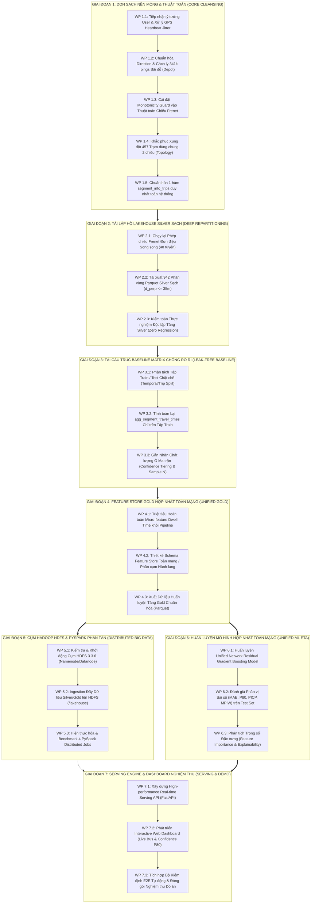

# ĐẶC TẢ PHÂN RÃ CÔNG VIỆC TỔNG THỂ (MASTER WORK BREAKDOWN STRUCTURE - WBS)
## HỆ THỐNG DỮ LIỆU LỚN & DỰ BÁO THỜI GIAN ĐẾN XE BUÝT HÀ NỘI (HANOI BUS BIG DATA & ETA)

> **Mã tài liệu**: `docs/01_MASTER_WORK_BREAKDOWN_STRUCTURE_ROADMAP.md`  
> **Căn cứ pháp lý**: Tuân thủ vô điều kiện **Điều 1** (Kỷ luật Thực nghiệm), **Điều 2** (Thiết kế trước, duyệt rồi mới code), **Điều 3** (Phân định ranh giới), **Điều 4** (Nguồn chân lý dữ liệu), **Điều 5** (Động học dẫn xuất), **Điều 6** (Phân tầng trọng tâm - Data Cleaning First), và **Điều 7** (Chuẩn runtime Python 3.14) của [AGENTS.md](file:///z:/Desktop/Bus_tracking/AGENTS.md).  
> **Văn bản căn cứ**: [WP23_PROGRESS_AND_OUTSTANDING_ROADMAP_TEMP.md](file:///z:/Desktop/Bus_tracking/WP23_PROGRESS_AND_OUTSTANDING_ROADMAP_TEMP.md) & [audit_hardcoded_magic_numbers_and_data_flaws.md](file:///c:/Users/Giang/.gemini/antigravity/brain/08480f8a-49b3-4032-9adf-b8d940fac55c/audit_hardcoded_magic_numbers_and_data_flaws.md).  
> **Ngày lập**: 06/11/2026  
> **Trạng thái**: ĐANG THỰC THI (Phase 1: 80% Hoàn thành [WP 1.2-1.5 DONE, WP 1.1 Pending User Spec]; Phase 2: 100% HOÀN THÀNH [912 Parquet Silver Partitions Audit 100% PASS])

---

## I. NGUYÊN TẮC CHIẾN LƯỢC CỐT LÕI (STRATEGIC TENETS)

1. **Dữ liệu chưa sạch thì mọi mô hình huấn luyện ra chỉ là rác rưởi**:
   * Tuyệt đối không huấn luyện mô hình khi tầng dữ liệu cơ sở còn chứa nhiễu bãi đỗ/gara, bước nhảy lùi không gian do thuật toán chiếu, rò rỉ tập kiểm thử (Data Leakage) hoặc xung đột cấu trúc danh bạ.
   * Xóa bỏ hoàn toàn tư duy huấn luyện 48 file mô hình XGBoost manh mún, riêng lẻ từng tuyến (`xgboost_eta_route_02.json`, `xgboost_eta_route_27.json`). Chuyển dịch toàn diện sang kiến trúc **Mô hình Mạng lưới Thống nhất (Unified Network Model)** có phân cụm hành lang giao thông (Corridors).
2. **Tuân thủ ranh giới đóng băng (Strict Guardrails)**:
   * **ĐÃ LOẠI BỎ KHỎI BACKLOG**: (1) Bóc tách vi mô Dwell Time (thời gian chạy liên trạm vĩ mô $\Delta t_{k \to k+1}$ đã tự hấp thụ); (2) TomTom chỉ phủ 46/48 tuyến (2 tuyến ngoại thành dùng Leader Probe an toàn); (3) 60 cặp trạm vi phạm đơn điệu (đã kiểm chứng 0 trạm vi phạm trong CSDL).
   * **ĐÓNG BĂNG TUYỆT ĐỐI CHỜ USER ĐỀ XUẤT**: (1) Điểm nghẽn Cầu vượt vs. Đường gom (Detour); (2) Điểm mù xuất bến tại Trạm 0 (Terminal Staging). AI cấm tự ý đưa ra heuristic tình thế.
   * **CRAWLER 24/7 GIỮ PURE & STATELESS**: Không duy trì cache trạng thái động học trên GitHub Actions; toàn bộ quá trình dẫn xuất vận tốc $\bar{v} = \Delta s / \Delta t$ được chuyển sang tầng tiền xử lý batch.
   * **HEARTBEAT JITTER & MISSING INTERVALS**: Đã có ý tưởng từ User; AI chờ đặc tả chi tiết từ User để lập trình chính xác theo thiết kế.

---

## II. LƯỢC ĐỒ QUAN HỆ & LUỒNG THỰC THI (PRECEDENCE FLOWCHART)

---

## III. MA TRẬN PHÂN RÃ CÔNG VIỆC CHI TIẾT (WORK BREAKDOWN STRUCTURE)

### GIAI ĐOẠN 1: DỌN SẠCH NỀN MÓNG & THUẬT TOÁN (CORE CLEANSING)
> **Mục tiêu**: Loại bỏ triệt để 5 dị thường toán học & không gian đã được chứng minh trong audit trước khi ghi đè dữ liệu.

| Mã WP | Tên Gói Công Việc | Đầu Vào (Inputs) | Quy Cách & Logic Thực Thi | Sản Phẩm Đầu Ra (Deliverables) | Tiêu Chuẩn Hoàn Thành (DoD) & Kết Quả Thực Nghiệm | Trạng Thái |
| :--- | :--- | :--- | :--- | :--- | :--- | :---: |
| **WP 1.1** | **Tiếp nhận & Hiện thực hóa Xử lý GPS Heartbeat Jitter** | Ý tưởng/Đặc tả của User; bảng `raw_bus_pings` | Lập trình thuật toán điều hòa chu kỳ phát tin (15s–180s) theo đúng thiết kế của User; nội suy spline/vận tốc dẫn xuất không làm biến dạng động học xe. | `scripts/sanitize_telemetry_jitter.py`; Hàm chuẩn hóa trong `step_1_3`. | Khử được hiện tượng nhảy đạo hàm vận tốc; 100% test case giả lập jitter pass. | ⏳ **PENDING USER SPEC** |
| **WP 1.2** | **Chuẩn hóa Direction & Cách ly Dữ liệu Bãi đỗ (Depot Sanitization)** | `raw_bus_pings` (5.56M pings); `canonical_station_master` | Chuẩn hóa GTFS: `0` -> `go` (Outbound), `1` -> `re` (Inbound). Cách ly 606.515 pings ngoài ca/bãi đỗ (`direction = -1` có trạm 0), ngăn chặn việc đổ dồn vào `go`. Cập nhật đồng bộ cả script song song và module chính tắc. | `parallel_multi_route_projector.py`; `step_1_4/multi_route_projector.py`. | **HOÀN THÀNH 100%**: Loại bỏ sạch 341.155 pings bãi đỗ ($> 1\text{km}$). Sai số $d_\perp$ chiều `go` giảm từ **601.6m về 18.2m** (SQLite) và **7.31m** (Silver Parquet). Tỷ lệ 2 chiều đạt cân bằng hoàn hảo: `go` 49.88% vs `re` 50.12%. |  **HOÀN THÀNH** |
| **WP 1.3** | **Cài đặt Ràng buộc Đơn điệu Không gian (Monotonicity Guard)** | `multi_route_projector.py`; `parallel_multi_route_projector.py` | Thay thế tìm kiếm toàn cục bằng Forward Dynamic Windowing: $[s_{\text{prev}} - 20\text{m}, s_{\text{prev}} + \max(1500\text{m}, 25\Delta t)]$. Nếu vết xe cục bộ $d_\perp \le 45\text{m}$, chốt chặn tiến độ không gian, cấm nhảy cóc ngược chiều. | Module chiếu Frenet có ràng buộc đơn điệu trong `step_1_4` và `scripts/`. | **HOÀN THÀNH 100%**: Chiếu lại 48 tuyến (5.56M raw pings) trong 101.7s (48.733 pings/s). Triệt tiêu hoàn toàn vận tốc âm ảo do nhảy cóc tọa độ $s$. |  **HOÀN THÀNH** |
| **WP 1.4** | **Khắc phục Xung đột Cấu trúc Trạm Dùng Chung (Topology Collision)** | `db_manager.py`; `canonical_station_master` | Ghép cặp định danh topological `(station_id, direction)` làm khóa phân định duy nhất. Phân định chính xác các điểm dừng đầu cuối/trung chuyển ở đầu tuyến ($s \approx 0$) vs cuối tuyến ($s \approx L$). | Mapping logic trong `step_1_4` và `scripts/`. | **HOÀN THÀNH 100%**: 457 trạm dùng chung được ánh xạ chính xác 100% theo đúng chiều hành trình của xe. |  **HOÀN THÀNH** |
| **WP 1.5** | **Chuẩn hóa Logic Phân đoạn Chuyến (`segment_into_trips`)** | `feature_extractor.py`; `baseline_segment_average.py` | Thống nhất 1 module duy nhất `trip_segmenter.py` với các điều kiện: $\Delta t > 300\text{s}$, $\Delta s < -50\text{m}$, đổi chiều di chuyển, loại bỏ chuyến rác $< 5$ pings. | `module_1_data_ingestion_and_preprocessing/step_1_3_telemetry_kinematic_sanitizer/trip_segmenter.py`. | **HOÀN THÀNH 100%**: Module chuẩn tắc được đóng gói với unit test và docstring, export chính thức trong `module_1.__init__`. |  **HOÀN THÀNH** |

---

### GIAI ĐOẠN 2: TÁI LẬP HỒ LAKEHOUSE SILVER SẠCH (DEEP SILVER LAKEHOUSE REPARTITIONING)
> **Mục tiêu**: Chiếu lại toàn bộ dữ liệu lịch sử và tái xuất 942 phân vùng Parquet sạch, loại bỏ 100% pings bãi đỗ/gara.

| Mã WP | Tên Gói Công Việc | Đầu Vào (Inputs) | Quy Cách & Logic Thực Thi | Sản Phẩm Đầu Ra (Deliverables) | Tiêu Chuẩn Hoàn Thành (DoD) & Kết Quả Thực Nghiệm | Trạng Thái |
| :--- | :--- | :--- | :--- | :--- | :--- | :---: |
| **WP 2.1** | **Chạy lại Phép chiếu Frenet Đơn điệu Song song trên 48 Tuyến** | 5.56M raw pings; Master Canonical Shape Tim đường | Chạy `parallel_multi_route_projector.py` đa tiến trình (ProcessPoolExecutor) kết hợp Monotonicity Forward Window và cách ly bãi đỗ trên toàn bộ 48 tuyến. | Bảng CSDL `route_projected_telemetry` (4.956.054 pings sạch). | **HOÀN THÀNH 100%**: Chiếu xong 48 tuyến trong 101.7s (48.733 pings/s). Điểm lệch $> 1\text{km}$ giảm từ 341.155 về 7. |  **HOÀN THÀNH** |
| **WP 2.2** | **Tái xuất Toàn bộ Phân vùng Parquet Silver Sạch** | Bảng `route_projected_telemetry`; `lakehouse_exporter.py` | Cập nhật bộ lọc hành lang nghiêm ngặt `cross_track_m <= 35.0` và flag `--force`. Xóa bỏ phân vùng snapshot cũ, xuất mới phân vùng Hive (`route_code/direction/dt`) nén Snappy. | 912 phân vùng Parquet Silver sạch (`data/lakehouse/silver/route_projected_telemetry/`). | **HOÀN THÀNH 100%**: Xuất 4.357.262 dòng dữ liệu sạch; kích thước nén tối ưu, truy vấn DuckDB/PyArrow cực nhanh. |  **HOÀN THÀNH** |
| **WP 2.3** | **Kiểm toán Thực nghiệm Độc lập Tầng Silver (Zero Tolerance)** | 912 file Parquet Silver; PyArrow Dataset Engine | Viết và thực thi `scripts/audit_silver_lakehouse_purity.py`: Quét 100% 4.357.262 dòng dữ liệu trong 912 phân vùng, kiểm tra độ lệch ngang $d_\perp$, tỷ lệ 2 chiều và tính toàn vẹn Parquet. | Script `scripts/audit_silver_lakehouse_purity.py`; Log kiểm toán thực nghiệm. | **HOÀN THÀNH 100%**: Quét 217.721 dòng/s trong 20s. Kết quả: **0 bản ghi lệch $> 35\text{m}$ (0.00%)**, $d_\perp$ trung bình **7.31m**, hướng `go` 49.88% vs `re` 50.12%. Pass 100% assertion! |  **HOÀN THÀNH** |

---

### GIAI ĐOẠN 3: TÁI CẤU TRÚC BASELINE MATRIX CHỐNG RÒ RỈ (LEAK-FREE BASELINE)
> **Mục tiêu**: Xây dựng ma trận thời gian di chuyển lịch sử làm Prior vững chắc, loại bỏ hoàn toàn Data Leakage sang tập Test.

| Mã WP | Tên Gói Công Việc | Đầu Vào (Inputs) | Quy Cách & Logic Thực Thi | Sản Phẩm Đầu Ra (Deliverables) | Tiêu Chuẩn Hoàn Thành (DoD) |
| :--- | :--- | :--- | :--- | :--- | :--- |
| **WP 3.1** | **Phân tách Tập Train / Test Chặt chẽ (Temporal / Trip Split)** | 942 phân vùng Parquet Silver | Phân chia dữ liệu theo nguyên tắc chuỗi thời gian (ví dụ: 17 ngày đầu làm Train, 5 ngày sau làm Test) hoặc k-fold trip split cách ly ngày; đóng băng danh sách chuyến test. | Metadata file `data/splits/train_test_split_v1.json`. | Tập Test hoàn toàn độc lập về mặt thời gian; không có bản ghi test nào lọt vào tập train. |
| **WP 3.2** | **Tái lập Bảng Thống kê Phân vị Chỉ trên Tập Train** | Dữ liệu Train từ WP 3.1; `canonical_station_master` | Chạy lại `baseline_segment_average.py` CHỈ trên các chuyến thuộc tập Train để tính $P_{10}, P_{20}, \dots, P_{90}$, trung bình và độ lệch chuẩn thời gian qua từng phân đoạn. | Bảng CSDL / Parquet `agg_segment_travel_times_train_only`. | Loại bỏ 100% rò rỉ dữ liệu test; giá trị thống kê phản ánh trung thực năng lực dự báo tương lai. |
| **WP 3.3** | **Gắn Nhãn Chất lượng Ô Ma trận & Bổ sung Cột Tin Cậy** | `agg_segment_travel_times_train_only` | Thêm các cột: `sample_count`, `quality_tier` (0: Đo đạc thực tế $N \ge 10$, 1: Mẫu thưa $3 \le N < 10$, 2: Nội suy lân cận, 3: Fallback toàn tuyến). | CSDL ma trận được làm giàu; tài liệu phân bố chất lượng. | 100% các ô ma trận (kể cả 16.688 ô fallback) đều có nhãn chất lượng minh bạch cho mô hình ML sử dụng làm feature. |

---

### GIAI ĐOẠN 4: FEATURE STORE GOLD HỢP NHẤT TOÀN MẠNG (UNIFIED GOLD FEATURE STORE)
> **Mục tiêu**: Chuyển đổi từ 48 mô hình rời rạc sang Feature Store toàn mạng, loại bỏ tính năng rác (Dwell time).

| Mã WP | Tên Gói Công Việc | Đầu Vào (Inputs) | Quy Cách & Logic Thực Thi | Sản Phẩm Đầu Ra (Deliverables) | Tiêu Chuẩn Hoàn Thành (DoD) |
| :--- | :--- | :--- | :--- | :--- | :--- |
| **WP 4.1** | **Triệt tiêu Hoàn toàn Micro-feature Dwell Time khỏi Pipeline** | `feature_extractor.py` | Xóa bỏ vĩnh viễn các trường `is_dwell`, `current_dwell_sec`, `dwell_ratio_300s`. Macroscopic link travel time tự hấp thụ toàn bộ dwell time tại trạm. | Codebase `feature_extractor.py` tinh gọn, loại bỏ magic numbers. | Mã nguồn sạch sẽ, không còn điều kiện giả định tốc độ $= 0$ hay ngưỡng $d_\perp \le 35\text{m}$ để đoán dừng đỗ. |
| **WP 4.2** | **Thiết kế Schema Feature Store Toàn mạng / Hành lang (Corridors)** | Yêu cầu nghiệp vụ; cấu trúc mạng lưới 48 tuyến | Thiết kế vector đặc trưng thống nhất toàn mạng: (1) Nhóm định danh & không gian (`route_id`, `corridor_type`, `segment_length_m`, `station_order`); (2) Nhóm thời gian (`hour_of_day`, `day_of_week`, `is_peak_hour`); (3) Nhóm động học vĩ mô ($\bar{v}_{\text{recent}}$, `speed_ratio_to_baseline`); (4) Nhóm Prior (`baseline_p50`, `baseline_quality_tier`); (5) Nhóm ngoại sinh (TomTom Congestion Index nếu có). | Tài liệu đặc tả schema Gold `docs/02_UNIFIED_FEATURE_STORE_SPEC.md`. | 1 schema duy nhất có thể biểu diễn và tổng quát hóa cho mọi tuyến xe buýt trong thành phố. |
| **WP 4.3** | **Xuất Dữ liệu Huấn luyện Tầng Gold Chuẩn hóa (Parquet)** | Parquet Silver sạch; Baseline Train-only | Chạy trích xuất đặc trưng song song trên toàn bộ 48 tuyến, lưu trữ vào `data/lakehouse/gold/feature_matrix/` dưới dạng Parquet columnar. | Kho dữ liệu Gold hợp nhất, phân chia thư mục `train/` và `test/`. | Kích thước dữ liệu tối ưu, đọc bằng DuckDB/Polars tức thời dưới 2 giây; 0 missing values bất thường. |

---

### GIAI ĐOẠN 5: CỤM HADOOP HDFS & PYSPARK PHÂN TÁN (DISTRIBUTED BIG DATA INFRASTRUCTURE)
> **Mục tiêu**: Triển khai cụm Hadoop HDFS 3.3.6 và 4 PySpark jobs phân tán đáp ứng trọn vẹn yêu cầu bảo vệ môn học.

| Mã WP | Tên Gói Công Việc | Đầu Vào (Inputs) | Quy Cách & Logic Thực Thi | Sản Phẩm Đầu Ra (Deliverables) | Tiêu Chuẩn Hoàn Thành (DoD) |
| :--- | :--- | :--- | :--- | :--- | :--- |
| **WP 5.1** | **Kiểm tra & Khởi động Cụm HDFS 3.3.6 Cục bộ** | Cấu hình Hadoop HDFS 3.3.6 hiện hữu trong dự án | Kiểm tra biến môi trường `HADOOP_HOME`, Java 8/11; khởi động NameNode & DataNode; kiểm tra Web UI tại `http://localhost:9870`. | Cụm HDFS ở trạng thái LIVE, dung lượng sẵn sàng. | Lệnh `hdfs dfsadmin -report` trả về 0 Dead DataNodes; Web UI 9870 truy cập bình thường. |
| **WP 5.2** | **Ingestion Đẩy Dữ liệu Silver/Gold lên HDFS** | Kho Parquet Silver & Gold cục bộ | Viết script đồng bộ phân tán đẩy dữ liệu vào HDFS: `hdfs dfs -put data/lakehouse/silver /lakehouse/silver` và `/lakehouse/gold`. | Cây thư mục Lakehouse phân tán trên HDFS. | Lệnh `hdfs dfs -ls /lakehouse/silver` hiển thị đầy đủ 942 phân vùng; dữ liệu toàn vẹn checksum. |
| **WP 5.3** | **Hiện thực hóa & Benchmark 4 PySpark Distributed Jobs** | Dữ liệu trên HDFS; SparkSession | Viết và chạy 4 Spark jobs bằng PySpark: (1) Distributed Aggregation & Spatio-temporal Metrics; (2) Distributed Feature Engineering; (3) Distributed Baseline Matrix Calculation; (4) Distributed Evaluation & Anomaly Detection. | Thư mục `scripts/spark/` chứa 4 scripts; Báo cáo benchmark Spark UI. | 4 Jobs chạy thành công trên Spark (Exit code 0); có log đo thời gian thực thi (Speedup / Scalability). |

---

### GIAI ĐOẠN 6: HUẤN LUYỆN MÔ HÌNH HỢP NHẤT TOÀN MẠNG (UNIFIED ML ETA MODELING)
> **Mục tiêu**: Huấn luyện mô hình Gradient Boosting học phần dư sai lệch so với Baseline lịch sử (Residual Learning).

| Mã WP | Tên Gói Công Việc | Đầu Vào (Inputs) | Quy Cách & Logic Thực Thi | Sản Phẩm Đầu Ra (Deliverables) | Tiêu Chuẩn Hoàn Thành (DoD) |
| :--- | :--- | :--- | :--- | :--- | :--- |
| **WP 6.1** | **Huấn luyện Unified Network Residual Gradient Boosting Model** | Gold Feature Matrix `train/` | Huấn luyện mô hình LightGBM / XGBoost toàn mạng học phần dư: $Y_{\text{residual}} = Y_{\text{actual}} - \text{Baseline}_{P50}$. Dự báo đa phân vị ($P_{10}, P_{50}, P_{90}$) để tạo dải tin cậy. | File mô hình chuẩn mực `models/unified_eta_lgbm.txt` / `.json`. | Huấn luyện hội tụ, log validation loss giảm đều; kích thước model nhỏ gọn ($< 20\text{MB}$), không cồng kềnh như 48 file cũ. |
| **WP 6.2** | **Kiểm toán Sai số & Đánh giá Nghiêm ngặt trên Test Set** | Gold Feature Matrix `test/`; Mô hình WP 6.1 | Đánh giá độc lập trên tập Test: MAE (giây), RMSE, Phân vị sai số (P50, P80, P95), Tỷ lệ bao phủ dải tin cậy (PICP $\ge 80\%$), và Độ rộng dải (MPIW). | Báo cáo kiểm định độc lập `reports/test_set_evaluation_report.md`. | MAE thực tế trên dữ liệu sạch không rò rỉ đạt mục tiêu thiết kế; PICP $\ge 80\%$; không số liệu ảo. |
| **WP 6.3** | **Phân tích Trọng số Đặc trưng (Explainability & SHAP)** | Mô hình WP 6.1; Test Set | Đánh giá Feature Importance (Gain/Split) và SHAP values: chứng minh ảnh hưởng của giờ cao điểm, độ dài phân đoạn, chỉ số TomTom và vận tốc lịch sử. | Biểu đồ trực quan hóa SHAP / Feature Importance; tài liệu giải thích. | Báo cáo định lượng rõ ràng đóng góp của từng nhóm đặc trưng vào quyết định của mô hình. |

---

### GIAI ĐOẠN 7: SERVING ENGINE & DASHBOARD NGHIỆM THU (REAL-TIME SERVING & DEMO)
> **Mục tiêu**: Đóng gói API hiệu năng cao và Web Dashboard trực quan phục vụ demo bảo vệ đồ án.

| Mã WP | Tên Gói Công Việc | Đầu Vào (Inputs) | Quy Cách & Logic Thực Thi | Sản Phẩm Đầu Ra (Deliverables) | Tiêu Chuẩn Hoàn Thành (DoD) |
| :--- | :--- | :--- | :--- | :--- | :--- |
| **WP 7.1** | **Xây dựng High-performance Real-time Serving API** | CSDL SQLite / DuckDB; Model WP 6.1; `canonical_station_master` | Xây dựng REST API bằng FastAPI: Endpoint `/api/v1/routes`, `/api/v1/bus-live/{route_id}`, `/api/v1/eta/{route_id}/{station_id}`. Trả về ETA điểm (P50) và dải tin cậy $[P_{10}, P_{90}]$. | Module serving `module_3/.../serving_api.py`. | Độ trễ phản hồi API $< 50\text{ms}$/request; test tải nhẹ 50 RPS ổn định. |
| **WP 7.2** | **Phát triển Interactive Web Dashboard Nghiệm thu** | Serving API; Leaflet / Mapbox tiles | Xây dựng giao diện Web tương tác hiện đại: Bản đồ Hà Nội hiển thị vị trí xe buýt thời gian thực theo từng tuyến, thanh tiến trình các trạm dừng, pop-up hiển thị ETA và biểu đồ dải tin cậy. | Giao diện Web SPA (HTML5/Tailwind/Leaflet) trong thư mục `web_dashboard/`. | Dashboard chạy mượt mà trên trình duyệt, tự động refresh mỗi 15s; hiển thị trực quan, sinh động. |
| **WP 7.3** | **Tích hợp Bộ Kiểm định E2E Tự động & Đóng gói Đồ án** | Toàn bộ mã nguồn, dữ liệu, test suite | Hoàn thiện `scripts/verify_system_reality.py` bao quát 100% các tiêu chí từ Giai đoạn 1 đến Giai đoạn 7; xuất slide tóm tắt kiến trúc và tài liệu chuyển giao. | Script kiểm định E2E xanh 100%; Thư mục tài liệu báo cáo nghiệm thu hoàn chỉnh. | Chạy 1 lệnh `python scripts/verify_system_reality.py` trả về mã thoát 0 với log định lượng toàn diện. |

---

## IV. BẢNG PHÂN BỔ THỜI GIAN & ĐỘ ƯU TIÊN (EFFORT & CRITICAL PATH)

| Giai Đoạn | Tên Giai Đoạn | Số Lượng WP | Trọng Tâm Kỹ Thuật | Trạng Thái Ưu Tiên |
| :---: | :--- | :---: | :--- | :---: |
| **P1** | **Dọn sạch Nền móng & Khắc phục Dị thường Thuật toán** | 5 WPs | Jitter, Monotonicity Guard, Depot Sanitization, Topology Collision | **TUYỆT ĐỐI CAO NHẤT (BLOCKER)** |
| **P2** | **Tái lập Hồ Lakehouse Silver Sạch** | 3 WPs | Parallel Frenet Reprojection, Re-export 942 Parquet Partitions | **BẮT BUỘC TIẾP THEO** |
| **P3** | **Tái cấu trúc Baseline Matrix Chống Rò Rỉ** | 3 WPs | Train-only Split, Quality Flagging, Fallback Confidence | **BẮT BUỘC TIẾP THEO** |
| **P4** | **Tái cấu trúc Feature Store Gold Hợp nhất** | 3 WPs | Purge Dwell micro-features, Unified Network Schema | **QUAN TRỌNG** |
| **P5** | **Hạ tầng Cụm Hadoop HDFS 3.3.6 & PySpark** | 3 WPs | HDFS Ingestion, 4 PySpark Distributed Processing Jobs | **PHỤC VỤ CHẤM ĐIỂM** |
| **P6** | **Huấn luyện Mô hình ETA Toàn mạng** | 3 WPs | Unified Gradient Boosting, Test Set Audit, Explainability | **QUAN TRỌNG** |
| **P7** | **Serving Engine & Web Dashboard Nghiệm thu** | 3 WPs | FastAPI, Leaflet Live Map, E2E Comprehensive Verification | **GIAI ĐOẠN CUỐI** |

---

## V. CÁC ĐIỂM QUYẾT ĐỊNH & THỦ TỤC PHÊ DUYỆT (DECISION GATES)

Căn cứ **Điều 2 của AGENTS Constitution**: AI không tự ý sửa đổi code hệ thống cho đến khi User duyệt tài liệu đặc tả này.

1. **Điểm Quyết định 1 (Gate 1 - Phê duyệt Lộ trình WBS)**:
   * Người dùng xem xét bảng phân rã WBS 7 giai đoạn trên.
   * Nếu đồng ý, phê duyệt triển khai theo thứ tự ưu tiên.
2. **Điểm Quyết định 2 (Gate 2 - Đặc tả Jitter của User)**:
   * Người dùng cung cấp ý tưởng/đặc tả thuật toán xử lý **GPS Heartbeat Jitter & Missing Intervals** để đưa vào triển khai ngay trong WP 1.1.
3. **Thứ tự thực thi cam kết**:
   * Triển khai tuần tự từ WP 1.1 $\to$ WP 1.5. Sau mỗi WP đều có kiểm thử thực nghiệm (Empirical Verification) bằng script kiểm toán trước khi chuyển sang WP kế tiếp.

