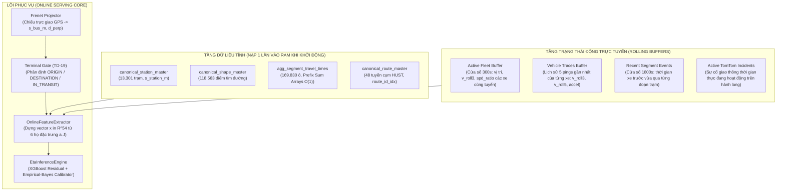

# ĐẶC TẢ KIẾN TRÚC BỘ TRÍCH XUẤT ĐẶC TRƯNG TRỰC TUYẾN & SERVING PIPELINE (BƯỚC 3.5)
> **Status: superseded design history (2026-11-10).** The historical `online_feature_extractor.py` and `eta_serving_service.py` names map to `online_features.py` and `serving_service.py`; implementation authority is [SPEC-16](specs/16_REFACTOR_SPEC_STEP_3_4_SERVING_AND_3_5_WEB_DEMO.md). Their presence does not mean the public app has wired the split facade.
> **Mã tài liệu**: `docs/05_ONLINE_FEATURE_EXTRACTOR_AND_SERVING_SPEC.md`
> **Căn cứ pháp lý**: Tuân thủ vô điều kiện **Điều 1** (Kỷ luật Thực nghiệm), **Điều 2** (Thiết kế trước, duyệt rồi mới code), **Điều 3** (Ranh giới Production), **Điều 4** (Nguồn chân lý dữ liệu), **Điều 5** (Động học dẫn xuất), và **Điều 8** (Minh bạch Nợ kỹ thuật) của [AGENTS.md](../AGENTS.md).
> **Nhiệm vụ giải quyết**: `TD-26` (Triệt tiêu độ lệch Train/Serve Skew, đóng gói Online Feature Extractor từ telemetry trực tiếp và tích hợp Terminal Gate `TD-19`).

---

## 1. MỤC TIÊU VÀ NGUYÊN TẮC THIẾT KẾ (DESIGN PRINCIPLES)

1. **Triệt tiêu 100% Độ lệch Train/Serve Skew (Zero Skew Guarantee)**:
   - Bộ trích xuất trực tuyến (`OnlineFeatureExtractor`) kế thừa và sao chép chính xác 100% các công thức toán học, ngưỡng cắt (`clip`), mảng cộng dồn $O(1)$ (`Prefix Sum`) và cấu trúc họ đặc trưng từ [`feature_store_builder.py`](../module_3_bus_eta_prediction/step_3_2_feature_store_extractor/feature_store_builder.py).
   - Đảm bảo đầu ra là vector 54 đặc trưng chuẩn xác $\mathbf{x} \in \mathbb{R}^{54}$ khớp hoàn toàn với mô hình sản xuất `5_XGB_Global_Calibrated` (`_r3_big`).

2. **Tối ưu hóa Thời gian Thực Cực hạn (Ultra-low Latency & Memory Efficiency)**:
   - **Nạp tĩnh 1 lần (In-memory Preloading)**: Toàn bộ danh bạ trạm dừng (`canonical_station_master`), tim đường (`canonical_shape_master`) và ma trận thời gian di chuyển lịch sử (`agg_segment_travel_times`) được nạp sẵn vào RAM dưới dạng mảng NumPy tối ưu $O(1)$.
   - **Độ trễ mục tiêu**: Trích xuất đặc trưng + suy luận mô hình hoàn tất trong **$< 10\text{ ms}$** cho mỗi yêu cầu đơn lẻ, đạt thông lượng **$> 10.000\text{ bản ghi/giây}$** khi xử lý lô toàn tuyến.

3. **Tích hợp Chặt chẽ Cổng Bến Đầu Cuối (Terminal Gate — `TD-19`)**:
   - Tách bạch 3 trạng thái của xe dựa trên vị trí tiến độ $s_{\text{bus}}$:
     * `AT_ORIGIN_TERMINAL`: $s_{\text{bus}} < s_{\text{station}}[1]$ (xe đang trong bãi xuất phát hoặc chờ xuất bến) $\to$ Trả về trạng thái chờ xuất bến, không xuất ETA động học giả tạo.
     * `AT_DESTINATION_TERMINAL`: $s_{\text{bus}} \ge s_{\text{station}}[N-1]$ (xe đã vào cổng bãi đỗ cuối tuyến) $\to$ Kết thúc hành trình.
     * `ACTIVE_IN_TRANSIT`: $s_{\text{station}}[1] \le s_{\text{bus}} < s_{\text{station}}[N-1]$ $\to$ Thực thi suy luận ETA động học cho tất cả các trạm phía trước.

4. **Tương thích Kiến trúc Lai 2 API (Hybrid API Parity — `TD-27`)**:
   - Nhận diện đúng quy ước tọa độ:
     * Nguồn từ `route_bus_gps`: `Lat` là Vĩ độ ($20.x$), `Lng` là Kinh độ ($105.x$).
     * Nguồn từ `vehicle_hn/get`: `Lat` là Kinh độ ($105.x$), `Lng` là Vĩ độ ($20.x$).
   - Tự động lọc hành lang: Kiểm tra khoảng cách trực giao $d_\perp \le 35,0\text{m}$. Nếu $d_\perp > 35,0\text{m}$, cảnh báo trạng thái xe đi đường tránh (`DETOUR_OFF_CORRIDOR`).

---

## 2. KIẾN TRÚC DỮ LIỆU & BỘ NHỚ TRỰC TUYẾN (IN-MEMORY STATE SPECIFICATION)



### 2.1. Cấu trúc Prefix Sum $O(1)$ cho Ma trận Baseline (Họ d)
Mỗi tuyến `route_code` và chiều `dir_str` trong mỗi cặp `(day_type, hr_slot)` duy trì 1 từ điển mảng NumPy kích thước $N_{\text{seg}} = M_{\text{stations}} - 1$:
- `p50`, `mean`, `p10`, `p90`, `var`, `len`
- Mảng cộng dồn bắt đầu bằng `0.0`: `pref_p50`, `pref_mean`, `pref_p10`, `pref_p90`, `pref_var`, `pref_t0`

Khi xe đang ở tọa độ $s_{\text{bus}}$ thuộc phân đoạn $k_{\text{curr}}$ và trạm đích là $t_k$:
$$\text{dist\_to\_next} = s_{\text{station}}[k_{\text{curr}} + 1] - s_{\text{bus}}$$
$$\alpha_{\text{curr}} = \text{clip}\left(\frac{\text{dist\_to\_next}}{L_{\text{seg}}[k_{\text{curr}}]},\; 0.0,\; 1.0\right)$$
$$\text{Baseline}_{\text{P50}} = \alpha_{\text{curr}} \times p_{50}[k_{\text{curr}}] + \left(\text{pref\_p50}[t_k] - \text{pref\_p50}[k_{\text{curr}} + 1]\right)$$

Công thức trên được thực thi trong $O(1)$ phép tính, triệt tiêu hoàn toàn vòng lặp Python.

### 2.2. Trích xuất Động học Xe (Họ a) & Lịch sử Trượt
Với mỗi xe `vehicle_id`, duy trì hàng đợi 5 bản tin gần nhất:
$$v_{\text{roll3}} = \text{clip}\left(\frac{s_t - s_{t-3}}{\Delta t_{t-3}} \times 3.6,\; 0.0,\; 80.0\right)$$
$$v_{\text{roll5}} = \text{clip}\left(\frac{s_t - s_{t-5}}{\Delta t_{t-5}} \times 3.6,\; 0.0,\; 80.0\right)$$
$$a = \frac{v_{\text{roll3}} - v_{\text{roll5}}}{\Delta t_{\min}}$$

---

## 3. ĐẶC TẢ GIAO DIỆN LẬP TRÌNH (API SPECIFICATION)

### 3.1. Class `OnlineFeatureExtractor`
Vị trí: `module_3_bus_eta_prediction/step_3_4_eta_serving_and_evaluation/online_feature_extractor.py`

```python
class OnlineFeatureExtractor:
    def __init__(self, db_path: str = DEFAULT_DB_PATH) -> None:
        """Nạp toàn bộ bảng Master Ground Truth và ma trận Baseline vào RAM."""
        ...

    def project_coordinate(
        self, route_code: str, direction: str, lat: float, lon: float
    ) -> Tuple[float, float, bool]:
        """Chiếu (lat, lon) lên tim đường tuyến, trả về (s_bus_m, cross_track_m, is_on_corridor)."""
        ...

    def get_terminal_gate_status(
        self, route_code: str, direction: str, s_bus_m: float
    ) -> str:
        """Xác định trạng thái: 'AT_ORIGIN_TERMINAL' | 'AT_DESTINATION_TERMINAL' | 'ACTIVE_IN_TRANSIT'."""
        ...

    def extract_features_for_ego(
        self,
        route_code: str,
        direction: str,
        vehicle_id: str,
        device_epoch: float,
        s_bus_m: float,
        speed_kmh: float,
        target_station_order: Optional[int] = None,
    ) -> pd.DataFrame:
        """Trích xuất bảng 54 đặc trưng cho 1 trạm đích cụ thể hoặc toàn bộ các trạm phía trước."""
        ...
```

### 3.2. Class `EtaServingService`
Vị trí: `module_3_bus_eta_prediction/step_3_4_eta_serving_and_evaluation/eta_serving_service.py`

```python
class EtaServingService:
    def __init__(self, tag: str = "_r3_big", db_path: str = DEFAULT_DB_PATH) -> None:
        """Khởi tạo đồng thời OnlineFeatureExtractor và EtaInferenceEngine."""
        self.extractor = OnlineFeatureExtractor(db_path=db_path)
        self.engine = EtaInferenceEngine(tag=tag)

    def predict_route_live_etas(
        self, route_code: str, direction: str = "go", target_station_id: Optional[int] = None
    ) -> List[Dict[str, Any]]:
        """
        Truy vấn trực tiếp BusMap API theo tuyến, trích xuất đặc trưng và trả về
        danh sách kết quả dự báo ETA thời gian thực cho từng xe đang lăn bánh.
        """
        ...
```

---

## 4. TIÊU CHUẨN KIỂM CHỨNG & NGHIỆM THU (DEFINITION OF DONE)

1. **Kiểm tra Sai lệch Train/Serve (Zero Skew Assertion)**:
   - Chạy script kiểm chứng [`scripts/verify_online_serving_pipeline.py`](../scripts/verify_online_serving_pipeline.py) đối chiếu giữa các dòng của Feature Store Gold và các dòng được tái tạo bởi `OnlineFeatureExtractor`.
   - Sai số tương đối giữa các đặc trưng cốt lõi (`baseline_eta_p50_sec`, `baseline_skew_sec`, `remaining_distance_m`, `physics_probe_corrected_eta_sec`) bắt buộc phải **$< 0.01$**.
2. **Kiểm chứng Độ trễ (Serving Latency SLA)**:
   - Độ trễ trích xuất đặc trưng + suy luận 1 xe trung vị **$< 10\text{ ms}$**.
   - Độ trễ tính toán toàn bộ xe trên tuyến (lô ~15 xe × ~20 trạm = ~300 cặp) **$< 50\text{ ms}$**.
3. **Kiểm chứng Tích hợp Trực tiếp (Live E2E Verification)**:
   - Kết nối trực tiếp API `route_bus_gps` cho Tuyến `02` hoặc Tuyến `32`, in ra bảng kết quả dự báo ETA trực tiếp cho các xe đang lăn bánh trên đường Hà Nội.
