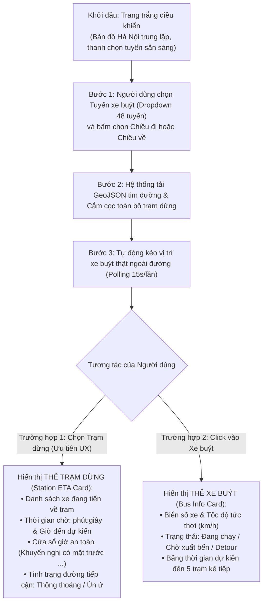

# ĐẶC TẢ KIẾN TRÚC & KẾ HOẠCH TRIỂN KHAI WEB APP DEMO (BƯỚC 3.5 / GIAI ĐOẠN 7)
> **Mã tài liệu**: `docs/08_WEB_APP_DEMO_SPECIFICATION_AND_PLAN.md`  
> **Căn cứ pháp lý**: Tuân thủ vô điều kiện **Điều 1** (Kỷ luật Thực nghiệm), **Điều 2** (Thiết kế trước, duyệt rồi mới code), **Điều 3** (Ranh giới Production), **Điều 4** (Nguồn chân lý dữ liệu), **Điều 6** (Phân tầng trọng tâm - Vertical Slice), và **Điều 8** (Minh bạch Nợ kỹ thuật) của [AGENTS.md](file:///z:/Desktop/Bus_tracking/AGENTS.md).  
> **Cơ sở thiết kế**: Tổng hợp sau phỏng vấn chuyên sâu `/grill-me` và căn cứ trên [`docs/06_ETA_INFERENCE_ENGINE_SPEC.md`](file:///z:/Desktop/Bus_tracking/docs/06_ETA_INFERENCE_ENGINE_SPEC.md), [`docs/07_ONLINE_FEATURE_EXTRACTOR_AND_SERVING_SPEC.md`](file:///z:/Desktop/Bus_tracking/docs/07_ONLINE_FEATURE_EXTRACTOR_AND_SERVING_SPEC.md).

---

## 1. ĐỊNH VỊ CỐT LÕI & USER STORIES RÚT GỌN (CORE PROBLEM & USER STORIES)

### 1.1. Tuyên ngôn Định vị Sản phẩm
Web App Demo là ứng dụng **Dự Báo Thời Gian Đến Thực Tế Của Xe Buýt (Live ETA Prediction)** tập trung phục vụ trải nghiệm người dùng thực tiễn:
- **Trọng tâm là ETA**: Toàn bộ luồng nghiệp vụ xoay quanh bài toán dự báo thời gian xe đến trạm chính xác, trực quan, đáng tin cậy.
- **Dữ liệu thực tế 24/7**: Sử dụng trực tiếp luồng viễn trắc xe buýt đang lăn bánh trên đường phố Hà Nội (không cần cơ chế replay lịch sử giả lập).
- **Tránh phô diễn kỹ thuật thừa**: Không đưa các chỉ số nội bộ của mô hình ML (như delta sai số phần dư so với Baseline) lên giao diện người dùng. Thay vào đó, chuyển hóa toàn bộ sức mạnh AI thành **thông tin có ích cho hành khách**: cửa sổ giờ xe đến an toàn và trạng thái ùn tắc hành lang.

---

### 1.2. Insight Kỹ thuật Giao thông: Tính Bất Đối Xứng Của Rủi Ro Đến Trạm (Asymmetric Arrival Risk)
Trong giao thông công cộng, sai số dự báo có hậu quả bất đối xứng nghiêm trọng:
$$\text{Cost}(\text{Dự báo muộn hơn thực tế}) \gg \text{Cost}(\text{Dự báo sớm hơn thực tế})$$
- **Nếu app dự báo trễ hơn thực tế (Xe đến sớm)**: Hành khách thong thả ra trạm $\to$ Xe đã đi qua mất $\to$ **Lỡ chuyến (Missed Bus)**, phải chờ chuyến sau 15–30 phút $\to$ Trải nghiệm cực kỳ tồi tệ!
- **Nếu app dự báo sớm hơn thực tế một khoảng an toàn (Conservative Arrival Window)**: Hành khách ra trạm sớm $\to$ Chờ tại trạm thêm 2–3 phút nhưng **chắc chắn đón được xe**.
- **Giải pháp trên Web Demo**: 
  * Hiển thị **Thời gian dự kiến trung bình (ETA Expected)**.
  * Hiển thị **Cửa sổ thời gian an toàn (Safe Arrival Window $[P_{10}, P_{90}]$)** và **Mốc giờ khuyến nghị có mặt tại trạm** để hành khách không bao giờ bị lỡ chuyến.

---

### 1.3. User Stories Rút gọn

```
+---------------------------------------------------------------------------------------------------+
|                                   USER STORIES BẢN RÚT GỌN                                        |
+---------------------------------------------------------------------------------------------------+
| [US-01] Là một HÀNH KHÁCH CHỜ XE (Station-Centric - Trọng tâm P0):                                 |
|         Tôi muốn chọn tuyến xe và trạm dừng mình đang đứng, để biết chính xác còn bao nhiêu phút  |
|         nữa xe sẽ tới trạm, khoảng giờ nào xe có thể cập bến, và nên có mặt trước mấy giờ để      |
|         không bị lỡ chuyến.                                                                        |
|                                                                                                   |
| [US-02] Là một HÀNH KHÁCH QUAN TÂM TÌNH HÌNH ĐƯỜNG (Traffic Insight - P1):                         |
|         Tôi muốn biết đoạn đường xe sắp đi qua đang thông thoáng, ùn ứ chậm hay kẹt xe để chủ    |
|         động kế hoạch di chuyển (dựa trên tốc độ xe trước và sự cố TomTom).                        |
|                                                                                                   |
| [US-03] Là một NGƯỜI QUAN SÁT LỘ TRÌNH (Vehicle Interaction - P1):                                |
|         Tôi muốn click vào bất kỳ xe buýt nào đang di chuyển trên bản đồ để biết biển số, vận tốc, |
|         và lộ trình dự kiến xe sẽ đến các trạm tiếp theo lúc mấy giờ.                             |
|                                                                                                   |
| [US-04] Là một GIÁM SÁT VIÊN HÀNH LANG (Corridor Adherence - P1):                                 |
|         Tôi muốn hệ thống tự động gắn nhãn trực quan các xe đi đường tránh lệch hành lang         |
|         (Detour > 35m) hoặc xe đang chờ tại bến xuất phát (Terminal Staging) để hiểu rõ tình trạng.|
+---------------------------------------------------------------------------------------------------+
```

---

## 2. LUỒNG TRẢI NGHIỆM NGƯỜI DÙNG (USER INTERACTION FLOW)



---

## 3. THIẾT KẾ GIAO DIỆN & CÁC THÀNH PHẦN HIỂN THỊ (UI/UX SPECIFICATION)

### 3.1. Trạng Thái Khởi Đầu (Initial State)
- Khi truy cập `http://127.0.0.1:8000`: Giao diện ở **trạng thái khởi đầu sạch sẽ (Blank Canvas State)**.
- Bản đồ Leaflet mở ở góc nhìn bao quát Thủ đô Hà Nội.
- Thanh Sidebar bên trái hiển thị tiêu đề hệ thống và hộp chọn tuyến (`<select id="routeSelect">`), kèm 2 nút bấm chuyển chiều (`[Chiều đi (A -> B)]` và `[Chiều về (B -> A)]`).
- Chưa có tim đường hay xe nào hiển thị cho đến khi người dùng chọn tuyến.

### 3.2. Thẻ Thông Tin Dự Báo ETA Tại Trạm (Station ETA Card — Trọng tâm P0)
Khi người dùng click vào một trạm dừng trên bản đồ hoặc chọn trạm từ danh sách, giao diện hiển thị bảng thông tin trực quan:

```
+-------------------------------------------------------------------+
|  TRẠM: 521A Nguyễn Trãi (Chiều về Bến xe Yên Nghĩa)               |
+-------------------------------------------------------------------+
|  🚌 XE GẦN NHẤT: 29B-205.51 (Cách 1.4 km - Đang chạy 24 km/h)      |
|                                                                   |
|  ⏱️ THỜI GIAN CHỜ DỰ KIẾN:  5 phút 30 giây                        |
|  🕒 GIỜ ĐẾN DỰ KIẾN:        21:52                                 |
|                                                                   |
|  🛡️ CỬA SỔ AN TOÀN:         21:49 – 21:54                         |
|     👉 Khuyến nghị: Có mặt tại trạm trước 21:49 để không lỡ xe!    |
|                                                                   |
|  🚦 TÌNH TRẠNG HÀNH LANG:   Thông thoáng (Vận tốc trung bình 25km/h)|
+-------------------------------------------------------------------+
|  🚌 XE TIẾP THEO: 29B-208.41 (Cách 4.2 km)                        |
|  ⏱️ Thời gian chờ: 14 phút (Dự kiến: 22:01)                       |
+-------------------------------------------------------------------+
```

---

## 4. KIẾN TRÚC CONTRACT-FIRST & PHÂN RÃ MODULE

Ứng dụng tuân thủ nghiêm ngặt **Kiến trúc Hợp đồng Đi trước (Contract-First Architecture)**:
1. **Hợp đồng API (API Contract)**: Định nghĩa đầu tiên, độc lập và bất biến tại [`contract.py`](file:///z:/Desktop/Bus_tracking/module_3_bus_eta_prediction/step_3_5_web_demo/contract.py) bằng Pydantic v2 Models & OpenAPI 3.1 Schemas.
2. **Đẩy về Backend (BE Driven by Contract)**: Router FastAPI kế thừa trực tiếp các schemas từ `contract.py` làm `response_model` và input validator, tự động xuất `/openapi.json` và tài liệu `/docs`.
3. **Đẩy về Frontend (FE Driven by Contract)**: Client JavaScript đọc các trường chuẩn hóa 1:1 từ Contract, loại bỏ hoàn toàn suy đoán kiểu dữ liệu và sai lệch thuộc tính.

```
module_3_bus_eta_prediction/step_3_5_web_demo/
├── __init__.py               # Package descriptor
├── contract.py               # [TRỌNG TÂM CONTRACT-FIRST] Pydantic v2 Schemas & OpenAPI Specification
├── app.py                    # FastAPI entrypoint, lifespan startup (nạp trước EtaServingService), CORS, static mount
├── api_routes.py             # Router phục vụ 4 endpoints RESTful JSON tuân thủ contract.py
├── cache_manager.py          # In-Memory TTL Cache thread-safe (15s) chống nghẽn Gateway BusMap
└── static/                   # Frontend SPA (Single Page Application thuần túy)
    ├── index.html            # Khung HTML5, Tailwind CSS CDN, Leaflet.js CDN, Sidebar điều khiển
    ├── css/
    │   └── style.css         # Styling icon xe buýt, hiệu ứng pulse khi xe di chuyển, popup layout
    └── js/
        ├── app.js            # Controller chính: Quản lý state chọn tuyến, polling 15s, render ETA Card
        └── map_manager.js    # Quản lý Leaflet Map: Vẽ GeoJSON LineString, marker trạm dừng, marker xe xoay góc
```

---

## 5. ĐẶC TẢ CHI TIẾT HỆ THỐNG RESTFUL API

### 5.1. `GET /api/v1/routes`
- **Mục đích**: Lấy danh mục 48 tuyến cụm HUST phục vụ dropdown selector.
- **Payload phản hồi**:
```json
[
  {
    "route_code": "02",
    "route_id": 2,
    "route_name": "Bác Cổ - BX Yên Nghĩa",
    "has_go_direction": true,
    "has_re_direction": true
  }
]
```

### 5.2. `GET /api/v1/routes/{route_code}/geometry?direction={go|re}`
- **Mục đích**: Cung cấp LineString tim đường và danh sách trạm dừng có tọa độ.
- **Payload phản hồi**:
```json
{
  "route_code": "02",
  "direction": "go",
  "route_length_m": 15071.4,
  "shape_geojson": {
    "type": "LineString",
    "coordinates": [[105.747619, 20.949979], [105.750532, 20.951130], ...]
  },
  "stations": [
    {
      "station_order": 0,
      "station_id": 1667,
      "station_name": "(B) BX Yên Nghĩa",
      "lat": 20.949979,
      "lon": 105.747619,
      "cum_distance_m": 0.0
    }
  ]
}
```

### 5.3. `GET /api/v1/routes/{route_code}/live-eta?direction={go|re}&target_station_order={optional}`
- **Mục đích**: Trả về snapshot xe buýt thời gian thực kèm dự báo ETA an toàn cho từng trạm.
- **Payload phản hồi**:
```json
{
  "route_code": "02",
  "direction": "go",
  "timestamp": "2026-11-07T21:45:00+07:00",
  "cached": true,
  "total_buses": 7,
  "active_in_transit_count": 6,
  "traffic_condition": "Thông thoáng",
  "buses": [
    {
      "vehicle_id": "231981",
      "plate": "29B-205.92",
      "status": "ACTIVE_IN_TRANSIT",
      "lat": 21.006422,
      "lon": 105.823181,
      "speed_kmh": 22.0,
      "heading_deg": 45.0,
      "current_station_order": 18,
      "current_station_name": "Trường Đại học Thuỷ Lợi",
      "predictions": [
        {
          "target_station_order": 19,
          "target_station_id": 520,
          "target_station_name": "Đại học Công Đoàn",
          "eta_seconds": 255.0,
          "eta_minutes": 4.2,
          "safe_arrival_time": "21:49",
          "expected_arrival_time": "21:52",
          "safe_window": "21:49 – 21:54"
        }
      ]
    }
  ]
}
```

### 5.4. `GET /api/v1/health`
- **Mục đích**: Healthcheck hệ thống, giám sát RAM và trạng thái nạp `EtaServingService`.

---

## 6. PHÂN RÃ CÔNG VIỆC & ƯỚC LƯỢNG THỜI GIAN THỰC HIỆN (WBS & TIMELINE)

| Gói Công Việc (Task) | Nội Dung Kỹ Thuật Chi Tiết | Đầu Ra (Deliverables) | Thời Gian Code | Thời Gian Test | Tổng Thời Gian |
| :--- | :--- | :--- | :---: | :---: | :---: |
| **Task 1: Backend Core & TTL Cache** | • Cài đặt `cache_manager.py` với thread-safe TTL 15s.<br>• Viết `app.py` với lifespan startup: nạp sẵn `EtaServingService` vào RAM khi khởi động để triệt tiêu độ trễ request đầu.<br>• Cấu hình CORS và phục vụ thư mục tĩnh `static/`. | `cache_manager.py`<br>`app.py` | 15 phút | 5 phút | **20 phút** |
| **Task 2: RESTful API Routes & GeoJSON Serializer** | • Viết `api_routes.py` hiện thực hóa 4 endpoints: `/routes`, `/geometry`, `/live-eta`, `/health`.<br>• Tự động chuyển đổi `canonical_shape_master` thành GeoJSON LineString và danh mục trạm dừng Point. | `api_routes.py` | 12 phút | 5 phút | **17 phút** |
| **Task 3: Giao Diện Người Dùng (SPA Leaflet + Tailwind)** | • `index.html`: Khung giao diện Responsive, thanh điều khiển Sidebar, thẻ thông tin trạm dừng.<br>• `map_manager.js`: Vẽ tim đường Leaflet, icon trạm dừng, icon xe buýt xoay theo góc hướng.<br>• `app.js`: Quản lý state chọn tuyến, chuyển chiều, tự động polling 15s, popup bảng ETA trực quan. | `static/index.html`<br>`static/js/app.js`<br>`static/js/map_manager.js`<br>`static/css/style.css` | 20 phút | 10 phút | **30 phút** |
| **Task 4: Kiểm Thử Tự Động & Kịch Bản Khởi Chạy** | • Viết script kiểm thử tích hợp tự động `scripts/verify_web_app_demo.py` bằng `TestClient` (kiểm tra 100% endpoint pass).<br>• Đo độ trễ Cache Hit (< 2ms) và Cache Miss (< 400ms).<br>• Soạn script PowerShell khởi chạy trực tiếp: `run_demo.ps1`. | `scripts/verify_web_app_demo.py`<br>`run_demo.ps1` | 8 phút | 5 phút | **13 phút** |
| **TỔNG CỘNG** | **Toàn bộ pipeline Web App Demo hoàn chỉnh (Vertical Slice E2E)** | | **55 phút** | **25 phút** | **~80 phút**<br>*(AI thực thi liên tục: ~25-35 phút)* |

---

## 7. TIÊU CHUẨN NGHIỆM THU (DEFINITION OF DONE - DoD)

1. **Khởi chạy độc lập**: Chạy lệnh `run_demo.ps1` hoặc `uvicorn` mở được trên trình duyệt tại `http://127.0.0.1:8000`.
2. **Khởi đầu trang trắng**: Truy cập ban đầu là bản đồ sạch; chọn tuyến và chiều thì lộ trình tim đường và trạm dừng mới được vẽ ra.
3. **Trọng tâm ETA trạm dừng (Station-Centric)**:
   - Click vào bất kỳ trạm nào $\to$ Bảng thông tin hiển thị các xe sắp tới, số phút chờ, giờ đến dự kiến và mốc giờ khuyến nghị có mặt tại trạm.
4. **Không lỗi thời gian thực**:
   - Tự động nhận diện xe bến xuất phát, xe bến đích và xe detour lệch hành lang mà không gây lỗi máy chủ (500).
