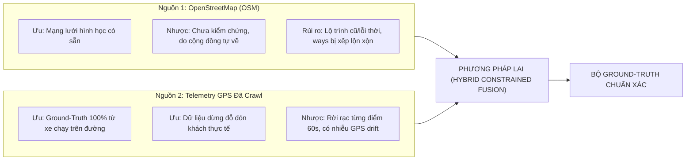
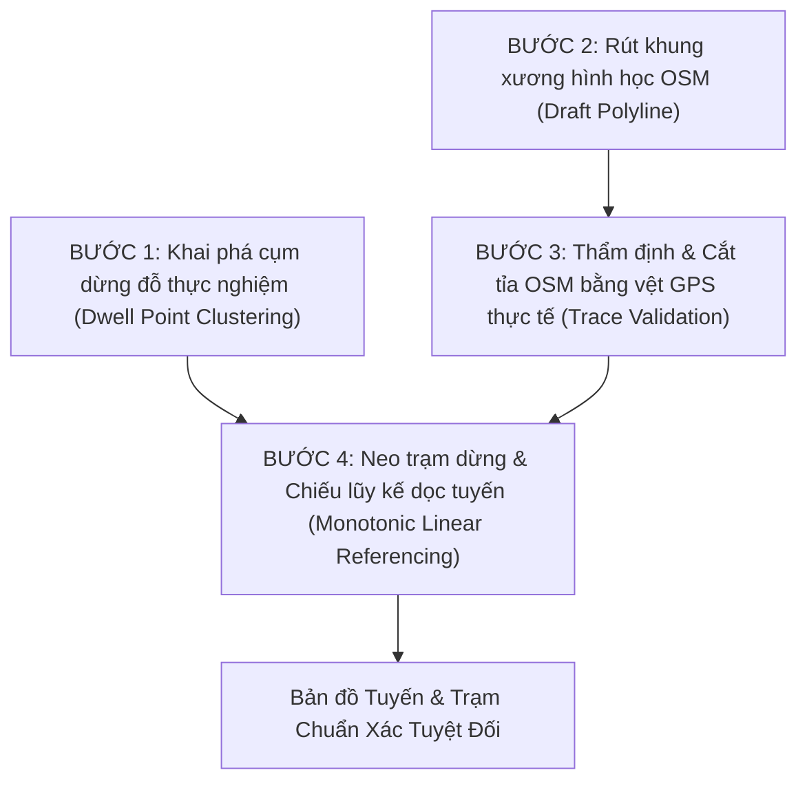

# 26. PHƯƠNG PHÁP LUẬN XÁC ĐỊNH TRẠM DỪNG & HÌNH HỌC TUYẾN CHUẨN XÁC NHẤT
### Kết hợp OSM (Chưa kiểm chứng) và Telemetry GPS Thực Tế (Ground-Truth Khách Quan)

> **Mục tiêu:** Xây dựng quy trình kỹ thuật xác định danh mục trạm dừng và Polyline hình học tuyến đường với độ chuẩn xác tuyệt đối, không đoán mò, không tin mù quáng vào OSM, tận dụng tối đa vệt di chuyển thực tế của hàng trăm lượt xe buýt.

---

## 1. Bản Chất Của 2 Nguồn Dữ Liệu: Điểm Mạnh & Cạm Bẫy

| Đặc tính | OpenStreetMap (OSM) | Telemetry GPS Thực Tế |
| :--- | :--- | :--- |
| **Bản chất** | Bản đồ vector do cộng đồng biên tập | Tọa độ phần cứng GPS trên nóc xe buýt gửi về mỗi 60s |
| **Độ tin cậy** | **Chưa được kiểm chứng** (Có thể là lộ trình cũ từ 2020-2022, thiếu đoạn đổi phân luồng, ways bị đảo ngược hoặc chắp vá) | **Chuẩn xác thực tế 100%** (Phản ánh đúng con đường xe đang lăn bánh hôm nay) |
| **Điểm trạm dừng** | Vị trí cắm mốc trên bản đồ (có thể lệch vào vỉa hè 15-30m, hoặc trạm đã dời vị trí) | **Cụm dừng đón trả khách vật lý** (Vận tốc $v < 5\text{ km/h}$, dừng $15\text{s} - 45\text{s}$) |
| **Hình dạng tuyến** | Có sẵn liên kết đường phố nhưng dễ bị "nối chéo" do người vẽ thêm bớt | Là chuỗi điểm rời rạc cách nhau ~60s (cần nối khớp theo tim đường) |

---

## 2. Chiến Lược 4 Bước Để Đạt Độ Chuẩn Xác Cao Nhất

Thay vì chọn 1 trong 2, ta dùng **Telemetry làm Chuẩn đối sánh và Thước đo thẩm định (Ground-Truth Validator)** để nắn chỉnh và làm sạch hình học OSM:

---

### BƯỚC 1: Khai Phá Cụm Dừng Đỗ Thực Nghiệm Từ Telemetry GPS
*Mục tiêu: Tìm chính xác tọa độ vật lý nơi xe buýt thực tế dừng đón trả khách.*

1. **Lọc dữ liệu dừng đỗ (Dwell Points):**
   - Từ các batch telemetry của từng tuyến, lọc toàn bộ bản ghi thỏa mãn:
     $$v < 5.0\text{ km/h} \quad \text{và} \quad \text{quality\_status} == \text{"ACTIVE\_VALID"}$$
   - Loại trừ hoàn toàn các điểm trong bến xe/depot nghỉ đêm bằng bộ lọc thời gian ($05:00 - 21:00$) và bán kính ngoài tuyến.
2. **Gom cụm mật độ không gian (DBSCAN Clustering):**
   - Với mỗi tuyến, áp dụng DBSCAN với bán kính lân cận $\epsilon = 35\text{m}$, số điểm tối thiểu $\text{MinPts} = 3$:
     $$\text{Cluster}_k = \text{DBSCAN}(\{(lat_i, lon_i) \mid v_i < 5.0\})$$
   - Mỗi cụm $\text{Cluster}_k$ đại diện cho một vị trí dừng đỗ thực tế được lặp lại bởi nhiều xe và nhiều chuyến khác nhau trong ngày.
3. **Xác định tọa độ tâm điểm trạm thực tế (Station Ground-Truth Anchor):**
   - Tọa độ trạm dừng vật lý được tính bằng trọng tâm của cụm:
     $$lat_{stop}(k) = \frac{1}{|C_k|} \sum_{i \in C_k} lat_i, \quad lon_{stop}(k) = \frac{1}{|C_k|} \sum_{i \in C_k} lon_i$$
   - Gán nhãn mã trạm dựa trên trường `current_station_id` xuất hiện với tần suất cao nhất trong cụm đó.

---

### BƯỚC 2: Rút Khung Xương Hình Học Từ OSM (Draft Polyline)
*Mục tiêu: Lấy tim đường chi tiết từng khúc cua làm bản thảo ban đầu.*

1. **Truy vấn relation tuyến tương ứng từ OSM:**
   - Lấy toàn bộ danh sách `way` và `node` của 2 chiều (Outbound & Inbound) mà không dùng Bounding Box cắt xén.
2. **Duyệt đồ thị nối liền mạch (Directed Continuity Stitching):**
   - Bắt đầu từ đầu bến mục tiêu, liên tục tìm đoạn đường tiếp giáp gần nhất ($d < 150\text{m}$).
   - Tự động đảo chiều các đoạn đường bị số hóa ngược vector để tạo thành một LineString mượt mà.
   - Bỏ qua các đoạn đường lạc dòng (stray ways) bị người vẽ OSM gán nhầm vào cuối relation.

---

### BƯỚC 3: Thẩm Định & Cắt Tỉa Lộ Trình OSM Bằng Telemetry (Trace Validation)
*Mục tiêu: Loại bỏ các đoạn đường sai lệch hoặc lỗi thời trong OSM.*

1. **Kiểm tra độ phủ GPS thực tế trên Polyline OSM:**
   - Lấy toàn bộ các điểm GPS của xe đang lăn bánh ($v \ge 10\text{ km/h}$) của tuyến đó.
   - Với mỗi đoạn đường $W_j$ trên Polyline OSM, đếm số lượng pings GPS thực tế nằm trong hành lang $\pm 40\text{m}$:
     $$\text{Support}(W_j) = \#\{\text{ping} \mid \text{dist}(\text{ping}, W_j) \le 40\text{m}\}$$
2. **Quy tắc phân loại và xử lý:**
   - **Đoạn được xác thực ($\text{Support} > 0$):** Xe buýt thực tế có chạy qua $\to$ **Giữ lại làm tim đường chính thức**.
   - **Đoạn không có xe chạy ($\text{Support} == 0$ trên toàn bộ lịch sử batch):** 
     * Đây là đoạn đường trong OSM bị sai hoặc lộ trình xe thực tế đã đổi đường tránh ùn tắc/phân luồng mới.
     * Cắt bỏ đoạn này và nắn lại theo đúng dải GPS thực tế mà các xe đang chạy.

---

### BƯỚC 4: Neo Trạm Dừng & Chiếu Lũy Kế Dọc Tuyến (Linear Referencing)
*Mục tiêu: Đảm bảo thứ tự trạm tuyệt đối đúng theo chiều xe chạy và không nhảy cóc.*

1. **Khớp cặp trạm:**
   - Đối chiếu cụm tâm dừng thực tế từ Bước 1 với:
     * Danh sách thứ tự trạm chính thống từ BusMap `timeline/list` (lấy tên trạm chuẩn tiếng Việt).
     * Mốc trạm dừng `highway=bus_stop` từ OSM (để tham chiếu vị trí biển báo).
2. **Chiếu vuông góc lên Polyline chuẩn:**
   - Mỗi trạm $k$ được chiếu vuông góc lên đường Polyline đã thẩm định để tìm khoảng cách lũy kế $s_k$ (mét tính từ đầu bến):
     $$s_k = \text{ProjectToRoute}(lat_k, lon_k, \text{Polyline})$$
3. **Ràng buộc đơn điệu nghiêm ngặt (Monotonicity Constraint):**
   - Xe buýt chạy tiến, không đi lùi:
     $$0 = s_0 < s_1 < s_2 < \dots < s_{N-1} < s_N = L_{total}$$
   - Nếu $s_{k+1} \le s_k$: Phát hiện bất thường cục bộ (ví dụ vòng xuyến quay đầu hoặc trạm đối diện chiều về bị lẫn) $\to$ Tự động điều chỉnh khoảng cách tối thiểu $\Delta s_{min} \ge 50\text{m}$.

---

## 3. Tiêu Chí Nghiệm Thu Định Lượng (Quantitative Acceptance Criteria)

Một tuyến và danh sách trạm chỉ được coi là **Ground-Truth Đạt Chuẩn** khi vượt qua 4 bài kiểm tra tự động:

1. **Tỷ lệ GPS thực tế khớp tuyến:**
   $$\text{OnRouteRatio} = \frac{\#\{\text{ping} \mid \text{dist}(\text{ping}, \text{Polyline}) \le 40\text{m}\}}{\text{Total Active Pings}} \ge \mathbf{85\%}$$
2. **Khoảng cách nhảy tối đa giữa 2 điểm liên tiếp trên Polyline:**
   $$\max_{i} \text{dist}(P_i, P_{i+1}) \le \mathbf{80\text{ m}} \quad (\text{Tuyệt đối } 0\% \text{ đường nối chéo})$$
3. **Khoảng cách giữa 2 trạm dừng liên tiếp:**
   $$150\text{m} \le \Delta s_k = s_{k+1} - s_k \le 1.500\text{m} \quad (\text{Đúng quy chuẩn khoảng cách trạm buýt đô thị})$$
4. **Tỷ lệ xác thực trạm dừng:**
   - Ít nhất **$70\%$ số trạm** có vết dừng thực tế của xe ($v < 5\text{ km/h}$) trùng khớp trong bán kính $40\text{m}$.

---

## 4. Kế Hoạch Triển Khai Thực Hiện

1. **Chuẩn bị đầu vào:**
   - File cache OSM raw đã có: `data/metadata/osm_hust_routes_raw.json` (18 tuyến, 36 relations).
   - Các batch telemetry GPS thực tế đã có trong `data/raw/` và Hugging Face.
2. **Triển khai script phân tích & đối chiếu (1 file duy nhất, gọn gàng, chạy local):**
   - Gom các cụm dừng đỗ thực tế từ telemetry.
   - Thẩm định và nắn chỉnh Polyline OSM theo vệt GPS thực tế.
   - Xuất bảng nghiệm thu định lượng kiểm chứng cho từng tuyến.

