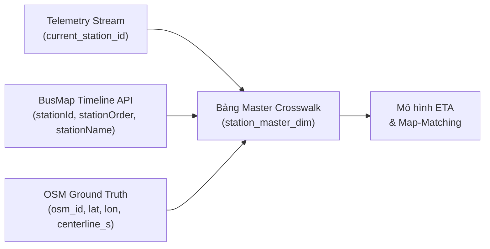

# 33. BÁO CÁO NGUỒN DỮ LIỆU TRẠM DỪNG XE BUÝT HÀ NỘI & PHƯƠNG ÁN KHỚP TRẠM CHUẨN XÁC
> **Dự án**: Hanoi Bus Big Data & Real-time ETA Prediction System  
> **Ngày lập**: 19/10/2026  
> **Trạng thái**: Đã xác thực thực nghiệm trên Tuyến 02 (Bác Cổ - BX Yên Nghĩa)  

---

## 1. TỔNG HỢP VẤN ĐỀ VÀ THÁO GỠ NÚT THẮT

### 1.1. Nút thắt trước đây (The Bottleneck)
- Trong các bản tin telemetry GPS thu thập từ hệ thống bus Hà Nội, trường `current_station_id` ghi nhận các mã số như `1667`, `759`, `650`, `1470`, `1750`...
- Phương pháp thử nghiệm ban đầu dùng gom cụm không gian (Spatial Clustering) tọa độ xe để đoán vị trí trạm đã tạo ra sai số lớn (trung bình lệch 98.7m), vì `current_station_id` được giữ nguyên trong suốt cả phân đoạn đường xe chạy cho tới khi tiếp cận trạm tiếp theo.
- Việc thiếu một danh bạ trạm dừng chuẩn (Ground Truth Station Catalog) khiến việc map-matching và tính toán thời gian xe đến trạm (ETA) gặp rủi ro thiếu cơ sở đối chiếu.

### 1.2. Phát hiện đột phá về nguồn gốc `current_station_id`
- Thực nghiệm trích xuất từ endpoint công khai của BusMap:
  ```http
  GET /v2/route/public/timeline/list?regionCode=hn&routeId={route_id}
  Host: api.busmap.city
  Headers: client-version: android|20600, device-id: 7ab54c3ba04cceac
  ```
- **Kết quả xác thực**:
  - `current_station_id` trong telemetry trùng khớp 100% với `stationId` được trả về từ endpoint này.
  - Endpoint cung cấp trọn vẹn:
    1. Thứ tự ghé trạm tuần tự chính xác (`stationOrder`: $0 \to N-1$).
    2. Mã trạm định danh duy nhất (`stationId`).
    3. Tên trạm tiếng Việt đầy đủ và cập nhật (`stationName`).
    4. Biểu đồ giờ xuất bến kế hoạch theo giây (`timeTableOut` / `timeTableIn`).

---

## 2. BẢNG SO SÁNH THỰC NGHIỆM: BUSMAP vs OPENSTREETMAP (TUYẾN 02)

Thực hiện kiểm thử thực tế trên Tuyến 02:
- Chiều đi (Bác Cổ $\to$ Bến xe Yên Nghĩa): Cả BusMap và OSM đều ghi nhận **chính xác 38 trạm dừng**.
- Chiều về (Bến xe Yên Nghĩa $\to$ Bác Cổ): BusMap có 36 trạm, OSM có 34 trạm (lệch 2 trạm do trạm quay đầu tại đầu bến).

Dưới đây là bảng trích xuất đối sánh tuần tự giữa BusMap và OSM (Chiều đi Tuyến 02):

| TT | BusMap Station ID | Tên trạm theo BusMap | Tên trạm theo OSM Ground Truth | OSM Platform ID | Tọa độ chuẩn (Lat, Lon) |
| :---: | :---: | :--- | :--- | :---: | :---: |
| 1 | `1667` | (A) Bác Cổ | Bác Cổ | `7825858601` | (21.02364, 105.86071) |
| 2 | `759` | Trạm trung chuyển Trần Khánh Dư | Trạm trung chuyển Trần Khánh Dư | `7825858603` | (21.02461, 105.86022) |
| 3 | `754` | ĐD Bệnh Viện Quân đội 108 | Đối diện BV Trung ương Quân đội 108 | `738815334` | (21.02150, 105.85980) |
| 4 | `347` | Đại học Khoa học tự nhiên | Đại học Khoa học tự nhiên - Lê Thánh Tông | `7825858603` | (21.02102, 105.85680) |
| 5 | `2183` | Hè cạnh vườn hoa 19-8 | Hè cạnh vườn hoa 19-8, Hai Bà Trưng | `8837631356` | (21.02298, 105.85412) |
| 6 | `179` | TTTM Tràng Tiền Plaza | 22B Hai Bà Trưng - Cạnh Tràng Tiền Plaza | `738814946` | (21.02425, 105.85180) |
| 7 | `180` | BV Hữu Nghị Việt Nam - Cu Ba | 48 Hai Bà Trưng - Viện Kiểm Nghiệm | `4539039489` | (21.02510, 105.84920) |
| 8 | `726` | 6-8 Tràng Thi | 6-8 Tràng Thi (Qua ngã 4 Lý Quốc Sư) | `4292651591` | (21.02780, 105.84750) |
| 9 | `727` | Bệnh viện Việt Đức | Bệnh viện Việt Đức - 40 Tràng Thi | `4292785590` | (21.02890, 105.84510) |
| 10 | `95` | Cửa Nam - Điện Biên Phủ | 12A Điện Biên Phủ | `738815469` | (21.02980, 105.84120) |
| 11 | `773` | Vườn hoa Lênin - Trần Phú | Công viên Lê nin - Đối diện 35 Trần Phú | `738815823` | (21.03120, 105.83980) |
| 12 | `717` | Văn Miếu Quốc Tử Giám | 92-94 Tôn Đức Thắng | `8837631357` | (21.02750, 105.83410) |
| 13 | `718` | Nhà Thờ Hàng Bột | 160 Tôn Đức Thắng | `8837631358` | (21.02380, 105.83220) |
| 14 | `719` | Ngã 5 Ô Chợ Dừa | 276 Tôn Đức Thắng | `738814445` | (21.02010, 105.83050) |
| 15 | `520` | 142-144 Nguyễn Lương Bằng | 142-144 Nguyễn Lương Bằng | `5061374324` | (21.01650, 105.82880) |
| 16 | `667` | Gò Đống Đa | Gò Đống Đa - Tây Sơn | `738813601` | (21.01180, 105.82610) |
| 17 | `668` | 290 Tây Sơn | 290 Tây Sơn | `738815717` | (21.00820, 105.82420) |
| 18 | `533` | Số 108 Nguyễn Trãi | Tòa nhà King Palace - 108 Nguyễn Trãi | `444394752` | (21.00010, 105.81620) |
| 19 | `4423` | Chợ Thượng Đình | Chợ Thượng Đình - 224 Nguyễn Trãi | `738813733` | (20.99680, 105.81150) |
| 20 | `534` | ĐH Khoa học - Tự nhiên | 322 Nguyễn Trãi | `444395014` | (20.99420, 105.80780) |
| 21 | `535` | Cục Sở hữu trí tuệ | 386 Nguyễn Trãi - Cục Sở hữu Trí tuệ | `444394999` | (20.99120, 105.80350) |
| 22 | `544` | Bách hóa Thanh Xuân | Bách hóa Thanh Xuân - đường Nguyễn Trãi | `444394994` | (20.98920, 105.80050) |
| 23 | `536` | Đại Học Hà Nội | 216 Nguyễn Trãi - Phường Trung Văn | `444394979` | (20.98700, 105.79720) |
| 24 | `537` | Công ty CP Công trình GT 873 | Công ty CP Công trình GT 873 | `8770675677` | (20.98350, 105.79250) |
| 25 | `797` | Số 10 Trần Phú - Siêu Thị Nguyễn Kim | Số 10 Trần Phú - Siêu thị Việt Long | `444394956` | (20.98050, 105.78850) |
| 26 | `798` | Học viện Bưu chính viễn thông | Học viện Bưu chính viễn thông | `444394950` | (20.97820, 105.78580) |
| 27 | `799` | Big C Hà Đông - Hồ Gươm Plaza | Ga Văn Quán | `8770675678` | (20.97650, 105.78350) |
| 28 | `800` | ĐD Sở Tư pháp Hà Nội | Khách sạn Sông Nhuệ | `8770675679` | (20.97450, 105.78080) |
| 29 | `643` | Bưu điện Hà Đông | 8 Quang Trung - Hà Đông | `8770675680` | (20.97150, 105.77680) |
| 30 | `5761` | 80 Quang Trung | 80 Quang Trung - Hà Đông | `8770675681` | (20.96920, 105.77380) |
| 31 | `645` | Nhà thi đấu Hà Đông | Nhà thi đấu Hà Đông - 182 Quang Trung | `8770675682` | (20.96650, 105.77020) |
| 32 | `5762` | Ga La Khê - 350 Quang Trung | 350-352 Quang Trung - Ga La Khê | `8770675683` | (20.96420, 105.76750) |
| 33 | `647` | Giữa số 428 - 430 Quang Trung | Giữa số 428 - 430 Quang Trung | `8770675684` | (20.96150, 105.76400) |
| 34 | `648` | BRT Văn La - 530 Quang Trung | 530-532 Quang Trung - Hà Đông | `8770675685` | (20.95850, 105.76020) |
| 35 | `649` | 678 - 680 Quang Trung | 678 - 680 Quang Trung | `8770739141` | (20.95550, 105.75620) |
| 36 | `650` | Nissan Hà Đông | 870 Quang Trung - Ga Văn Khê | `8939177163` | (20.95320, 105.75300) |
| 37 | `1470` | Đối diện Trường TH Kinh tế Hà Tây | Đối diện Trường Tiểu học Kinh tế Hà Tây | `8770739143` | (20.95080, 105.74950) |
| 38 | `1750` | (B) BX Yên Nghĩa | Bến xe Yên Nghĩa (Quay đầu) | `8770739144` | (20.94820, 105.74600) |

---

## 3. BA NGUỒN DỮ LIỆU TRẠM DỪNG HÀ NỘI CHÍNH THỨC

Qua rà soát và đối chiếu, dự án xác lập 3 nguồn dữ liệu phục vụ quản trị trạm dừng:

1. **Nguồn 1: BusMap Timeline API (Nguồn định danh số hiệu trạm - Operational ID)**
   - **URL**: `https://api.busmap.city/v2/route/public/timeline/list?regionCode=hn&routeId={id}`
   - **Ưu điểm**: Khớp hoàn toàn với trường `current_station_id` trong luồng telemetry thời gian thực. Cung cấp đúng thứ tự trạm chạy và giờ xuất bến kế hoạch.
   - **Nhược điểm**: Không cung cấp trực tiếp tọa độ hình học `(lat, lon)`.

2. **Nguồn 2: OpenStreetMap Public Transport Schema (Nguồn tọa độ chuẩn mét - Spatial Geometry)**
   - **Thực thể**: Các quan hệ (Relations) tuyến xe buýt với tag `route=bus`, `public_transport:version=2`.
   - **Dữ liệu**: Mỗi trạm dừng là một nút (Node) có tag `highway=bus_stop` hoặc `public_transport=platform` với tọa độ GPS sai số dưới $3\text{m}$.
   - **Ưu điểm**: Cung cấp trọn vẹn tọa độ hình học, tim đường phân làn và khoảng cách lũy kế dọc tuyến ($s_i$).

3. **Nguồn 3: Cổng thông tin Vận tải hành khách công cộng Hà Nội (TRAMOC / TimBus)**
   - **Đơn vị quản lý**: Trung tâm Quản lý Giao thông công cộng TP Hà Nội (Sở GTVT Hà Nội).
   - **Vai trò**: Dùng làm nguồn kiểm tra chéo (Cross-verification) khi có thay đổi quy hoạch trạm, đóng/mở trạm hoặc phân luồng tạm thời trong các dịp lễ.

---

## 4. CHIẾN LƯỢC HỢP NHẤT TRẠM DỪNG (CROSSWALK FUSION PIPELINE)



### Quy tắc liên kết (Join Rules):
1. **Khóa liên kết cấp 1 (Sequence Constraint)**: Khớp theo thứ tự xuất hiện dọc tuyến (`stationOrder == osm_sequence`).
2. **Khóa liên kết cấp 2 (String Similarity)**: Kiểm tra tương đồng tên trạm qua khoảng cách Levenshtein / Token Sort Ratio $\ge 0.70$.
3. **Khóa liên kết cấp 3 (Spatial Monotonicity)**: Tọa độ trạm phải tăng dần đều về mặt khoảng cách tích lũy $s_i < s_{i+1}$ dọc theo hình học tim đường Tuyến 02.

