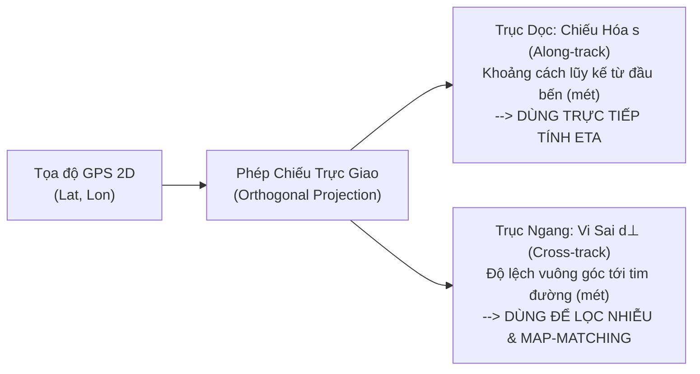

# 35. CHIẾN LƯỢC CHIẾU HÓA TUYẾN TÍNH (FRENET FRAME) & ĐỘ LỆCH TÂM ĐƯỜNG TRONG MÔ HÌNH ETA
> **Dự án**: Hanoi Bus Big Data & Real-time ETA Prediction System  
> **Ngày lập**: 19/10/2026  
> **Mục tiêu**: Làm rõ bản chất toán học giữa Chiếu hóa (Along-track) và Vi sai tâm đường (Cross-track), thống nhất quy trình tính toán gộp (Single-pass) phục vụ Feature Store và ETA.

---

## 1. BẢN CHẤT HỌC THUẬT: HAI MẶT CỦA CÙNG MỘT PHÉP BIẾN ĐỔI

Trong GIS Giao thông và Điều khiển tự hành (Autonomous Vehicles), việc chuyển đổi từ hệ tọa độ địa lý 2D $(Lat, Lon)$ sang hệ tọa độ bám tuyến đường cong được chuẩn hóa bằng **Hệ quy chiếu Frenet-Serret** (Linear Referencing System - LRS):

$$\mathbf{p}(Lat, Lon) \xrightarrow{\quad \text{Projection} \quad} (s, d_\perp)$$

### 1.1. Chiếu hóa dọc tuyến ($s$ - Along-track Distance)
- **Ý nghĩa**: Biến cung đường xe buýt từ không gian 2D phức tạp thành một trục số 1D duy nhất $s \in [0, L_{route}]$.
- **Ứng dụng sống còn cho ETA**:
  - Mỗi trạm dừng $k$ có một vị trí cố định $s_k$ trên trục số.
  - Mỗi xe buýt tại thời điểm $t$ có vị trí $s_{bus}(t)$.
  - **Khoảng cách còn lại đến trạm đích $k$**:
    $$\Delta s_{remain} = s_k - s_{bus}(t)$$
  - Đây là **đặc trưng quan trọng số 1 (Top 1 Feature)** quyết định $80-90\%$ độ chính xác của mọi mô hình ETA (cả Baseline lẫn LightGBM).

### 1.2. Vi sai tâm đường ($d_\perp$ - Cross-track Error / Lateral Offset)
- **Ý nghĩa**: Khoảng cách trực giao ngắn nhất từ vị trí xe đến tim đường Polyline.
- **Ứng dụng**:
  - **Lọc nhiễu văng GPS**: Nếu $d_\perp > 30\text{m}$, bản tin GPS bị văng do hẻm vực nhà cao tầng (Urban Canyon) hoặc xe đang rẽ vào bãi đổ xăng/đường nhánh.
  - **Nhận diện làn đường**: Phân biệt xe đi làn BRT riêng giữa đường ($d_\perp \approx 0\text{m}$) hay làn hỗn hợp sát vỉa hè ($d_\perp \approx 6-10\text{m}$).

> **KẾT LUẬN VỀ THUẬT TOÁN**: Không tách rời "Chiếu hóa" và "Xác định vi sai tâm đường" thành hai bài toán độc lập. Cả hai được tính toán **đồng thời trong một lần duyệt (Single Pass)** của hàm chiếu điểm lên đoạn thẳng $\mathcal{O}(N_{segments})$.

---

## 2. CÔNG THỨC TOÁN CHIẾU TRỰC GIAO TỔNG QUÁT

Cho Polyline tim đường gồm chuỗi $N$ điểm đỉnh: $\mathbf{P}_1, \mathbf{P}_2, \dots, \mathbf{P}_N$ với độ dài lũy kế tương ứng $S_1 = 0, S_2, \dots, S_N$.

Với mỗi điểm GPS xe $\mathbf{p} = (x, y)$:
1. Xét từng đoạn thẳng $\mathbf{e}_j = \mathbf{P}_{j+1} - \mathbf{P}_j$:
   - Tính hệ số chiếu chuẩn hóa $t_j$:
     $$t_j = \frac{(\mathbf{p} - \mathbf{P}_j) \cdot \mathbf{e}_j}{\|\mathbf{e}_j\|^2}$$
   - Cắt cụt về đoạn đóng (Clamping): $\hat{t}_j = \max(0, \min(1, t_j))$.
   - Điểm chiếu trực giao trên đoạn: $\mathbf{p}_{proj, j} = \mathbf{P}_j + \hat{t}_j \mathbf{e}_j$.
   - Khoảng cách vuông góc: $d_j = \|\mathbf{p} - \mathbf{p}_{proj, j}\|$.

2. Chọn phân đoạn $j^*$ tối thiểu hóa khoảng cách vuông góc:
   $$j^* = \arg\min_j d_j$$
   - **Vi sai tâm đường**: $d_\perp = d_{j^*}$.
   - **Tọa độ chiếu hóa**: $s = S_{j^*} + \hat{t}_{j^*} \|\mathbf{e}_{j^*}\|$.

---

## 3. LỘ TRÌNH HÀNH ĐỘNG TIẾP THEO (VERTICAL SLICE ĐẾN ĐÍCH)

Để tránh sa đà vào tiểu tiết thuật toán và bám sát nguyên tắc **End-to-End Vertical Slice**, thứ tự thực thi là:

1. **Bước 1 (Master Data Tuyến 02)**:
   - Lưu 40 trạm và 178 điểm tim đường của Tuyến 02 từ TimBus vào DB.
   - Tính sẵn $s_k$ cho toàn bộ 40 trạm ($s_0 = 0\text{m} \to s_{39} \approx 17.500\text{m}$).

2. **Bước 2 (Chiếu hóa Telemetry Tuyến 02)**:
   - Chạy chiếu hóa vector cho các bản tin GPS của Tuyến 02 trong ngày 17/10 - 18/10.
   - Bổ sung trường $s_{bus}$, $d_\perp$, và vận tốc dẫn xuất $\bar{v} = \Delta s / \Delta t$.

3. **Bước 3 (Big Data Medallion & Baseline ETA)**:
   - Xuất bảng sang định dạng Parquet (Silver Layer).
   - Huấn luyện mô hình Baseline (Historical Segment Average) tính ETA cho từng trạm và đo MAE/RMSE.

