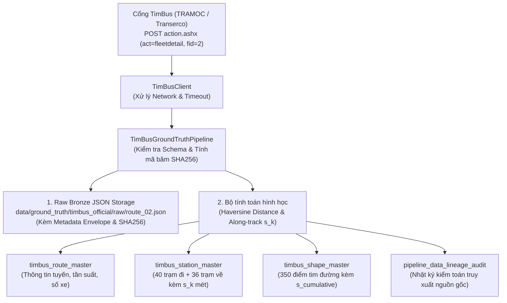

# 36. THIẾT LẬP ĐƯỜNG ỐNG DỮ LIỆU CHÍNH THỨC & KHẢ NĂNG TRUY XUẤT NGUỒN GỐC (DATA LINEAGE & TRACEABILITY)
> **Dự án**: Hanoi Bus Big Data & Real-time ETA Prediction System  
> **Module thực thi**: `module_2_osm_ground_truth_and_road_network/step_2_4_timbus_official_ground_truth_extractor`  
> **Ngày thiết lập**: 19/10/2026  
> **Nguồn thẩm định**: TRAMOC & Transerco (Sở Giao thông Vận tải Hà Nội)  

---

## 1. MỤC TIÊU VÀ ĐÁP ỨNG TIÊU CHUẨN QUẢN TRỊ DỮ LIỆU

Để phục vụ lâu dài cho dự án và đáp ứng đúng tiêu chuẩn môn học Dữ liệu lớn (Big Data Engineering), toàn bộ dữ liệu trạm dừng và hình học tim đường đã được chính thức hóa qua quy trình 3 lớp:
1. **Raw Bronze Ingestion**: Lưu vết bản tin JSON gốc kèm phong bì siêu dữ liệu (Metadata Envelope) và mã băm toàn vẹn `SHA256`.
2. **Relational Lakehouse Staging**: Chuẩn hóa dữ liệu sang các bảng chiều (`Dim Table`) trong SQLite (`data/telemetry_audit_2026_10_17_18.db`), tính sẵn khoảng cách lũy kế mét ($s_k$) dọc theo tuyến đường.
3. **Data Lineage & Traceability**: Mọi bản ghi đều liên kết ngược về bảng nhật ký kiểm toán `pipeline_data_lineage_audit` với nguồn gốc, thời điểm trích xuất (ISO 8601 UTC) và chữ ký số.

---

## 2. KIẾN TRÚC ĐƯỜNG ỐNG (PIPELINE ARCHITECTURE)



---

## 3. CƠ SỞ DỮ LIỆU VÀ CÁC SCHEMA ĐÃ TRIỂN KHAI

### 3.1. Bảng Chiều Trạm Dừng (`timbus_station_master`)
Lưu trữ danh bạ 40 trạm chiều đi và 36 trạm chiều về của Tuyến 02:
* `route_code`: Mã số tuyến xe buýt (`"02"`).
* `direction`: Hướng di chuyển (`"go"`: Chiều đi Bác Cổ $\to$ Yên Nghĩa; `"re"`: Chiều về Yên Nghĩa $\to$ Bác Cổ).
* `station_order`: Thứ tự tuần tự ghé trạm ($0, 1, 2, \dots, N-1$).
* `station_id`: Mã định danh trạm (`ObjectID`) — **trùng khớp 100% với `current_station_id` trong Telemetry**.
* `station_name`: Tên trạm dừng chính thức được công bố bởi Sở GTVT.
* `lat`, `lon`: Tọa độ địa lý chuẩn WGS84 (độ chính xác 6 chữ số thập phân).
* `cum_distance_m`: Vị trí khoảng cách lũy kế của trạm dọc theo tim đường ($s_k$ từ $0\text{m} \to 17.415,8\text{m}$).
* `extracted_at`: Thời điểm trích xuất dữ liệu chuẩn UTC.
* `raw_sha256`: Khóa băm toàn vẹn dữ liệu.

### 3.2. Bảng Tim Đường Đa Tuyến (`timbus_shape_master`)
Lưu trữ 350 tọa độ tim đường chính thức của toàn tuyến:
* Chiều đi (`go`): 178 điểm tọa độ, tổng chiều dài $17.415,8\text{ m}$ ($\approx 17,42\text{ km}$).
* Chiều về (`re`): 172 điểm tọa độ, tổng chiều dài $16.475,7\text{ m}$ ($\approx 16,48\text{ km}$).

### 3.3. Bảng Kiểm Toán Truy Xuất Nguồn Gốc (`pipeline_data_lineage_audit`)
Lưu vết minh bạch mọi lần chạy đường ống:
| Cột | Giá trị bản ghi thực tế Tuyến 02 |
| :--- | :--- |
| `audit_id` | `1` |
| `pipeline_name` | `TimBusOfficialGroundTruthPipeline` |
| `source_system` | `TRAMOC/Transerco` |
| `entity_id` | `02` |
| `records_count` | `426` (76 trạm + 350 điểm tim đường) |
| `checksum_sha256` | `b1d5da641dbd585b489386ea6b5770529ee5c0c40e08c6329a83995d4f1b8800` |
| `file_path` | `data/ground_truth/timbus_official/raw/route_02.json` |
| `execution_status` | `SUCCESS` |
| `execution_timestamp`| `2026-10-19T13:20:45.741400+00:00` |

---

## 4. HƯỚNG DẪN TÁI HIỆN VÀ MỞ RỘNG (REPRODUCIBILITY)

Để tải và lưu dữ liệu cho bất kỳ tuyến xe buýt nào trong tương lai (hoặc quét hàng loạt 49 tuyến):
```bash
# Ingest Tuyến 02 (mặc định)
python scripts/ingest_official_timbus_routes.py --fid 2

# Ingest bất kỳ tuyến nào khác (ví dụ Tuyến 32)
python scripts/ingest_official_timbus_routes.py --fid 32
```
Toàn bộ quy trình chạy hoàn toàn tự động, tự động tính toán hình học, tự động đối soát toàn vẹn mã băm và cập nhật vào cơ sở dữ liệu dùng chung của dự án.

