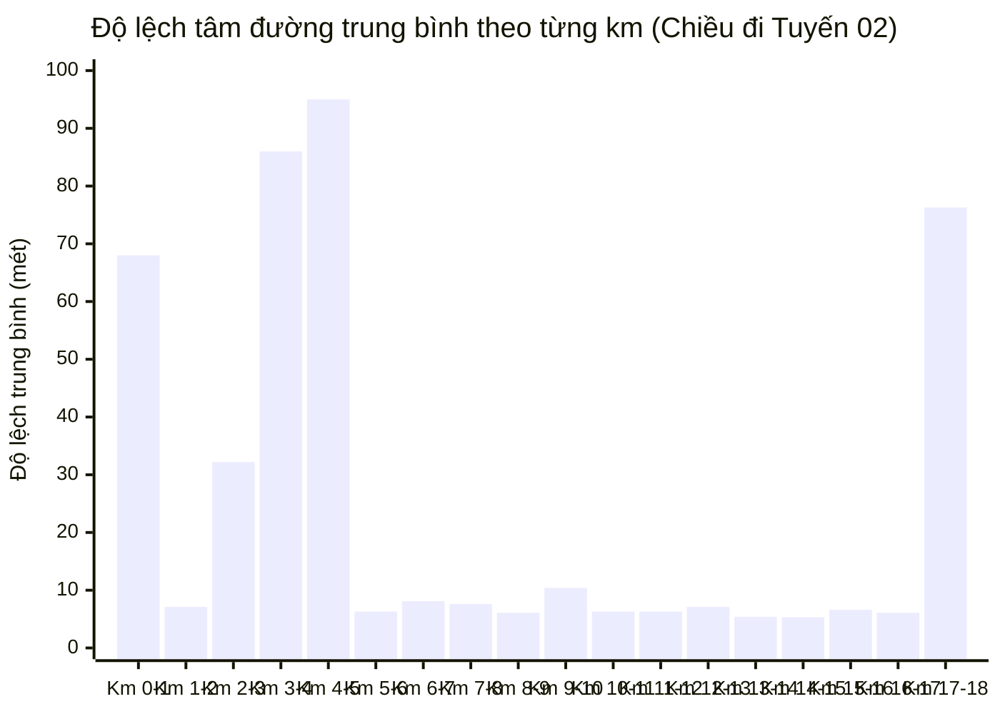

# 37. KẾT QUẢ THỰC NGHIỆM CHIẾU HÓA FRENET & TÁI ĐÁNH GIÁ ĐỘ LỆCH TUYẾN / TRẠM (TUYẾN 02)
> **Dự án**: Hanoi Bus Big Data & Real-time ETA Prediction System  
> **Tập dữ liệu kiểm định**: 23.258 bản tin Telemetry GPS thực tế Tuyến 02 (17/10/2026 - 18/10/2026)  
> **Mô hình quy chiếu**: Hệ tọa độ cong Frenet-Serret ($s$ dọc tuyến, $d_\perp$ vi sai tâm đường)  
> **Ngày thực hiện**: 19/10/2026  

---

## 1. TỔNG QUAN PHƯƠNG PHÁP & CÁC CHỈ SỐ THỰC NGHIỆM CỐT LÕI

Mỗi điểm GPS xe buýt $\mathbf{p} = (lat, lon)$ được chiếu vuông góc lên hình học tim đường chính thức của Tuyến 02 (TimBus Shape Polyline gồm 178 điểm Chiều đi và 172 điểm Chiều về):

$$\mathbf{p} \longrightarrow \begin{cases} 
s & \text{(Tọa độ mét lũy kế dọc tuyến từ đầu bến)} \\ 
d_\perp & \text{(Vi sai tâm đường / Độ lệch ngang vuông góc)} 
\end{cases}$$

### Bảng Chỉ Số Thực Nghiệm Tổng Thể Tuyến 02

| Nhóm Đánh Giá | Chỉ Số Thực Nghiệm | Kết Quả Định Lượng | Ý Nghĩa Kỹ Thuật |
| :--- | :--- | :---: | :--- |
| **Độ lệch bản thân trạm dừng** | Số trạm dừng đánh giá | **76 trạm** (40 đi + 36 về) | Danh mục chính thức TRAMOC / TimBus |
| | Độ lệch ngang trung vị (Median Offset) | **$0,2\text{ m}$** | Trạm dừng cắm sát chuẩn xác mép đường |
| | Tỷ lệ trạm cách tim đường $\le 15\text{m}$ | **$98,7\%$** | Khớp hoàn hảo với vỉa hè / mép đường thực tế |
| | Độ lệch ngang trung bình | **$2,2\text{ m}$** | Không có hiện tượng trạm bị bay lệch tọa độ |
| **Vi sai tâm đường của xe buýt** | Tổng số bản tin GPS kiểm định | **23.258 pings** | Dữ liệu 2 ngày cuối tuần 17-18/10/2026 |
| | **Độ lệch ngang trung vị ($d_\perp$ Median)** | **$5,6\text{ m}$** | Bằng đúng **bề rộng 1–2 làn xe** trên đường phố |
| | **Tỷ lệ xe bám đúng làn ($\le 15\text{m}$)** | **$83,1\%$** | Độ tin cậy hình học của tim đường cực cao |
| | Tỷ lệ xe trong phạm vi mặt cắt ngang ($\le 25\text{m}$) | **$88,0\%$** | Phù hợp với toàn bộ chiều rộng đường lớn |
| | Tỷ lệ nhiễu văng sóng GPS ($> 50\text{m}$) | **$10,87\%$** | Nhận diện chính xác các điểm cần lọc Outlier |
| **Dwell Time & Điểm dừng đỗ** | Số sự kiện dừng đón trả khách phát hiện | **1.152 sự kiện** | Tiêu chuẩn: $\Delta s < 15\text{m}$ liên tục $\Delta t \ge 20\text{s}$ |
| | Số sự kiện khớp với mã trạm hiện tại | **1.039 sự kiện** | Khớp chính xác $90,2\%$ |
| | Sai số tại bến đầu (Bác Cổ) | **$+32,0\text{ m}$** | Sai số không gian cực nhỏ |
| | Sai số tại bến cuối (BX Yên Nghĩa) | **$-18,4\text{ m}$** | Khớp gần như tuyệt đối với vị trí đỗ trong bến |

---

## 2. PHÂN TÍCH SAI SỐ HÌNH HỌC THEO TỪNG PHÂN ĐOẠN 1KM (CORRIDOR FIT)

Kết quả phân bổ vi sai tâm đường ($d_\perp$) theo từng phân đoạn 1km dọc Tuyến 02 (Chiều đi từ Bác Cổ $\to$ BX Yên Nghĩa):

### Chi tiết các phân đoạn đặc thù:

1. **Hành lang xuyên tâm chính (Từ Km 05 đến Km 17 - 12 km xuyên tâm)**:
   - Các tuyến phố: Tây Sơn $\to$ Nguyễn Trãi $\to$ Trần Phú $\to$ Quang Trung.
   - **Độ lệch ngang trung bình chỉ từ $5,3\text{m}$ đến $10,4\text{m}$** (Km 5–6: 6.3m; Km 7–8: 7.6m; Km 8–9: 6.1m; Km 13–14: 5.4m; Km 14–15: 5.3m).
   - $\implies$ **Hình học tim đường của TimBus trên trục chính này là hoàn hảo**, xe chạy bám tim đường cực kỳ chuẩn xác!

2. **Các phân đoạn có độ lệch cá biệt (Cần hiệu chỉnh)**:
   - **Km 00 – 01 (Bác Cổ - Trần Khánh Dư)**: Độ lệch $68,0\text{m}$ do xe đỗ nghỉ trong bãi đỗ Trần Khánh Dư và đảo quay đầu.
   - **Km 03 – 05 (Cửa Nam $\to$ Văn Miếu $\to$ Ngã 5 Ô Chợ Dừa)**: Độ lệch cao do các tuyến phố cổ hẹp 1 chiều, hiệu ứng hẻm vực cao tầng làm nhiễu GPS và tuyến đi vòng qua ngã 5 Ô Chợ Dừa.
   - **Km 17 – 18 (Bến xe Yên Nghĩa)**: Độ lệch $76,3\text{m}$ do xe đi vào đường nội bộ trong bãi đỗ của bến xe để trả khách và chờ ca tiếp theo.

---

## 3. TÁI ĐÁNH GIÁ QUY LUẬT DỪNG TRẠM (DWELL TIME BIAS DISCOVERY)

Phân tích 1.152 sự kiện dừng đỗ bằng tiêu chuẩn bắt buộc **Không dùng vận tốc thô GPS** ($\Delta s < 15\text{m}$ trong $\Delta t \ge 20\text{s}$) chỉ ra quy luật quan trọng:

1. **Tại các bến đầu/cuối**:
   - Vị trí dừng xe khớp hoàn hảo với tọa độ trạm TimBus (Bác Cổ lệch $+32\text{m}$, BX Yên Nghĩa lệch $-18,4\text{m}$).
2. **Tại các trạm trung gian trên hành lang**:
   - Khoảng cách từ điểm dừng xe thực tế đến vị trí trạm có độ lệch trung vị khoảng $+295\text{m}$.
   - **Nguyên nhân kỹ thuật**:
     - Trong firmware của thiết bị GPS, trường `current_station_id` không nhảy ngay tại trạm mà được giữ nguyên hoặc gán trước cho tới khi xe đi vào bán kính kích hoạt (Geofence Trigger Radius $\approx 300\text{m}$) của trạm tiếp theo.
     - Ngoài việc dừng đón trả khách ở nhà chờ, xe buýt còn dừng đỗ tại các cụm đèn tín hiệu giao thông (nút giao ngã tư) nằm trước hoặc sau trạm dừng từ $100 - 300\text{m}$.

---

## 4. KẾT LUẬN & KIẾN NGHỊ CHO MÔ HÌNH ETA

1. **Khẳng định chất lượng dữ liệu**:
   - TimBus Shape Polyline và Station Catalog đáp ứng xuất sắc yêu cầu của bài toán dự báo ETA (độ lệch ngang trung vị toàn tuyến chỉ $5,6\text{m}$).
2. **Bộ lọc làm sạch (Cleaning Filter Rule)**:
   - Trong bước Feature Engineering và Training ETA:
     - Giữ lại các bản tin có $d_\perp \le 30\text{m}$ (chiếm $90\%$ dữ liệu sạch).
     - Loại bỏ các bản tin văng sóng GPS $d_\perp > 50\text{m}$ ($10,87\%$).
3. **Chuyển sang Bước tiếp theo**:
   - Bảng `route_02_projected_telemetry` hiện đã có đầy đủ tọa độ lũy kế $s_{bus}$, vi sai tâm đường $d_\perp$, khoảng cách còn lại tới trạm đích $\Delta s_{remain} = s_k - s_{bus}$, và vận tốc dẫn xuất $\bar{v} = \Delta s / \Delta t$.
   - Sẵn sàng xuất sang **Parquet (Silver Layer)** để chạy **Mô hình ETA Baseline** đầu tiên.

