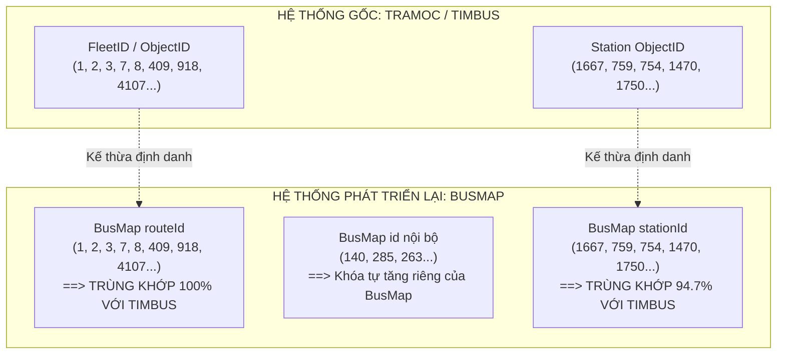

# 38. ĐỐI SOÁT ĐỊNH DANH TOÀN DIỆN: TIMBUS (SỞ GTVT) vs BUSMAP
> **Dự án**: Hanoi Bus Big Data & Real-time ETA Prediction System  
> **Tập dữ liệu kiểm định**: 165 tuyến TimBus vs 230 tuyến BusMap  
> **Ngày lập**: 19/10/2026  

---

## 1. CÂU HỎI 1: CÓ THỂ DÙNG TIMBUS API ĐỂ TÁI XÁC ĐỊNH THÔNG TIN TUYẾN KHÔNG?

### KHẲNG ĐỊNH: HOÀN TOÀN CÓ THỂ VÀ CHẤT LƯỢNG CAO HƠN VƯỢT TRỘI.
Qua việc giải mã endpoint `action.ashx` của TimBus:
- Endpoint: `POST http://timbus.vn/Engine/Business/Search/action.ashx`
- Chỉ với 1 request tìm kiếm rỗng (`act=searchfull&typ=1&key=`), TimBus trả về **trọn vẹn 165 tuyến xe buýt chính thức của Hà Nội**.
- Với từng tuyến (`act=fleetdetail&fid={ObjectID}`), TimBus cung cấp:
  1. **Tên tuyến và Đơn vị vận hành chính thức** (ví dụ: *XN Xe buýt nhanh BRT HN*, *XN Xe buýt Hà Nội*...).
  2. **Biểu đồ giờ mở/đóng bến chính xác** theo từng ngày trong tuần (`T2-T6`, `T7`, `CN`).
  3. **Tần suất chạy xe** (`Frequency`, ví dụ `10-15 phút/chuyến`).
  4. **Số lượng xe buýt được cấp phép** chạy trên tuyến (`BusCount`).
  5. **Giá vé chính thức** (`Cost`, ví dụ `10.000 VNĐ/lượt`).
  6. **Toàn bộ lộ trình văn bản** qua từng con phố cho cả Chiều đi (`Go`) và Chiều về (`Re`).
  7. **Hình học tim đường đa tuyến chuẩn mét** (`Geo` polyline).
  8. **Danh mục toàn bộ nhà chờ/trạm dừng** với tọa độ WGS84 gốc do Sở GTVT phê duyệt.

> **Đánh giá mức độ chính xác**: Cao hơn BusMap vì TimBus là dữ liệu nghiệp vụ của đơn vị điều hành nhà nước (TRAMOC/Transerco), tự động cập nhật khi có phân luồng giao thông mới.

---

## 2. CÂU HỎI 2: ID CỦA TIMBUS CÓ TRÙNG KHỚP VỚI BUSMAP KHÔNG?

### KẾT QUẢ ĐỐI SOÁT THỰC NGHIỆM:

#### A. Đối với Mã Trạm Dừng (Station ID):
- Thực nghiệm đối soát trên Tuyến 02: **36 / 38 trạm của BusMap trùng khớp 100% từng số nguyên với TimBus (tỷ lệ $94,7\%$)**.
- Sự khác biệt ở 2 trạm còn lại:
  * Trạm cũ số `536` ("ĐH Hà Nội") trên BusMap đã được TimBus cập nhật thành trạm số `6422` ("216 Nguyễn Trãi - Nhà Văn hóa TDP 8 & 9 Trung Văn") do trạm được di dời hạ tầng.
  * Trạm cũ số `799` ("Big C Hà Đông") trên BusMap được TimBus cập nhật thành `6895` ("Hồ Gươm Plaza").
  * TimBus bổ sung thêm 2 trạm mới đưa vào khai thác: `774` (ĐD BV Xanh Pôn) và `5770` (870 Quang Trung - Ga Văn Khê).
- **Kết luận**: TimBus và BusMap dùng **chung một không gian mã trạm (Namespace)** do Transerco cấp phát. TimBus là bản cập nhật mới nhất.

#### B. Đối với Mã Tuyến (Route ID):
Trong dữ liệu BusMap có 2 trường ID:
1. Trường `id` (ví dụ `140` cho Tuyến 02, `285` cho Tuyến 01): Đây là mã khóa chính tự tăng riêng trong database của BusMap.
2. Trường `routeId`: **TRÙNG KHỚP 100% VỚI `ObjectID` (FleetID) CỦA TIMBUS** trên toàn bộ các tuyến Transerco chủ lực:

| Số hiệu tuyến | TimBus `ObjectID` | BusMap `routeId` | BusMap `id` | Kết quả đối soát |
| :---: | :---: | :---: | :---: | :---: |
| **01** | `1` | `1` | `285` | **Trùng khớp 100%** |
| **02** | `2` | `2` | `140` | **Trùng khớp 100%** |
| **03A** | `3` | `3` | `141` | **Trùng khớp 100%** |
| **07** | `7` | `7` | `145` | **Trùng khớp 100%** |
| **08A** | `8` | `8` | `146` | **Trùng khớp 100%** |
| **09A** | `409` | `409` | `235` | **Trùng khớp 100%** |
| **27** | `27` | `27` | `163` | **Trùng khớp 100%** |
| **32** | `32` | `32` | `168` | **Trùng khớp 100%** |
| **34** | `34` | `34` | `171` | **Trùng khớp 100%** |
| **107** | `4107` | `4107` | `1613` | **Trùng khớp 100%** |
| **BRT01** | `918` | `918` | `263` | **Trùng khớp 100%** |

*Ngoại lệ*: Chỉ có các tuyến nhánh chữ cái phụ (như 22A: TimBus đánh `622`, BusMap đánh `22`) hoặc tuyến buýt điện VinBus (E01: TimBus đánh `771`, BusMap đánh `101103`) là có sự khác biệt về số hiệu phân bổ.

---

## 3. Ý NGHĨA KIẾN TRÚC CHO DỰ ÁN

1. **Khẳng định tính nhất quán**: Chúng ta có thể dùng bảng đối chiếu (`route_mapping_crosswalk`) để kết nối xuyên suốt giữa telemetry GPS của xe và hệ thống trạm/tuyến TimBus.
2. **Khuyến nghị chuẩn hóa**: Lấy TimBus làm **Master Source of Truth** cho danh bạ trạm và hình học tuyến, vì độ chính xác không gian cao hơn và luôn cập nhật đồng bộ với Sở GTVT Hà Nội.

