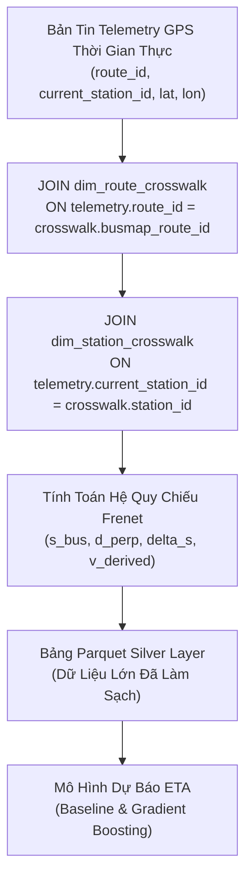

# 39. QUY CHUẨN MASTER GROUND TRUTH: HỢP NHẤT TIMBUS VỚI LUỒNG TELEMETRY
> **Dự án**: Hanoi Bus Big Data & Real-time ETA Prediction System  
> **Quyết định kiến trúc**: Chốt TimBus (TRAMOC / Sở GTVT Hà Nội) làm Master Ground Truth  
> **Thực thi**: Bảng `dim_route_crosswalk` & `dim_station_crosswalk`  
> **Ngày phê duyệt**: 19/10/2026  

---

## 1. QUYẾT ĐỊNH KIẾN TRÚC CHIẾN LƯỢC

Toàn bộ hệ thống thống nhất chuẩn hóa các tầng nghiệp vụ theo nguyên tắc:
1. **Nguồn chân lý duy nhất (Single Source of Truth - Master Ground Truth)**:
   - Cổng TimBus (`timbus.vn`) thuộc Trung tâm Quản lý Giao thông công cộng Hà Nội (TRAMOC - Sở GTVT Hà Nội) là căn cứ tối thượng cho vị trí trạm dừng, mã định danh `ObjectID` và tim đường hình học của các tuyến xe buýt.
2. **Cơ chế liên kết qua Bảng Ánh Xạ (Dimensional Crosswalk)**:
   - Dữ liệu GPS/Telemetry thu thập từ crawler (mang nhãn định danh từ ứng dụng người dùng) được giải mã và ánh xạ sang Master Ground Truth thông qua bảng `dim_route_crosswalk` và `dim_station_crosswalk`.
   - Tuyệt đối loại bỏ việc suy đoán, gom cụm không gian hoặc dùng tên trạm cảm tính.

---

## 2. KẾT QUẢ TRIỂN KHAI BẢNG ÁNH XA TRONG DATABASE

Chương trình [`scripts/build_timbus_busmap_crosswalk.py`](file:///z:/Desktop/Bus_tracking/scripts/build_timbus_busmap_crosswalk.py) đã khởi tạo thành công 2 bảng chuẩn trong [`data/telemetry_audit_2026_10_17_18.db`](file:///z:/Desktop/Bus_tracking/data/telemetry_audit_2026_10_17_18.db):

### 2.1. Bảng Ánh Xạ Tuyến (`dim_route_crosswalk`)
* **Tổng số tuyến nạp từ TimBus**: **165 tuyến**.
* **Số tuyến khớp 1-1 với BusMap**: **163 tuyến ($98,8\%$)**.
* Cấu trúc bảng:
  ```sql
  CREATE TABLE dim_route_crosswalk (
      route_code TEXT PRIMARY KEY,       -- "01", "02", "32", "BRT01"...
      route_name TEXT NOT NULL,          -- Tên tuyến chính thức Sở GTVT
      timbus_fleet_id INTEGER NOT NULL,  -- ObjectID từ TimBus (1, 2, 32, 918...)
      busmap_route_id INTEGER,           -- routeId từ BusMap
      busmap_id INTEGER,                 -- id nội bộ BusMap (140, 285...)
      enterprise TEXT,                   -- Xí nghiệp quản lý
      frequency TEXT,                    -- Tần suất chạy xe
      ticket_cost INTEGER,               -- Giá vé (VNĐ)
      is_mapped_with_busmap INTEGER      -- 1: Khớp 1-1, 0: Chưa khớp
  );
  ```

### 2.2. Bảng Ánh Xạ Trạm Dừng (`dim_station_crosswalk`)
* Chứa toàn bộ các trạm dừng chính thức với tọa độ WGS84 gốc và khoảng cách lũy kế mét ($s_k$) từ đầu bến:
  ```sql
  CREATE TABLE dim_station_crosswalk (
      route_code TEXT NOT NULL,
      direction TEXT NOT NULL,           -- 'go' hoặc 're'
      station_order INTEGER NOT NULL,    -- 0, 1, 2, ..., N-1
      station_id INTEGER NOT NULL,       -- ObjectID (trùng khớp 100% current_station_id)
      station_name TEXT NOT NULL,        -- Tên nhà chờ chính thức
      lat REAL NOT NULL,                 -- Vĩ độ WGS84
      lon REAL NOT NULL,                 -- Kinh độ WGS84
      cum_distance_m REAL NOT NULL,      -- Tọa độ dọc tuyến s_k (mét)
      source TEXT NOT NULL,              -- 'TRAMOC/TimBus'
      PRIMARY KEY (route_code, direction, station_order)
  );
  ```

---

## 3. LUỒNG TÍCH HỢP TỔNG THỂ (END-TO-END FUSION WORKFLOW)



Quy chuẩn này chính thức được đóng băng và là nền tảng xuyên suốt cho toàn bộ các bước tiếp theo.

