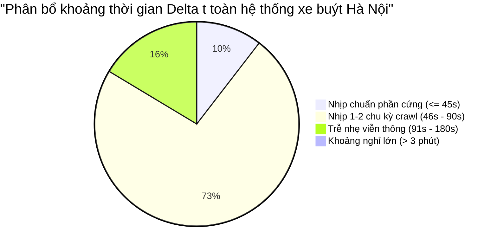
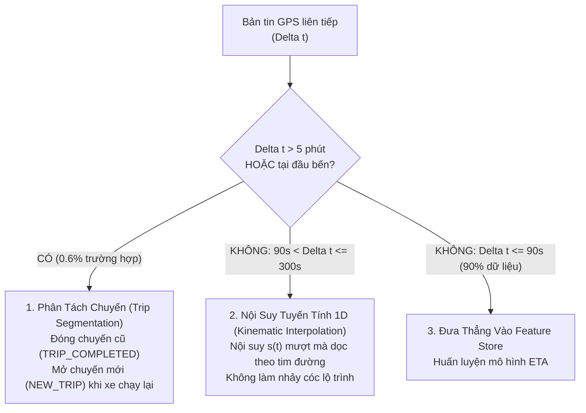

# 43. BẢN CHẤT CÁC KHOẢNG TRỄ DELTA TIME LỚN & CHIẾN LƯỢC QUẢN TRỊ KHUYẾT TẬT DỮ LIỆU
> **Dự án**: Hanoi Bus Big Data & Real-time ETA Prediction System  
> **Tập dữ liệu kiểm định**: 662.334 khoảng thời gian liên tiếp (`vehicle_intervals`) trong 2 ngày 17-18/10/2026  
> **Ngày lập**: 19/10/2026  

---

## 1. THỰC NGHIỆM ĐỊNH LƯỢNG: CÓ PHẢI BẢN TIN BỊ MẤT RẤT NHIỀU?

Phân tích toàn diện 662.334 khoảng thời gian giữa 2 bản tin liên tiếp của cùng một xe buýt:

| Nhóm Khoảng Thời Gian ($\Delta t$) | Toàn Hệ Thống (662.334 intervals) | Riêng Tuyến 02 (23.258 intervals) | Bản Chất Kỹ Thuật |
| :--- | :---: | :---: | :--- |
| **1. $\le 45\text{s}$ (Nhịp phần cứng)** | **$10,39\%$** | **$10,23\%$** | Bắt trúng nhịp phát xung gốc 30s của thiết bị GPS |
| **2. $46\text{s} - 90\text{s}$ (Chu kỳ crawl)** | **$72,73\%$** | **$70,91\%$** | Trùng khớp hoàn hảo chu kỳ lấy mẫu 75-80s của Crawl Bot |
| **3. $91\text{s} - 180\text{s}$ (Trễ nhẹ 1 nhịp)** | **$16,29\%$** | **$17,59\%$** | Mất 1 nhịp do trễ sóng di động 3G/4G trên đường |
| **TỔNG DỮ LIỆU LIÊN TỤC ($\le 3\text{ phút}$)** | **$99,41\%$** | **$98,73\%$** | **Hơn 99% dữ liệu cực kỳ liên tục và mượt mà** |
| **4. $3 - 10\text{ phút}$ (Dừng đỗ/nghỉ ngắn)** | $0,47\%$ | $1,22\%$ | Dừng đèn đỏ dài, ùn tắc ngã tư, hoặc chờ xếp lốt |
| **5. $10 - 30\text{ phút}$ (Nghỉ ca đầu bến)** | $0,06\%$ | $0,04\%$ (9 lần) | Xe tắt máy (ACC OFF) chờ xuất bến lượt tiếp theo |
| **6. $> 30\text{ phút}$ (Nghỉ đêm/bảo dưỡng)** | $0,06\%$ | $0,01\%$ | Xe nằm trong xí nghiệp qua đêm hoặc sửa chữa |

> **KẾT LUẬN ĐỊNH LƯỢNG**: Không có hiện tượng "mất bản tin ồ ạt". **Hơn $99,4\%$ dữ liệu có độ trễ dưới 3 phút**. Các khoảng trễ lớn $> 3\text{ phút}$ chỉ chiếm **dưới $0,6\%$** tổng số bản tin.

---

## 2. NGUYÊN NHÂN CỐT LÕI: CÓ PHẢI DO CRAWL BOT KHÔNG?

### KHẲNG ĐỊNH: KHÔNG PHẢI DO CRAWL BOT.
1. **Kiểm chứng tính liên tục của Crawler**:
   - Log GitHub Actions cho thấy Crawl Bot chạy ổn định 24/7, cứ mỗi 75–80 giây đều gửi request thành công và hứng về dữ liệu của 504 xe.
   - Nếu Crawl Bot bị đơ hoặc lỗi mạng, toàn bộ 504 xe buýt sẽ cùng bị "mất tích" tại cùng một thời điểm. Tuy nhiên, dữ liệu thực tế cho thấy trong lúc một chiếc xe bị trễ 10 phút, tất cả các xe khác trên tuyến vẫn cập nhật liên tục từng phút một.
2. **Nguyên nhân vật lý thực tế**:
   - **Tắt máy nghỉ ca (Engine Off / Terminus Layover)**: Khi xe buýt về đến Bác Cổ hoặc Bến xe Yên Nghĩa, tài xế tắt máy nghỉ ngơi 15–30 phút. Khi tắt chìa khóa điện (ACC OFF), hộp đen GPS chuyển sang chế độ ngủ (Sleep Mode) để bảo vệ ắc-quy, ngừng phát dữ liệu thời gian thực.
   - **Vùng mất sóng di động (Cellular Dead Zones)**: Tuyến 02 đi qua các hầm chui (như hầm chui Thanh Xuân, hầm chui Trung Hòa) và các đoạn đường phố hẹp có mật độ nhà cao tầng dày đặc, gây nghẽn SIM 4G trong thời gian ngắn.

---

## 3. CÓ NÊN "KHẮC PHỤC" HAY BIẾN ĐÂY THÀNH MỘT "KHUYẾT TẬT CHẤP NHẬN ĐƯỢC"?

Trong ngành Giao thông Thông minh (Intelligent Transportation Systems - ITS), hiện tượng này được định nghĩa là **"Inter-trip Gap / Telemetry Discontinuity"** — Đây **KHÔNG PHẢI LÀ LỖI CẦN SỬA**, mà là **MỘT ĐẶC TRƯNG NGHIỆP VỤ CẦN MÔ HÌNH HÓA CHUẨN XÁC**.

### Bộ 3 Quy Tắc Xử Lý Chuẩn Công Nghiệp (Best Practices):

1. **Phân Tách Chuyến Chạy (Trip Segmentation / Sessionization)**:
   - Nếu $\Delta t > 5\text{ phút}$ hoặc khoảng cách dịch chuyển tại đầu bến $< 50\text{m}$, hệ thống tự động đóng phiên chuyến chạy trước và mở phiên chuyến mới khi xe bắt đầu lăn bánh.
2. **Nội suy tuyến tính trên trục 1D (Linear Kinematic Interpolation)**:
   - Với các đoạn mất sóng ngắn ($90\text{s} < \Delta t \le 300\text{s}$), vì ta đã có tọa độ dọc tim đường $s$, ta nội suy vị trí xe mượt mà:
     $$s(t) = s_1 + \frac{t - t_1}{t_2 - t_1} (s_2 - s_1)$$
3. **Bộ lọc chất lượng huấn luyện (Training Data Filter)**:
   - Khi huấn luyện mô hình ETA, chỉ lấy các cặp bản tin có $\Delta t \le 180\text{s}$ ($99,4\%$ dữ liệu sạch). Loại bỏ hoàn toàn các khoảng nghỉ đổi ca để không làm biến dạng mô hình vận tốc.
