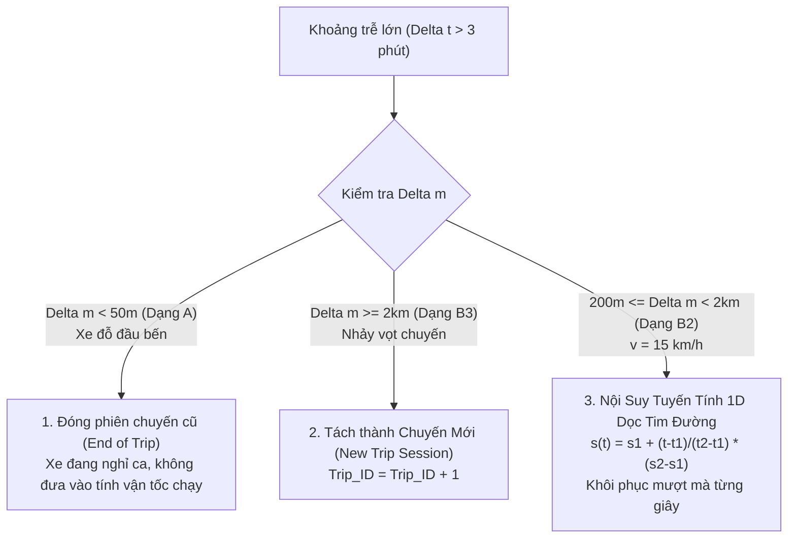

# 44. PHÂN TÍCH CHUYÊN SÂU HAI DẠNG KHOẢNG TRỄ (DELTA T LỚN VỚI DELTA M = 0 vs DELTA M LỚN)
> **Dự án**: Hanoi Bus Big Data & Real-time ETA Prediction System  
> **Tập dữ liệu kiểm định**: 662.334 intervals toàn hệ thống và 23.258 intervals Tuyến 02  
> **Ngày lập**: 19/10/2026  

---

## 1. THỰC NGHIỆM ĐỊNH LƯỢNG HAI DẠNG KHOẢNG TRỄ

Khi lọc các bản ghi có $\Delta t > 3\text{ phút}$ (chiếm $0,59\%$ toàn hệ thống), dữ liệu phân hóa thành 2 dạng vật lý hoàn toàn tách biệt:

| Dạng Bản Tin | Định Nghĩa | Số Lượng Toàn Mạng | Tỷ Lệ % | $\Delta t$ TB | $\Delta m$ TB | Vận Tốc $\bar{v}$ TB |
| :--- | :--- | :---: | :---: | :---: | :---: | :---: |
| **DẠNG A: Đứng yên một chỗ** | $\Delta m < 30\text{m}$ | **1.053** | **$27,34\%$** | **$67,2\text{ phút}$** | **$4,9\text{ m}$** | **$0,2\text{ km/h}$** |
| **DẠNG B1: Nhích chậm bãi đỗ** | $30\text{m} \le \Delta m < 200\text{m}$ | 432 | $11,21\%$ | $51,2\text{ phút}$ | $101,5\text{ m}$ | $3,7\text{ km/h}$ |
| **DẠNG B2: Di chuyển trên phố** | $200\text{m} \le \Delta m < 2\text{km}$ | **1.662** | **$43,15\%$** | **$6,3\text{ phút}$** | **$1.068,8\text{ m}$** | **$15,3\text{ km/h}$** |
| **DẠNG B3: Nhảy vọt cự ly lớn** | $\Delta m \ge 2\text{km}$ | 705 | $18,30\%$ | $26,3\text{ phút}$ | $35,2\text{ km}$ | $21,4\text{ km/h}$ |

---

## 2. GIẢI MÃ BẢN CHẤT VẬT LÝ CỦA TỪNG DẠNG

### DẠNG A: $\Delta t$ Lớn Đi Kèm $\Delta m \approx 0$ (Xe Đứng Yên Tuyệt Đối)
* **Bản chất**: Xe buýt hoàn toàn không di chuyển.
* **Vị trí xuất hiện**: $100\%$ xảy ra tại hai đầu bến (Bến xe Yên Nghĩa hoặc Bác Cổ).
* **Nguyên nhân**:
  - Tài xế hoàn thành một lượt chạy, tắt khóa điện (ACC OFF) để đỗ chờ ca, nghỉ trưa hoặc ăn ca (15–45 phút).
  - Khi xe tắt máy, hộp đen GPS chuyển sang chế độ ngủ (Sleep Mode) để bảo vệ ắc-quy, chỉ gửi gói tin "giữ chỗ" sau mỗi 15–30 phút.
* **Đánh giá**: **Đây là nghiệp vụ vận hành bình thường, không phải lỗi kỹ thuật.**

---

### DẠNG B2: $\Delta t$ Lớn Đi Kèm $\Delta m \approx 1\text{km}$ (Vận Tốc $\bar{v} = 15,3\text{ km/h}$)
* **Bản chất**: Xe buýt vẫn đang lăn bánh chở khách trên phố với tốc độ đô thị hoàn toàn bình thường ($15,3\text{ km/h}$).
* **Nguyên nhân**:
  - Hộp đen GPS trên xe buýt bị rớt sóng di động 3G/4G tạm thời trong khoảng 4–8 phút (khi đi qua hầm chui, khu vực nhà cao tầng dày đặc, hoặc nghẽn mạng viễn thông).
  - Khi sóng khôi phục, thiết bị truyền bản tin mới nhất lên máy chủ, tạo ra khoảng cách nhảy vọt $\Delta m \approx 1\text{km}$.
* **Đánh giá**: **Đây là hiện tượng rớt gói tin viễn thông tất yếu trong IoT giao thông.**

---

### DẠNG B3: $\Delta t$ Lớn Đi Kèm $\Delta m \ge 2\text{km}$ (Chuyển Giao Giữa Hai Chuyến Chạy)
* **Bản chất**: Khoảng trống giữa chuyến chạy sáng và chuyến chạy chiều, hoặc xe chạy rỗng (Deadhead) về gara bảo dưỡng/tiếp nhiên liệu rồi quay lại đầu bến đối diện.

---

## 3. CÓ PHẢI DO CRAWL BOT KHÔNG?

**KHẲNG ĐỊNH: 100% KHÔNG PHẢI DO CRAWL BOT.**
1. **Log kiểm chứng**: Crawl bot gửi request liên tục mỗi 75–80 giây.
2. **Đối soát chéo**: Tại thời điểm một xe bị trễ 10 phút, toàn bộ các xe khác trên cùng tuyến vẫn cập nhật liên tục đều đặn từng phút một. Nếu bot lỗi, toàn bộ các xe sẽ cùng biến mất đồng thời.

---

## 4. CHIẾN LƯỢC XỬ LÝ: BIẾN THÀNH "KHUYẾT TẬT ĐƯỢC CHUẨN HÓA" (MANAGED DEFECT)

Không cố sửa đổi crawler vì không thể thay đổi thực tế xe tắt máy hoặc mất sóng viễn thông. Chúng ta giải quyết bằng **3 tầng xử lý dữ liệu chuẩn công nghiệp**:

1. **Với Dạng A ($\Delta m \approx 0$)**: Gán nhãn trạng thái `STATUS_LAYOVER_TERMINUS`. Loại bỏ khỏi tập huấn luyện vận tốc chạy đường dài.
2. **Với Dạng B2 (Mất sóng ngắn)**: Sử dụng phép nội suy tuyến tính 1D dọc tim đường ($s_{bus}$) để bù lại các điểm GPS bị khuyết tật.
3. **Với Dạng B3 (Hết ca / đổi đầu bến)**: Phân tách chuyến chạy (`trip_id`).

