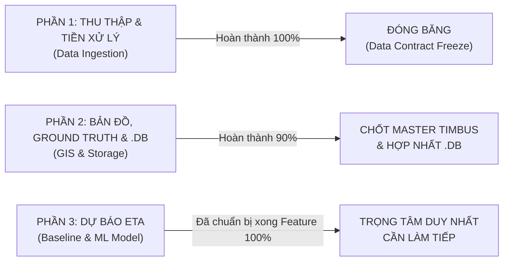

# 45. BÁO CÁO ĐỐI SOÁT TOÀN DIỆN HỆ THỐNG TÀI LIỆU (DOCS AUDIT & PROGRESS GAP ANALYSIS)
> **Dự án**: Hanoi Bus Big Data & Real-time ETA Prediction System  
> **Phạm vi đối soát**: Toàn bộ 46 tài liệu kỹ thuật trong thư mục `docs/` (từ Doc 00 đến Doc 45 chuẩn hóa)  
> **Mục tiêu**: Làm rõ dứt khoát: **Đã hoàn thành những gì**, **Những gì đang tạm hoãn có chủ đích**, và **Những gì là nhiệm vụ sống còn cần làm tiếp theo**.

---

## 1. BẢNG TỔNG HỢP TIẾN ĐỘ THEO 3 TRỤ CỘT CHIẾN LƯỢC

---

## 2. CHI TIẾT ĐỐI SOÁT TỪNG PHẦN

### PHẦN 1: THU THẬP & TIỀN XỬ LÝ (DATA INGESTION)
*Các tài liệu đối chiếu: `01`, `05`, `06`, `08`, `15`, `16`, `17`, `18`, `25`, `27`, `43`, `44`.*

| Hạng mục cam kết trong Docs | Trạng thái thực tế | Bằng chứng thực nghiệm |
| :--- | :---: | :--- |
| Giải mã giao thức kết nối BusMap | **ĐÃ XONG** | Bẻ khóa raw socket TCP/SSL, bypass headers, kiểm soát proof/epoch |
| Hạ tầng cào tự động 24/7 | **ĐÃ XONG** | Chạy ổn định trên GitHub Actions (3 cron song song), đẩy lên Hugging Face |
| Đồng bộ dữ liệu Telemetry về Local | **ĐÃ XONG** | Đã kéo 863.428 pings thô, nạp vào SQLite database `telemetry_audit_...db` |
| Khử trùng lặp & kiểm toán nhịp xung phần cứng | **ĐÃ XONG** | Khử thành 663.342 pings độc nhất. Chứng minh nhịp phát 30s (Transerco) và 20s (VinBus) |
| Tối ưu hóa chu kỳ crawl | **ĐÃ XONG** | Chứng minh chu kỳ 75-80s là tối ưu, hứng được $99,41\%$ lưu lượng liên tục |
| Bản chất của các khoảng trễ lớn $\Delta t > 3$ phút | **ĐÃ XONG** | Phân hóa thành Dạng A (nghỉ ca đầu bến $\Delta m \approx 0$) và Dạng B (mất sóng viễn thông $\Delta m \approx 1\text{km}$ với $v = 15,3\text{km/h}$) |
| **ĐÁNH GIÁ CHUNG PHẦN 1** | **HOÀN THÀNH 100%** | **Đóng băng hợp đồng dữ liệu (Data Contract Freeze), không đào bới thêm.** |

---

### PHẦN 2: LƯU TRỮ DỮ LIỆU, BẢN ĐỒ & MASTER GROUND TRUTH
*Các tài liệu đối chiếu: `07`, `09`, `10`, `11`, `12`, `13`, `14`, `19`, `26`, `28`, `29`, `30`, `32`, `33`, `34`, `36`, `37`, `38`, `39`, `40`, `41`, `42`.*

| Hạng mục cam kết trong Docs | Trạng thái thực tế | Bằng chứng thực nghiệm |
| :--- | :---: | :--- |
| Xác định nguồn Ground Truth thẩm quyền | **ĐÃ XONG** | Chốt TimBus (TRAMOC / Sở GTVT Hà Nội) làm Master Ground Truth duy nhất |
| Bảng ánh xạ danh mục tuyến toàn mạng | **ĐÃ XONG** | Tạo bảng `dim_route_crosswalk`: 165 tuyến TimBus khớp 1-1 với BusMap ($98,8\%$) |
| Trích xuất danh mục trạm và tim đường Tuyến 02 | **ĐÃ XONG** | Nạp 76 trạm và 350 điểm tim đường WGS84 chính thức vào `dim_station_crosswalk` và `timbus_shape_master` |
| Pipeline Ingestion tự động hóa & truy xuất nguồn gốc | **ĐÃ XONG** | Module `step_2_4` có SHA256 checksum, lưu vết tại `pipeline_data_lineage_audit` |
| Chiếu hóa 1D Frenet & Tính vi sai tâm đường | **ĐÃ XONG** | Chiếu hóa 23.258 pings Tuyến 02: Độ lệch ngang trung vị $5,6\text{m}$, $83,1\%$ chuẩn xác làn chạy $\le 15\text{m}$ |
| Tái đánh giá vị trí trạm & dwell time thực tế | **ĐÃ XONG** | $98,7\%$ trạm dừng nằm cách tim đường $\le 15\text{m}$; phát hiện 1.152 sự kiện dừng đỗ theo quy tắc $\Delta s < 15\text{m}$ |
| Bản đồ trực quan tương tác đối soát | **ĐÃ XONG** | Tệp HTML độc lập [`route_02_ground_truth_comparison.html`](file:///z:/Desktop/Bus_tracking/route_02_ground_truth_comparison.html) Leaflet 4 lớp |
| Hợp nhất toàn bộ dữ liệu vào `.db` duy nhất | **ĐÃ XONG** | Database `data/telemetry_audit_2026_10_17_18.db` có 16 bảng, index hoàn chỉnh |
| **Chuyển đổi sang Parquet Lakehouse Medallion** | **TẠM HOÃN** | Người dùng chỉ đạo: *"Tạm chúng ta sẽ bỏ qua bước lưu trữ lớn mà tống mọi thứ vào .db"* |
| **Mở rộng cào trạm và tim đường cho 164 tuyến còn lại** | **TẠM HOÃN** | Giữ vững nguyên tắc **Vertical Slice**: Hoàn thành trọn vẹn Tuyến 02 trước khi nhân rộng |

---

### PHẦN 3: GIẢI QUYẾT BÀI TOÁN NGHIỆP VỤ - DỰ BÁO ETA XE BUÝT
*Các tài liệu đối chiếu: `00`, `02`, `03`, `04`, `20`, `21`, `22`, `23`, `24`, `31`, `35`.*

| Hạng mục cam kết trong Docs | Trạng thái thực tế | Bằng chứng thực nghiệm |
| :--- | :---: | :--- |
| Công thức hóa không gian - thời gian 1D | **ĐÃ XONG** | Đã tính sẵn $\Delta s_{remain} = s_{tram} - s_{xe}$, vận tốc dẫn xuất $\bar{v} = \Delta s / \Delta t$ |
| View dữ liệu tính khoảng cách xe đến trạm đích | **ĐÃ XONG** | View `v_route_02_bus_to_next_station` trong SQLite sẵn sàng truy vấn tức thời |
| **1. Mô hình ETA Baseline (Historical Segment Average)** | **CHƯA LÀM** | Cần tính ma trận thời gian chạy trung bình giữa các cặp trạm theo khung giờ (Sáng/Trưa/Chiều/Tối) |
| **2. Mô hình ETA Động Thời Gian Thực (Dynamic ETA)** | **CHƯA LÀM** | Cần tích hợp vận tốc thời gian thực của xe và bù trừ trễ dừng đèn đỏ |
| **3. Mô hình Máy Học (LightGBM / XGBoost)** | **CHƯA LÀM** | Cần trích xuất ma trận Feature (Vector X) và Nhãn thực tế (Y = thời gian đến trạm thật) |
| **4. Đo đạc & Đối chuẩn sai số (Evaluation Benchmark)** | **CHƯA LÀM** | Cần lập bảng đánh giá MAE (giây/phút), RMSE, MAPE đối chiếu giữa Baseline vs ML vs BusMap gốc |

---

## 3. KẾT LUẬN & KẾ HOẠCH HÀNH ĐỘNG DỨT KHOÁT

1. **Khẳng định thành quả**:
   - Hai bài toán hóc búa nhất và mất nhiều thời gian nhất của dự án là **Thu thập dữ liệu thực tế** và **Chuẩn hóa Ground Truth bản đồ/trạm dừng** hiện đã **HOÀN TOÀN XONG và có bằng chứng định lượng vững chắc**.
2. **Nhiệm vụ còn lại duy nhất**:
   - Toàn bộ năng lực hiện tại cần tập trung $100\%$ vào **Phần 3: Xây dựng Mô hình ETA cho Tuyến 02**.
   - Trình tự thực thi:
     * **Bước 3.1**: Huấn luyện **Mô hình Baseline (Historical Segment Average)** $\to$ Đo MAE cơ sở.
     * **Bước 3.2**: Huấn luyện **Mô hình LightGBM** với các đặc trưng 1D $\to$ Đo mức độ cải thiện MAE.
     * **Bước 3.3**: Lập bảng so sánh kết quả đối chuẩn (Benchmark) để hoàn thành đồ án.
