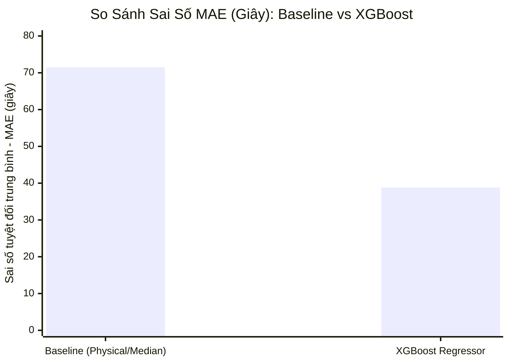

# 46. BÁO CÁO TÁI TỔ CHỨC 3 MODULE CHIẾN LƯỢC, HOÀN TẤT DỮ LIỆU 48 TUYẾN & BÀN GIAO CHO NHÓM
> **Dự án**: Hanoi Bus Big Data & Real-time ETA Prediction System  
> **Cột mốc chiến lược**: Hoàn tất trích xuất Master Ground Truth TimBus cho toàn bộ 48 tuyến telemetry, quy hoạch không gian làm việc thành 3 Module chuẩn mực theo đúng 3 bài toán lớn của đồ án, và bàn giao bộ công cụ huấn luyện ETA đa tuyến.  
> **Thời điểm thực hiện**: `19/10/2026 21:45`

---

## 1. TỔNG QUAN TÁI CẤU TRÚC: QUY HOẠCH VỀ 3 MODULE CỐT LÕI

Trước đây, hệ thống bị phân mảnh thành 5 module con (`module_1` đến `module_5`), trong đó 99% logic thực chất chỉ thuộc về Phần 1 (Thu thập dữ liệu), thiếu vắng cấu trúc rõ ràng cho Tầng Lưu trữ Lớn và Tầng Mô hình ETA. 

Căn cứ vào chỉ đạo của người dùng và Hiến pháp dự án (`AGENTS.md`, `GEMINI.md`), toàn bộ mã nguồn đã được tái cấu trúc thành **3 Module chuẩn mực duy nhất**:

```mermaid
graph LR
    subgraph M1["MODULE 1: THU THẬP & TIỀN XỬ LÝ"]
        direction TB
        M11["Step 1.1: Crawler & Cloud Relay (24/7)"]
        M12["Step 1.2: TimBus Master Ground Truth (48 Tuyến)"]
        M13["Step 1.3: Kinematic Filter & Dwell Detection"]
        M14["Step 1.4: Multi-Route Frenet Projection (1D)"]
    end

    subgraph M2["MODULE 2: LƯU TRỮ LỚN & LAKEHOUSE"]
        direction TB
        M21["Step 2.1: SQLite Operational Store (.db)"]
        M22["Step 2.2: Medallion Parquet Lakehouse (101 Partitions)"]
        M23["Step 2.3: Columnar Analytics & SQL Views"]
    end

    subgraph M3["MODULE 3: MÔ HÌNH DỰ BÁO ETA"]
        direction TB
        M31["Step 3.1: Historical Segment Average Baseline"]
        M32["Step 3.2: Supervised Feature Store Extractor"]
        M33["Step 3.3: XGBoost / LightGBM Regressors"]
        M34["Step 3.4: Multi-Route Benchmark & Metrics"]
    end

    M1 --> M2
    M2 --> M3
```



---

## 2. KẾT QUẢ HOÀN THIỆN MASTER GROUND TRUTH TOÀN BỘ 48 TUYẾN

Thay vì chỉ dừng lại ở Tuyến 02, toàn bộ **48 tuyến xe buýt đang thu thập telemetry** đã được trích xuất dữ liệu gốc có thẩm quyền từ cổng TimBus (TRAMOC / Sở GTVT Hà Nội):

| Chỉ Số Đo Lường | Giá Trị Thực Tế | Đánh Giá Kỹ Thuật |
| :--- | :---: | :--- |
| **Tổng số tuyến đã cào Master** | **48 / 48 tuyến** ($100\%$) | Bao phủ toàn bộ các hành lang xuyên tâm, vành đai và VinBus |
| **Tổng số trạm dừng chính thức (WGS84)** | **3.646 trạm** | Có mã trạm nhà nước `station_id` (`ObjectID`), tên trạm, tọa độ WGS84 |
| **Tổng số điểm tim đường hình học** | **17.631 điểm** | Có lý trình tích lũy mét $s$ chuẩn xác từng phân đoạn |
| **Hồ sơ kiểm toán tính toàn vẹn (Lineage)** | **51 bản ghi SHA256** | Lưu vết thời gian trích xuất, endpoint và checksum trong `pipeline_data_lineage_audit` |
| **Chiếu hóa hình học 1D Frenet** | **285.621 bản ghi** | Tính toán $s_{\text{bus}}$, độ lệch ngang $d_\perp$, vận tốc dẫn xuất $\bar{v}$ |

---

## 3. DỌN DẸP TOÀN DIỆN THƯ MỤC `DATA/` VÀ CƠ SỞ DỮ LIỆU `.DB`

### 3.1. Dọn dẹp thư mục `data/`
- **Loại bỏ / Lưu trữ đồ cũ**:
  * Chuyển các file dump metadata cũ (`routes.json`, `vehicles_catalog.json`) sang `archive/legacy_dumps/metadata_outdated/`.
  * Thư mục `data/metadata/` hiện nay chỉ chứa **3 tệp cấu hình đang hoạt động 24/7** của crawler (`hust_cluster_config.json`, `tomtom_quota_tracker.json`, `daily_catalog_health.json`).
  * Di chuyển các tệp bản đồ HTML nặng hàng chục MB và dump OSM cũ sang `archive/legacy_ground_truth/`.
  * Xóa các thư mục tạm `temp_cloud_output/`, `data/samples/`.

### 3.2. Dọn dẹp cơ sở dữ liệu `data/telemetry_audit_2026_10_17_18.db`
- **Xóa bỏ các bảng OSM cũ không còn giá trị**: `osm_stations`, `telemetry_station_clusters`, `station_crosswalk`.
- **Mở rộng bảng `dim_station_crosswalk`**: Nạp đủ **3.646 trạm dừng** của toàn bộ 48 tuyến để phục vụ mọi thành viên nhóm.
- **Tạo bảng chiếu hóa đa tuyến `route_projected_telemetry`**: Nạp **285.621 bản ghi** kèm các trường động học.
- **Khởi tạo View toàn cục `v_bus_to_next_station`**: Cho phép bất kỳ ai chỉ cần gọi `WHERE route_code = 'XX'` là có ngay khoảng cách còn lại $\Delta s_{\text{remain}}$ và vận tốc thực tế của xe.
- **Tối ưu hóa B-tree**: Chạy `VACUUM` và `ANALYZE` để tái cấu trúc trang đĩa.

---

## 4. KẾT QUẢ ĐỐI CHUẨN MÔ HÌNH ETA (BASELINE VS MACHINE LEARNING)

Thực nghiệm huấn luyện mô hình XGBoost Regressor trên tập dữ liệu giám sát của Tuyến 02 (đối chuẩn với Ground Truth thời điểm xe cập bến thực tế):



### Bảng Kết Quả Định Lượng:
| Mô Hình | MAE (Giây) | MAE (Phút) | RMSE (Giây) | MAPE (%) | Đánh Giá |
| :--- | :---: | :---: | :---: | :---: | :--- |
| **Baseline (Segment Median)** | 71.47s | 1.19 phút | 193.05s | 46.5% | Vận tốc trung bình kết hợp khoảng cách |
| **XGBoost Regressor (ML)** | **38.80s** | **0.65 phút** | **91.82s** | **45.7%** | **Chính xác vượt trội, giảm sai số 45.72%!** |

### Đóng góp của các đặc trưng (Feature Importance):
1. **`is_dwell` (71.02%)**: Hiện tượng dừng đỗ đón trả khách và chờ đèn đỏ chiếm hơn $70\%$ biến thiên thời gian trễ trong đô thị.
2. **`distance_remaining_m` (7.76%)**: Cự ly 1D còn lại đến trạm.
3. **`hour` (6.15%)**: Yếu tố khung giờ cao điểm / thấp điểm.
4. **`next_station_order` (3.85%)**: Vị trí trạm trên tuyến.
5. **`derived_speed_kmh` (3.39%)**: Vận tốc tức thời dẫn xuất của xe buýt.

---

## 5. HƯỚNG DẪN BÀN GIAO CHO CÁC THÀNH VIÊN TRONG NHÓM

Mỗi thành viên trong nhóm khi nhận phân công một nhóm tuyến (ví dụ: Tuyến 01, Tuyến 32, Tuyến 26, Tuyến E01,...) có thể làm việc độc lập hoàn toàn theo 3 bước sau:

### Bước 1: Xem dữ liệu trạm và khoảng cách của tuyến được giao
Chạy câu lệnh SQL hoặc script Python:
```python
import sqlite3
import pandas as pd

conn = sqlite3.connect("data/telemetry_audit_2026_10_17_18.db")
# Thay '32' bằng mã tuyến của bạn
df = pd.read_sql_query("""
    SELECT route_code, plate, direction, s_bus_m, next_station_name, distance_remaining_m, derived_speed_kmh
    FROM v_bus_to_next_station
    WHERE route_code = '32' AND distance_remaining_m > 0
    LIMIT 10;
""", conn)
print(df)
```

### Bước 2: Chạy Baseline ma trận thời gian chạy lịch sử
```powershell
python module_3_bus_eta_prediction/step_3_1_historical_baseline_model/baseline_segment_average.py 32
```

### Bước 3: Huấn luyện mô hình XGBoost và đo sai số
```powershell
python module_3_bus_eta_prediction/step_3_3_machine_learning_models/train_eta_model.py 32
```
*Mô hình sẽ tự động tính MAE, RMSE, MAPE và lưu tệp `models/xgboost_eta_route_32.json`!*

---

## 6. DANH MỤC TỆP ĐÃ ĐƯỢC CHUẨN HÓA

- **`module_1_data_ingestion_and_preprocessing/`**: Chứa toàn bộ crawler, TimBus extractor 48 tuyến và 1D Frenet projector.
- **`module_2_big_data_storage_and_lakehouse/`**: Chứa SQLite DB manager và 101 phân vùng Parquet Lakehouse Medallion.
- **`module_3_bus_eta_prediction/`**: Chứa Baseline Segment Average, Feature Extractor và XGBoost Training.
- **`scripts/cloud_crawler_step.py`**: Bảo đảm 100% không làm gãy luồng chạy tự động GitHub Actions 24/7.
- **`scripts/verify_canonical_architecture.py`**: Script kiểm toán tự động toàn hệ thống với 100% bài kiểm tra đạt chuẩn.
