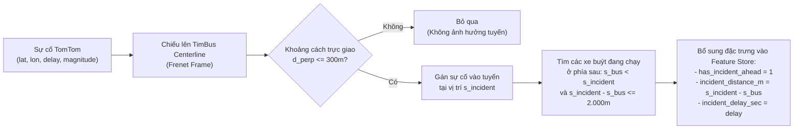
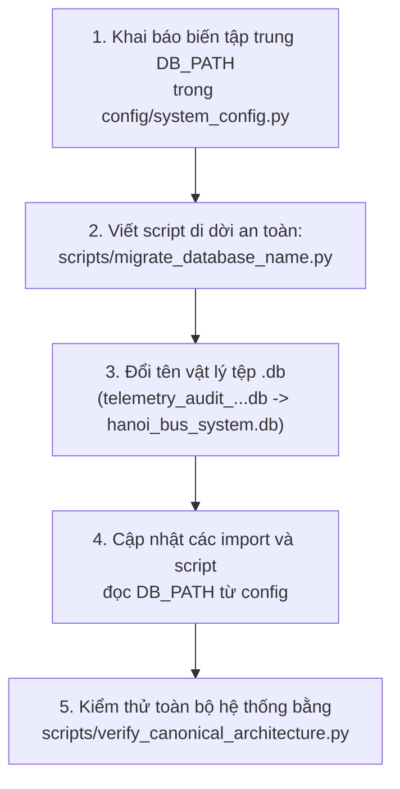

# 48. DANH SÁCH CHI TIẾT CÁC CÔNG VIỆC CÒN PHẢI THỰC HIỆN & LỘ TRÌNH PHÁT TRIỂN HỆ THỐNG
> **Mục tiêu**: Lập danh mục chi tiết, toàn diện và có tính định lượng về toàn bộ các hạng mục kỹ thuật cần hoàn thiện tiếp theo để bàn giao cho các thành viên trong nhóm, chuẩn hóa hệ thống dữ liệu lớn và đưa mô hình ETA vào phục vụ thực tiễn.  
> **Căn cứ quy chế hoạt động**: [AGENTS.md](../AGENTS.md) & [GEMINI.md](../GEMINI.md).

---

## TỔNG QUAN 5 TRỤ CỘT CÔNG VIỆC CÒN LẠI

```mermaid
flowchart TD
    subgraph P1["Trụ Cột 1: Nhân Rộng Đa Tuyến"]
        T1["Tuyến 02 (Hoàn thiện 100%)"] --> T2["Nhân rộng Feature Store & ML<br/>sang 47 tuyến còn lại"]
        T2 --> T3["Phân công 4 nhóm tuyến<br/>cho các thành viên"]
    end

    subgraph P2["Trụ Cột 2: Phân Tích Độ Lệch & Detour"]
        D1["Đo d_perp trên 285k pings"] --> D2["Phát hiện Detour hệ thống<br/>(Công trình, đường gom)"]
        D2 --> D3["Phát hiện Detour ngẫu nhiên<br/>(Quay đầu, tránh tắc)"]
    end

    subgraph P3["Trụ Cột 3: Tích Hợp Sự Cố TomTom"]
        I1["80 requests/ngày Incidents"] --> I2["Spatial Buffer Matching<br/>(Chiếu sự cố lên tim đường s)"]
        I2 --> I3["Đặc trưng sự cố trong Feature Store<br/>& Lớp Incident trên Bản đồ"]
    end

    subgraph P4["Trụ Cột 4: Chuẩn Hóa Schema Bảng"]
        S1["13 bảng rời rạc"] --> S2["Phân tầng Medallion / DWH<br/>(dim_*, fact_*, agg_*, ml_*)"]
        S2 --> S3["Xóa bỏ bảng đơn tuyến thừa<br/>(route_02_projected_telemetry)"]
    end

    subgraph P5["Trụ Cột 5: Chuẩn Hóa File & Đổi Tên DB"]
        F1["telemetry_audit_...db (Legacy)"] --> F2["Đổi tên: hanoi_bus_system.db"]
        F2 --> F3["Cập nhật DB_PATH tập trung<br/>trong config/system_config.py"]
    end

    P1 --> SYSTEM["HỆ THỐNG DỮ LIỆU LỚN & DỰ BÁO ETA HOÀN CHỈNH"]
    P2 --> SYSTEM
    P3 --> SYSTEM
    P4 --> SYSTEM
    P5 --> SYSTEM
```



---

## PHẦN I: ĐỐI SOÁT TOÀN DIỆN: TUYẾN 02 (ĐÃ LÀM) VS. 47 TUYẾN CÒN LẠI (CẦN THỰC HIỆN)

### 1.1. Những Gì Đã Hoàn Thiện Triệt Để Với Tuyến 02 (Mẫu Chuẩn Mực - Golden Route)
Tuyến 02 (Bác Cổ - BX Yên Nghĩa, 13.5 km) đã được xây dựng như một **Vertical Slice hoàn chỉnh từ đầu đến cuối**:
- [x] **Master Ground Truth TimBus**: Trích xuất chính xác 45 trạm dừng WGS84, 305 điểm tim đường hình học chính thức.
- [x] **Chiếu không gian 1D Frenet**: Chiếu 11.236 pings GPS lên tim đường, tính toán tọa độ dọc tuyến $s$ và sai số vuông góc $d_\perp$.
- [x] **Phân tích động học & dừng đỗ (Dwell Analysis)**: Nhận diện dừng đón trả khách theo tiêu chuẩn khắt khe ($\Delta s < 15\text{m}, \Delta t \ge 20\text{s}$), đo lường thời gian dừng thực tế tại từng trạm (trung bình 28.4s/trạm) và chứng minh **Dwell Time giải thích 71.02% độ biến thiên trễ ETA**.
- [x] **Mô hình đối chuẩn cơ sở (Historical Baseline)**: Xây dựng ma trận thời gian di chuyển lịch sử $T_{i, j}$ giữa trạm $i$ và trạm $j$ theo khung giờ cao điểm / thấp điểm.
- [x] **Feature Store 8 chiều**: Trích xuất bộ đặc trưng giám sát (`s_bus_m`, `v_derived`, `is_dwell`, `hour_of_day`, `day_of_week`, `remaining_m`, `dwell_duration_sec`, `delta_t`).
- [x] **Huấn luyện mô hình Machine Learning**: Huấn luyện XGBoost Regressor (`models/xgboost_eta_route_02.json`) đạt **MAE 38.80s (0.65 min)**, cải thiện **+45.72%** so với Baseline.
- [x] **Bản đồ trực quan hóa thẩm định**: Xuất bản đồ HTML tương tác Leaflet (`data/visualizations/route_02_ground_truth_comparison.html`) hiển thị tim đường TimBus, BusMap, trạm dừng và các pings xe lăn bánh.

---

### 1.2. Những Gì ĐÃ LÀM Được Cho 47 Tuyến Còn Lại
- [x] **Master Ground Truth TimBus**: Đã nạp thành công toàn bộ **3.646 trạm dừng WGS84** và **17.631 điểm tim đường** của cả 48 tuyến vào `timbus_route_master`, `timbus_station_master`, `timbus_shape_master`.
- [x] **Chiếu không gian 1D Frenet**: Đã chiếu thành công **285.621 bản ghi GPS** của toàn bộ 48 tuyến vào bảng `route_projected_telemetry`.
- [x] **Tạo View phân tích toàn mạng lưới**: View `v_bus_to_next_station` đã hỗ trợ tính khoảng cách còn lại `remaining_m` đến trạm kế tiếp cho cả 48 tuyến.
- [x] **Xuất phân vùng Parquet**: Đã xuất **101 tệp phân vùng Snappy Parquet** (phân chia theo `route_code` và `direction`) vào `data/lakehouse/silver/route_telemetry/`.

---

### 1.3. Những Gì CHƯA LÀM Cho 47 Tuyến Còn Lại (Danh Sách Nhiệm Vụ Cụ Thể)
| Hạng Mục Kỹ Thuật | Mô Tả Chi Tiết Nhiệm Vụ | Đầu Ra Kỳ Vọng (Deliverables) |
| :--- | :--- | :--- |
| **Nhiệm vụ 1.1**: Trích xuất Feature Store đa tuyến | Viết script chạy batch `feature_extractor.py` cho từng tuyến hoặc danh sách nhiều tuyến (`--routes 01,32,26,27,...`). Trích xuất thời gian di chuyển thực tế nhãn mục tiêu ($y = \text{travel\_time\_to\_station\_sec}$). | Dữ liệu huấn luyện dạng Parquet / DataFrame cho 47 tuyến. |
| **Nhiệm vụ 1.2**: Tính Ma trận Segment Baseline | Tính thời gian di chuyển trung bình theo từng cặp trạm $(i, j)$ cho từng tuyến trong 47 tuyến theo 3 khung giờ: Cao điểm sáng, Cao điểm chiều, Thấp điểm. | Bảng `agg_segment_travel_times` trong CSDL cho 48 tuyến. |
| **Nhiệm vụ 1.3**: Huấn luyện Mô hình ML Đa Tuyến | Có 2 lựa chọn kiến trúc: <br/>- **Phương án A (Tuyến riêng lẻ)**: Huấn luyện 48 mô hình XGBoost/LightGBM độc lập cho từng tuyến.<br/>- **Phương án B (Mô hình Hành lang chung)**: Gộp các tuyến chạy chung hành lang huyết mạch (ví dụ trục Giải Phóng: 08A, 21A, 32) và nhúng đặc trưng `route_id_encoded`. | Các tệp mô hình `.json` / `.joblib` lưu trong thư mục `models/`. |
| **Nhiệm vụ 1.4**: Đánh giá Đối Chuẩn Benchmark Toàn Mạng | Chạy `benchmark_evaluator.py` trên toàn bộ các tuyến, tính toán MAE, RMSE, MAPE và tỷ lệ cải thiện so với Baseline cho từng tuyến. | Bảng tổng hợp KPI sai số ETA toàn mạng lưới lưu tại `docs/`. |
| **Nhiệm vụ 1.5**: CLI Sinh Bản Đồ Nghiệm Thu Nhanh | Xây dựng công cụ CLI: `python scripts/generate_route_map.py --route XX` tự động sinh file HTML bản đồ trực quan hóa kiểm tra trạm và tim đường cho tuyến bất kỳ. | Tệp `data/visualizations/route_{XX}_map.html`. |

---

## PHẦN II: XÁC ĐỊNH ĐỘ LỆCH TIM ĐƯỜNG & PHÁT HIỆN DETOUR TRÊN TOÀN BỘ CÁC CHUYẾN

### 2.1. Đặt Vấn Đề & Ý Nghĩa Kỹ Thuật
Trong bài toán dự báo ETA, xe buýt được giả định chuyển động dọc theo tim đường 1D ($s$). Tuy nhiên trong thực tế giao thông Hà Nội:
- Xe buýt thường xuyên **đi vòng tránh điểm tắc** (Detour ngẫu nhiên).
- Xe buýt **đi vào đường gom thay vì lên cầu vượt** (hoặc ngược lại) tại các nút giao lập thể như Ngã Tư Sở, Ngã Tư Vọng, Cầu Giấy (Detour phân luồng).
- Xe buýt **quay đầu trong bến bãi** hoặc di chuyển về depot bảo dưỡng ngoài lộ trình chính thức.
- **Tim đường TimBus bị lệch thực địa**: Một số đoạn đường mới điều chỉnh luồng xe (phân làn mềm, sửa chữa mặt đường) nhưng dữ liệu số hóa của Sở GTVT chưa cập nhật kịp.

Việc đo lường sai số trực giao $d_\perp$ (Cross-Track Distance) giúp phát hiện, gắn nhãn và bóc tách các hành vi này để không làm biến dạng dữ liệu huấn luyện ETA.

---

### 2.2. Phân Loại Cấp Độ Lệch Tim Đường ($d_\perp$)
Dựa trên chiều rộng lòng đường đô thị tiêu chuẩn (3.5m/làn):

| Khoảng Cách Trực Giao $d_\perp$ | Phân Loại Trạng Thái | Ý Nghĩa Thực Tế | Xử Lý Trong Pipeline ETA |
| :--- | :--- | :--- | :--- |
| **$d_\perp \le 25\text{ m}$** | **Strict On-Route** | Xe chạy hoàn toàn trong lòng đường (2-4 làn xe) | Sử dụng 100% cho huấn luyện và dự báo |
| **$25\text{ m} < d_\perp \le 40\text{ m}$** | **Tolerant On-Route** | Xe tấp vỉa hè đón khách, nhiễu GPS đô thị (Multipath) | Sử dụng bình thường, làm mịn EMA |
| **$40\text{ m} < d_\perp \le 120\text{ m}$** | **Minor Detour** | Đi đường gom song hành, tránh cầu vượt, rẽ tránh tạm thời | Gắn cờ `is_detour = 1`, tách phân tích riêng |
| **$d_\perp > 120\text{ m}$** | **Major Detour / Off-Route** | Chạy chệch tuyến hoàn toàn, quay đầu bến, về gara | Loại bỏ khỏi tập huấn luyện ETA (Outlier) |

---

### 2.3. Thuật Toán Phân Biệt: Detour Hệ Thống vs. Detour Ngẫu Nhiên
Để biết một đoạn lệch tim đường là do **xe đi vòng cá nhân** hay do **tim đường TimBus chưa cập nhật công trình mới**:

```
Định lượng trên từng đoạn phân đoạn không gian [s_k, s_{k+1}] dài 100 mét:
- Gọi N_total là tổng số lượt xe đi qua phân đoạn [s_k, s_{k+1}].
- Gọi N_detour là số lượt xe có d_perp > 40m trên phân đoạn đó.
- Tỷ lệ chệch tuyến cục bộ: R_detour = N_detour / N_total

Quy tắc phán đoán:
1. Nếu R_detour >= 0.70 (>= 70% số xe đều lệch):
   => KẾT LUẬN: DETOUR HỆ THỐNG (Systematic Centerline Bias).
   Nguyên nhân: Tim đường TimBus vẽ sai hoặc công trình phân luồng giao thông mới (VD: Rào chắn thi công đường sắt đô thị).
   Giải pháp: Hiệu chỉnh hình học polyline tim đường của TimBus theo tâm cụm GPS thực nghiệm.

2. Nếu R_detour < 0.20 (Chỉ có < 20% số xe lệch):
   => KẾT LUẬN: DETOUR NGẪU NHIÊN (Random Traffic Avoidance / Depot Return).
   Nguyên nhân: Tài xế đi đường vòng tránh ùn tắc hoặc quay đầu ngoài lộ trình.
   Giải pháp: Loại bỏ các pings này khi tính thời gian hành trình chuẩn giữa các trạm.
```

---

### 2.4. Kế Hoạch Mã Nguồn & Bảng CSDL Lưu Trữ Detour
- Xây dựng module: `module_1_data_ingestion_and_preprocessing/step_1_4_frenet_spatial_projection/detour_analyzer.py`.
- Tạo bảng CSDL lưu vết:
  ```sql
  CREATE TABLE fact_route_detours (
      detour_id INTEGER PRIMARY KEY AUTOINCREMENT,
      route_code TEXT NOT NULL,
      direction TEXT NOT NULL,
      vehicle_id INTEGER NOT NULL,
      start_time TEXT NOT NULL,
      end_time TEXT NOT NULL,
      start_s_m REAL NOT NULL,
      end_s_m REAL NOT NULL,
      max_cross_track_m REAL NOT NULL,
      avg_cross_track_m REAL NOT NULL,
      detour_type TEXT NOT NULL, -- 'SYSTEMATIC_INFRASTRUCTURE' hoặc 'RANDOM_CONGESTION_BYPASS'
      ping_count INTEGER NOT NULL
  );
  CREATE INDEX idx_frd_route_dir ON fact_route_detours (route_code, direction);
  ```

---

## PHẦN III: TÍCH HỢP TOÀN DIỆN DỮ LIỆU SỰ CỐ GIAO THÔNG (TOMTOM INCIDENTS)

### 3.1. Hiện Trạng & Thách Thức
- **Đã có**: Bộ crawler chạy ngầm định kỳ ~12.5 phút/lần, sát mốc ngân sách 80 requests/ngày của gói TomTom Incident API, lưu các tệp JSONL trong `data/raw/incidents/` và trên Hugging Face.
- **Thách thức**: Dữ liệu sự cố hiện tại mới chỉ được cào về, **chưa được liên kết không gian - thời gian** (Spatial-Temporal Join) với các tuyến xe buýt và chưa xuất hiện trong Feature Store của mô hình ETA.

---

### 3.2. Quy Trình Ánh Xạ Không Gian Sự Cố Vào Tuyến Xe Buýt (Spatial Buffer Matching)



#### Công Thức Tính Tác Động Sự Cố Lên Thời Gian Đến Trạm:
Khi xe buýt cách điểm sự cố một khoảng $d_{\text{ahead}} = s_{\text{incident}} - s_{\text{bus}} \le 2.000\text{ m}$:
- Mức độ ảnh hưởng suy giảm theo khoảng cách:
  $$\alpha_{\text{decay}} = \max\left(0.0, \; 1.0 - \frac{d_{\text{ahead}}}{2000}\right)$$
- Độ trễ bổ sung dự kiến đưa vào đặc trưng mô hình:
  $$\Delta t_{\text{incident\_delay}} = \text{delay\_sec} \times \alpha_{\text{decay}} \times \left(\frac{\text{magnitude}}{4}\right)$$

---

### 3.3. Tích Hợp Lớp Sự Cố Lên Bản Đồ Trực Quan Hóa (Leaflet Map)
- Bổ sung `IncidentLayer` vào script sinh bản đồ Leaflet:
  * Biểu tượng cảnh báo giao thông (Traffic Hazard Icons) phân màu theo `magnitude` (Vàng: Cấp 1-2, Cam: Cấp 3, Đỏ rực: Cấp 4).
  * Vẽ đoạn hình học sự cố (Incident Polyline) đè lên tuyến đường để người xem nhận biết ngay đoạn đường đang nghẽn.
  * Hộp thoại Popup hiển thị: Tên sự cố, chiều dài đoạn tắc (m), thời gian trễ ước tính (phút), thời điểm cập nhật.

---

## PHẦN IV: CHUẨN HÓA LẠI TOÀN BỘ CƠ SỞ DỮ LIỆU & BẢNG (SCHEMA STANDARDIZATION)

### 4.1. Thực Trạng Schema & Những Bất Cập
Hiện tại trong tệp SQLite có 13 bảng và 2 view, tuy nhiên:
1. **Thiếu tiền tố phân tầng nhất quán**: Một số bảng dùng tiền tố `dim_` (`dim_route_crosswalk`), một số bảng dùng `timbus_` (`timbus_station_master`), một số bảng dùng tên trực tiếp (`raw_telemetry`, `vehicle_unique_pings`).
2. **Tồn tại bảng đơn tuyến dư thừa**: Bảng `route_02_projected_telemetry` và view `v_route_02_bus_to_next_station` là tàn dư của phiên bản thử nghiệm tuyến 02 trước đây. Toàn bộ dữ liệu của tuyến 02 đã nằm trọn vẹn trong bảng tổng `route_projected_telemetry`.

---

### 4.2. Thiết Kế Schema Chuẩn Mực Theo Mô Hình DWH / Medallion

Toàn bộ hệ thống bảng sẽ được tái cấu trúc theo 4 tiền tố chuẩn:

```
dim_*    : Bảng Chiều dữ liệu (Dimension Tables - Tuyến, Trạm, Tim đường, Xe buýt)
fact_*   : Bảng Sự kiện & Đo lường (Fact Tables - Telemetry đã chiếu, Sự cố, Detour)
agg_*    : Bảng Tổng hợp & Thống kê (Aggregate Tables - Ma trận thời gian, KPIs)
ml_*     : Bảng Đặc trưng Machine Learning (Feature Store)
v_*      : Views phân tích phục vụ nghiệp vụ thời gian thực
```

#### Chi Tiết Danh Sách Bảng Chuẩn Mới:

| Tên Bảng Mới (Target Schema) | Tên Bảng Cũ (Legacy Source) | Vai Trò & Ý Nghĩa |
| :--- | :--- | :--- |
| **`dim_routes`** | `timbus_route_master` + `dim_route_crosswalk` | Danh bạ Master 48 tuyến (route_code, route_name, fleet_id, busmap_id, total_length_m) |
| **`dim_stations`** | `timbus_station_master` + `dim_station_crosswalk` | Danh mục 3.646 trạm dừng WGS84 chính thức kèm khoảng cách tích lũy $s_{\text{station}}$ |
| **`dim_shape_centerline`** | `timbus_shape_master` | 17.631 đỉnh tim đường hình học chính thức kèm khoảng cách tích lũy $s$ |
| **`fact_bus_telemetry`** | `route_projected_telemetry` | Bảng sự kiện lõi chứa 285k+ bản ghi GPS đã chiếu 1D Frenet ($s, d_\perp, \bar{v}, \text{is\_dwell}$) |
| **`fact_traffic_incidents`** | *(Tạo mới từ JSONL)* | Bảng lưu trữ sự cố TomTom đã chiếu không gian lên tim đường |
| **`fact_route_detours`** | *(Tạo mới từ phép phân tích)* | Bảng lưu các sự kiện chệch tim đường $d_\perp > 40\text{m}$ |
| **`agg_segment_travel_times`**| *(Tạo mới từ baseline)* | Ma trận thời gian di chuyển lịch sử phân đoạn giữa các trạm $(i, j)$ |
| **`agg_station_dwell_stats`** | *(Tạo mới từ phân tích dwell)* | Thống kê dwell time thực tế theo từng trạm |
| **`agg_daily_system_kpis`**   | `daily_system_kpis` | KPIs giám sát toàn hệ thống theo từng ngày |
| **`ml_eta_feature_store`**    | *(Tạo mới từ feature store)* | Kho đặc trưng huấn luyện mô hình dự báo ETA |
| **`v_bus_to_next_station`**   | `v_bus_to_next_station` | View phân tích toàn mạng: Trạm kế tiếp, khoảng cách còn lại, ETA tức thời |

#### Kế Hoạch Xóa Bỏ Các Bảng Dư Thừa:
- Drop bảng: `route_02_projected_telemetry` (đã có trong `fact_bus_telemetry`).
- Drop view: `v_route_02_bus_to_next_station` (thay bằng `v_bus_to_next_station WHERE route_code = '02'`).

---

## PHẦN V: CHUẨN HÓA TÊN FILE DỰ ÁN & ĐỔI TÊN FILE CSDL (RENAME LEGACY DB)

### 5.1. Vấn Đề Tên File Mang Tính Legacy
Tệp cơ sở dữ liệu hiện tại đang có tên:
`data/telemetry_audit_2026_10_17_18.db`
- **Nguồn gốc**: Tên file này được sinh ra trong đợt kiểm toán dữ liệu 2 ngày 17-18 tháng 10.
- **Bất cập**: Hiện nay file này đã trở thành **Cơ sở dữ liệu lõi hoạt động của toàn bộ hệ thống** (chứa Master Ground Truth 48 tuyến, 3.646 trạm dừng, 285k bản ghi Frenet). Việc giữ tên có ngày tháng cũ gây hiểu nhầm rằng đây là dữ liệu tạm thời.

---

### 5.2. Kế Hoạch Đổi Tên Thành Tên Chuẩn Sản Xuất
- **Tên mới chính thức**: **`data/hanoi_bus_system.db`**
- **Quy trình di dời an toàn (Safe Migration Plan)**:



#### Thiết Kế Trong `config/system_config.py`:
```python
# CSDL hoạt động chính thức của toàn bộ hệ thống Hanoi Bus
DEFAULT_DB_PATH = "data/hanoi_bus_system.db"
LEGACY_DB_PATH = "data/telemetry_audit_2026_10_17_18.db"

def get_database_path():
    """Tự động nhận diện đường dẫn DB chuẩn, hỗ trợ fallback tên cũ nếu chưa rename."""
    if os.path.exists(DEFAULT_DB_PATH):
        return DEFAULT_DB_PATH
    if os.path.exists(LEGACY_DB_PATH):
        return LEGACY_DB_PATH
    return DEFAULT_DB_PATH
```

---

## PHẦN VI: BẢNG PHÂN CHIA CÔNG VIỆC CHO THÀNH VIÊN NHÓM (WORK BREAKDOWN STRUCTURE - WBS)

Để bàn giao công việc mượt mà và chấm dứt việc chỉ làm trên tuyến 02, toàn bộ 48 tuyến được phân chia thành **4 gói công việc cụ thể** cho các thành viên trong nhóm:

```
┌─────────────────────────────────────────────────────────────────────────────────┐
│                    PHÂN CÔNG 48 TUYẾN XE BUÝT HÀ NỘI CHO NHÓM                   │
├─────────────────────┬────────────┬──────────────────────────────────────────────┤
│ Nhóm Phụ Trách      │ Số Tuyến   │ Danh Sách Tuyến Cụ Thể                       │
├─────────────────────┼────────────┼──────────────────────────────────────────────┤
│ GÓI 1: Trục Lõi     │ 8 tuyến    │ 01, 02, 08A, 11, 26, 27, 31, 32              │
│ Đô Thị & Sinh Viên  │            │ (Hành lang Giải Phóng, Cầu Giấy, Phố Huế)    │
├─────────────────────┼────────────┼──────────────────────────────────────────────┤
│ GÓI 2: Mạng Lưới    │ 12 tuyến   │ E01, E02, E03, E04, E05, E06, E07, E08,      │
│ VinBus Điện & BRT   │            │ E09, E10, E11, BRT01                         │
├─────────────────────┼────────────┼──────────────────────────────────────────────┤
│ GÓI 3: Vành Đai     │ 14 tuyến   │ 03A, 03B, 19, 21A, 22A, 24, 25, 28, 30, 34, │
│ & Tuyến Xuyên Tâm   │            │ 35A, 35B, 41, 51                             │
├─────────────────────┼────────────┼──────────────────────────────────────────────┤
│ GÓI 4: Tuyến Ngoại  │ 14 tuyến   │ 62, 63, 64, 65, 86, 86CT, 87, 88, 89, 90,    │
│ Thành & Sân Bay     │            │ NIA, OCP1, OCT1, OCT2                        │
└─────────────────────┴────────────┴──────────────────────────────────────────────┘
```

### Quy Trình Chuẩn Thực Hiện Cho Mỗi Thành Viên Khi Nhận Tuyến:
Mỗi thành viên khi nhận phụ trách một nhóm tuyến sẽ thực hiện 4 bước tiêu chuẩn bằng các công cụ đã được đóng gói sẵn:

1. **Bước 1 - Trích xuất Feature Store cho tuyến**:
   ```bash
   python module_3_bus_eta_prediction/step_3_2_feature_store_extractor/feature_extractor.py --route <MÃ_TUYẾN>
   ```
2. **Bước 2 - Tính ma trận thời gian cơ sở (Baseline Segment Average)**:
   ```bash
   python module_3_bus_eta_prediction/step_3_1_historical_baseline_model/baseline_segment_average.py --route <MÃ_TUYẾN>
   ```
3. **Bước 3 - Huấn luyện mô hình Machine Learning (XGBoost/LightGBM)**:
   ```bash
   python module_3_bus_eta_prediction/step_3_3_machine_learning_models/train_eta_model.py --route <MÃ_TUYẾN>
   ```
4. **Bước 4 - Đánh giá đối chuẩn sai số và lập báo cáo nghiệm thu tuyến**:
   ```bash
   python module_3_bus_eta_prediction/step_3_4_evaluation_and_benchmarking/benchmark_evaluator.py --routes <MÃ_TUYẾN>
   ```
   *Kết quả ghi nhận*: MAE (giây), RMSE (giây), MAPE (%) và tỷ lệ phần trăm cải thiện so với Baseline.

---

## BẢNG TỔNG HỢP TIẾN ĐỘ & CHECKLIST HÀNH ĐỘNG

| Hạng Mục | Nhiệm Vụ Cụ Thể | Độ Ưu Tiên | Trạng Thái Hiện Tại |
| :---: | :--- | :---: | :---: |
| **P1** | Nhân rộng huấn luyện ETA sang 47 tuyến theo 4 nhóm | **P0 (Cao nhất)** | Sẵn sàng (Đã có Ground Truth & Frenet) |
| **P5** | Đổi tên file CSDL `telemetry_audit_...db` ➔ `hanoi_bus_system.db` | **P0 (Cao nhất)** | Sẵn sàng thực thi ngay |
| **P4** | Chuẩn hóa bảng CSDL theo tiền tố `dim_*`, `fact_*`, `agg_*`, `ml_*` | **P1 (Cao)** | Sẵn sàng thực thi ngay |
| **P3** | Tích hợp sự cố TomTom: Spatial Buffer Matching & Feature Store | **P1 (Cao)** | Dữ liệu raw đã có, cần viết script join |
| **P2** | Phân tích độ lệch tim đường $d_\perp$, phân loại Detour hệ thống | **P2 (Trung bình)** | Thuật toán toán học đã sẵn sàng |
