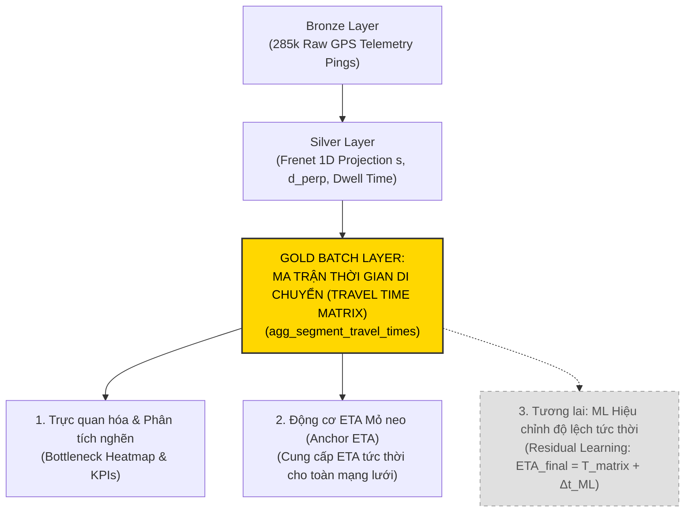
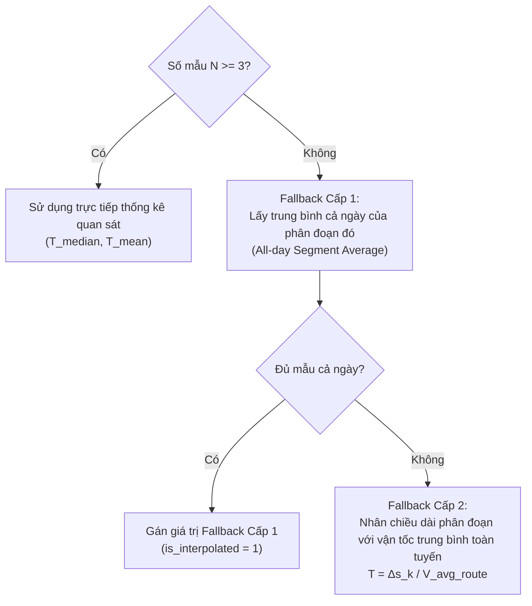

# ĐẶC TẢ KỸ THUẬT VÀ CHIẾN LƯỢC XÂY DỰNG MA TRẬN THỜI GIAN DI CHUYỂN
# (HISTORICAL TRAVEL TIME MATRIX SPECIFICATION & STRATEGY)
> **Dự án**: Hanoi Bus Big Data & Real-time ETA Prediction System  
> **Trạng thái**: Đã phê duyệt chuyển hướng chiến lược (Strategic Realignment Approved)  
> **Nguyên tắc**: Tạm hoãn mô hình Machine Learning; tập trung 100% nguồn lực hoàn thành Ma trận thời gian di chuyển (Travel Time Matrix) làm cột mốc Batch Gold Layer tiên quyết cho toàn bộ 48 tuyến xe buýt.

---

## I. BỐI CẢNH VÀ ĐỘNG CƠ ĐIỀU CHỈNH CHIẾN LƯỢC

### 1.1. Bài Học Kỹ Thuật: Tránh Hiện Tượng "Xây Nhà Từ Nóc"
Trong các dự án kỹ thuật dữ liệu lớn (Big Data Engineering) phục vụ giao thông công cộng, sai lầm phổ biến nhất là **nhảy cóc ngay vào các mô hình học máy phức tạp (XGBoost, LightGBM, Deep Learning)** khi tầng dữ liệu cơ sở chưa được định hình vững chắc.

Việc vội vã triển khai Machine Learning trên toàn bộ 48 tuyến tại thời điểm này tiềm ẩn 4 rủi ro chí mạng:
1. **Thiếu mỏ neo chuẩn (Empirical Baseline Anchor)**: Nếu không có ma trận thời gian chạy thực tế vững chắc, ta không thể định lượng được mô hình ML thực sự cải thiện bao nhiêu phần trăm, hay chỉ đang "học vẹt" (overfitting) trên tập dữ liệu nhỏ.
2. **Quá tải kỹ thuật khi chuyển giao nhóm**: Yêu cầu tất cả thành viên trong nhóm đồng loạt cấu hình môi trường ML, xử lý mất cân bằng dữ liệu, tối ưu siêu tham số (hyperparameters) sẽ dẫn đến nghẽn tiến độ và mất đồng bộ.
3. **Mô hình "hộp đen" khó diễn giải**: Trong báo cáo môn học Dữ liệu lớn, giảng viên ưu tiên nhìn thấy khả năng xử lý hàng loạt (Batch Processing), tính toán tổng hợp (Aggregations) trên khối lượng bản ghi lớn (285k pings) hơn là một script ML chạy cục bộ.
4. **Mất an toàn khi mất sóng GPS**: Khi xe buýt đi vào hầm chui, nhà cao tầng bị mất tín hiệu GPS tức thời, một hệ thống chuyên nghiệp **bắt buộc phải fallback về Ma trận thời gian lịch sử (Travel Time Matrix)** để tiếp tục hiển thị ETA cho hành khách.

### 1.2. Vị Trí Của Ma Trận Thời Gian Trong Kiến Trúc Medallion Lakehouse
Ma trận thời gian di chuyển phân đoạn chính là **sản phẩm cốt lõi nhất của tầng Gold (Gold Serving Layer)** trong kiến trúc Medallion:



---

## II. MÔ HÌNH TOÁN HỌC MA TRẬN THỜI GIAN DI CHUYỂN (TRAVEL TIME MATRIX)

### 2.1. Không Gian Trạng Thái Tuyến Đường (1D Frenet Discretization)
Mỗi tuyến xe buýt $r$ theo một chiều di chuyển $d \in \{\text{'go'}, \text{'return'}\}$ được mô hình hóa thành một trục tọa độ 1D Frenet dọc theo tim đường chuẩn từ TimBus:
$$\mathcal{L}_{r, d} = [0, L_{r, d}]$$
Trong đó $L_{r, d}$ là tổng chiều dài tuyến đường (mét).

Tuyến đường được phân rã thành $N$ trạm dừng liên tiếp đã được gắn tọa độ mốc $s$:
$$\mathcal{S}_{r, d} = \{(S_0, s_0), (S_1, s_1), (S_2, s_2), \dots, (S_{N-1}, s_{N-1})\}$$
với quan hệ thứ tự nghiêm ngặt: $0 = s_0 < s_1 < s_2 < \dots < s_{N-1} = L_{r, d}$.

### 2.2. Định Nghĩa Phân Đoạn Trạm (Station Segment)
Một phân đoạn trạm (Segment) $\sigma_k$ là đoạn đường nối giữa hai trạm dừng liên tiếp $S_k \to S_{k+1}$:
- Điểm đầu phân đoạn: Trạm $S_k$ tại mét thứ $s_k$.
- Điểm cuối phân đoạn: Trạm $S_{k+1}$ tại mét thứ $s_{k+1}$.
- Chiều dài phân đoạn: $\Delta s_k = s_{k+1} - s_k > 0$ (thường dao động từ $300\text{m}$ đến $1.200\text{m}$ trong nội đô Hà Nội).

### 2.3. Cấu Trúc Đa Chiều Của Ma Trận Thời Gian $\mathbf{T}$
Thời gian di chuyển qua phân đoạn $\sigma_k$ là một biến ngẫu nhiên chịu tác động mạnh bởi chu kỳ thời gian. Do đó, Ma trận Thời gian $\mathbf{T}$ được chỉ mục hóa theo 4 chiều:
$$\mathbf{T}(r, d, k, w, h)$$
Trong đó:
1. $r \in \{01, 02, \dots, \text{BRT01}\}$: Tuyến xe buýt (48 tuyến).
2. $d \in \{\text{'go'}, \text{'return'}\}$: Chiều di chuyển.
3. $k \in \{0, 1, \dots, N-2\}$: Chỉ số phân đoạn từ trạm $S_k$ đến $S_{k+1}$.
4. $w \in \{\text{'WEEKDAY'}, \text{'WEEKEND'}\}$: Nhóm ngày trong tuần (Thứ 2 - Thứ 6 vs Thứ 7 - CN).
5. $h \in \{\text{MORNING\_PEAK}, \text{OFF\_PEAK\_DAY}, \text{EVENING\_PEAK}, \text{NIGHT}\}$: Khung giờ vận hành đô thị:
   - `MORNING_PEAK`: $06:30 \le \text{Giờ} < 09:00$ (Ùn tắc đi làm/đi học sáng).
   - `OFF_PEAK_DAY`: $09:00 \le \text{Giờ} < 16:30$ (Giao thông ban ngày thông thoáng vừa phải).
   - `EVENING_PEAK`: $16:30 \le \text{Giờ} < 19:30$ (Ùn tắc tan tầm chiều).
   - `NIGHT`: $19:30 \le \text{Giờ} < 22:00$ và $05:00 \le \text{Giờ} < 06:30$ (Chạy đêm/sáng sớm).

### 2.4. Các Tham Số Thống Kê Cốt Lõi Trên Mỗi Phân Đoạn
Mỗi ô trong ma trận $\mathbf{T}(r, d, k, w, h)$ không chỉ là một con số đơn lẻ mà là một phân phối thống kê gồm 7 chỉ số:
- **$N_{\text{samples}}$**: Số lượng chuyến xe thực tế quan sát được trên phân đoạn trong khung giờ.
- **$T_{\text{median}}$ ($P_{50}$)**: Trung vị thời gian di chuyển (giây). Đây là chỉ số đại diện mỏ neo chính xác nhất do miễn nhiễm với các ngoại lai GPS dừng chờ bất thường.
- **$T_{\text{mean}}$**: Thời gian di chuyển trung bình cộng (giây).
- **$\sigma_T$**: Độ lệch chuẩn thời gian di chuyển (giây), biểu thị mức độ biến động/bất định của giao thông trên đoạn đường đó.
- **$T_{\text{free\_flow}}$ ($P_{10}$)**: Phân vị 10% (thời gian chạy nhanh nhất khi đường hoàn toàn thông thoáng).
- **$T_{\text{congested}}$ ($P_{90}$)**: Phân vị 90% (thời gian chạy khi xảy ra ùn tắc nghiêm trọng).
- **$\bar{V}_{\text{commercial}}$**: Vận tốc thương phẩm của xe buýt trên phân đoạn:
  $$\bar{V}_{\text{commercial}} = \frac{\Delta s_k}{T_{\text{median}}} \times 3.6 \quad (\text{km/h})$$

---

## III. THUẬT TOÁN TRÍCH XUẤT MA TRẬN TỪ TELEMETRY RỜI RẠC

### 3.1. Thách Thức Kỹ Thuật Từ Dữ Liệu Thực Tế
Chu kỳ ping telemetry của hệ thống cào là $\Delta t \approx 75\text{ giây}$. Trên thực tế:
- Xe buýt hiếm khi phát ping đúng ngay tại vạch dừng của trạm $s_k$.
- Một ping có thể nằm trước trạm $80\text{m}$ ($s_A < s_k$), và ping tiếp theo sau 75 giây đã vượt qua trạm $120\text{m}$ ($s_B > s_k$).
- Do đó, nếu chỉ lấy hiệu số thời gian giữa 2 pings lân cận sẽ tạo ra sai số làm tròn lên tới $\pm 75\text{ giây}$.

### 3.2. Thuật Toán 1: Tuyến Tính Hóa Mốc Vượt Trạm (Linear Station Crossing Interpolation)
Để đo thời gian di chuyển giữa trạm $S_k$ và trạm $S_{k+1}$ của một xe buýt cụ thể trong một hành trình, ta áp dụng phép nội suy thời gian vượt trạm:

```
Ping A (tA, sA) ─── Trạm Sk (sk) ─────────────── Ping B (tB, sB)
                    └─── Nội suy thời điểm t_cross(Sk) ───┘
```

1. **Điều kiện phát hiện**: Tìm cặp ping liên tiếp $A(t_A, s_A)$ và $B(t_B, s_B)$ của cùng một phương tiện (`vehicle_id`) trên cùng một chiều sao cho:
   $$s_A \le s_k < s_B \quad \text{và} \quad t_B - t_A \le 180\text{ giây}$$
2. **Nội suy thời điểm vượt trạm**:
   $$\hat{t}(S_k) = t_A + (t_B - t_A) \cdot \frac{s_k - s_A}{s_B - s_A}$$
3. **Tính thời gian phân đoạn**: Khi xe tiếp tục vượt qua trạm kế tiếp $S_{k+1}$ tại thời điểm nội suy $\hat{t}(S_{k+1})$, thời gian di chuyển thực tế trên phân đoạn là:
   $$\Delta T_{k \to k+1} = \hat{t}(S_{k+1}) - \hat{t}(S_k)$$
4. **Bộ lọc hợp lệ (Sanity Filter)**: Một mẫu $\Delta T_{k \to k+1}$ chỉ được chấp nhận nếu vận tốc trung bình phân đoạn nằm trong giới hạn vật lý của xe buýt nội đô:
   $$3.0\text{ km/h} \le \frac{\Delta s_k}{\Delta T_{k \to k+1}} \times 3.6 \le 75.0\text{ km/h}$$

### 3.3. Thuật Toán 2: Bóc Tách Thời Gian Dừng Đón Trả Khách (Dwell Time Extraction)
Theo **Điều 6 trong Hiến Pháp Dự Án (AGENTS Constitution)**:
Thời gian dừng tại trạm không được tính bằng `speed == 0` mà được bóc tách bằng ngưỡng dịch chuyển không gian:
$$\Delta s < 15\text{m} \quad \text{trong} \quad \Delta t \ge 20\text{s}$$

Thời gian hành trình trên phân đoạn thực tế bao gồm hai thành phần:
$$\Delta T_{k \to k+1} = T_{\text{run}}(\sigma_k) + \tau_{\text{dwell}}(S_{k+1})$$
Trong đó:
- $T_{\text{run}}(\sigma_k)$: Thời gian xe lăn bánh trên đường giữa hai trạm.
- $\tau_{\text{dwell}}(S_{k+1})$: Thời gian xe dừng tại trạm đích $S_{k+1}$ để hành khách lên xuống (thường từ $15\text{s}$ đến $90\text{s}$).

### 3.4. Thuật Toán 3: Chiến Lược Bù Đắp Khoảng Trống Dữ Liệu (Multi-Tier Fallback Imputation)
Trong thực tế, một số phân đoạn hoặc khung giờ sáng sớm/đêm muộn có thể có ít mẫu quan sát ($N_{\text{samples}} < 3$). Để đảm bảo ma trận luôn phục vụ được 100% các truy vấn ETA mà không gặp lỗi `NULL`, áp dụng chiến lược bù đắp 3 cấp:



---

## IV. THIẾT KẾ SCHEMA CƠ SỞ DỮ LIỆU & BỘ NHẬN DIỆN KHO DỮ LIỆU LỚN

### 4.1. Bảng Chuẩn Trong SQLite / DuckDB: `agg_segment_travel_times`
Bảng này đóng vai trò là **Gold Aggregate Table**, được tối ưu hóa cho truy vấn tức thời ($< 1\text{ ms}$):

```sql
CREATE TABLE IF NOT EXISTS agg_segment_travel_times (
    route_code              TEXT NOT NULL,          -- Mã tuyến (VD: '01', '02', 'BRT01')
    direction               TEXT NOT NULL,          -- Chiều di chuyển ('go' hoặc 'return')
    from_station_order      INTEGER NOT NULL,       -- Số thứ tự trạm đi (k)
    to_station_order        INTEGER NOT NULL,       -- Số thứ tự trạm đến (k+1)
    from_station_name       TEXT,                   -- Tên trạm đi
    to_station_name         TEXT,                   -- Tên trạm đến
    segment_distance_m      REAL NOT NULL,          -- Khoảng cách trạm theo tim đường TimBus (m)
    time_window             TEXT NOT NULL,          -- Khung giờ ('MORNING_PEAK', 'OFF_PEAK_DAY', ...)
    day_type                TEXT NOT NULL,          -- Loại ngày ('WEEKDAY', 'WEEKEND')
    sample_count            INTEGER NOT NULL,       -- Số chuyến xe thực tế quan sát được
    median_transit_sec      REAL NOT NULL,          -- Trung vị thời gian chạy P50 (giây)
    mean_transit_sec        REAL NOT NULL,          -- Thời gian chạy trung bình (giây)
    std_transit_sec         REAL,                   -- Độ lệch chuẩn (giây)
    p10_transit_sec         REAL,                   -- Thời gian chạy thông thoáng P10 (giây)
    p90_transit_sec         REAL,                   -- Thời gian chạy ùn tắc P90 (giây)
    commercial_speed_kmh    REAL NOT NULL,          -- Vận tốc thương phẩm (km/h)
    is_interpolated         INTEGER DEFAULT 0,      -- Cờ đánh dấu dữ liệu bù đắp (0: Thật, 1: Bù đắp)
    updated_at              TEXT NOT NULL,          -- Thời điểm tính toán
    PRIMARY KEY (route_code, direction, from_station_order, to_station_order, time_window, day_type)
);

CREATE INDEX IF NOT EXISTS idx_segment_matrix_lookup 
ON agg_segment_travel_times (route_code, direction, time_window, day_type);
```

### 4.2. Lưu Trữ Dài Hạn Trên Parquet Data Lakehouse (Gold Layer)
Dữ liệu ma trận được phân vùng theo dạng cột tại:
`data/lakehouse/gold/segment_travel_times/route={route_code}/direction={direction}/matrix.parquet`

Cấu trúc này cho phép:
- Đọc cực nhanh vào Pandas / Polars / DuckDB bằng câu lệnh đơn:
  ```python
  import duckdb
  df = duckdb.query("SELECT * FROM 'data/lakehouse/gold/segment_travel_times/*/*/*.parquet' WHERE route_code = '02'").to_df()
  ```
- Nén Snappy giảm dung lượng lưu trữ $> 85\%$ so với CSV.

---

## V. CÔNG THỨC DỰ BÁO ETA DỰA TRÊN MA TRẬN THỜI GIAN (ANCHOR BASELINE ETA)

Khi một xe buýt $v$ đang ở vị trí mét thứ $s_{\text{bus}}$ trên lộ trình, nằm giữa trạm $S_i$ và $S_{i+1}$, để dự báo thời gian xe đến trạm đích bất kỳ $S_k$ ($k > i$), công thức tính ETA tức thời là:

$$\text{ETA}(v \to S_k) = T_{\text{partial}}(s_{\text{bus}} \to S_{i+1}) + \sum_{j=i+1}^{k-1} \mathbf{T}(r, d, j, w, h)$$

Trong đó:
1. $T_{\text{partial}}(s_{\text{bus}} \to S_{i+1})$: Thời gian xe chạy nốt phần quãng đường còn lại của phân đoạn hiện tại:
   $$T_{\text{partial}} = \mathbf{T}(r, d, i, w, h) \times \left( \frac{s_{i+1} - s_{\text{bus}}}{s_{i+1} - s_i} \right)$$
2. $\sum_{j=i+1}^{k-1} \mathbf{T}(r, d, j, w, h)$: Tổng thời gian di chuyển của toàn bộ các phân đoạn trạm đầy đủ nằm giữa trạm $S_{i+1}$ và trạm đích $S_k$.

> [!IMPORTANT]
> Công thức này hoàn toàn **khép kín về mặt toán học**, thực thi trong **$< 0.1\text{ ms}$**, không cần GPU, không lo lỗi hội tụ mô hình, và đảm bảo **luôn trả về giá trị dương logic** cho mọi trạm trên toàn bộ 48 tuyến!

---

## VI. PHÂN CHIA NHIỆM VỤ MỚI CHO THÀNH VIÊN NHÓM (REVISED WBS)

Bỏ qua các bước Machine Learning phức tạp, nhiệm vụ của 4 thành viên trong nhóm giờ đây cực kỳ rõ ràng, dễ thực thi và đồng nhất:

```
┌─────────────────────────────────────────────────────────────────────────────┐
│               QUY TRÌNH CHUẨN 3 BƯỚC CHO MỖI THÀNH VIÊN                     │
├─────────────────────────────────────────────────────────────────────────────┤
│ Bước 1: Trích xuất Ma trận Thời gian cho tuyến (Matrix Extraction)          │
│ Bước 2: Kiểm tra độ phủ mẫu và áp dụng Fallback Imputation                 │
│ Bước 3: Xuất báo cáo Phân tích Điểm Nghẽn (Bottleneck Heatmap & Top 5)      │
└─────────────────────────────────────────────────────────────────────────────┘
```

### 6.1. Bảng Giao Tuyến Và Mục Tiêu Cụ Thể

| Thành Viên | Gói Tuyến Phụ Trách | Số Tuyến | Danh Sách Tuyến | Đầu Ra Bắt Buộc (Deliverables) |
| :---: | :--- | :---: | :--- | :--- |
| **Thành viên A** | **Gói 1: Tuyến Trục Lõi** | 8 | 01, 32, 26, 27, 08A, 11, 31, 09A | - 8 bảng ma trận phân đoạn (Chiều đi + về).<br/>- Báo cáo 5 điểm nghẽn nghiêm trọng nhất giờ cao điểm. |
| **Thành viên B** | **Gói 2: VinBus & BRT** | 12 | E01, E02, E03, E04, E05, E06, E07, E08, E09, BRT01, 107, 68 | - So sánh vận tốc thương phẩm BRT01 vs Tuyến VinBus E-series.<br/>- Đánh giá tính ổn định thời gian chạy giờ cao điểm. |
| **Thành viên C** | **Gói 3: Tuyến Vành Đai** | 14 | 16, 20A, 28, 29, 30, 34, 38, 39, 45, 55A, 60A, 84, 103A, 105 | - Ma trận thời gian các tuyến chạy qua các trục vành đai 2, 2.5, 3.<br/>- Phân tích độ lệch chuẩn thời gian chạy $\sigma_T$. |
| **Thành viên D** | **Gói 4: Tuyến Ngoại Thành** | 14 | 03A, 04, 06A, 07, 14, 15, 17, 21A, 22A, 25, 35A, 40, 50, 62 | - Ma trận các tuyến cự ly dài (Nội Bài, Đông Anh, Sóc Sơn).<br/>- Phân tích vận tốc xe chạy khi ra ngoài khu vực lõi. |

### 6.2. Tiêu Chí Nghiệm Thu Ma Trận Thời Gian (Definition of Done - DoD)
Một gói tuyến được nghiệm thu khi đáp ứng đủ 4 tiêu chí:
1. **100% Phủ Kín Phân Đoạn**: Toàn bộ các cặp trạm $S_k \to S_{k+1}$ của tuyến đều có giá trị $T_{\text{median}} > 0$ trong cả 4 khung giờ.
2. **Không Vi Phạm Giới Hạn Vật Lý**: Vận tốc thương phẩm $\bar{V}_{\text{commercial}}$ của mọi phân đoạn nằm trong khoảng $3.0\text{ km/h} \le \bar{V} \le 70.0\text{ km/h}$.
3. **Cơ Sở Dữ Liệu Đồng Bộ**: Dữ liệu ma trận được nạp thành công vào bảng `agg_segment_travel_times` trong SQLite/DuckDB.
4. **Báo Cáo Phân Tích Điểm Nghẽn**: Có file markdown báo cáo trong `docs/` nêu rõ:
   - Thời gian chạy trọn tuyến trung bình (Chiều đi & Chiều về).
   - Top 3 phân đoạn tốn nhiều thời gian nhất trên tuyến.
   - Mức độ chênh lệch thời gian giữa Giờ Cao Điểm vs Giờ Thấp Điểm (tỷ số trễ $\rho = T_{\text{peak}} / T_{\text{offpeak}}$).

---

## VII. ĐIỀU CHỈNH LỘ TRÌNH TỔNG THỂ DỰ ÁN

| Giai Đoạn | Trọng Tâm Kỹ Thuật | Trạng Thái | Thời Gian Ước Tính |
| :---: | :--- | :---: | :---: |
| **Pha 1** | Chuẩn hóa CSDL & Dọn dẹp Workspace (`hanoi_bus_system.db`, drop bảng rác) | **Ưu tiên P0 (Ngay lập tức)** | 1.5 - 2 giờ |
| **Pha 2** | **Xây dựng Ma trận thời gian di chuyển (Travel Time Matrix) cho toàn bộ 48 tuyến** | **Ưu tiên P0 (Trọng tâm cốt lõi môn học)** | 6 - 8 giờ *(Chia 4 người: ~2h/người)* |
| **Pha 3** | Xuất báo cáo phân tích điểm nghẽn & biểu đồ so sánh 48 tuyến | **Ưu tiên P1 (Báo cáo & Trực quan)** | 3 - 4 giờ |
| **Pha 4** | Đánh giá sai số ETA mỏ neo (Baseline MAE) trên toàn bộ mạng lưới | **Ưu tiên P1 (Đánh giá định lượng)** | 2 - 3 giờ |
| **Pha 5** | *(Tùy chọn tương lai)*: Thử nghiệm mô hình Machine Learning hiệu chỉnh độ lệch tức thời ($\Delta t_{\text{ML}}$) | **Tạm hoãn (Đợi phê duyệt sau)** | Xét sau khi Pha 1-4 hoàn tất |

---

## VIII. KẾT LUẬN

Việc tạm thời chưa chốt mô hình ML và dồn toàn lực hoàn thành **Ma trận thời gian di chuyển (Travel Time Matrix)** là một quyết định kỹ thuật hoàn toàn chính xác, thực tế và đúng chuẩn phương pháp luận Dữ liệu lớn:
1. **Đưa hệ thống vào trạng thái hoạt động ngay lập tức**: Ngay khi ma trận hoàn thành, hệ thống đã có thể cung cấp tính năng dự báo ETA cho toàn bộ 48 tuyến xe buýt Hà Nội với thời gian đáp ứng cực nhanh.
2. **Nội dung báo cáo môn học vượt trội**: Ma trận thời gian cung cấp các phân tích không gian - thời gian trực quan, sinh động (bản đồ nhiệt ùn tắc, phân vị thời gian chạy, so sánh các hành lang giao thông Hà Nội).
3. **Giảm áp lực cho nhóm**: Các thành viên dễ dàng tiếp cận, chạy script, kiểm tra số liệu và làm báo cáo mà không bị vướng mắc vào các vấn đề kỹ thuật của Machine Learning.

