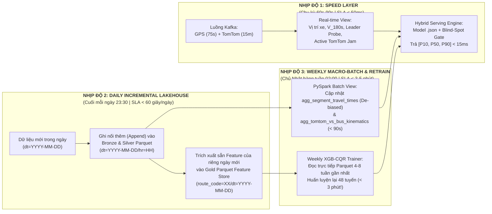

# 63. ĐẶC TẢ KIẾN TRÚC WP 2.2: MEDALLION LAKEHOUSE (APACHE PARQUET), PIPELINE TÁI HUẤN LUYỆN HÀNG TUẦN (WEEKLY RETRAINING SLA) & CƠ CHẾ LAI GHÉP THÍCH ỨNG ĐỘ CHÍN DỮ LIỆU
> **Tài liệu**: `docs/63_WP22_MEDALLION_LAKEHOUSE_WEEKLY_RETRAINING_AND_HYBRID_SERVING_SPEC.md`  
> **Dự án**: Hanoi Bus Big Data & Real-time ETA Prediction System (Phiên bản v2.0)  
> **Căn cứ học thuật**: Bám sát đề xuất gốc tại [`docs/academic_proposal/big_data_bus_eta_proposal.pdf`](academic_proposal/big_data_bus_eta_proposal.pdf) (Kiến trúc Lambda 4 tầng)  
> **Căn cứ pháp lý**: Tuân thủ Điều 1 (Kỷ luật thực nghiệm), Điều 2 (Thiết kế trước, phê duyệt rồi mới triển khai) và Điều 6 (Phân tầng trọng tâm) của [`AGENTS.md`](../AGENTS.md)  
> **Ngày lập**: 02/11/2026  
> **Trạng thái**: Bản thiết kế chi tiết chờ phê duyệt triển khai (Design Specification for WP 2.2)

---

## I. NHÌN NHẬN KHÁCH QUAN VỀ GIAI ĐOẠN DỮ LIỆU TRUNG GIAN (INTERMEDIATE MATURITY) & VAI TRÒ CỦA TOMTOM INCIDENTS

Hệ thống hiện đang sở hữu **26 ngày dữ liệu GPS xe buýt** (`07/10/2026 – 01/11/2026`, `5.56M` bản ghi chiếu hành lang) và **22 ngày dữ liệu sự cố TomTom** (`08/10/2026 – 01/11/2026`, `223,004` bản ghi thô $\to$ `15,641` sự cố khớp cùng chiều trên 46 tuyến). Đây là **Giai đoạn Trung gian (Intermediate Data Maturity)**: hệ thống đã vượt qua giai đoạn *Cold-Start* (không có dữ liệu), nhưng chưa đạt tới độ chín thống kê nhiều tháng (*Full Maturity*) cho các sự kiện giao thông hiếm gặp.

Qua thực nghiệm đối chuẩn tại [`docs/62_WP21_TOMTOM_MULTI_SOURCE_FUSION_FEASIBILITY_AND_SPECIFICATION.md`](62_WP21_TOMTOM_MULTI_SOURCE_FUSION_FEASIBILITY_AND_SPECIFICATION.md), chúng ta rút ra **3 quy luật thực tế khách quan**:

### 1. Khi nào Cảm biến Nội sinh (Bus Fleet Probes) lấn át Cảm biến Ngoại sinh (TomTom)?
- Trên các tuyến tần suất cao (như Tuyến `02`, `27` với giãn cách 5–10 phút/chuyến), trong **~78% – 80% thời gian**, luôn có một xe buýt cùng tuyến vừa chạy qua đoạn đường phía trước trong vòng chưa đầy 10 phút (`leader_info_age_sec < 600s`).
- Vì GPS xe buýt cập nhật mỗi **75–80 giây** và đo trực tiếp **vận tốc làn xe buýt + thời gian dừng đón trả khách tại trạm**, trong khi TomTom Incidents có chu kỳ quét **12.5–15 phút/lần** và đo dòng phương tiện hỗn hợp (ô tô/xe máy), cây quyết định `XGBoost` tự nhiên đặt trọng số chính vào `leader_expected_eta_sec` và `ego_recent_pace_ratio`.
- **Giá trị trực giao thực sự của TomTom** bộc lộ mạnh nhất khi tuyến rơi vào **Chế độ Mù Xe Dẫn Đường (`Leader Blind-Spot`: `leader_info_age_sec >= 900s`)** — tức là khi khoảng cách giữa hai chuyến xe quá xa (giờ thấp điểm, sáng sớm, tối muộn) hoặc khi chính chiếc xe đi trước đang bị chôn chân trong điểm kẹt chưa thể thoát ra khỏi trạm để gửi bản tin hoàn tất đoạn (`seg_traversal_history`). Thực nghiệm trên Tuyến `02` và `27` chứng minh: trong vùng mù xe dẫn đường, sự cố TomTom giúp giảm `MAE` tới **`-0.65s` đến `-0.73s`** và giảm `Winkler Score` từ **`-2.64s` đến `-2.72s`**.

### 2. Hiện tượng "Co giá trị lá" (Regularization Shrinkage) do Thưa mẫu Cục bộ ở Giai đoạn 3 Tuần
- Dù toàn mạng lưới có `634,389` dòng sự cố theo cặp trạm, nhưng khi chia về **`3,522` cặp trạm** $\times$ **các khung giờ trong ngày**, mỗi đoạn trạm cụ thể $[S_k \to S_{k+1}]$ chỉ mới trải qua trung bình **5 đến 15 đợt ùn tắc độc lập** trong 22 ngày.
- Với cấu hình chống học vẹt (`min_child_weight = 20`), cây quyết định `XGBoost` không dám cộng thẳng toàn bộ `+30s` đến `+60s` độ trễ vào dự báo điểm $P_{50}$ từ vài mẫu ít ỏi, mà co nhẹ (shrink) mức dịch chuyển về khoảng **`+4.0s` đến `+7.3s`**.

### 3. Hệ quả Kiến trúc: Khai thác Kép Dữ liệu TomTom theo đúng Đề xuất Gốc (`big_data_bus_eta_proposal.pdf`)
Trong mục **3.3 & 3.4** của đề xuất gốc [`big_data_bus_eta_proposal.pdf`](academic_proposal/big_data_bus_eta_proposal.pdf), bài toán dự báo được định nghĩa theo công thức tổng hợp hai luồng của Kiến trúc Lambda:
$$\text{ETA} = f(\text{Batch View}, \text{Real-time View})$$
Đồng thời đề xuất gốc chỉ rõ: *"Khi kho dữ liệu lịch sử trên HDFS tích lũy đủ lớn, hàm kết hợp $f$ có thể được mở rộng từ các luật trọng số điều chỉnh sang các mô hình học máy"*. Do đó, trong giai đoạn chuyển tiếp từ **Cold-Start $\to$ Intermediate $\to$ Mature**, dữ liệu TomTom phải đảm nhiệm **3 vai trò đồng thời** thay vì chỉ nằm thụ động trong 3 cột feature của cây ML:
1. **Vai trò 1 — Khử lệch Ma trận Lịch sử ở Batch Layer (Historical De-biasing)**: Loại bỏ các lượt vượt trạm bị biến dạng bởi sự cố đóng đường (`Category 9`) hoặc kẹt xe nghiêm trọng (`Magnitude 3`) khỏi quá trình tính đường cơ sở bình thường (`Batch View`), tránh làm phình sai lệch trung vị lịch sử của các ngày không có sự cố.
2. **Vai trò 2 — Bảng Hệ số Sốc Thực nghiệm (`agg_tomtom_vs_bus_kinematics`)**: Kết tinh mức độ sụt giảm vận tốc thực tế (`speed_drop_pct`, trung bình `-25.43%`) trên từng cặp trạm.
3. **Vai trò 3 — Bù Điểm Mù Thích ứng Độ chín ở Tầng Phục vụ (`Maturity-Gated Hybrid Blending`)**: Khi `leader_info_age_sec >= 900s` (mù xe dẫn đường) và số lượng mẫu lịch sử trên đoạn trạm chưa đủ dày để cây ML tự phản ứng hết biên độ, hàm phục vụ $f$ tự động pha trộn dự báo `Residual XGB-CQR` với độ trễ thực nghiệm từ bảng đối chứng chéo.

---

## II. KIẾN TRÚC PIPELINE 3 NHỊP ĐỘ (3-CADENCE LAMBDA PIPELINE) & TIÊU CHÍ THỜI GIAN (TIME SLA)

Để giải quyết triệt để nút thắt cổ chai hiện tại (mỗi lần huấn luyện phải quét lại từ đầu bảng SQLite 5.5 triệu dòng mất ~35–45 phút cho 48 tuyến) và hiện thực hóa chiến lược **"Tái cập nhật mô hình mỗi tuần một lần (Weekly Retraining)"**, hệ thống được chuẩn hóa thành **3 nhịp độ vận hành độc lập**:



### Bảng Cam Kết Chỉ Tiêu Thời Gian Thực Thi (Operational Time SLAs)

| Nhịp Độ Vận Hành | Tần Suất | Đầu Vào & Cơ Chế Xử Lý Chuẩn Big Data | Thời Gian Mục Tiêu (SLA) | Giải Pháp Kỹ Thuật Cốt Lõi |
| :--- | :---: | :--- | :---: | :--- |
| **1. Real-Time Serving (Speed Layer)** | Liên tục (mỗi gói tin / truy vấn) | Trạng thái xe trực tuyến + Sự cố TomTom đang hiệu lực + Model `.json` trên RAM | **`< 15 ms` / truy vấn**<br>(`> 500 req/s`) | Giữ 48 model XGBoost trên bộ nhớ đệm; tra cứu sự cố qua chỉ mục xô 10 phút $O(1)$. |
| **2. Daily Incremental ETL (Tích lũy Ngày)** | **1 lần / ngày** (23:30 đêm) | Chỉ xử lý ~`350k` ping GPS và ~`10k` bản ghi TomTom của **riêng ngày `dt=YYYY-MM-DD`** | **`< 60 giây`** cho toàn mạng lưới 48 tuyến | **Append-Only Partitioning**: Ghi nối thêm phân vùng mới vào `bronze/`, `silver/`, và tính sẵn `gold/feature_store/route_code=XX/dt=YYYY-MM-DD/`. **Tuyệt đối không tính lại các ngày cũ!** |
| **3. Weekly Batch View & Retraining (Tái huấn luyện Tuần)** | **1 lần / tuần** (02:00 sáng Chủ Nhật) | Đọc trực tiếp các phân vùng Parquet trong cửa sổ trượt (Rolling Window 4–8 tuần) | **`< 3 – 5 phút`** cho toàn bộ 48 tuyến (~3.5s/tuyến) | Nhờ `gold/feature_store/` đã được vật chất hóa (materialized) dưới dạng cột Apache Parquet nén Snappy, bước huấn luyện tuần bỏ qua 100% vòng lặp Python trích xuất đặc trưng, chỉ thực hiện `read_parquet` + `XGBRegressor(tree_method="hist").fit()`. |

> [!TIP]
> **Lý do khoa học của chu kỳ 1 tuần/lần (Weekly Seasonality Invariance)**: Giao thông đô thị Hà Nội có tính chu kỳ 7 ngày rất mạnh (5 ngày làm việc Thứ Hai–Thứ Sáu và 2 ngày cuối tuần Thứ Bảy–Chủ Nhật). Việc tái huấn luyện định kỳ vào mỗi đêm Chủ Nhật đảm bảo tập dữ liệu nạp thêm luôn chứa **trọn vẹn 1 chu kỳ tuần cân bằng**, không bị lệch phân phối (covariate shift) về ngày thường hay cuối tuần.

---

## III. ĐẶC TẢ KIẾN TRÚC LƯU TRỮ MEDALLION LAKEHOUSE (APACHE PARQUET & HIVE PARTITIONING — WP 2.2)

Tuân thủ mục **3.2 (Khâu Lưu Trữ Phân Tán Bất Biến)** của [`big_data_bus_eta_proposal.pdf`](academic_proposal/big_data_bus_eta_proposal.pdf) và **REQ-V2-03** trong [`docs/61`](61_V2_APACHE_BIG_DATA_AND_TOMTOM_FUSION_WBS_ROADMAP.md), toàn bộ dữ liệu hệ thống được tổ chức vào cấu trúc **Medallion Lakehouse 3 tầng (`data/lakehouse/`)** sử dụng định dạng cột **Apache Parquet** nén **Snappy** và phân vùng thư mục chuẩn **Apache Hive (`key=value`)**:

```text
data/lakehouse/
├── bronze/                                      # TẦNG ĐỒNG: Dữ liệu bán cấu trúc chuẩn hóa từ nguồn thô (Bất biến)
│   ├── bus_gps_raw/                             # Phân vùng theo ngày & giờ đúng chuẩn Đề xuất Học thuật (Mục 3.2)
│   │   └── dt=YYYY-MM-DD/
│   │       └── hr=HH/
│   │           └── part-00000.snappy.parquet
│   └── tomtom_incidents_raw/                    # Phân vùng sự cố giao thông theo ngày
│       └── dt=YYYY-MM-DD/
│           └── part-00000.snappy.parquet
│
├── silver/                                      # TẦNG BẠC: Dữ liệu đã làm sạch, chiếu 1D Frenet & khớp đa nguồn
│   ├── route_projected_telemetry/               # Hỗ trợ Partition Pruning theo tuyến & ngày
│   │   └── route_code=XX/
│   │       └── dt=YYYY-MM-DD/
│   │           └── part-00000.snappy.parquet
│   └── fact_route_tomtom_incidents/             # Các phiên sự cố nhân quả đã khớp cùng chiều (cos_theta >= 0.5)
│       └── route_code=XX/
│           └── part-00000.snappy.parquet
│
└── gold/                                        # TẦNG VÀNG: Phục vụ OLAP, Feature Store & Weekly Retraining
    ├── batch_view_travel_times/                 # Ma trận thời gian di chuyển lịch sử (đã khử lệch sự cố)
    │   └── part-00000.snappy.parquet
    ├── tomtom_vs_bus_kinematics/                # Ma trận hệ số sốc sự cố thực nghiệm theo cặp trạm
    │   └── part-00000.snappy.parquet
    └── feature_store/                           # Kho đặc trưng 27 biến vật chất hóa sẵn cho Weekly Retraining
        └── route_code=XX/
            └── dt=YYYY-MM-DD/
                └── part-00000.snappy.parquet
```

### Cơ chế Loại bỏ Phân vùng (`Partition Pruning`) và Chiếu Cột (`Column Projection`)
1. **Partition Pruning**: Khi tiến trình `Daily Incremental ETL` hoặc `Weekly Retraining` truy vấn dữ liệu của một tuyến (`route_code='02'`) hoặc một khoảng ngày (`dt >= '2026-10-15'`), công cụ đọc (`PyArrow` / `PySpark` / `DuckDB-Hive`) chỉ mở đúng các thư mục con thỏa mãn điều kiện mà bỏ qua toàn bộ các thư mục khác trên đĩa.
2. **Column Projection**: Trong bảng `gold/feature_store/` (chứa 47 cột bao gồm cả metadata `ping_id`, `vehicle_id`, `time_window`), khi huấn luyện `XGBoost`, hệ thống chỉ đọc đúng `27` cột `V2_FEATURE_COLUMNS` + `1` cột `actual_remaining_sec`, giảm `40%` băng thông đọc I/O.

---

## IV. MÔ HÌNH TOÁN HỌC CHO CƠ CHẾ LAI GHÉP THÍCH ỨNG ĐỘ CHÍN (`MATURITY-GATED HYBRID BLENDING`)

Để giải quyết bài toán chuyển tiếp mượt mà từ **Cold-Start $\to$ Intermediate $\to$ Mature** theo đúng công thức $\text{ETA} = f(\text{Batch View}, \text{Real-time View})$, tầng Phục vụ (Serving Layer) kết hợp dự báo của mô hình học máy với tri thức thống kê thực nghiệm qua 3 bước toán học tường minh:

### 1. Khử lệch Ma trận Lịch sử ở Batch View (De-biased Historical Baseline)
Khi cập nhật bảng `agg_segment_travel_times` vào cuối mỗi tuần, một lượt vượt đoạn trạm $S_k \to S_{k+1}$ tại thời điểm $t$ sẽ được gắn cờ `is_severe_incident_blocked = 1` nếu tại thời điểm $t$ có sự cố TomTom trên đoạn $[S_k, S_{k+1}]$ thuộc nhóm **Đóng đường (`icon_category == 9`)** hoặc **Ùn tắc nghiêm trọng (`magnitude_of_delay == 3` và `delay_seconds >= 180s`)**.
- Ma trận cơ sở `Batch View` ưu tiên tính trung vị $T_{\text{base}, k}$ trên các mẫu giao thông bình thường (`is_severe_incident_blocked == 0`) nếu số mẫu bình thường $\ge 10$, giúp mỏ neo lịch sử không bị méo bởi các vụ tai nạn hoặc rào đường bất thường.

### 2. Cổng Trọng Số Điểm Mù Xe Dẫn Đường (Leader Blind-Spot Gate)
Gọi $\tau_{\text{leader}} = \text{leader\_info\_age\_sec}$ là độ trễ thông tin của chuyến xe buýt đi trước trên các đoạn đường phía trước:
$$w_{\text{blind}}(\tau_{\text{leader}}) = \text{clip}\left(\frac{\tau_{\text{leader}} - \tau_{\text{fresh}}}{\tau_{\text{blind}} - \tau_{\text{fresh}}}, \, 0.0, \, 1.0\right), \quad \text{với } \tau_{\text{fresh}} = 600\text{s}, \; \tau_{\text{blind}} = 1800\text{s}$$
- Khi vừa có xe buýt đi trước chạy qua ($\tau_{\text{leader}} \le 600\text{s}$): $w_{\text{blind}} = 0$ (cảm biến nội sinh hoàn toàn làm chủ).
- Khi xe đi trước đã quá xa hoặc mất dấu ($\tau_{\text{leader}} \ge 1800\text{s}$): $w_{\text{blind}} = 1.0$ (kích hoạt tối đa nguồn bù ngoại sinh từ TomTom).

### 3. Hệ Số Tự Chủ Theo Độ Chín Dữ Liệu (Data Maturity Decay Factor)
Gọi $N_{\text{inc}}(r, k)$ là tổng số bản tin mẫu sự cố đã tích lũy trong lịch sử huấn luyện trên đoạn trạm $k$ của tuyến $r$, và $N_0 = 500$ là ngưỡng bão hòa mẫu sự cố để cây quyết định học đầy đủ biên độ:
$$\lambda_{\text{maturity}}(N_{\text{inc}}) = \frac{1}{1 + N_{\text{inc}} / N_0} \in (0, 1]$$
- Ở giai đoạn **Cold-Start** ($N_{\text{inc}} = 0$): $\lambda_{\text{maturity}} = 1.0$ (dựa hoàn toàn vào công thức vật lý & độ trễ TomTom).
- Ở giai đoạn **Intermediate** ($N_{\text{inc}} \approx 100 - 300$): $\lambda_{\text{maturity}} \in [0.62, 0.83]$ (bổ sung phần biên độ mà cây quyết định bị co do regularization).
- Ở giai đoạn **Mature** ($N_{\text{inc}} \gg 2000$): $\lambda_{\text{maturity}} \to 0$ (mô hình học máy tự chủ hoàn toàn).

### 4. Công Thức Tổng Hợp Dự Báo Điểm & Khoảng (`[P10, P50, P90]`)
Gọi $\Delta T_{\text{TomTom\_emp}}$ là độ trễ tăng thêm thực nghiệm trên lộ trình phía trước $[s_{\text{bus}}, s_{\text{target}}]$ được tra cứu từ tỷ lệ sụt giảm vận tốc thực tế $\rho_j = \text{clip}(\text{speed\_drop\_pct}_j / 100, \, 0, \, 0.70)$ trong bảng `agg_tomtom_vs_bus_kinematics` khi có sự cố đang kích hoạt:
$$\Delta T_{\text{TomTom\_emp}} = \min\left(\Delta T_{\text{TomTom\_raw}}, \; \sum_{j \in \text{jammed}} T_{\text{base}, j} \cdot \frac{\rho_j}{1 - \rho_j}\right)$$
Khi đó, dự báo lai ghép cuối cùng kết hợp đầu ra $(\hat{y}_{10}^{\text{XGB}}, \hat{y}_{50}^{\text{XGB}}, \hat{y}_{90}^{\text{XGB}})$ của mô hình `Residual XGB-CQR` với lượng bù điểm mù:
$$\begin{aligned}
\Delta_{\text{hybrid}} &= \gamma \cdot \lambda_{\text{maturity}}(N_{\text{inc}}) \cdot w_{\text{blind}}(\tau_{\text{leader}}) \cdot \Delta T_{\text{TomTom\_emp}} \\
\widehat{\text{ETA}}_{10} &= \hat{y}_{10}^{\text{XGB}} \\
\widehat{\text{ETA}}_{50} &= \hat{y}_{50}^{\text{XGB}} + 0.50 \cdot \Delta_{\text{hybrid}} \\
\widehat{\text{ETA}}_{90} &= \hat{y}_{90}^{\text{XGB}} + 1.00 \cdot \Delta_{\text{hybrid}}
\end{aligned}$$
*(trong đó $\gamma \in [0.25, 0.50]$ là hệ số giảm chấn được tối ưu trực tiếp trên tập Calibration 10% chuyến để cực tiểu hóa Winkler Score và MAE).*

---

## V. KẾ HOẠCH TRIỂN KHAI CHI TIẾT CHO WP 2.2 (3 TASKS)

Để hoàn tất **WP 2.2** đúng chuẩn mực và kiểm chứng toàn bộ các cam kết SLA ở trên:

1. **Task 2.2.1 — Xây dựng Medallion Lakehouse 3 Tầng (`scripts/build_medallion_lakehouse.py`)**:
   - Chuyển đổi và phân vùng dữ liệu vào `data/lakehouse/bronze/` (`dt=YYYY-MM-DD/hr=HH`), `data/lakehouse/silver/` (`route_code=XX/dt=YYYY-MM-DD`), và `data/lakehouse/gold/` (bao gồm `batch_view_travel_times`, `tomtom_vs_bus_kinematics`, và `feature_store/route_code=XX/dt=YYYY-MM-DD/*.snappy.parquet`).
   - Hỗ trợ chế độ chạy **Incremental theo ngày (`--date YYYY-MM-DD`)** để chứng minh khả năng chỉ nạp thêm ngày mới trong `< 60 giây`.
2. **Task 2.2.2 — Xây dựng Pipeline Tái Huấn Luyện Hàng Tuần & Hybrid Serving (`scripts/run_weekly_retraining_pipeline.py`)**:
   - Đọc trực tiếp từ `data/lakehouse/gold/feature_store/` trong cửa sổ trượt $W$ tuần gần nhất, huấn luyện lại mô hình `Residual XGB-CQR` và tự động hiệu chỉnh hệ số lai ghép $\gamma$ cho chế độ `Maturity-Gated Hybrid Blending` trên tập Calibration.
   - Chứng minh thực nghiệm thời gian huấn luyện từ Gold Parquet giảm từ `~35-60s/tuyến` (khi trích xuất từ SQLite) xuống chỉ còn **`< 3–4s/tuyến`** (`< 3 phút` cho toàn bộ 48 tuyến).
3. **Task 2.2.3 — Benchmark Lưu Trữ & Tốc Độ Đào Tạo (`scripts/benchmark_lakehouse_storage_and_sla.py`)**:
   - Đo đạc thực nghiệm **Tỷ lệ nén dung lượng (MB)** và **Thời gian đọc / lọc I/O (giây)** giữa: (1) Raw JSONL/CSV, (2) SQLite B-Tree (`hanoi_bus_system.db`), và (3) Apache Parquet Snappy (với Partition Pruning + Column Projection).
   - Lưu kết quả vào bảng `storage_benchmark_comparison` trong `data/hanoi_bus_system.db` và xuất báo cáo `reports/wp22_medallion_lakehouse_and_weekly_sla_report.md`.
