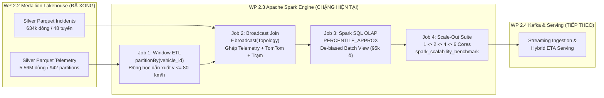

# 64. ĐẶC TẢ THIẾT KẾ WP 2.3: XỬ LÝ PHÂN TÁN VỚI APACHE SPARK (PYSPARK & SPARK SQL)
> **Tài liệu**: `docs/64_WP23_APACHE_SPARK_DISTRIBUTED_PROCESSING_AND_SCALABILITY_SPEC.md`  
> **Dự án**: Hanoi Bus Big Data & Real-time ETA Prediction System  
> **Chuyên đề**: WP 2.3 Distributed Big Data Processing, Broadcast Spatial Join, OLAP De-biased Batch View & Scale-Out Benchmark  
> **Ngày lập**: 02/11/2026  
> **Trạng thái**: Bản đặc tả thiết kế chờ phê duyệt (Design First — Awaiting User Approval)  
> **Căn cứ pháp lý**: Tuân thủ vô điều kiện **Điều 2 (Thiết kế trước, phê duyệt rồi mới triển khai)**, **Điều 4 (Nguồn chân lý dữ liệu)**, và **Điều 5 (Động học dẫn xuất)** của [AGENTS.md](file:///z:/Desktop/Bus_tracking/AGENTS.md).

---

## I. MỤC TIÊU & BỐI CẢNH WP 2.3 TRONG LỘ TRÌNH V2.0

Tiếp nối thành công của **WP 2.1** (Tích hợp sự cố TomTom) và **WP 2.2** (Medallion Lakehouse & Weekly Retraining SLA), **WP 2.3** là gói công việc trọng tâm nhằm đáp ứng toàn diện yêu cầu học thuật của môn học **Lưu trữ và Xử lý Dữ liệu lớn**:



### Các mục tiêu cốt lõi:
1. **Nâng cấp động cơ tính toán lên Apache Spark (PySpark 4.2.0 / Java 25 LTS)**: Chuyển toàn bộ các pipeline xử lý đơn luồng hoặc loop ad-hoc sang mô hình tính toán phân tán bộ nhớ (In-Memory Resilient Distributed Dataset & DataFrame API).
2. **Kỹ thuật Window Function trong xử lý chuỗi thời gian GPS**: Tính toán vận tốc dẫn xuất $\bar{v} = \Delta s / \Delta t$ và trạng thái dừng đỗ (Dwell) trên 5.56 triệu bản ghi bằng `pyspark.sql.window.Window.partitionBy("vehicle_id").orderBy("device_epoch")`, áp dụng trần vật lý $v \le 80.0$ km/h (loại trừ dị thường Mach-4).
3. **Kỹ thuật tối ưu hóa Broadcast Hash Join (`F.broadcast`)**: Ghép nối dữ liệu lớn (Silver Telemetry) với Master Topology tim đường và dữ liệu sự cố TomTom mà không kích hoạt Data Shuffle qua mạng.
4. **Phân tích OLAP đa chiều & Khử lệch sự cố (De-biasing)**: Dùng **Spark SQL** với hàm xấp xỉ phân vị `PERCENTILE_APPROX(duration_sec, 0.5)` để tính ma trận thời gian di chuyển 95.094 ô, tách biệt mẫu lưu thông tự do (`free-flow`) và mẫu bị tắc nghẽn do sự cố TomTom.
5. **Thực nghiệm đo kiểm mở rộng Scale-Out & Scale-Up**: Đo lường định lượng thời gian xử lý và thông lượng (`records/second`) khi mở rộng số lõi CPU (`1, 2, 4, 6` cores) và kích thước tập dữ liệu (`25%, 50%, 100%`).

---

## II. ĐẶC TẢ CHI TIẾT 4 TÁC VỤ KỸ THUẬT (WORK BREAKDOWN)

### Tác Vụ 2.3.1: PySpark Window ETL — Tính Động Học Dẫn Xuất & Lọc Nhiễu Trên 5.56M Dòng

* **Mục tiêu**: Đọc toàn bộ phân vùng Silver Parquet `data/lakehouse/silver/route_projected_telemetry/route_code=*/dt=*/*.parquet` vào Spark DataFrame và tính toán động học dẫn xuất chuẩn hóa.
* **Đặc tả logic toán học & Window**:
  - Partitioning: `Window.partitionBy("vehicle_id").orderBy("device_epoch")`.
  - Lag calculations:
    $$\Delta t = \text{device\_epoch} - \text{lag}(\text{device\_epoch}, 1)$$
    $$\Delta s = |\text{s\_bus\_m} - \text{lag}(\text{s\_bus\_m}, 1)|$$
  - Điều kiện vận tốc hợp lệ (áp dụng Bug 10 fix):
    - Chuyển động tiến: $s_{\text{bus}} \ge \text{lag}(s_{\text{bus}}, 1) - 50.0\text{m}$.
    - Thời gian hợp lệ: $0 < \Delta t \le 300\text{s}$ và cùng hướng (`direction == lag(direction)`).
    - Vận tốc: $v_{\text{mps}} = \Delta s / \Delta t \implies v_{\text{kmh}} = \min(80.0, v_{\text{mps}} \times 3.6)$.
    - Nếu $v_{\text{kmh}} > 100$ km/h hoặc nhảy ngược chuyến: gán `NULL`.
  - Nhận diện Dwell Time (chuẩn Điều 5 & Bug 12):
    $$\text{is\_dwell} = \mathbb{I}(\Delta s < 15.0\text{m} \land \Delta t \ge 20.0\text{s})$$
* **Tệp mã nguồn**: `module_2_big_data_storage_and_lakehouse/step_2_3_spark_distributed_computing/spark_kinematic_etl.py`

---

### Tác Vụ 2.3.2: PySpark Broadcast Spatial Join — Ghép Nối Đa Nguồn Không Gây Data Shuffle

* **Mục tiêu**: Kết nối 3 nguồn dữ liệu dị biệt bằng cơ chế **Broadcast Hash Join** (`org.apache.spark.sql.functions.broadcast`):
  1. **Nguồn lớn (Fact Stream)**: Silver Telemetry (~5.56M bản ghi).
  2. **Nguồn tham chiếu 1 (Master Topology)**: Danh bạ trạm dừng `canonical_station_master` (1.815 trạm, ~120 KB).
  3. **Nguồn tham chiếu 2 (Incident Context)**: `fact_route_tomtom_incidents` (634k bản ghi sự cố, ~25 MB).
* **Kỹ thuật chống tắc nghẽn Shuffle**:
  ```python
  from pyspark.sql import functions as F

  # Broadcast bảng danh bạ trạm và bảng sự cố sang toàn bộ Executor nodes
  df_joined = df_telemetry.join(
      F.broadcast(df_stations),
      on=["route_code", "direction"],
      how="inner"
  ).filter(
      (df_telemetry.s_bus_m >= df_stations.s_from_m) & 
      (df_telemetry.s_bus_m < df_stations.s_to_m)
  )
  ```
* **Bằng chứng Spark Catalyst Optimizer**: Xuất `explain(True)` chứng minh Execution Plan sử dụng toán tử `BroadcastHashJoin` thay vì `SortMergeJoin`.
* **Tệp mã nguồn**: `module_2_big_data_storage_and_lakehouse/step_2_3_spark_distributed_computing/spark_multisource_join.py`

---

### Tác Vụ 2.3.3: Spark SQL OLAP — Ma Trận Batch View Phân Vị Khử Lệch Sự Cố (De-biased Batch View)

* **Mục tiêu**: Thay thế truy vấn SQLite đơn luồng bằng **Spark SQL Engine** phân tán để tổng hợp ma trận 95.094 ô thời gian di chuyển phân vị ($P_{10}, P_{50}, P_{90}$).
* **Kỹ thuật De-biasing**:
  - Gắn cờ sự cố cho từng chặng xe vượt qua: $\text{has\_incident} = \mathbb{I}(\text{tomtom\_delay\_sec} > 0 \land \text{severity} \ge 2)$.
  - Tách hai phân nhóm phân tích:
    1. **Baseline Tự Nhiên (Clean Batch View)**: Chỉ tính trên các hành trình không có sự cố để phục vụ làm mốc tham chiếu chuẩn.
    2. **Ma trận Hệ số Sự cố (Incident Impact View)**: Tính tỷ lệ sụt giảm vận tốc khi có sự cố TomTom làm bằng chứng đối chứng chéo.
* **Cú pháp Spark SQL**:
  ```sql
  SELECT 
      route_code, direction, from_station_order, to_station_order, time_window, day_type,
      COUNT(*) AS sample_trips,
      PERCENTILE_APPROX(segment_duration_sec, 0.10) AS p10_sec,
      PERCENTILE_APPROX(segment_duration_sec, 0.50) AS p50_sec,
      PERCENTILE_APPROX(segment_duration_sec, 0.90) AS p90_sec,
      PERCENTILE_APPROX(segment_duration_sec, 0.50) - PERCENTILE_APPROX(segment_duration_sec, 0.10) AS spread_sec
  FROM global_temp.bus_segment_trajectories
  WHERE has_incident = 0
  GROUP BY route_code, direction, from_station_order, to_station_order, time_window, day_type
  ```
* **Tệp mã nguồn**: `module_2_big_data_storage_and_lakehouse/step_2_3_spark_distributed_computing/spark_olap_batch_matrix.py`

---

### Tác Vụ 2.3.4: Bộ Đo Kiểm Hiệu Năng & Khả Năng Mở Rộng (Scale-Out & Scale-Up Benchmark Suite)

* **Mục tiêu**: Cung cấp bảng dữ liệu thực nghiệm khách quan và đồ thị đo đạc cho báo cáo học thuật môn học Lưu trữ và Xử lý Dữ liệu lớn.
* **Ma trận thực nghiệm Scale-Out (Số nhân CPU)**:
  - Cấu hình Spark: `local[1]`, `local[2]`, `local[4]`, `local[6]`.
  - Đo lường: Thời gian chạy (giây), Tốc độ gia tốc (Speedup factor $S_k = T_1 / T_k$), Hiệu suất sử dụng lõi (Efficiency $E_k = S_k / k$).
* **Ma trận thực nghiệm Scale-Up (Quy mô dữ liệu)**:
  - Tập dữ liệu: 25% (12 tuyến, ~1.4M dòng), 50% (24 tuyến, ~2.8M dòng), 100% (48 tuyến, ~5.56M dòng).
  - Đo lường: Thông lượng xử lý (nghìn bản ghi / giây).
* **Kết quả đầu ra**:
  - Bảng tổng hợp Markdown: `reports/spark_scalability_benchmark_report.md`.
  - Tệp bảng Parquet: `data/lakehouse/gold/spark_scalability_benchmark/part-00000.snappy.parquet`.
* **Tệp mã nguồn**: `scripts/run_wp23_spark_scalability_benchmark.py`

---

## III. TỔ CHỨC CẤU TRÚC THƯ MỤC & MÃ NGUỒN V2.3

Tuân thủ nghiêm ngặt **Điều 3 Hiến pháp (Phân định Production vs. Experiment)**:

```
module_2_big_data_storage_and_lakehouse/
└── step_2_3_spark_distributed_computing/      # [PRODUCTION MODULE]
    ├── __init__.py
    ├── spark_session_factory.py               # Quản lý SparkSession (tối ưu cấu hình Windows/Java 25)
    ├── spark_kinematic_etl.py                 # Task 2.3.1: Window ETL tính động học v <= 80 km/h
    ├── spark_multisource_join.py              # Task 2.3.2: Broadcast Spatial Join
    └── spark_olap_batch_matrix.py             # Task 2.3.3: Spark SQL De-biased Batch View

scripts/
└── run_wp23_spark_scalability_benchmark.py     # Task 2.3.4: Benchmark runner đa cấu hình (1..6 cores)

reports/
└── wp23_spark_distributed_benchmark_report.md  # Báo cáo kết quả định lượng & đồ thị Speedup
```

---

## IV. TIÊU CHUẨN HOÀN THÀNH (DEFINITION OF DONE - DoD)

Gói công việc WP 2.3 được coi là hoàn tất khi và chỉ khi:
1. **Khả năng thực thi (Executable)**: Toàn bộ 4 tác vụ chạy thông suốt trên môi trường Python 3.14 + PySpark 4.2.0 + Java 25 LTS với exit code 0.
2. **Không hồi quy (No Regression)**: Không làm ảnh hưởng đến dữ liệu SQLite gốc (`hanoi_bus_system.db`) hay các bảng Parquet đã xuất ở WP 2.2.
3. **Tính đúng đắn định lượng (Mathematical Rigor)**: Ma trận tính từ Spark SQL tương đương về phân vị với ma trận SQLite của WP 2.2 trên các mẫu sạch ($|\text{diff}| \le 1.0\text{s}$).
4. **Báo cáo đo kiểm thực tế (Traceability & Benchmark)**: Xuất bảng `spark_scalability_benchmark` đầy đủ số liệu đo đạc thực tế của 4 mức core (1, 2, 4, 6) trên 5.56 triệu dòng dữ liệu.

---

## V. ĐỀ XUẤT PHÊ DUYỆT BƯỚC TIẾP THEO

Kính trình người dùng xem xét văn bản đặc tả thiết kế trên. Khi nhận được sự đồng ý phê duyệt, tôi sẽ tiến hành:
1. Tạo thư mục chính tắc `module_2_big_data_storage_and_lakehouse/step_2_3_spark_distributed_computing/`.
2. Xây dựng `spark_session_factory.py` tối ưu hóa cho Windows + Java 25 (tắt cảnh báo unneeded, tối ưu `spark.sql.shuffle.partitions`).
3. Triển khai tuần tự Task 2.3.1 $\to$ 2.3.2 $\to$ 2.3.3 $\to$ 2.3.4.
4. Chạy kiểm chứng thực nghiệm và commit từng bước lên Git.
