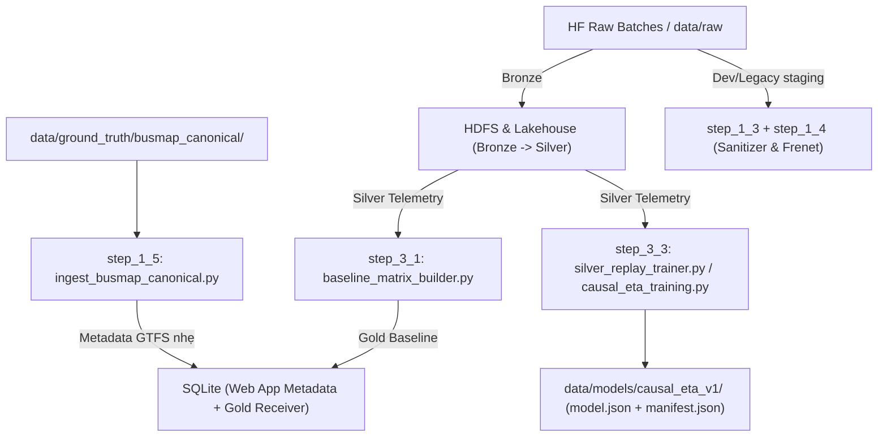

# Batch View Pipeline (Luồng Xử lý Lô & Huấn luyện)

- **Trạng thái:** Current
- **Phạm vi:** Toàn bộ đường ống xử lý dữ liệu lịch sử từ raw JSONL đến SQLite, Parquet Medallion Lakehouse (Bronze–Silver–Gold), HDFS và huấn luyện mô hình `causal-eta.v1`.
- **Nguồn sự thật (Code paths):** `config/system_config.py`, `module_1_data_ingestion_and_preprocessing/step_1_3_*`, `step_1_4_*`, `step_1_5_*`, `module_2_big_data_storage_and_lakehouse/`, `module_3_bus_eta_prediction/step_3_1_*`, `step_3_2_*`, `step_3_3_*`.

## 1. Sơ đồ luồng Batch View

## 2. Hợp đồng dữ liệu & Các bước thực thi

| Giai đoạn | Module / Symbol | Đầu vào -> Đầu ra | Ràng buộc chính (SSOT) |
| --- | --- | --- | --- |
| 0. Nạp GTFS chuẩn | `step_1_5_busmap_canonical_migration/ingest_busmap_canonical.py` | `busmap_canonical/*` -> `canonical_routes`, `canonical_shapes`, `canonical_stations` | Chiếu trạm lên `s_station_m` trong SQLite |
| 1. Bronze & Silver trên HDFS/Lakehouse | `step_2_4_hdfs_history` (`hf_bronze.py`, `p2_transform.py`) & `step_2_2` (`lakehouse_exporter.py`) | HF Raw -> HDFS Bronze -> Silver Parquet (`cross_track_m <= 35.0m`) | Kho lưu trữ lịch sử chính (thay thế vai trò lưu raw/silver của SQLite giai đoạn thử nghiệm) |
| 2. Tiền xử lý cục bộ *(khi chạy từ `data/raw`)* | `step_1_3` (`telemetry_sanitizer.py`, `bulk_ping_ingester.py`) & `step_1_4` (`multi_route_projector.py`, `tomtom_incident_projector.py`) | `data/raw/*/*.jsonl` -> chiếu Frenet 1D | Kiểm tra đủ 4 biên `HANOI_BBOX` (`19.50..22.50`, `104.50..107.50`) |
| 3. Baseline Matrix (Gold) | `step_3_1_historical_baseline_model/baseline_matrix_builder.py` | Silver Parquet + `train_test_split_v1.json` -> Gold Parquet & SQLite baseline | `MIN_SAMPLES_FOR_BASELINE = 5`, `MAX_SEGMENT_TRAVEL_TIME_SEC = 1800.0` |
| 4. Huấn luyện ML | `step_3_3_machine_learning_models/silver_replay_trainer.py` | Silver Parquet + `CausalFeatures` -> `data/models/causal_eta_v1/` | 36 features nhân quả, residual XGBoost |

## 3. Các lỗi đã chốt & Giới hạn hiện tại

- **Đã sửa:**
  - Mở rộng `HANOI_BBOX` lên vùng liên tỉnh miền Bắc (`19.50..22.50`, `104.50..107.50`) để không loại nhầm các tuyến ngoại thành.
  - Sửa `get_database_path()` kiểm tra `os.path.exists(LEGACY_AUDIT_DB_PATH)` trước khi fallback.
  - Sửa `telemetry_sanitizer.py`: phân biệt `IDLE_DEPOT` bằng `TERMINAL_STATIONARY_TOL_M` (`50.0m`) thay cho hằng số tốc độ, không cập nhật `kinematic_cache` khi `GPS_DRIFT_JUMP`, kiểm tra `OUT_OF_BOUNDS` trước `IDLE_DEPOT`.
  - Sửa `trip_segmenter.py`: yêu cầu `s < (prev_s - MAX_BACKWARD_JITTER_M)` trong `is_terminal_reset`.
  - Sửa `lakehouse_exporter.py`: đồng bộ điều kiện `cross_track_m <= MAX_CORRIDOR_CROSS_TRACK_M` ở kiểm tra tăng dần `db_dates`, ghi nguyên tử, và kiểm tra từng tuyến ở `fact_route_tomtom_incidents`.
- **Kiến trúc lưu trữ:**
  - HDFS/Lakehouse đảm nhiệm toàn bộ dữ liệu lịch sử thô (Bronze) và đã chiếu (Silver). SQLite chỉ giữ vai trò nền nhẹ cho Web App (GTFS metadata) và hứng kết quả tổng hợp từ HDFS Gold.
