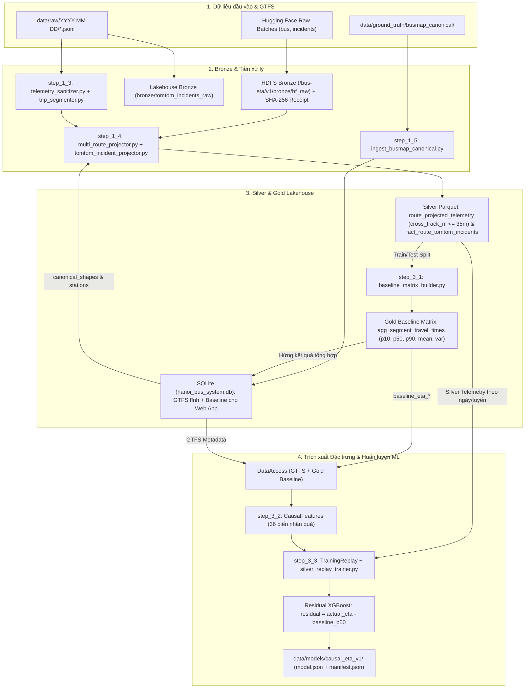

# Batch View Pipeline (Luồng Xử lý Lô & Huấn luyện)

- **Trạng thái:** Current
- **Phạm vi:** Đường ống xử lý dữ liệu lịch sử từ raw JSONL đến HDFS / Medallion Lakehouse (Bronze–Silver–Gold), SQLite nền nhẹ và huấn luyện mô hình `causal-eta.v1`.
- **Nguồn sự thật (Code paths):** `config/system_config.py`, `module_1_data_ingestion_and_preprocessing/step_1_3_*`, `step_1_4_*`, `step_1_5_*`, `module_2_big_data_storage_and_lakehouse/`, `module_3_bus_eta_prediction/step_3_1_*`, `step_3_2_*`, `step_3_3_*`.

## 1. Sơ đồ luồng Batch View

## 2. Hợp đồng dữ liệu & Các bước thực thi

| Bước | Module / Symbol | Đầu vào -> Đầu ra | Ràng buộc chính (SSOT) |
| --- | --- | --- | --- |
| 0. Nạp GTFS chuẩn | `step_1_5_busmap_canonical_migration/ingest_busmap_canonical.py` | `busmap_canonical/*` -> `canonical_routes`, `canonical_shapes`, `canonical_stations` | Chiếu trạm lên `s_station_m` trong SQLite |
| 1. Bronze & Silver trên HDFS/Lakehouse | `step_2_4_hdfs_history` (`hf_bronze.py`, `p2_transform.py`) & `step_2_2` (`lakehouse_exporter.py`) | HF Raw -> HDFS Bronze -> Silver Parquet (`cross_track_m <= 35.0m`) | Kho lưu trữ lịch sử chính, ghi nguyên tử `.tmp` + `os.replace` |
| 2. Tiền xử lý & Chiếu tuyến | `step_1_3` (`telemetry_sanitizer.py`, `trip_segmenter.py`) & `step_1_4` (`multi_route_projector.py`, `tomtom_incident_projector.py`) | Ping GPS & Incidents -> Quỹ đạo đã lọc & chiếu 1D Frenet | `HANOI_BBOX` 4 biên (`19.50..22.50`, `104.50..107.50`), `TERMINAL_STATIONARY_TOL_M = 50.0m`, `MAX_BACKWARD_JITTER_M = 120.0m` |
| 3. Baseline Matrix (Gold) | `step_3_1_historical_baseline_model/baseline_matrix_builder.py` | Silver Parquet + `train_test_split_v1.json` -> Gold Parquet & SQLite baseline | `MIN_SAMPLES_FOR_BASELINE = 5`, `MAX_SEGMENT_TRAVEL_TIME_SEC = 1800.0` |
| 4. Huấn luyện ML | `step_3_3_machine_learning_models/silver_replay_trainer.py` | Silver Parquet + `CausalFeatures` -> `data/models/causal_eta_v1/` | 36 features nhân quả, residual XGBoost |
