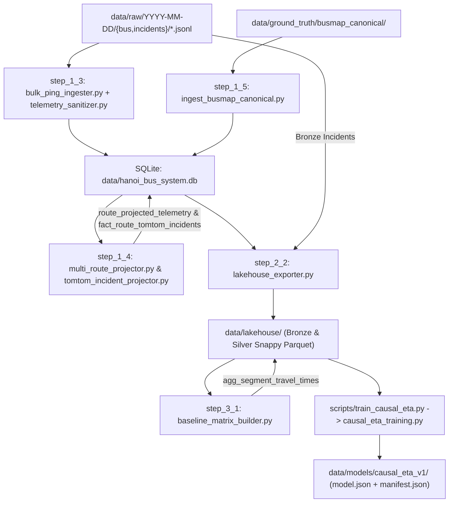

# Batch View Pipeline (Luồng Xử lý Lô & Huấn luyện)

- **Trạng thái:** Current
- **Phạm vi:** Toàn bộ đường ống xử lý dữ liệu lịch sử từ raw JSONL đến SQLite, Parquet Medallion Lakehouse (Bronze–Silver–Gold), HDFS và huấn luyện mô hình `causal-eta.v1`.
- **Nguồn sự thật (Code paths):** `config/system_config.py`, `module_1_data_ingestion_and_preprocessing/step_1_3_*`, `step_1_4_*`, `step_1_5_*`, `module_2_big_data_storage_and_lakehouse/`, `module_3_bus_eta_prediction/step_3_1_*`, `step_3_2_*`, `step_3_3_*`, `scripts/train_causal_eta.py`.

## 1. Sơ đồ luồng Batch View

## 2. Hợp đồng dữ liệu & Các bước thực thi

| Giai đoạn | Entrypoint | Đầu vào -> Đầu ra | Ràng buộc chính (SSOT) |
| --- | --- | --- | --- |
| 0. Nạp GTFS chuẩn | `step_1_5_busmap_canonical_migration/ingest_busmap_canonical.py` | `busmap_canonical/*` -> `canonical_routes`, `canonical_shapes`, `canonical_stations` | Chiếu trạm lên `s_station_m` |
| 1. Nạp ping thô | `step_1_3_telemetry_kinematic_sanitizer/bulk_ping_ingester.py` | `data/raw/*/bus/*.jsonl` -> `raw_bus_pings` | Kiểm tra đủ 4 biên `HANOI_BBOX` (`19.50..22.50`, `104.50..107.50`) |
| 2. Chiếu Frenet 1D | `step_1_4_frenet_spatial_projection/multi_route_projector.py` | `raw_bus_pings` -> `route_projected_telemetry` | Đa tiến trình theo tuyến, giữ ping hợp lệ |
| 3. Chiếu sự cố | `step_1_4_frenet_spatial_projection/tomtom_incident_projector.py` | `data/raw/*/incidents/*.jsonl` -> `fact_route_tomtom_incidents` | Chiếu đoạn sự cố lên lưới 100m theo tuyến |
| 4. Xuất Lakehouse | `step_2_2_parquet_medallion_lakehouse/lakehouse_exporter.py` | SQLite + JSONL -> `data/lakehouse/{bronze,silver}/` | Lọc `cross_track_m <= MAX_CORRIDOR_CROSS_TRACK_M (35.0m)`, ghi nguyên tử `.tmp` + `os.replace` |
| 5. Baseline Matrix | `step_3_1_historical_baseline_model/baseline_matrix_builder.py` | Silver Parquet + `train_test_split_v1.json` -> `gold/agg_segment_travel_times` | `MIN_SAMPLES_FOR_BASELINE = 5`, `MAX_SEGMENT_TRAVEL_TIME_SEC = 1800.0` |
| 6. Huấn luyện ML | `scripts/train_causal_eta.py` | Silver Parquet + `CausalFeatures` -> `data/models/causal_eta_v1/` | 36 features nhân quả, residual XGBoost |

## 3. Các lỗi đã chốt & Giới hạn hiện tại

- **Đã sửa:**
  - Mở rộng `HANOI_BBOX` lên vùng liên tỉnh miền Bắc (`19.50..22.50`, `104.50..107.50`) để không loại nhầm các tuyến ngoại thành.
  - Sửa `get_database_path()` kiểm tra `os.path.exists(LEGACY_AUDIT_DB_PATH)` trước khi fallback.
  - Sửa `telemetry_sanitizer.py`: phân biệt `IDLE_DEPOT` bằng `TERMINAL_STATIONARY_TOL_M` (`50.0m`) thay cho hằng số tốc độ, không cập nhật `kinematic_cache` khi `GPS_DRIFT_JUMP`, kiểm tra `OUT_OF_BOUNDS` trước `IDLE_DEPOT`.
  - Sửa `trip_segmenter.py`: yêu cầu `s < (prev_s - MAX_BACKWARD_JITTER_M)` trong `is_terminal_reset`.
  - Sửa `lakehouse_exporter.py`: đồng bộ điều kiện `cross_track_m <= MAX_CORRIDOR_CROSS_TRACK_M` ở kiểm tra tăng dần `db_dates`, ghi nguyên tử, và kiểm tra từng tuyến ở `fact_route_tomtom_incidents`.
- **Giới hạn đã biết:**
  - `data/hanoi_bus_system.db` (~3.08 GB) và `data/lakehouse/silver/` vẫn lưu song song dữ liệu telemetry để phục vụ đồng thời ETL/serving metadata và phân tích Parquet.
