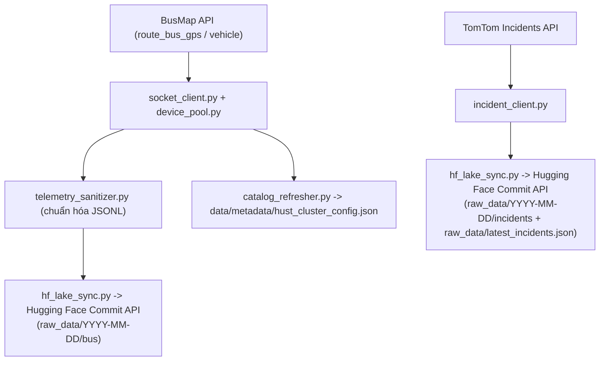
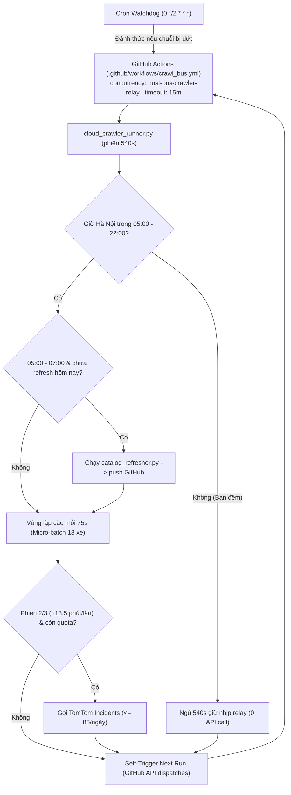

# Tài liệu Module Thu thập Dữ liệu (Crawler)

- **Trạng thái:** Current
- **Phạm vi:** Cloud Crawler 24/7 trên GitHub Actions, Local Crawler, TomTom Incidents, làm mới danh mục xe đầu ngày và đồng bộ lên Hugging Face Dataset.
- **Nguồn sự thật (Code paths):** `.github/workflows/crawl_bus.yml`, `module_1_data_ingestion_and_preprocessing/step_1_1_busmap_crawler_and_relay/`, `config/system_config.py`.

## 1. Sơ đồ Luồng Dữ liệu (Data Flow)



## 2. Sơ đồ Luồng Logic (Logic Flow)



## 3. Thành phần & Tham số SSOT

| Thành phần / Hằng số | Giá trị / Vai trò |
| --- | --- |
| Workflow `crawl_bus.yml` | `concurrency: hust-bus-crawler-relay` (`cancel-in-progress: false`), `timeout-minutes: 15`, tự gọi `dispatches` để nối phiên 24/7 |
| `SESSION_DURATION_SEC` | `540` giây (9 phút mỗi phiên); ngoài giờ `05:00–22:00` crawler ngủ đủ 540s để giữ nhịp relay mà không gọi API |
| `BUS_POLL_INTERVAL_SEC` / `BUS_MICRO_BATCH_SIZE` | `75s` mỗi vòng / `18` xe mỗi micro-batch |
| `socket_client.py` | Raw SSL socket HTTP/1.1, hỗ trợ `Transfer-Encoding: chunked`, DNS cache có `_IP_CACHE_LOCK`, thread timeout `4.2s` |
| `catalog_refresher.py` | Quét `route_bus_gps` toàn bộ 49 tuyến, cập nhật `routeId` khi xe đổi tuyến, chỉ xóa xe khi `status == "ERROR"` |
| `incident_client.py` | Chỉ gọi TomTom Incidents (`MAX_TOMTOM_INCIDENT_DAILY = 80`, `MAX_TOMTOM_INCIDENT_MONTHLY = 2500`); đẩy ngay snapshot live qua `push_latest_incidents_to_hf` |
| `hf_lake_sync.py` | Upload qua Hugging Face Commit API vào `raw_data/YYYY-MM-DD/{bus,incidents}/batch_HHMMSS.jsonl` và `raw_data/latest_incidents.json` (live relay cho Speed Layer) |

## 4. Cách kiểm thử & Vận hành

```bash
# Chạy thử 1 vòng đầy đủ cục bộ (không đẩy Hugging Face, không gọi TomTom)
python -m module_1_data_ingestion_and_preprocessing.step_1_1_busmap_crawler_and_relay.cloud_crawler_runner --test --no-tomtom

# Làm mới danh mục xe thủ công
python -m module_1_data_ingestion_and_preprocessing.step_1_1_busmap_crawler_and_relay.catalog_refresher
```
