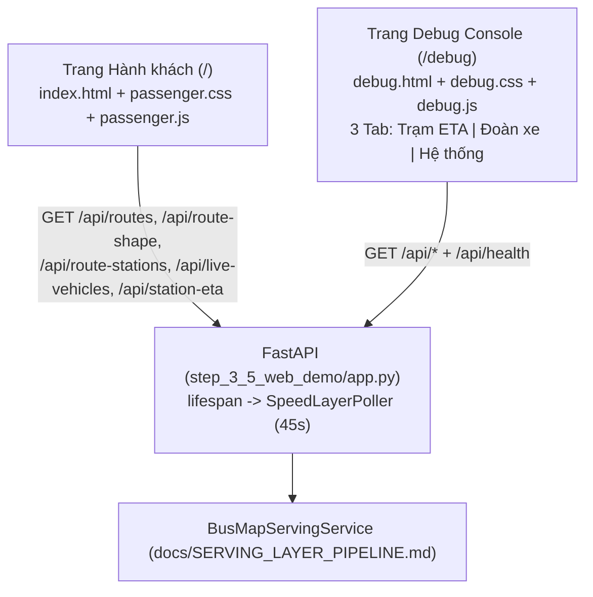

# Tài liệu Web Demo App (`DEMO_APP`)

- **Trạng thái:** Current
- **Phạm vi:** Ứng dụng FastAPI phục vụ 2 giao diện web tách biệt (`/` Hành khách tối giản và `/debug` Operations Console), các REST endpoints, bản đồ Esri vệ tinh và script khởi động nền trước demo.
- **Nguồn sự thật (Code paths):** `module_3_bus_eta_prediction/step_3_5_web_demo/` (`app.py`, `static/index.html`, `static/passenger.*`, `static/debug.*`, `static/bus_core.js`), `scripts/start_demo_bg.*`, `scripts/stop_demo_bg.*`.
- **Chi tiết tầng Serving & Speed Layer:** Xem [docs/SERVING_LAYER_PIPELINE.md](SERVING_LAYER_PIPELINE.md) và [docs/SPEED_LAYER_PIPELINE.md](SPEED_LAYER_PIPELINE.md).

## 1. Sơ đồ Luồng Dữ liệu (Data Flow — 2 Trang Tách biệt)



- **Trang Hành khách (`/`):**
  - Giao diện tối giản, mặc định bản đồ **Esri vệ tinh (`World_Imagery`)**, bảng nổi bên trái có thể kéo dãn chiều rộng (`#panelResizer`) và thu gọn; trên mobile dùng bottom-sheet 3 mức.
  - Ô tìm tuyến (`#routeCombobox`) và ô chọn/lọc trạm (`#stationCombobox`) nằm phía trên vùng ETA để giữ khoảng trống rộng cho thẻ dự báo.
  - **Tự động ghim khi click trạm** (trên bản đồ hoặc danh sách) và **không mở khung popup trên bản đồ**; làm nổi bật **xe gần trạm nhất** bằng thẻ hero và badge pulse trên bản đồ.
- **Trang Debug (`/debug`):**
  - Nền dark-slate tách biệt, chia 2 cột bản đồ Esri vệ tinh — bảng phân tích (kéo dãn tỷ lệ qua `#dbgSplitter`), gồm **3 tab độc lập**:
    1. **Trạm & ETA:** bảng toàn bộ xe đang tiếp cận (hàng xe gần nhất được highlight), hiển thị `TB query` vs `BM thiết bị` (`busmap_updated_at`), `buffer_seconds`, `delay_seconds`, `fallback_reason`.
    2. **Đoàn xe & Telemetry:** toàn bộ xe đang hoạt động, nguồn `timbus`/`busmap`, thời gian gói tin, vận tốc mượt/gốc/`Δt` (click dòng để định vị trên bản đồ).
    3. **Hệ thống & Poller:** trạng thái `/api/health` (`healthy` / `degraded`), `SpeedLayerPoller` (`cycle_count`, bộ đếm phân loại 4 trạng thái, `Circuit Breaker`) và `ModelRuntime`.

## 2. API Endpoints (`step_3_5_web_demo/app.py`)

| Endpoint | Mục đích |
| --- | --- |
| `GET /` | Trang Hành khách tối giản (`static/index.html`) |
| `GET /debug` | Trang Debug Console tách biệt (`static/debug.html`) |
| `GET /api/health`, `GET /api/v1/health` | Trạng thái `healthy`/`degraded`, `model_available`, `poller` snapshot và release info |
| `GET /api/routes` | Danh sách tuyến xe buýt hỗ trợ |
| `GET /api/live-vehicles` | Vị trí xe trực tiếp kèm `upstream_status`, `timbus_status`, `busmap_updated_at` |
| `GET /api/route-shape`, `GET /api/route-stations` | Hình học polyline và danh sách trạm lượt đi/lượt về |
| `GET /api/station-eta` | Danh sách xe đang tiến tới trạm kèm `SafeWindowDTO`, `fallback_reason` và trạng thái upstream |

## 3. Cách chạy & Kiểm thử

```powershell
# Khởi động chạy ngầm trước demo ~15 phút (tự bật SpeedLayerPoller, chống chạy trùng port)
scripts\start_demo_bg.bat

# Dừng server sau khi demo xong
scripts\stop_demo_bg.bat
```

```bash
# Hoặc chạy trực tiếp foreground (bắt buộc --workers 1 để dùng chung RAM với SpeedLayerPoller)
python -m uvicorn module_3_bus_eta_prediction.step_3_5_web_demo.app:app --host 127.0.0.1 --port 8000 --workers 1

# Kiểm thử API & UI contracts
python -m pytest tests/module_3/test_speed_poller_and_feedback.py tests/module_3/test_spec24_conservative_eta_blackbox.py --basetemp=runtime/pytest_tmp -q
```
