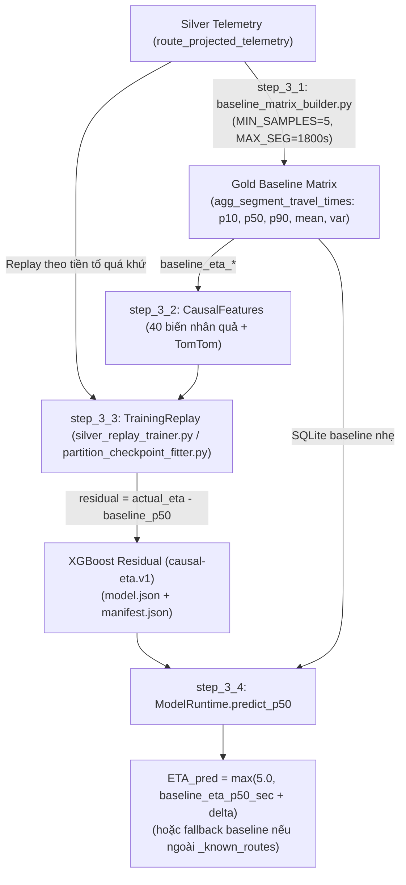

# Mô hình Dự báo ETA (`causal-eta.v1`)

- **Trạng thái:** Current
- **Phạm vi:** Baseline Matrix (`step_3_1`), bộ 40 đặc trưng nhân quả `CausalFeatures` gồm 4 đặc trưng TomTom (`step_3_2`), mô hình residual XGBoost (`step_3_3`, streaming `QuantileDMatrix` + GPU CUDA) và runtime suy luận (`step_3_4`).
- **Nguồn sự thật (Code paths):** `step_3_1_historical_baseline_model/baseline_matrix_builder.py`, `step_3_2_feature_store_extractor/causal_eta.py`, `step_3_3_machine_learning_models/` (`causal_eta_training.py`, `silver_replay_trainer.py`, `partition_checkpoint_fitter.py`), `step_3_4_eta_serving_and_evaluation/model_runtime.py`, `data/models/causal_eta_v1/manifest.json`.

## 1. Sơ đồ Luồng Dữ liệu (Data Flow — Residual ETA)



- **Baseline Matrix (`step_3_1`):** Tổng hợp phân vị (`p10`, `p50`, `p90`, `mean`, `var`) thời gian đi giữa các trạm theo `(route_id, direction, segment_idx, day_type, hour_slot)` từ Silver Parquet (`MIN_SAMPLES_FOR_BASELINE = 5`, `MAX_SEGMENT_TRAVEL_TIME_SEC = 1800.0`).
- **Nhân quả tuyệt đối (`CausalFeatures`):** Dùng chung 1 code path giữa replay huấn luyện và inference trực tuyến (`_observe_causal_snapshot` + `features(...)`), chỉ dùng tiền tố quan sát quá khứ.
- **Fallback an toàn (`ModelRuntime`):** Nếu `route_id_idx` nằm ngoài `_known_routes` trong `manifest.json` hoặc thiếu feature, `predict_p50_with_reason()` trả `(None, fallback_reason)` để tầng serving fallback tường minh về baseline thuần.

## 2. Danh sách 40 Features (`causal-eta.v1`)

| Nhóm | Các biến trong `manifest.json` |
| --- | --- |
| Tuyến & Thời gian (9) | `route_id_idx`, `direction_id`, `current_station_order`, `target_station_order`, `day_type`, `day_of_week`, `hour_slot`, `sin_time`, `cos_time` |
| Hình học & Khoảng cách (7) | `s_bus_m`, `s_target_m`, `remaining_distance_m`, `n_stations_ahead`, `progress_ratio`, `target_progress_ratio`, `dist_to_next_station_m` |
| Động học Ego (2) | `ego_speed_avg_3min_kmh`, `ego_speed_avg_5min_kmh` |
| Thống kê Baseline (11) | `baseline_eta_p50_sec`, `baseline_eta_mean_sec`, `baseline_eta_p10_sec`, `baseline_eta_p90_sec`, `baseline_eta_p90_minus_p10_sec`, `baseline_eta_rss_std_sec`, `baseline_eta_mean_minus_p50_sec`, `baseline_max_seg_p90_sec`, `baseline_tier0_frac`, `route_base_speed_kmh`, `route_station_spacing_m` |
| Đội xe cùng tuyến (7) | `lead_bus_dist_ahead_m`, `follow_bus_dist_behind_m`, `n_active_buses_on_route`, `n_buses_in_corridor_ahead`, `lead_bus_speed_kmh`, `follow_bus_speed_kmh`, `lead_bus_speed_ratio` |
| Sự cố TomTom (4) | `inc_ahead_total_delay_sec` *(monotone `+1`)*, `inc_dist_to_nearest_m`, `inc_ahead_jam_length_m`, `inc_info_age_sec` *(tuổi snapshot `t_cur - crawled_epoch`)* |

## 3. Huấn luyện & Kiểm thử

```bash
python -m module_3_bus_eta_prediction.step_3_3_machine_learning_models.silver_replay_trainer --help
python -m pytest tests/module_3/test_causal_eta_training.py tests/module_3/test_eta_validation_protocol.py --basetemp=runtime/pytest_tmp -q
```
