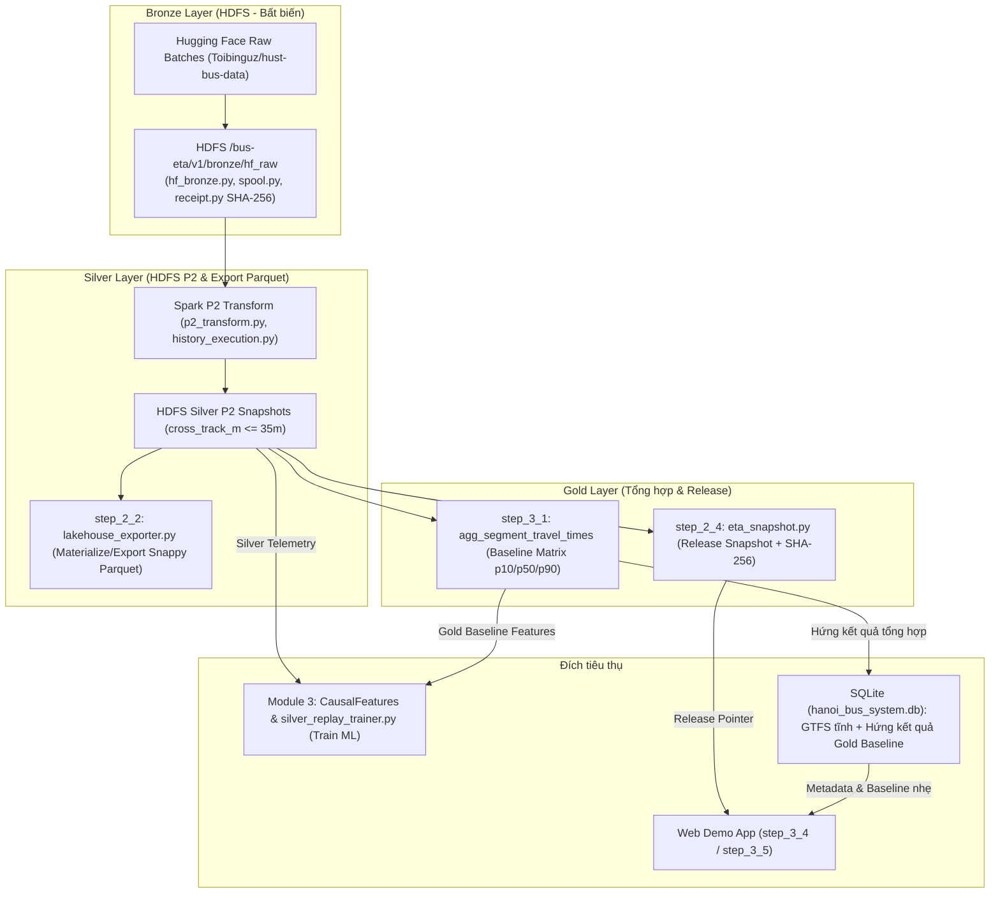

# Lưu trữ HDFS & Medallion Lakehouse (Bronze – Silver – Gold)

- **Trạng thái:** Current
- **Phạm vi:** Kiến trúc lưu trữ lịch sử tập trung trên **HDFS (Bronze – Silver – Gold)** — toàn bộ dữ liệu live thu thập đều đi qua HDFS, không lưu trữ song song ngoài luồng; SQLite chỉ làm nền nhẹ cho Web App.
- **Nguồn sự thật (Code paths):** `module_2_big_data_storage_and_lakehouse/` (`step_2_1`, `step_2_2`, `step_2_4`), `docker-compose.hdfs.yml`, `docs/HDFS_RUNBOOK.md`.

## 1. Sơ đồ phân tầng Bronze – Silver – Gold

## 2. Vai trò các kho lưu trữ hiện tại

| Kho lưu trữ | Vai trò | Dữ liệu chứa |
| --- | --- | --- |
| **HDFS (`step_2_4_hdfs_history`)** | **Kho lưu trữ lịch sử duy nhất và chính thức** cho toàn bộ dữ liệu thu thập (Bronze), đã lọc & chiếu Frenet (Silver), và tổng hợp/release (Gold) | `/bus-eta/v1/bronze/hf_raw`, HDFS Silver P2 snapshots, Gold release artifacts |
| **SQLite (`step_2_1_sqlite_operational_store`)** | **Nền nhẹ cho Web App** và **nơi hứng kết quả tổng hợp từ HDFS Gold** để tra cứu độ trễ thấp | `canonical_routes`, `canonical_shapes`, `canonical_stations`, bảng baseline ETA |
| **Parquet Materialize (`step_2_2`)** | Xuất/kiểm toán các phân vùng Snappy Parquet (`cross_track_m <= 35.0m`, atomic `.tmp` + `os.replace`) phục vụ tiêu thụ offline | `silver/`, `gold/` |

## 3. Ràng buộc chất lượng & Vận hành

- Toàn bộ dữ liệu thu thập đều đi qua HDFS Bronze kèm SHA-256 receipt (`receipt.py`) trước khi qua Spark P2 Silver (`p2_transform.py`).
- Web Demo không truy vấn HDFS trực tiếp trong mỗi request; thay vào đó đọc từ release pointer / SQLite nhẹ đã hứng kết quả Gold và verify hash cục bộ (xem [HDFS_RUNBOOK.md](HDFS_RUNBOOK.md)).
