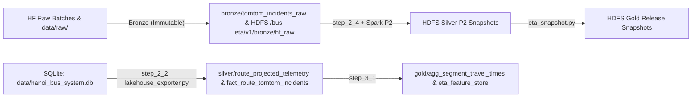

# Lưu trữ HDFS & Medallion Lakehouse (Bronze – Silver – Gold)

- **Trạng thái:** Current
- **Phạm vi:** Kiến trúc lưu trữ lịch sử 2 tầng: SQLite Operational Store (`data/hanoi_bus_system.db`), Medallion Lakehouse Parquet cục bộ (`data/lakehouse/`), và cụm HDFS/Spark (`step_2_4_hdfs_history/`).
- **Nguồn sự thật (Code paths):** `module_2_big_data_storage_and_lakehouse/` (`step_2_1`, `step_2_2`, `step_2_4`), `docker-compose.hdfs.yml`, `scripts/hdfs_*.py`, `docs/HDFS_RUNBOOK.md`.

## 1. Sơ đồ phân tầng Bronze – Silver – Gold

## 2. Phân vai giữa SQLite (`.db`) và Parquet Lakehouse / HDFS

| Kho lưu trữ | Vai trò chính | Dữ liệu chứa |
| --- | --- | --- |
| `data/hanoi_bus_system.db` | **Operational / ETL Staging & Serving Metadata:** phục vụ Module 1 ghi/chiếu và Web Demo/Serving tra cứu tuyến, trạm, baseline | `canonical_routes`, `canonical_shapes`, `canonical_stations`, `raw_bus_pings`, `route_projected_telemetry`, `fact_route_tomtom_incidents`, `baseline_segment_travel_times` |
| `data/lakehouse/` | **Analytical Store (Local Parquet Snappy):** xuất tăng dần từ `.db` + `data/raw` cho `step_3_1` và huấn luyện/đánh giá | `bronze/tomtom_incidents_raw/`, `silver/route_projected_telemetry/route_code=XX/dt=YYYY-MM-DD/`, `silver/fact_route_tomtom_incidents/`, `gold/` |
| HDFS (`step_2_4_hdfs_history`) | **Immutable Cluster Storage:** nhập raw từ Hugging Face kèm SHA-256 receipt, chạy Spark P2 transform và xuất release snapshot bất biến | `/bus-eta/v1/bronze/hf_raw`, Silver P2 snapshots, Gold release artifacts |

## 3. Ràng buộc chất lượng & Vận hành

- `lakehouse_exporter.py`: lọc `cross_track_m <= MAX_CORRIDOR_CROSS_TRACK_M` (`35.0m`), đồng bộ kiểm tra partition tăng dần, ghi nguyên tử qua `.tmp` + `os.replace`.
- Trên HDFS: không phục vụ trực tiếp request web; Web Demo đọc qua release pointer đã tải & verify hash cục bộ (xem chi tiết lệnh vận hành tại [HDFS_RUNBOOK.md](HDFS_RUNBOOK.md)).
