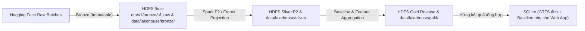

# Lưu trữ HDFS & Medallion Lakehouse (Bronze – Silver – Gold)

- **Trạng thái:** Current
- **Phạm vi:** Kiến trúc lưu trữ lịch sử trên HDFS / Medallion Lakehouse (`Bronze – Silver – Gold`) và vai trò nền nhẹ của SQLite cho Web App.
- **Nguồn sự thật (Code paths):** `module_2_big_data_storage_and_lakehouse/` (`step_2_1`, `step_2_2`, `step_2_4`), `docker-compose.hdfs.yml`, `docs/HDFS_RUNBOOK.md`.

## 1. Sơ đồ phân tầng Bronze – Silver – Gold

## 2. Vai trò các kho lưu trữ hiện tại

| Kho lưu trữ | Vai trò | Dữ liệu chứa |
| --- | --- | --- |
| **HDFS (`step_2_4_hdfs_history`) & Parquet Lakehouse (`data/lakehouse/`)** | **Kho lưu trữ chính** cho toàn bộ dữ liệu lịch sử thô (Bronze), đã lọc & chiếu Frenet (Silver), và tổng hợp phân tích/huấn luyện (Gold) | `/bus-eta/v1/bronze/hf_raw`, Silver P2 / `route_projected_telemetry`, `fact_route_tomtom_incidents`, Gold snapshots |
| **SQLite (`step_2_1_sqlite_operational_store`)** | **Nền nhẹ cho Web App** và **nơi hứng kết quả tổng hợp từ HDFS Gold** để tra cứu độ trễ thấp | `canonical_routes`, `canonical_shapes`, `canonical_stations`, bảng baseline ETA |

## 3. Ràng buộc chất lượng & Vận hành

- `step_2_2/lakehouse_exporter.py`: lọc `cross_track_m <= MAX_CORRIDOR_CROSS_TRACK_M` (`35.0m`), đồng bộ kiểm tra partition tăng dần, ghi nguyên tử qua `.tmp` + `os.replace`.
- Web Demo không truy vấn HDFS trực tiếp trong mỗi request; thay vào đó đọc từ release pointer / SQLite nhẹ đã hứng kết quả Gold và verify hash cục bộ (xem [HDFS_RUNBOOK.md](HDFS_RUNBOOK.md)).
