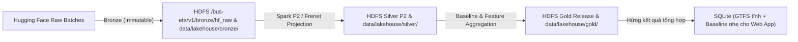

# Lưu trữ HDFS & Medallion Lakehouse (Bronze – Silver – Gold)

- **Trạng thái:** Current
- **Phạm vi:** Kiến trúc lưu trữ lịch sử trên HDFS / Medallion Lakehouse (`Bronze – Silver – Gold`) và vai trò nền nhẹ của SQLite cho Web App.
- **Nguồn sự thật (Code paths):** `module_2_big_data_storage_and_lakehouse/` (`step_2_1`, `step_2_2`, `step_2_4`), `docker-compose.hdfs.yml`, `docs/HDFS_RUNBOOK.md`.

## 1. Sơ đồ phân tầng Bronze – Silver – Gold

## 2. Chuyển dịch vai trò lưu trữ: Thử nghiệm -> Sản phẩm

- **Giai đoạn thử nghiệm (dev/local ban đầu):** SQLite (`data/hanoi_bus_system.db`) từng đóng vai trò kho lưu trữ duy nhất (chứa cả `raw_bus_pings`, `route_projected_telemetry`, `fact_route_tomtom_incidents`).
- **Kiến trúc sản phẩm hoàn thiện:**
  - **HDFS (`step_2_4_hdfs_history`) & Medallion Parquet (`data/lakehouse/`):** Đảm nhiệm vai trò **kho lưu trữ chính** cho toàn bộ dữ liệu lịch sử thô (Bronze), dữ liệu đã lọc & chiếu Frenet (Silver), và tổng hợp phân tích/huấn luyện (Gold).
  - **SQLite (`step_2_1_sqlite_operational_store`):** Nhường toàn bộ việc lưu `raw` và `silver` cho HDFS/Lakehouse, **chỉ còn 2 vai trò nhẹ**:
    1. Lưu metadata tĩnh GTFS chuẩn (`canonical_routes`, `canonical_shapes`, `canonical_stations`) làm nền nhẹ cho Web App (`step_3_4`, `step_3_5`).
    2. Làm nơi hứng kết quả tổng hợp từ HDFS Gold (như bảng baseline `eta_baseline_*` / `baseline_segment_travel_times`) để phục vụ tra cứu độ trễ thấp trên Web App.

## 3. Ràng buộc chất lượng & Vận hành

- `step_2_2/lakehouse_exporter.py`: lọc `cross_track_m <= MAX_CORRIDOR_CROSS_TRACK_M` (`35.0m`), đồng bộ kiểm tra partition tăng dần, ghi nguyên tử qua `.tmp` + `os.replace`.
- Trên HDFS: Web Demo không truy vấn HDFS trực tiếp trong mỗi request; thay vào đó đọc từ release pointer / SQLite nhẹ đã hứng kết quả Gold và verify hash cục bộ (xem [HDFS_RUNBOOK.md](HDFS_RUNBOOK.md)).
