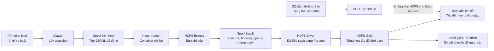
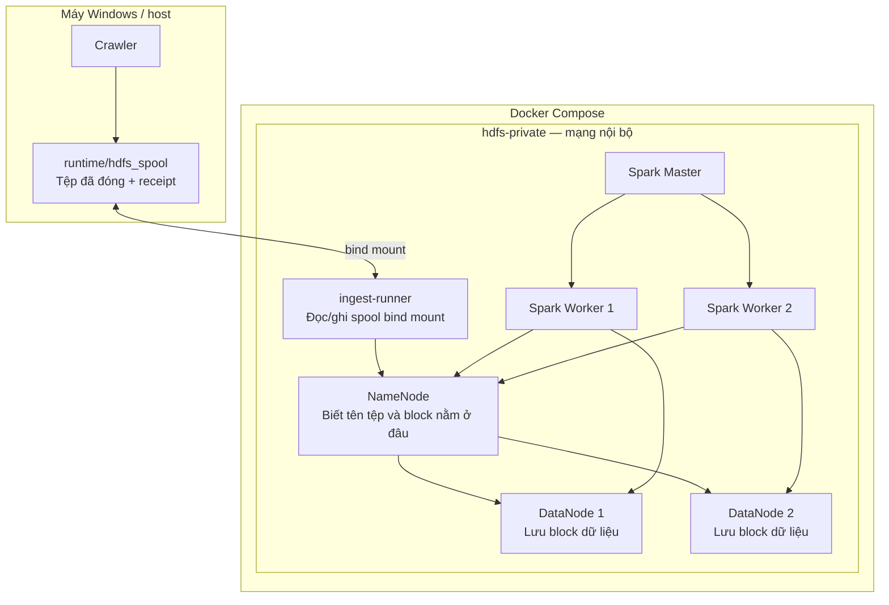
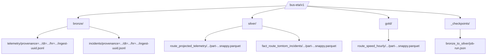
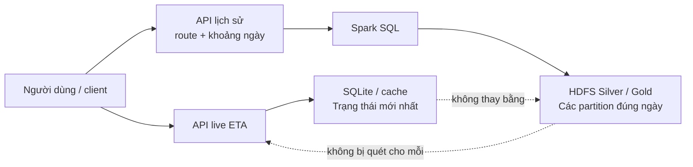
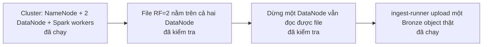

# HDFS trong dự án này: bản đồ dễ hiểu

> Tài liệu này giải thích **cách HDFS được dùng trong dự án xe buýt**. Nó không thay thế hay sửa đổi [SPEC-25](specs/25_MINIMUM_VIABLE_HDFS_STORAGE_AND_QUERY_SPEC.md). Khi hai tài liệu khác nhau về mức độ chi tiết, SPEC-25 và các log chạy thực tế là nguồn quyết định.

## Đọc nhanh trong 60 giây

HDFS không thay thế toàn bộ cơ sở dữ liệu hiện tại. Nó được bổ sung cho một việc rất cụ thể: **giữ lịch sử vị trí xe lâu dài, theo cách có thể chia dữ liệu lên nhiều máy và xử lý lại bằng Spark**.

- SQLite hiện giữ trạng thái hoạt động nhỏ gọn và phù hợp cho phần xe/ETA hiện tại.
- HDFS giữ các tệp lịch sử đã chốt; cùng một dữ liệu có thể có nhiều bản sao trên các DataNode.
- Spark đọc các tệp lịch sử từ HDFS để làm sạch, bỏ trùng và tạo bảng phân tích.
- HDFS không nằm trực tiếp trên đường trả ETA tức thời. ETA/live vẫn dùng trạng thái hiện tại, vì việc mở tệp phân tán để trả lời từng request sẽ chậm và không cần thiết.

Mục tiêu bài tập là chứng minh một đường đi thật: **dữ liệu xe buýt → tệp đệm an toàn → HDFS → Spark → dữ liệu lịch sử có thể truy vấn/đánh giá**. Đây là mô phỏng có thể chạy lại trên laptop, không phải lời hứa vận hành hệ thống thành phố 24/7.

---

## 1. Dữ liệu đi qua hệ thống như thế nào?

### 1.1 Luồng đầy đủ dự kiến



Điểm cần nhớ:

1. **Crawler** chỉ lấy dữ liệu. Nó chưa cần biết HDFS, Spark hay SQL.
2. **Spool** là thư mục tệp đệm trên máy chạy crawler. Dữ liệu trước hết được ghi thành tệp `*.tmp`; chỉ sau khi ghi xong và đóng tệp mới đổi tên thành `*.jsonl` để cho phép upload. Vì vậy uploader không bao giờ lấy một tệp đang ghi dở.
3. **ingest-runner** là container được phép nhìn thấy cả spool và mạng HDFS nội bộ. Nó đưa tệp đã đóng lên HDFS bằng WebHDFS và tạo receipt cục bộ sau khi được HDFS xác nhận.
4. **Spark** là bước xử lý theo lô, không phải request web. Nó biến dữ liệu thô thành dữ liệu sạch, có thể phân tích.
5. **SQLite/live ETA** vẫn là đường phục vụ trạng thái hiện tại. Đây là một nhánh khác với nhánh lịch sử HDFS.

### 1.2 Một ví dụ cụ thể: một ping xe buýt

Giả sử crawler nhận được lúc 07:10 một vị trí xe tuyến `01`: xe `123`, tọa độ `(21.03, 105.84)`, thời điểm thiết bị gửi là 07:09:56.

1. Crawler đưa ping này vào cửa sổ thu thập và tạo `event_id` ổn định. Nếu crawler nhận lại chính ping đó, `event_id` vẫn giống nhau.
2. Đến khi cửa sổ đóng, ping được ghi trong một JSONL, ví dụ `runtime/hdfs_spool/.../2026-11-01/07/telemetry.jsonl`. Tệp đã đóng mới được runner xử lý.
3. Runner upload tệp thành một object Bronze, ví dụ `/bus-eta/v1/bronze/telemetry/provenance=observed/dt=2026-11-01/hr=07/ingest-<uuid>.jsonl`.
4. Spark đọc Bronze. Hai ping có cùng `event_id` chỉ trở thành **một** dòng logic ở Silver. Spark cũng gắn ping vào tuyến, tính vị trí dọc tuyến (`s_bus_m`) và kiểm tra ping có lệch quá xa hành lang tuyến không.
5. Từ nhiều ping sạch, Gold có thể tạo một dòng kiểu: “tuyến 01, giờ này, có bao nhiêu ping và tốc độ trung bình bao nhiêu”. Phần này dùng cho truy vấn lịch sử và kiểm tra ETA offline, không làm thay đổi ETA live ngay lập tức.

---

## 2. HDFS nằm ở đâu trong Docker?



### Vai trò từng thành phần

| Thành phần | Nói đơn giản | Dữ liệu nó giữ |
| --- | --- | --- |
| Host crawler | Lấy vị trí xe từ nguồn công khai | Không cần giữ lịch sử phân tán |
| Spool | Hộp thư an toàn trước khi gửi lên HDFS | Tệp chờ upload và receipt |
| ingest-runner | “Người giao tệp” vào mạng riêng của HDFS | Không giữ bản dữ liệu thay HDFS |
| NameNode | Danh bạ của HDFS: tệp nào gồm block nào, block ở DataNode nào | Metadata HDFS |
| DataNode 1/2 | Ổ cứng chứa block dữ liệu thật | Các block Bronze/Silver/Gold |
| Spark | Đọc nhiều tệp/block và tạo dữ liệu sạch/tổng hợp | Kết quả ghi lại HDFS |
| SQLite/live service | Trạng thái gọn để phục vụ xe/ETA hiện tại | Trạng thái vận hành hiện có |

**Tại sao ingest-runner ở trong Docker thay vì host gọi NameNode trực tiếp?** WebHDFS có thể chuyển request ghi từ NameNode đến DataNode. Các DataNode cố ý không mở ra host. Vì vậy host chỉ tạo spool; runner trong cùng mạng Docker giao tệp qua đúng đường HDFS mà không phải mở cổng DataNode hay tạo đường local giả.

---

## 3. HDFS lưu những gì? Bronze, Silver và Gold nghĩa là gì?

Đây là tên ba mức dữ liệu, không phải ba phần mềm khác nhau.



| Mức | Nội dung | Tại sao cần giữ? | Định dạng |
| --- | --- | --- | --- |
| **Bronze** | Bản ghi gần nguyên gốc từ crawler, đóng theo giờ | Có thể kiểm tra lại nguồn, replay và biết một lỗi phát sinh từ lúc nào | JSONL |
| **Silver** | Ping đã được kiểm tra, bỏ trùng và gắn với tuyến | Là dữ liệu đáng tin hơn để phân tích nhiều lần | Parquet |
| **Gold** | Kết quả ngắn gọn theo nhu cầu bài toán, ví dụ tốc độ trung bình theo tuyến/giờ | Truy vấn lịch sử không phải quét từng ping | Parquet |
| **Checkpoint** | Dấu mốc job Spark đã hoàn thành | Tránh coi output đang ghi dở là dữ liệu hoàn tất | JSON |

`provenance` luôn nói rõ dữ liệu là gì:

- `observed`: quan sát thật từ API công khai;
- `replayed_observed`: phát lại chính dữ liệu đã quan sát, dùng để kiểm thử recovery;
- `synthetic_scale`: dữ liệu có kiểm soát để thấy block/Spark phân tán. Nó **không** được dùng để báo cáo độ chính xác ETA hay giả là dữ liệu thật.

Việc chia `dt=YYYY-MM-DD/hr=HH` giúp Spark chỉ mở phần dữ liệu cần thiết. Ví dụ truy vấn ngày 01/11 không phải đọc dữ liệu ngày 02/11.

---

## 4. Khi upload lỗi thì có mất dữ liệu không?

```mermaid
sequenceDiagram
    participant C as Crawler/spool
    participant R as ingest-runner
    participant H as HDFS

    C->>C: Ghi telemetry.jsonl.tmp
    C->>C: fsync, đóng tệp, đổi tên .jsonl
    R->>C: Chỉ chọn tệp .jsonl đã đóng
    R->>H: Upload WebHDFS
    alt HDFS xác nhận thành công
        H-->>R: Kích thước + hash khớp
        R->>C: Ghi receipt; tệp không còn chờ upload
    else Mạng/HDFS lỗi
        H--xR: Upload thất bại
        R->>C: Giữ nguyên tệp + không ghi receipt thành công
        Note over C,R: Lần sau retry chính tệp này
    end
    R->>H: Retry cùng tên object
    alt Object đã có, hash/kích thước khớp
        H-->>R: Xem là đã upload thành công
    else Object khác hash
        H-->>R: Báo lỗi rõ ràng, không ghi đè
    end
```

Đây là ý nghĩa của “at least once” trong dự án: cùng một tệp có thể được gửi lại sau lỗi. Vì vậy hệ thống cần hai lớp chống trùng:

1. **Lúc upload:** receipt + hash bảo đảm một lần gửi lại không lặng lẽ tạo hai object logic khác nhau.
2. **Lúc Spark xử lý:** `event_id` bảo đảm hai bản ghi cùng một ping chỉ tính một lần vào Silver.

Điều không hứa hẹn: spool nằm trên host, nên nó không phải lưu trữ nhiều máy. Nếu chính máy host mất hoàn toàn trước khi gửi HDFS, dữ liệu chưa upload không tự có bản sao. Đây là giới hạn đã được nêu rõ của demo sinh viên.

---

## 5. Truy vấn lịch sử khác gì ETA live?



| Câu hỏi | Đường dữ liệu phù hợp | Lý do |
| --- | --- | --- |
| “Xe này hiện ở đâu?” hoặc “ETA hiện tại?” | Live service + SQLite/cache | Cần nhanh, dữ liệu rất mới, phạm vi nhỏ |
| “Tuyến 01 tuần trước chạy nhanh/chậm thế nào?” | HDFS + Spark | Cần đọc nhiều giờ/ngày lịch sử và tính tổng hợp |
| “Tốc độ lịch sử có hỗ trợ ước lượng ETA offline không?” | HDFS Gold + bộ đánh giá offline | Cần đối chiếu với chuyến đã quan sát, không làm thay đổi model live |

Endpoint lịch sử dự kiến chỉ nhận tuyến và khoảng ngày tối đa 31 ngày. Nếu HDFS/Spark không sẵn sàng, API lịch sử phải báo không sẵn sàng thay vì âm thầm trả dữ liệu local rồi nói đó là HDFS.

---

## 6. HDFS mang lại gì mà SQLite hiện không nhằm giải quyết?

SQLite không phải “sai”; nó giải tốt dữ liệu hoạt động nhỏ trên một máy. HDFS được thêm vào khi mục tiêu là kiểm tra cách dữ liệu lịch sử có thể được lưu và xử lý trên nhiều worker.

| Cần làm | SQLite/live path | HDFS + Spark path |
| --- | --- | --- |
| Trả trạng thái xe mới nhất | Phù hợp | Không dùng |
| Giữ từng giờ/ngày lịch sử có thể phát lại | Có thể giữ cục bộ nhưng không chứng minh phân tán | Mục tiêu chính |
| Mất một nơi lưu block | Không phải mô hình replication của bài tập | RF=2: một block có hai bản sao trên DataNode khác nhau |
| Đọc/xử lý nhiều partition bằng nhiều worker | Không phải trọng tâm | Spark có thể phân việc qua worker |
| Phân biệt dữ liệu quan sát/replay/benchmark | Chưa phải mục tiêu live | `provenance` đi cùng tệp và output |

Với cluster hiện dùng 2 DataNode và replication factor 2, mỗi block cần có hai bản sao. Nếu một DataNode dừng sau khi replication hoàn thành, file vẫn đọc được từ DataNode còn lại. Điều đó chứng minh **chịu lỗi một bản sao dữ liệu**, không chứng minh NameNode HA hay khả năng phục vụ thành phố ở quy mô thật.

---

## 7. Hiện dự án đang ở đâu?

### Đã có bằng chứng chạy thật



- Cluster Docker có 1 NameNode, 2 DataNode, Spark master và 2 Spark worker.
- Đã kiểm tra hai DataNode sống; một file replication 2 vẫn đọc được khi dừng một DataNode, sau đó restart thành công.
- `ingest-runner` private đã upload thành công một object Bronze qua WebHDFS. Đây là upload thật, không phải chép vào thư mục local rồi gọi là HDFS.
- Các boundary để tái sử dụng phép chiếu tuyến hiện có và chạy code trong Spark container đã được chuẩn bị/kiểm tra.

### Đang làm, chưa được gọi là hoàn thành

| Hạng mục | Trạng thái đúng hiện tại | Còn phải chứng minh |
| --- | --- | --- |
| Upload Bronze qua spool | Đã có lần upload thành công | Retry/idempotency khi chạy lại, gián đoạn trước receipt, NameNode outage và runbook đầy đủ |
| P1 (spool → Bronze) | Chưa nghiệm thu | Hoàn tất NET-01…NET-06 và audit P1 |
| Spark Bronze → Silver → Gold | Chưa triển khai/nghiệm thu | Bỏ trùng, checkpoint, output Parquet, đối soát với pipeline local |
| Truy vấn lịch sử | Chưa triển khai/nghiệm thu | Chỉ đọc partition liên quan, trả aggregate đúng, xử lý HDFS unavailable |
| ETA-history validation | Chưa triển khai/nghiệm thu | Coverage/MAE trên chuyến hold-out hoặc kết luận không đủ coverage |
| Benchmark phân tán | Chưa triển khai/nghiệm thu | Ít nhất 3 HDFS block, dữ liệu có seed/provenance rõ, Spark chạy trên ≥2 executor |

Vì các mục sau Bronze chưa hoàn thành, chưa được nói rằng hệ thống hiện đã có “HDFS query”, “Silver/Gold dùng được” hoặc “HDFS làm ETA tốt hơn”. Đó là phần đích cần hoàn tất, không phải kết quả hiện tại.

---

## 8. Nếu bạn muốn tự nhìn thấy HDFS hoạt động thì xem gì?

Khi chạy demo, thay vì chỉ nhìn màn hình container “Up”, hãy yêu cầu nhóm chỉ ra năm bằng chứng này:

1. `dfsadmin -report`: có đúng 2 live DataNode.
2. `hdfs fsck` với object Bronze: block có replication factor 2 và không missing block.
3. Một DataNode dừng nhưng file vẫn đọc được.
4. Tệp JSONL đã đóng trong spool, hash của nó, object Bronze trên HDFS và receipt upload khớp nhau.
5. Khi P1/P2 hoàn thành: cùng `source_window_id` xuất hiện trên Bronze, Silver, Gold và kết quả truy vấn/đánh giá offline.

Năm bằng chứng này giúp phân biệt “có container Hadoop trên máy” với “HDFS thực sự là một phần của pipeline dữ liệu xe buýt”.

## Từ điển rất ngắn

| Từ | Nghĩa trong dự án |
| --- | --- |
| HDFS | Hệ tệp phân tán: tệp lớn được chia thành block và lưu trên nhiều DataNode |
| WebHDFS | Giao thức HTTP mà ingest-runner dùng để gửi/kiểm tra tệp trên HDFS |
| DataNode | Máy/container chứa block dữ liệu |
| NameNode | Thành phần biết block của một tệp đang nằm ở DataNode nào |
| Spark | Công cụ đọc/xử lý dữ liệu lịch sử theo lô trên nhiều worker |
| JSONL | Mỗi dòng là một JSON; hợp với dữ liệu thô ghi nối tiếp |
| Parquet | Tệp dạng cột, thường nhỏ/gọn và đọc tốt cho phân tích |
| Partition | Cách chia thư mục theo ngày/giờ để chỉ đọc phần dữ liệu cần thiết |
| Receipt | Dấu xác nhận local rằng một spool file đã được HDFS nhận đúng |
