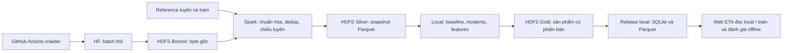

# HDFS trong dự án

Hiện trạng ngày 17/11/2026. [Cách chạy](HDFS_RUNBOOK.md) · [Hợp đồng](specs/HDFS_DATA_CONTRACTS.md).

## Vai trò và luồng dữ liệu

GitHub Actions chạy crawler theo phiên; Hugging Face (HF) giữ các batch thu được. Khi bật Docker, nhóm nạp lịch sử đó vào HDFS để xử lý và tạo dữ liệu cho ETA.

Spark xử lý Silver; thuật toán tạo baseline/incident facts/features chạy **local** từ cache Silver. Web chọn `-ReleasePointer` để đọc release đã tải hoặc `-LocalData` để test bằng nguồn local. Không query HDFS trong request. Release baseline-only chưa ghép model chưa kiểm chứng; không tự chuyển process đang chạy khi đổi pointer. Xem tiến độ thực nghiệm hiện tại ở SPEC-41, tách khỏi số liệu lịch sử bên dưới.

## Kết quả đã có bằng chứng

| Phần | Phạm vi |
| --- | --- |
| Bronze | Đủ **6.076 batch, 5.433.831.020 byte** của `Toibinguz/hust-bus-data`, revision `d0a59a0689f375ba72cad1729dd4cb19fd1f7c74`; đọc lại mọi hash/lineage, fsck HEALTHY, replication 2. [Bằng chứng](evidence/hdfs_full_history/README.md) |
| Silver | Đã xử lý đủ Bronze: **7.568.398 dòng bus đã chiếu tuyến**, 381.180 quan sát incidents, 54 tuyến, 1.463 partition tuyến/ngày. Có accounting, event duy nhất, lineage, fsck và chạy lại không nhân dữ liệu. [Đợt 17/11](evidence/hdfs_full_silver/README.md) |
| ETA/offline | Chọn 02/27 trong hai ngày từ Silver đầy đủ: 40.669 ping → 7.599 ô baseline, 3.542 incident facts, **56.196 train + 57.373 test feature rows**. Đối soát local giống từng giá trị; release dùng được khi cụm dừng và từ chối corruption/refresh lỗi. [Bằng chứng](evidence/hdfs_full_silver/README.md) |

Hai DataNode và hai Spark worker chung laptop: mô phỏng cơ chế phân tán, chưa chứng minh chịu mất máy vật lý hoặc hiệu năng nhiều máy. Lượt Silver thành công dùng 4 core, mất 27,3 phút; RSS Python worker cao nhất khoảng 312 MiB, không gồm JVM. Trung gian lưu trên đĩa.

Trong 12.988.883 quan sát bus đầu vào, 3.004.451 dòng trùng và 2.416.034 dòng bị loại theo quy tắc dữ liệu/projection; raw và lý do vẫn được giữ. Baseline của cửa sổ kiểm chứng có 2.328 ô tier 1, 5.271 ô tier 2, không dùng tier 3. Model chỉ thử load/predict 16 dòng; không suy ra accuracy toàn mạng.

## Phạm vi và giới hạn

Silver đầy đủ áp dụng cho revision HF đã nêu, không tự đuổi theo batch mới. Gold/features được kiểm chứng trên hai tuyến/hai ngày, chưa chạy toàn mạng hoặc retrain/promote model. DB/model/pointer ứng dụng được giữ nguyên.

Mỗi lượt Silver recompute tập batch đã chọn, chưa incremental compute. Có giới hạn batch/phiên để từ chối tải vượt mức trước publication. Tự theo dõi HF, compaction và GC chưa được tự động hóa. Chỉ bật Docker khi nhập/xử lý/đồng bộ; SQLite/cache vẫn dùng offline. [Evidence cũ](evidence/README.md) chỉ phản ánh từng lượt lịch sử.
