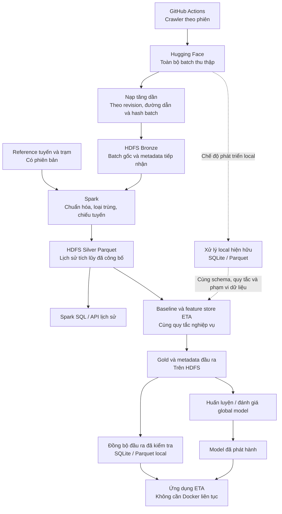

# HDFS: kiến trúc, trạng thái và việc còn lại

Cập nhật 12/11/2026. Code xác định hành vi; số liệu dưới đây thuộc lượt chạy có bằng chứng, không phải cam kết cho mọi dữ liệu.

## Kiến trúc

**GitHub Actions thu thập; Hugging Face giữ batch thô; HDFS tổ chức lịch sử để xử lý và khai thác; SQLite/local Parquet phục vụ ứng dụng và phát triển offline.**

GitHub Actions và HF ghép thành cơ chế thu thập qua nhiều phiên khi nhóm không có máy chủ riêng. Không suy diễn thành cam kết không có khoảng trống thu thập. HF không phải kho feature, model hoặc nơi phát hành Silver mặc định. Không có thành phần riêng tên “stable pool”.

HDFS phải được dùng cho lịch sử tích lũy và tác vụ ETA hiện tại: Spark đọc Bronze để xây Silver; lịch sử Silver cung cấp dữ liệu cho baseline và feature store; các đầu ra chuẩn được tái sử dụng cho huấn luyện, đánh giá và đồng bộ phục vụ. Việc chứa một bản sao thô hoặc chạy synthetic riêng chưa đáp ứng mục tiêu tích hợp.

Parquet là định dạng bảng, không phải một backend ngang hàng với HDFS/HF. Cùng bảng có thể nằm trên HDFS hoặc ổ local, với cùng schema và snapshot dữ liệu.

Luồng đến release đã chạy trong phạm vi mẫu. Nhánh train/evaluate không có nghĩa đã retrain. Hiện hệ thống chạy thuật toán baseline/feature hiện hữu trên cache Silver tải từ HDFS rồi đăng ký Gold lên HDFS; phải ghi rõ xử lý đó chạy local. Chỉ các bước thực sự chạy Spark trên HDFS mới được gọi là xử lý phân tán. Không cần viết lại toàn bộ thuật toán ML bằng Spark.

## Trách nhiệm

| Thành phần | Giữ gì / làm gì | Không giao thêm trách nhiệm |
| --- | --- | --- |
| GitHub Actions | Thu thập theo phiên, đẩy batch và tiếp sức | Không phụ thuộc Docker/HDFS trên laptop |
| Hugging Face | Kho batch đầu vào để tải lại, tiếp nhận bù | Không coi là Silver chỉ vì file có đuôi Parquet |
| Local staging/spool | File tải hoàn tất, retry và receipt | Không là nguồn lịch sử phân tán thay HDFS |
| HDFS Bronze | Bản batch gốc đã nhận, hash, revision và đường dẫn HF | Không sửa nội dung gốc để vừa schema envelope |
| HDFS Silver | Bảng đã chuẩn hóa/chiếu tuyến và loại trùng trên lịch sử tích lũy | Không công bố run dở hoặc cộng trùng nhiều run |
| HDFS Gold | Thống kê, baseline, feature đã kiểm tra và lineage | Không ghi đè âm thầm sản phẩm đang sử dụng |
| SQLite | Trạng thái/bảng phục vụ và backend local hiện hữu | Không bắt HDFS truy cập cho từng request ETA |
| Local Parquet | Cache hoặc backend xử lý local với schema chung | Không gọi local là HDFS khi Docker tắt |

“Thô” nghĩa là batch đúng như crawler đã lưu: có thể đã qua sanitizer ở crawler, không được tuyên bố là phản hồi API nguyên bản nếu code không lưu như vậy.

Các nguyên tắc dữ liệu đang dùng:

- Batch: dataset HF, revision đã chọn, đường dẫn, byte hash, kích thước, trạng thái nhận. Chốt revision cho mỗi lượt; không đọc `main` đang thay đổi giữa lượt rồi gọi là một snapshot.
- Bronze: lưu byte gốc và metadata riêng; envelope chuẩn phục vụ transform là bản dẫn xuất có liên kết ngược, không thay thế batch gốc. Batch trùng bytes có thể nhận biết; bản thay đổi cùng đường dẫn phải có version mới hoặc báo xung đột, không bỏ qua theo tên file.
- Event: nhận diện ổn định khi cùng ping xuất hiện ở nhiều batch; tái sử dụng công thức identity hiện có sau khi kiểm tra phù hợp dữ liệu HF. Timestamp thiếu timezone hoặc route chưa biết đi vào báo cáo/quarantine, không tự đoán.
- Reference: version/hash tuyến, trạm, hình học và quy tắc projection đi cùng snapshot. Dữ liệu lịch sử đã chiếu không được âm thầm đổi nghĩa khi reference cập nhật.
- Silver: giữ provenance/lineage và snapshot công bố rõ ràng; reader không cộng mọi thư mục `_runs`. Hiện recompute tập batch đã chọn, chưa cập nhật tăng dần theo partition.
- Gold: ràng buộc snapshot Silver, reference, phiên bản phép tính, phạm vi ngày và train/test split. Không gộp synthetic/replay vào accuracy quan sát thực.
- Cache: lưu snapshot/version, thời điểm đồng bộ, phạm vi dữ liệu và hash; hiển thị rõ đang dùng bản nào. Cache hỏng bị từ chối. Cache cũ nhưng hợp lệ có thể được chọn rõ ràng để chạy offline.

## Kết quả đã kiểm chứng

| Phần | Phạm vi thực | Bằng chứng |
| --- | --- | --- |
| U1: hợp đồng nguồn | Khảo sát bus/incidents thật, revision cố định, timestamp/direction/reference | [Inspection](evidence/hdfs_u1/hf_inspection.json) |
| U2: Bronze | Đủ 6.076 batch/5.433.831.020 byte tại revision `d0a59a0689f375ba72cad1729dd4cb19fd1f7c74`; đọc lại toàn bộ hash/lineage; fsck HEALTHY, replication 2 | [Full import](evidence/hdfs_full_history/README.md), [retry/outage](evidence/hdfs_u2/README.md) |
| U3: Silver | Ba batch thật, dedup/late data/projection parity/publication/retry/noop, query SQL/HTTP | [U3](evidence/hdfs_u3/README.md) |
| U4: ETA consumers | Tuyến 02/27, ngày 27/10 và 01/11: 358 ping, 7.599 ô baseline (5.151 tier-3 fallback), 14 incident facts, 180 train + 234 test feature rows, 60 cột | [U4–U6](evidence/hdfs_u456/README.md) |
| U5–U6: offline/replay | Exact parity từ cùng cache; global model smoke 16 dòng; release có hash, pointer atomic, corruption bị từ chối, refresh lỗi giữ bản tốt trước | [U4–U6](evidence/hdfs_u456/README.md) |
| Cơ chế phân tán | Hai DataNode/hai executor; thí nghiệm 4,6 MiB/5 block với block size 1 MiB | [P3B](evidence/hdfs_p3b/verification.md) |

Batch/byte không phải số event. Bronze đầy đủ không đồng nghĩa Silver/Gold toàn lịch sử. Model smoke không chứng minh accuracy hoặc category mapping đủ điều kiện promote. Các container chung laptop, chưa có độc lập lỗi phần cứng, HA NameNode hay benchmark nhiều máy.

## Đọc và vận hành

- [Runbook duy nhất](HDFS_RUNBOOK.md): cluster, import/resume, Silver/query, ETA/Gold/offline.
- [Hợp đồng kỹ thuật](specs/HDFS_DATA_CONTRACTS.md): identity/mapping/publication, runtime/network và AC.
- [Chỉ mục specs](specs/README.md): phân biệt hợp đồng, thiết kế và kết quả.

## Việc tiếp theo

1. Thiết kế Silver theo partition ngày/tuyến/cửa sổ overlap, giữ trajectory/dedup đúng ở biên. Builder hiện gom route vào RAM, chưa đủ cơ sở chạy cả 5,43 GB.
2. Thử vài partition thật: ghi peak RAM/thời gian/count input-accepted-rejected-duplicate; đối soát input/reference và thử late batch/crash trước publish. Đạt mới mở rộng.
3. Mở rộng baseline/features theo snapshot, giữ split trainer, thống kê coverage/fallback; giải quyết category mapping trước promote/retrain global model.
4. Nếu chuyển live serving: kiểm chứng chọn nguồn/rollback riêng; release thử nghiệm chưa thay DB/model ứng dụng.

Chưa có daemon HF, compaction toàn kho hoặc GC run/pending mồ côi. Không xóa raw/snapshot/volume để che lỗi.

## Lưu vết

Giữ raw evidence: [P1](evidence/hdfs_p1/), [P2](evidence/hdfs_p2/), [P3A](evidence/hdfs_p3a/README.md), [black-box](evidence/HDFS_P3A_BLACKBOX_REPORT.md), [baseline integration](evidence/hdfs_integration/verification.md). P3A từng nhập lịch sử đã chiếu từ SQLite; nguồn luồng hiện tại là HF. Synthetic/replay không thuộc accuracy quan sát thực.

SPEC-25 được giữ nguyên theo yêu cầu trước và chỉ là thiết kế ban đầu. Kế hoạch tạm/runbook trùng được gộp; bản cũ truy qua Git, không giữ archive trùng trong cây hiện hành.
