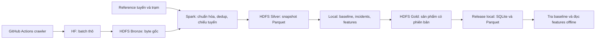

# HDFS trong dự án

Hiện trạng ngày 12/11/2026. [Cách chạy](HDFS_RUNBOOK.md) · [Hợp đồng](specs/HDFS_DATA_CONTRACTS.md).

## Vai trò và luồng dữ liệu

GitHub Actions chạy crawler theo phiên; Hugging Face (HF) giữ các batch thu được. Khi bật Docker, nhóm nạp lịch sử đó vào HDFS để xử lý và tạo dữ liệu cho ETA.

Spark xử lý Silver; thuật toán tạo baseline/incident facts/features chạy **local** từ cache Silver. Release dùng được khi tắt Docker. Đường SQLite/local hiện hữu vẫn hoạt động độc lập; lượt tích hợp chưa chuyển web đang dùng sang release này và chưa huấn luyện lại model.

## Kết quả đã có bằng chứng

| Phần | Phạm vi |
| --- | --- |
| Bronze | Đủ **6.076 batch, 5.433.831.020 byte** của `Toibinguz/hust-bus-data`, revision `d0a59a0689f375ba72cad1729dd4cb19fd1f7c74`; đọc lại mọi hash/lineage, fsck HEALTHY, replication 2. [Bằng chứng](evidence/hdfs_full_history/README.md) |
| Silver | Batch thật qua Spark; dedup, nhận muộn, projection parity, publication và query. **Chưa xử lý toàn lịch sử**. [Bằng chứng](evidence/hdfs_u3/README.md) |
| ETA/offline | Tuyến 02/27, hai ngày: 358 ping → 7.599 ô baseline, 14 incident facts, 180 train + 234 test feature rows; đối soát local và thử corruption/refresh lỗi. Model hiện hữu chỉ thử dự đoán 16 dòng. [Bằng chứng](evidence/hdfs_u456/README.md) |

Hai DataNode và hai Spark worker chung laptop: đã mô phỏng cơ chế phân tán, chưa chứng minh chịu mất máy vật lý hoặc hiệu năng nhiều máy. Batch không phải event; số liệu mẫu không đại diện accuracy toàn mạng. Trong mẫu baseline, 5.151/7.599 ô phải dùng fallback tier 3.

## Còn lại

1. Chia xử lý Silver thành phạm vi nhỏ, giữ trajectory/dedup đúng ở biên. Builder hiện gom route vào RAM, chưa chạy an toàn toàn bộ 5,43 GB.
2. Đo RAM/thời gian/count nhận-loại-trùng trên vài partition trước khi mở rộng Silver và dữ liệu ETA.
3. Trước promote/retrain: kiểm tra split, coverage/fallback và category mapping của global model.

Chưa có tự theo dõi HF, compaction hoặc dọn run dở. Chỉ cần bật Docker khi nhập/xử lý/đồng bộ. [Evidence cũ](evidence/README.md) là kết quả từng lượt, không phải roadmap hiện hành.
