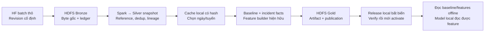

# HDFS → tác vụ ETA thật → release local/offline

Luồng kiểm chứng dùng dữ liệu HF thật, không dùng số liệu synthetic hoặc snapshot lịch sử lấy từ SQLite. SQLite chỉ cung cấp canonical reference ban đầu; lịch sử bus/incidents đi qua HF → HDFS Bronze → Spark Silver. Baseline, incident projector và feature builder hiện hữu xử lý local trên cache Silver đã kiểm tra; sản phẩm được lưu lại HDFS Gold rồi đồng bộ thành release local. Không gọi các bước local đó là Spark.



## Phạm vi đã chạy

- Bổ sung bốn batch bus/incidents của 27/10 và 01/11 tại revision HF trong [source window](evidence/hdfs_u456/source_window.json). Ledger đã có ba batch U3 trước đó, nên snapshot tổng gồm bảy batch; consumer chỉ chọn hai ngày và tuyến `02`, `27`.
- Consumer dùng 358 ping, tạo 7.599 ô baseline, 14 incident facts và 414 feature rows (180 train, 234 test; 60 cột gồm metadata/target). Nhiều ô baseline phải dùng fallback do mẫu ít: 5.151 ô tier 3. Không dùng kết quả này để tuyên bố chất lượng model toàn hệ thống.
- Chạy lại từ cache khi chặn external process/HDFS cho kết quả baseline, incident facts và mọi Parquet giống từng giá trị. Kiểm tra split train/test theo cấu hình, không đổi split để tăng số mẫu.
- Global model hiện hữu nạp và dự đoán hữu hạn được trên 16 dòng. Đây là smoke test schema/preprocessing, không phải đo accuracy; chưa promote mapping `route_id_idx` của subset hai tuyến vào live serving và không retrain/ghi đè model.

Chi tiết hash, output và kiểm chứng: [evidence](evidence/hdfs_u456/README.md). Artifact đã chạy: `4ee4031b0330c244267f0a249eaa8b49f3151bd664c277945c1179045e500e8a`.

## Chuẩn bị

1. Có canonical SQLite local, HF credential theo cơ chế hiện hữu (`get_hf_token`); không đưa token vào source window hoặc container.
2. Bật Docker khi cần nạp/xử lý/đồng bộ. Khởi động NameNode, hai DataNode, Spark master và hai worker theo runbook U3.
3. Xuất reference bằng `scripts/export_hdfs_history_reference.py` như U3. URI hash trong source window phải khớp reference thực tế; không suy rằng mọi database trên máy khác cho cùng hash.
4. Build service truyền artifact riêng: `docker compose -f docker-compose.hdfs.yml --profile eta build eta-artifacts`. Service chỉ ở mạng HDFS riêng, repo mount read-only, chỉ `runtime/eta_releases` được mount ghi cho download; không mở thêm cổng.

## Một lệnh diễn tập từ HF

```powershell
.\.venv\Scripts\python.exe scripts/run_hdfs_eta_workflow.py --source-window docs/evidence/hdfs_u456/source_window.json --workspace runtime/eta_u456_03 --dates 2026-10-27 2026-11-01 --routes 02 27 --pointer runtime/eta_active.json
```

Lệnh pin revision, stage/upload batch qua U2, gọi U3 để lấy snapshot đã công bố, materialize nếu chưa có cache, chạy domain builders nếu chưa có output, publish, download/verify rồi mới activate pointer. Chạy lại tái dùng cache/output/release có cùng identity và kiểm tra code baseline/feature/pipeline; không append thêm feature hoặc ghi đè model. Nếu output dở chưa có manifest, chọn workspace mới; chưa có sửa tự động workspace dở.

Ở cụm mới chỉ có source window này, snapshot ID sẽ khác cụm đã có thêm batch trước đó; luôn dùng ID do builder trả về. Nội dung source window không phải bộ lọc xóa batch cũ khỏi ledger. Ngày/tuyến consumer là bộ lọc rõ ràng.

Nếu Silver đã có, bỏ qua việc truy cập HF:

```powershell
.\.venv\Scripts\python.exe scripts/run_hdfs_eta_workflow.py --snapshot fcd8fdaa7f7717b00cf4282f3f9d1a0b7c54981e46b4238b7ae392a89e9ba1f9 --workspace runtime/eta_u456_03 --dates 2026-10-27 2026-11-01 --routes 02 27 --pointer runtime/eta_active.json
```

## Chạy từng bước hoặc offline

CLI `scripts/eta_snapshot_pipeline.py --help` có `materialize`, `build`, `publish`, `download`, `activate`, `inspect`, `baseline`. Bước `build` từ cache, `inspect` và `baseline --source release` không cần Docker/network.

```powershell
# Bản dữ liệu nào đang được chọn? Kiểm tra hash và identity trước khi trả thông tin.
.\.venv\Scripts\python.exe scripts/eta_snapshot_pipeline.py inspect --pointer runtime/eta_active.json

# Baseline từ release đã tải; không cần Docker.
.\.venv\Scripts\python.exe scripts/eta_snapshot_pipeline.py baseline --source release --pointer runtime/eta_active.json --route 02 --direction go --from-order 7 --to-order 8 --day-type 0 --hour-slot 13

# Đường local cũ vẫn có thể tra trực tiếp SQLite vận hành ở chế độ read-only.
.\.venv\Scripts\python.exe scripts/eta_snapshot_pipeline.py baseline --source local --database data/hanoi_bus_system.db --route 02 --direction go --from-order 7 --to-order 8 --day-type 0 --hour-slot 13
```

Hai chế độ hiển thị nguồn rõ ràng; không tự đổi nguồn sau lỗi. Release thử nghiệm không tự thay `data/hanoi_bus_system.db` hay cấu hình web demo. Khi cần nối serving hiện hữu, dùng cơ chế chọn DB của ứng dụng sau quyết định triển khai riêng; không sửa đè các thay đổi serving của người dùng.

## Kiểm chứng lại

```powershell
.\.venv\Scripts\python.exe scripts/verify_eta_snapshot_consumers.py --cache runtime/eta_u456_03/cache --output runtime/eta_u456_03/output --offline-output runtime/eta_u456_offline_next --model data/models/eta_xgb_global_full_54feat.json
.\.venv\Scripts\python.exe scripts/verify_eta_offline_release.py --pointer runtime/eta_active.json --scratch runtime/eta_offline_checks_next
```

Output/scratch mới không được tồn tại. Script thứ nhất chạy lại domain algorithms dưới chặn external calls, đối soát exact values, kiểm tra split và model thật. Script thứ hai đọc baseline từ release thật, tạo bản sao lỗi có chủ đích, xác nhận bị từ chối và pointer cũ còn nguyên khi refresh lỗi. Không dừng các dịch vụ Docker khác của người dùng; khả năng offline được xác minh bằng chặn external calls.

## Các giới hạn còn lại

- Đây là luồng có ích ở phạm vi mẫu, không chứng minh đủ dữ liệu huấn luyện global mới, coverage toàn mạng, phục vụ 24/7 hoặc tốc độ city-scale. Ngày train 27/10 nằm trong giai đoạn validation của trainer hiện hữu; lượt này không huấn luyện lại model.
- U3 vẫn recompute tập batch; materialize qua HDFS CLI theo file có overhead. Artifact nhiều file truyền bằng WebHDFS trong private service; không gọi Docker riêng cho từng file.
- Cache/artifact bị hỏng sẽ fail closed. Không tự chữa file corrupt hoặc xóa run mồ côi; giữ bản đang phục vụ. Release download được ghi vào `pending-UUID`, chỉ đổi tên và pointer sau verify; pending lỗi có thể cần dọn thủ công có chọn lọc.
- Kiểm tra hash toàn release phù hợp CLI/demo, chưa tối ưu thành cơ chế xác minh một lần cho API SLA thấp.
- Global model compatibility không chứng minh mapping route category hoặc accuracy trên subset tương đương model production. Live web/API model chưa được chuyển sang release này.
