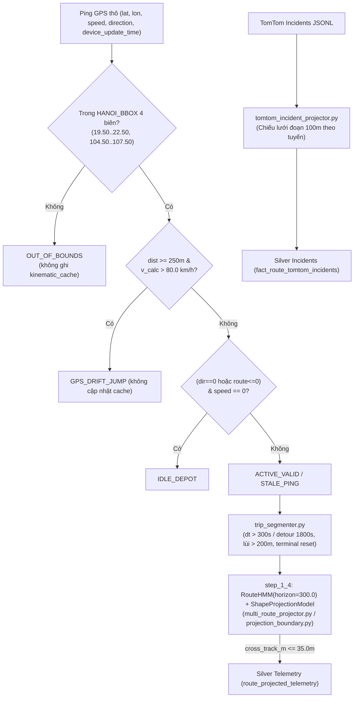

# Tài liệu Tiền xử lý & Chiếu Không gian (Preprocessing)

- **Trạng thái:** Current
- **Phạm vi:** Làm sạch động học ping GPS, phân đoạn chuyến đi, nạp dữ liệu chuẩn GTFS và chiếu tọa độ 2D sang hệ tọa độ đường 1D Frenet.
- **Nguồn sự thật (Code paths):** `module_1_data_ingestion_and_preprocessing/step_1_3_telemetry_kinematic_sanitizer/`, `step_1_4_frenet_spatial_projection/`, `step_1_5_busmap_canonical_migration/`, `config/system_config.py`.

## 1. Quy trình tiền xử lý



## 2. Quy tắc làm sạch & Chiếu không gian (`config/system_config.py`)

| Tham số / Quy tắc | Giá trị / Logic hiện hành |
| --- | --- |
| `HANOI_BBOX` (4 biên) | `min_lat=19.50`, `max_lat=22.50`, `min_lon=104.50`, `max_lon=107.50` (bao phủ cả tuyến buýt liên tỉnh quanh Hà Nội) |
| `GPS_DRIFT_MAX_SPEED_KMPH` & `GPS_DRIFT_MIN_DIST_M` | `80.0` km/h & `250.0` m — chỉ đánh dấu `GPS_DRIFT_JUMP` khi đồng thời vượt cả 2 ngưỡng (chống jitter `dt` nhỏ), không cập nhật cache khi `OUT_OF_BOUNDS` hoặc drift |
| `TERMINAL_STATIONARY_TOL_M` | `15.0` m — ngưỡng dịch chuyển tối thiểu phân biệt đứng yên / cắt đuôi tại bến |
| `MAX_CONTINUOUS_GAP_SEC` / `MAX_BRIDGEABLE_DETOUR_GAP_SEC` | `300.0` s / `1800.0` s — nối chuyến qua detour nếu `ds > 100m` và vận tốc `2..60 km/h` |
| `MAX_BACKWARD_RESET_M` | `200.0` m — ngưỡng lùi `s` xác nhận quay đầu / ngắt chuyến (`MAX_GPS_BACKWARD_JITTER_M = 20.0` m) |
| `MAX_CORRIDOR_CROSS_TRACK_M` | `35.0` m — ngưỡng tối đa cho phép khi xuất telemetry lên Silver Lakehouse |
| `RouteHMM` (`BATCH_HMM_HORIZON_SEC = 300.0`) | Dùng chung `ShapeProjectionModel` + `RouteHMM` giữa Batch (`multi_route_projector.py`, `horizon=300.0`) và Speed Layer (`step_3_4`) |

## 3. Kiểm thử

```bash
python -m pytest tests/module_1/test_installed_route_matcher.py tests/module_1/test_projection_boundary.py --basetemp=runtime/pytest_tmp -q
```
