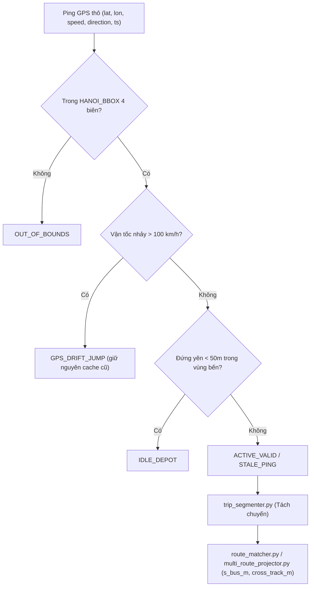

# Tài liệu Tiền xử lý & Chiếu Không gian (Preprocessing)

- **Trạng thái:** Current
- **Phạm vi:** Làm sạch động học ping GPS, phân đoạn chuyến đi, nạp dữ liệu chuẩn GTFS và chiếu tọa độ 2D sang hệ tọa độ đường 1D Frenet / HMM.
- **Nguồn sự thật (Code paths):** `module_1_data_ingestion_and_preprocessing/step_1_3_telemetry_kinematic_sanitizer/`, `step_1_4_frenet_spatial_projection/`, `step_1_5_busmap_canonical_migration/`, `config/system_config.py`.

## 1. Quy trình tiền xử lý



## 2. Quy tắc làm sạch & Chiếu không gian (`config/system_config.py`)

| Tham số / Quy tắc | Giá trị / Logic hiện hành |
| --- | --- |
| `HANOI_BBOX` (4 biên) | `min_lat=19.50`, `max_lat=22.50`, `min_lon=104.50`, `max_lon=107.50` (bao phủ cả tuyến buýt liên tỉnh quanh Hà Nội) |
| `MAX_BUS_SPEED_KMPH` | `100.0` km/h — vượt ngưỡng bị đánh dấu `GPS_DRIFT_JUMP` và **không** ghi đè `kinematic_cache[vid]` |
| `TERMINAL_STATIONARY_TOL_M` | `50.0` m — dùng để xác định xe đứng yên tại bãi/bến (`IDLE_DEPOT`) |
| `TRIP_MAX_TIME_GAP_SEC` | `900` giây — ngắt chuyến nếu mất tín hiệu quá 15 phút |
| `MAX_BACKWARD_JITTER_M` | `120.0` m — trong `trip_segmenter.py`, reset đầu-cuối chỉ kích hoạt khi `s < (prev_s - 120.0)` |
| `MAX_CORRIDOR_CROSS_TRACK_M` | `35.0` m — ngưỡng tối đa cho phép khi xuất telemetry lên Silver Lakehouse |
| `ShapeProjectionModel` & `RouteHMM` | Dùng chung cho cả `multi_route_projector.py` (Batch) và `BusMapServingService` (Speed View) |

## 3. Kiểm thử

```bash
python -m pytest tests/module_1/test_installed_route_matcher.py tests/module_1/test_projection_boundary.py --basetemp=runtime/pytest_tmp -q
```
