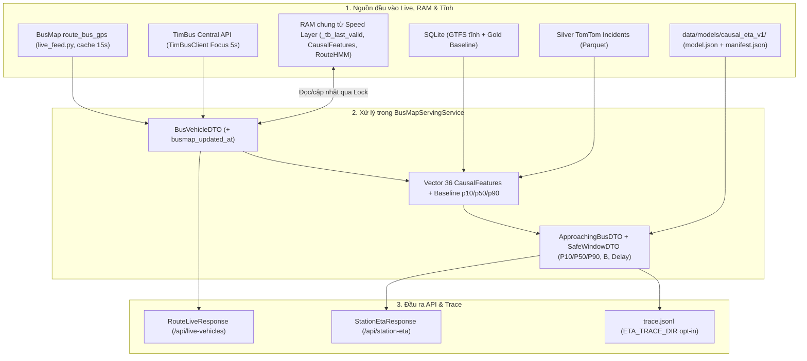
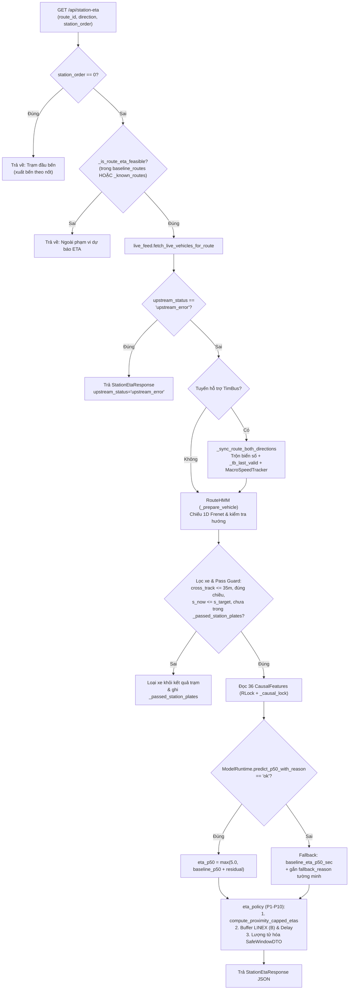

# Serving Layer Pipeline (Luồng Dữ liệu & Logic Phục vụ ETA)

- **Trạng thái:** Current
- **Phạm vi:** Tầng phục vụ request thời gian thực (`BusMapServingService`): tiếp nhận trạng thái đã làm ấm từ Speed Layer, gọi BusMap route-query trực tiếp + TimBus Focus `5s`, lọc/chiếu tuyến, suy luận `ModelRuntime` (`causal-eta.v1`), áp dụng `eta_policy` và trả DTO phản hồi tường minh.
- **Nguồn sự thật (Code paths):** `module_3_bus_eta_prediction/step_3_4_eta_serving_and_evaluation/` (`serving_service.py`, `live_feed.py`, `data_access.py`, `model_runtime.py`, `eta_policy.py`, `dto.py`, `request_trace.py`), `experiments/timbus/timbus_tracker.py`.
- **Liên quan:** [docs/SPEED_LAYER_PIPELINE.md](SPEED_LAYER_PIPELINE.md) (Speed Layer Poller), [docs/DEMO_APP.md](DEMO_APP.md) (Web UI & API).

## 1. Sơ đồ Luồng Dữ liệu (Data Flow)



## 2. Sơ đồ Luồng Logic (Logic Flow — `/api/station-eta`)



## 3. Hợp đồng Thành phần & Phản hồi Tường minh

| Thành phần | Trách nhiệm | Ghi chú thiết kế |
| --- | --- | --- |
| `live_feed.py` | Gọi `fetch_route_buses_live_status`, lọc `HANOI_BBOX`, parse `lastUpdateTime` | Trả `upstream_status` (`ok \| empty \| upstream_error`) và không cache phản hồi lỗi |
| `TimBusClient` | `query_central_vehicles_with_status` trả `(results, ok_count, error_count, last_error)` | Phân biệt miss thường với lỗi mạng/timeout (`timbus_status`: `ok \| partial_error \| upstream_error \| unsupported`) |
| `serving_service.py` | Duy trì `_tb_last_valid`, `_passed_station_plates`, `MacroSpeedTracker` và lọc theo trạm | Lưu `busmap_updated_at` gốc song song với thời gian query TimBus (`updated_at` / `ping_time`) |
| `ModelRuntime` | Nạp `causal-eta.v1`, gọi `predict_p50_with_reason` | Trả kèm `fallback_reason` (`ok \| cold_start_causal \| model_unavailable \| unknown_route \| predict_error`) |
| `eta_policy.py` | Áp dụng P1–P10, proximity cap, tính `buffer_seconds` (đệm) và `delay_seconds` (trễ) | Xuất `SafeWindowDTO` gồm mốc lạc quan (`eta_core - B`), P50 và bảo thủ (`eta_core + B`) |
| `data_access.py` | Đọc GTFS/Baseline SQLite và sự cố TomTom Silver Parquet | Hỗ trợ release pointer qua `release_source.py` |

## 4. Kiểm thử

```bash
python -m pytest tests/module_3/test_speed_poller_and_feedback.py tests/module_3/test_timbus_hybrid_serving.py tests/module_3/test_timbus_station_state_regressions.py --basetemp=runtime/pytest_tmp -q
```
