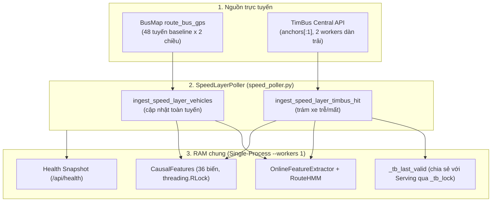
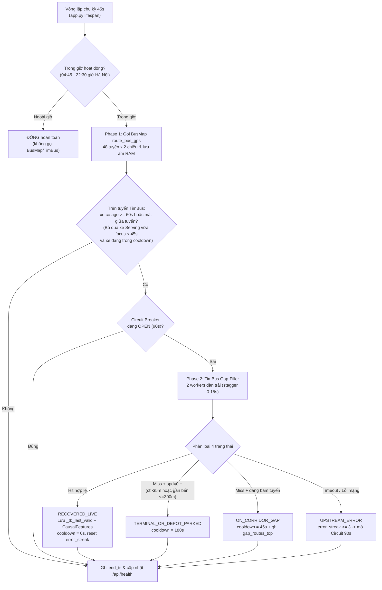

# Speed Layer Pipeline (Speed Layer Poller — Thu thập & Làm ấm RAM)

- **Trạng thái:** Current
- **Phạm vi:** Tầng Speed Layer (`SpeedLayerPoller`) chạy nền theo chu kỳ `45s` chỉ làm nhiệm vụ **thu thập và lưu ấm trạng thái** vào RAM chung (`_tb_last_valid`, `OnlineFeatureExtractor`, `RouteHMM`, `CausalFeatures`) để chống cold-start. Toàn bộ bước lọc theo trạm, dự báo ML và tính ETA do [docs/SERVING_LAYER_PIPELINE.md](SERVING_LAYER_PIPELINE.md) đảm nhiệm.
- **Nguồn sự thật (Code paths):** `module_3_bus_eta_prediction/step_3_4_eta_serving_and_evaluation/speed_poller.py`, `module_3_bus_eta_prediction/step_3_2_feature_store_extractor/causal_eta.py`, `module_1_data_ingestion_and_preprocessing/step_1_4_frenet_spatial_projection/route_matcher.py`, `experiments/timbus/timbus_tracker.py`.

## 1. Sơ đồ Luồng Dữ liệu (Data Flow)

## 2. Sơ đồ Luồng Logic (Logic Flow)

## 3. Thiết kế Đồng bộ & Ràng buộc Vận hành

| Thành phần | Trách nhiệm | Ghi chú thiết kế |
| --- | --- | --- |
| `SpeedLayerPoller` | Quét BusMap `route_query` mỗi `45s` + 2-worker TimBus gap-fill cho xe `age >= 60s` | Đóng hoàn toàn `22:30–04:45`; tắt được qua `DISABLE_SPEED_POLLER=1` khi chạy test |
| Chia sẻ `_tb_last_valid` | Đọc biển số Serving vừa focus `< 45s` để tránh gọi trùng; nạp hit mới lại cho Serving | Đồng bộ thread-safe qua `_tb_lock` |
| `CausalFeatures` | Bảo vệ trạng thái bằng `threading.RLock` + `_causal_lock` | Yêu cầu chạy `uvicorn --workers 1` để Speed và Serving dùng chung 1 RAM |
| Serving Layer (lọc & ETA) | Thực hiện toàn bộ lọc trạm, Pass Guard, `ModelRuntime` và `eta_policy` | Xem chi tiết tại [docs/SERVING_LAYER_PIPELINE.md](SERVING_LAYER_PIPELINE.md) |
