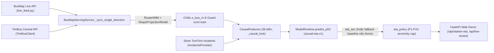

# Speed View Pipeline (Luồng Thời gian thực & Serving ETA)

- **Trạng thái:** Current
- **Phạm vi:** Luồng lấy dữ liệu trực tuyến từ BusMap + TimBus + sự cố TomTom, khớp tuyến nhân quả (`RouteHMM`), trích xuất 36 biến `CausalFeatures`, dự báo `ModelRuntime` (`causal-eta.v1`) và phục vụ API.
- **Nguồn sự thật (Code paths):** `module_3_bus_eta_prediction/step_3_4_eta_serving_and_evaluation/` (`serving_service.py`, `live_feed.py`, `data_access.py`, `model_runtime.py`, `eta_policy.py`, `dto.py`), `module_1_data_ingestion_and_preprocessing/step_1_4_frenet_spatial_projection/route_matcher.py`, `experiments/timbus/timbus_tracker.py`.

## 1. Sơ đồ luồng Speed View

## 2. Hợp đồng xử lý & Chính sách ổn định

| Thành phần | Trách nhiệm | Ghi chú thiết kế |
| --- | --- | --- |
| `live_feed.py` | Gọi BusMap API, cache RAM theo tuyến, parse thời gian ping (`parse_ping_epoch`) | Tránh gọi lặp liên tục khi nhiều client hỏi cùng tuyến |
| `TimBusClient` | Truy vấn GPS thời gian thực theo biển số/tuyến (`_sync_and_merge_timbus`) | Bù trễ và bổ sung tốc độ thực tế khi BusMap đứng nhịp |
| `route_matcher.py` (`RouteHMM`) | Chiếu tọa độ GPS lên 1D Frenet (`s_m`, `cross_track_m`) theo Viterbi nhân quả | Không I/O, dùng chung giữa replay và serving |
| `BusMapServingService` | Duy trì `_passed_station_plates` (pass guard), `_tb_last_valid`, `_causal` | Đảm bảo xe đã qua trạm không bị hồi sinh bởi cache cũ |
| `CausalFeatures` | Cập nhật quan sát từng xe (`_observe_causal_snapshot`) và xuất 36 features | Dùng chung 100% logic với lúc train (`step_3_2/causal_eta.py`) |
| `ModelRuntime` | Nạp `data/models/causal_eta_v1/`, kiểm tra `_known_routes`, dự báo residual + baseline | Trả `None` để fallback baseline nếu tuyến ngoài miền train |
| `eta_policy.py` | Ổn định hiển thị ETA (làm tròn, cửa sổ an toàn `SafeWindowDTO`, giới hạn gần trạm) | Tránh nhảy ETA bất thường khi xe dừng đèn đỏ sát trạm |

## 3. Điểm đã chốt & Giới hạn hiện tại

- **Đã sửa:** Khắc phục các lỗi đồng bộ cache/trộn nguồn (`live_feed.py`, `route_matcher.py`, `serving_service.py`, `model_runtime.py`, `data_access.py`) và bổ sung bảo vệ `_causal_lock` cho snapshot.
- **Giới hạn đã biết:**
  - `TimBusClient` phụ thuộc API ngoài `timbus.vn`; khi nguồn TimBus mất kết nối hoặc trễ, hệ thống tự fallback về BusMap thuần.
  - Giao diện web demo (`step_3_5_web_demo/static/`) vẫn còn một số điểm hiển thị cần tinh chỉnh UI ở các vòng sau, nhưng không ảnh hưởng API contract.
