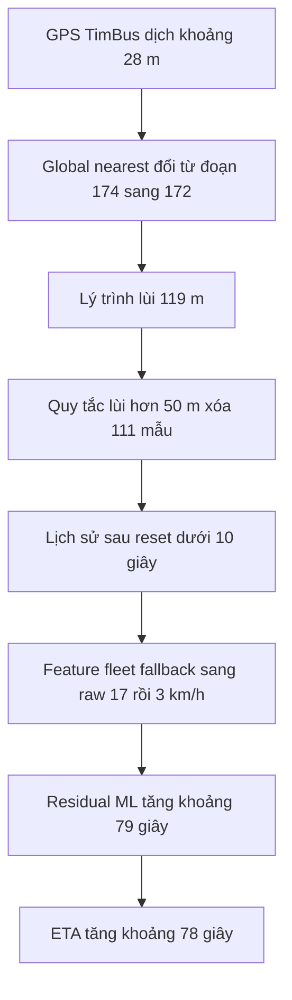

# Thí nghiệm tiếp: vì sao tốc độ xe dẫn 17 → 3 làm ETA nhảy?

Ngày cập nhật 17/11/2026. Phân tích tiếp raw đã thu, không có phiên live mới, không thay model/serving. Mốc giờ dưới đây là giờ Hà Nội. Tiếp nối [trường hợp trạm Việt Đức](VIET_DUC_STATION_CASE.md).

## 1. Kết luận theo ba giả thuyết

| Giả thuyết | Bằng chứng trong trường hợp đã truy | Kết luận hiện tại |
|---|---|---|
| Cold start làm tốc độ biến động | Replay đầy đủ khôi phục đúng cả 54 feature của hai gói. Lịch sử xe dẫn từ 111 mẫu bị xóa xuống 1 mẫu; sau đó chưa đủ 10 giây để tính tốc độ dịch chuyển. | **Xác nhận có khởi tạo lại lịch sử giữa phiên**, không phải process vừa chạy. Sau reset, feature dùng tốc độ tức thời TimBus 17 rồi 3. |
| Trộn TimBus/BusMap khác heartbeat | Đã đọc packet TimBus gốc tương ứng, xác minh hash và parse lại; chúng chứa đúng tọa độ và tốc độ 17/3. Hai DTO đều `telemetry_source=timbus`. | **Không có chuyển nguồn ở hai mẫu gây cú nhảy này.** Khác nhịp nguồn có thể ảnh hưởng các trường hợp khác, chưa được loại trừ toàn hệ thống. BusMap vẫn tham gia danh sách xe/seed hiển thị, nhưng không phải nguồn của hai tốc độ này. |
| Công thức toán học sai | Tính độc lập khoảng cách tới từng đoạn xác nhận kết quả phép chiếu global. Kiểm tra đơn vị tốc độ và ngưỡng lịch sử, replay dự báo model, thay thử đầu vào xe dẫn. | Chưa thấy lỗi số học/đơn vị gây cú nhảy. **Có vấn đề ở cách ghép các quy tắc đúng riêng lẻ:** chọn đoạn gần nhất → lý trình nhảy lùi → coi như lượt mới → bỏ lịch sử → fallback tốc độ tức thời → model phản ứng mạnh. |

Đây là kết luận cho một chuỗi sự kiện xác định; không mặc định mọi cú nhảy đều cùng nguyên nhân.

## 2. Truy ngược từ ETA tới packet và lịch sử

Xe được dự báo là `8837283`, tuyến 27 chiều 1, trạm thứ 23. Xe dẫn được extractor chọn là `8837137`, cách khoảng 6,26 km phía trước. Hai request ETA:

| Trường | 19:21:05 | 19:21:09 |
|---|---:|---:|
| Cự ly xe đang xét tới trạm (m) | 6.868,3 | 6.866,2 |
| Matrix (giây) | 1.307,76 | 1.307,45 |
| Tốc độ rolling của chính xe đang xét (km/h) | 18,51 | 18,37 |
| Tốc độ xe dẫn đưa vào model (km/h) | 17,0 | 3,0 |
| Residual XGBoost (giây) | −18,05 | +60,86 |
| ETA sau calibration (giây) | 1.279,7 | 1.358,1 |

Xe đang xét chỉ tiến khoảng 2 m, matrix gần như không đổi, nhưng ETA tăng 78,4 giây. Giờ đến dự báo lùi khoảng 82,96 giây trong 4,56 giây thực. Không chỉ đọc hai tốc độ rồi đoán nguyên nhân: đã replay các đầu vào để tách phản ứng model.

| Đầu vào trong phép thử | ETA tính lại (giây) |
|---|---:|
| Toàn bộ feature gói trước, như quan sát | 1.279,75 |
| Toàn bộ feature gói sau, như quan sát | 1.358,13 |
| Gói sau nhưng giữ `lead_bus_speed_kmh` và `lead_bus_speed_ratio` như gói trước | 1.279,21 |
| Gói trước nhưng thay đúng hai trường ấy bằng giá trị gói sau | 1.358,67 |
| Gói sau nhưng giữ toàn bộ nhóm fleet như gói trước | 1.278,65 |

**Kết luận về phép tính:** thay cặp tốc độ/tỷ lệ tốc độ xe dẫn đủ tái tạo gần toàn bộ cú nhảy. Các dòng thay đầu vào là thí nghiệm trên model, không phải quan sát giao thông mới và không phải bằng chứng forecast nào chính xác hơn. Chưa có nhãn đến trạm của xe đang xét trong phiên này.

## 3. Vì sao tốc độ “rolling” lại trở thành tốc độ tức thời?

Trước sự kiện, extractor có 111 mẫu của xe dẫn. Sau đó:

| Timestamp TimBus | Lý trình chiếu (m) | Bộ đệm | Lịch sử tính được | Giá trị fleet đưa vào model |
|---|---:|---|---|---:|
| 19:20:58,233 | 10.390,1 | Còn lịch sử | — | — |
| 19:21:03,506 | 10.270,9 | **Xóa 111 mẫu, còn 1** | 0 giây, không tính rolling được | Raw TimBus 17 km/h |
| 19:21:08,234 | 10.283,3 | 2 mẫu sau reset | 4,7286 giây, dưới ngưỡng 10 | Raw TimBus 3 km/h |
| 19:21:13,505 | 10.282,9 | 3 mẫu sau reset | 9,9995 giây, vẫn dưới ngưỡng 10 | Raw TimBus 10 km/h |

Code hiện xóa ring khi `s_bus < last_s − 50 m`, xem là quay đầu/đổi lượt. Fleet ưu tiên tốc độ cửa sổ 240 giây, rồi 75 giây; cả hai cần ít nhất 10 giây lịch sử. Không tính được thì dùng tốc độ raw.

Nếu chỉ tính từ hai vị trí sau reset, 12,4 m / 4,7286 s × 3,6 ≈ **9,44 km/h**, nhưng code cố ý chưa dùng vì thời gian quá ngắn. Không phải tính sai thành 3; **3 là giá trị fallback từ packet**. Ngưỡng tối thiểu có lý do chống nhiễu, nhưng chưa có dấu hiệu chất lượng đi cùng để model phân biệt rolling ổn định với fallback vừa reset.

Mốc 9,9995 giây cũng cho thấy ngưỡng có bước nhảy rõ: “khoảng hai nhịp 5 giây” chưa chắc đủ 10 giây theo timestamp. Chưa đổi ngưỡng theo một mẫu hay dùng ngưỡng mềm tùy ý.

## 4. Vì sao lịch sử bị xóa? Có thật xe quay đầu không?

Hai tọa độ GPS liên tiếp dịch khoảng **27,97 m**, nhưng phép chiếu đổi đoạn và làm lý trình lùi **119,2 m**. Đã tính độc lập các ứng viên:

| Timestamp | Đoạn gần nhất được chọn | Cự ly ngang tới đoạn | Lý trình | Đoạn cạnh tranh / cự ly ngang / lý trình |
|---|---:|---:|---:|---|
| 19:20:58 | 174 | 14,08 m | 10.390,06 m | 172 / 19,56 m / 10.243,55 m |
| 19:21:03 | 172 | 14,46 m | 10.270,94 m | 174 / 16,64 m / 10.362,31 m |

Đoạn 172 đi ra gần đoạn 174 đi ngược lại trên hình học tuyến. Ở gói sau, lợi thế khoảng cách ngang của đoạn được chọn chỉ khoảng **2,17 m**, trong khi lý trình hai ứng viên cách khoảng **91 m**. Global nearest chọn đúng mục tiêu toán học “gần nhất”, nhưng mục tiêu này chưa đủ để xác định nhánh xe đang đi.

Ngoài ra, code đang gán `deg` của DTO TimBus bằng tiếp tuyến của **chính đoạn vừa chọn**. Hướng hiển thị đổi khoảng 207° → 22° ở sự kiện này. Đây không phải một phép đo heading độc lập xác nhận xe đã quay đầu; kiểm tra hướng bằng góc tự suy từ đoạn sẽ không giúp phát hiện chọn nhầm đoạn đó.

Chưa xác định được nhánh vật lý thật chỉ từ các packet này. Không nên chữa bằng cách ép mọi `s` luôn tăng: nếu đang theo nhầm nhánh, ép đơn điệu chỉ giữ lại cái sai; nếu xe đổi lượt thật, ép tăng sẽ làm mất sự kiện thật. Cần thử chọn đoạn có ngữ cảnh trajectory/hướng dịch chuyển và kiểm chứng trên cả giao cắt, đoạn song song, mất dữ liệu và quay đầu thực.



## 5. Mở rộng khỏi một xe: thông tin hiện tại còn thiếu ở đâu?

Đã đọc cả 4.990 dự báo của phiên raw và toàn bộ 15.069.481 dòng feature store hiện có (11.364.661 train, 3.704.820 test), theo batch giới hạn RAM. Đây là đối soát ý nghĩa dữ liệu hiện có, không khôi phục provenance lần train cũ.

| Trường | Phiên live raw | Train hiện có | Test hiện có |
|---|---|---|---|
| `recent_seg_coverage_ratio > 0` | 0/4.990 | 9.474.608/11.364.661, khoảng 83,37% | 3.034.766/3.704.820, khoảng 81,91% |
| `ego_cum_delay_vs_baseline_sec != 0` | 0/4.990 | 10.666.027/11.364.661, khoảng 93,85% | 3.480.276/3.704.820, khoảng 93,94% |
| `recent_corridor_tt_sum_sec == baseline_eta_p50_sec` | 4.990/4.990 | Chưa tính tỷ lệ trong phép thử này | Chưa tính tỷ lệ trong phép thử này |

Không phải cứ khác phân phối là lỗi: live khác ngày/nguồn/phạm vi. Nhưng code online **gán hằng/default** cho các trường nêu trên, trong khi builder train có thuật toán dùng quan sát thực. Vì vậy có cơ sở xác định thiếu thông tin đầu vào, thay vì giải thích tất cả bằng điều kiện giao thông.

Scan 4.935 cặp gói liên tiếp cùng xe/cùng trạm, cách nhau tối đa 15 giây, loại lùi quá 20 m khỏi phép so sánh: có 10 lần ETA tăng từ 30 giây trở lên, 9 lần xe vẫn tiến gần trạm. Đây là danh sách cần điều tra, không phải tự động 10 lỗi. Có 30 đoạn tọa độ không đổi ít nhất 30 giây và timestamp fetch cuối vẫn “mới dưới 2 giây”; cùng một đoạn xe có thể xuất hiện ở nhiều trạm nên **không gọi là 30 lần đứng xe độc lập**.

Trên 1.145 forecast có nhãn GPS, 148 khuyến nghị có mặt muộn hơn cả đầu phải bracket, xuất hiện ở 13/14 lượt qua trạm; lớn nhất khoảng 121,86 giây sau đầu phải bracket. Forecast lặp không độc lập; đây không phải xác suất hành khách lỡ xe. Nhưng nó tiếp tục bác bỏ việc coi công thức khuyến nghị hiện tại là bảo đảm tới trước xe. Danh sách request và event được giữ để kiểm tra riêng.

## 6. Việc tiếp theo và điều kiện được sửa

1. **Chọn nhánh/đổi lượt:** thử thuật toán có ngữ cảnh trên raw, so với global hiện tại. AC: không reset chỉ vì đổi nhánh sát nhau; vẫn nhận ra quay đầu/lượt mới thật; không giữ xe đã qua trạm; giữ trạng thái không chắc khi thiếu bằng chứng. Không sửa bằng clamp đơn điệu đơn thuần.
2. **Chất lượng tốc độ:** tách raw, tốc độ từ dịch chuyển và độ dài lịch sử hợp lệ; thử hành vi sau reset. AC: chỉ ra model đang nhận loại tốc độ nào; đánh giá cả phản ứng cần thiết khi xe phanh thật và biến động do thiếu lịch sử. Chưa tự thay schema model hay mặc định làm mượt thêm.
3. **Train/serve semantics:** đối soát elapsed/delay/probe trên trajectory biết trước; xác định thông tin quan sát được và không quan sát được. Model hiện tại giữ nguyên cho đến khi có kết quả so sánh.
4. **Policy hành khách:** xử lý ý nghĩa giờ khuyến nghị, nhãn ùn tắc, tuổi GPS và phút nguyên; có ca đối chiếu theo chuỗi, không chỉ đúng công thức. Không dùng coverage trung bình để che các sự kiện khuyến nghị muộn.

## 7. Tái lập và bằng chứng

- [Tổng hợp scan](behavior_summary.json), [thay đầu vào xe dẫn và packet liên quan](lead_speed_sensitivity.json), [replay reset và các ứng viên chiếu](speed_reset_replay.json).
- Mọi event/danh sách packet giữ tại `runtime/eta_behavior_probe_20261117_v2/`; input raw vẫn ở `runtime/eta_live_session_20261117_raw/`. Phiên này chồng thời gian với pilot cũ, không gộp như quan sát mới độc lập.
- Replay fleet khớp đủ 54 feature ở cả hai gói nghi vấn; 15 test focused đạt, log `runtime/eta_behavior_tests_20261117.log`. Chưa thay cho bộ regression cuối toàn SPEC-41.
- Các file bằng chứng dẫn hash input/code; bản frozen source dùng khi thu không bị thay. Giữ cả lần thử trước và các output, không xóa raw.

```powershell
python scripts/probe_eta_behavior.py --session runtime/eta_live_session_20261117_raw --analysis runtime/eta_live_analysis_20261117_raw --output runtime/behavior_probe_recheck --features data/lakehouse/gold/eta_feature_store
python scripts/replay_eta_speed_reset.py --session runtime/eta_live_session_20261117_raw --case runtime/behavior_probe_recheck/lead_speed_sensitivity.json --output runtime/speed_reset_recheck.json
python -m pytest tests/test_eta_behavior_probes.py tests/test_eta_validation_protocol.py tests/test_eta_trace_replay.py -q -p no:cacheprovider
```
