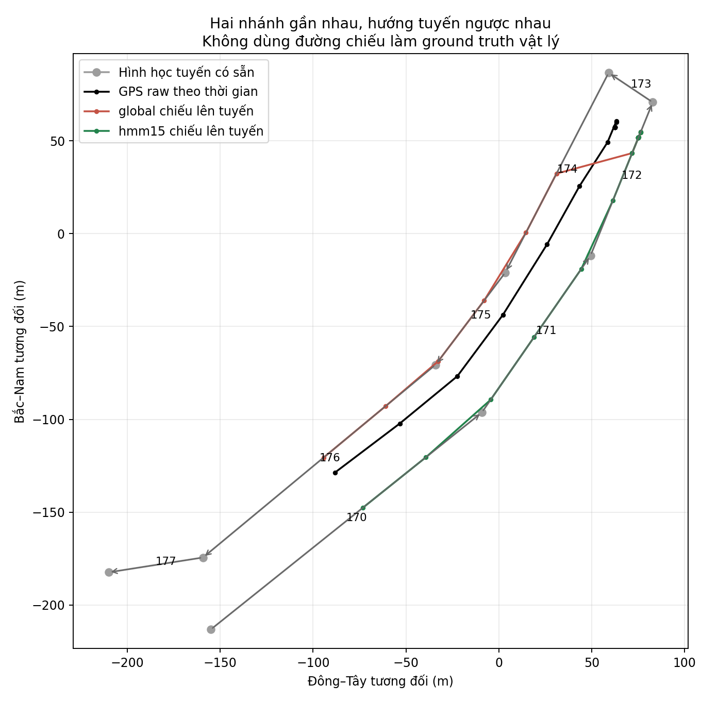
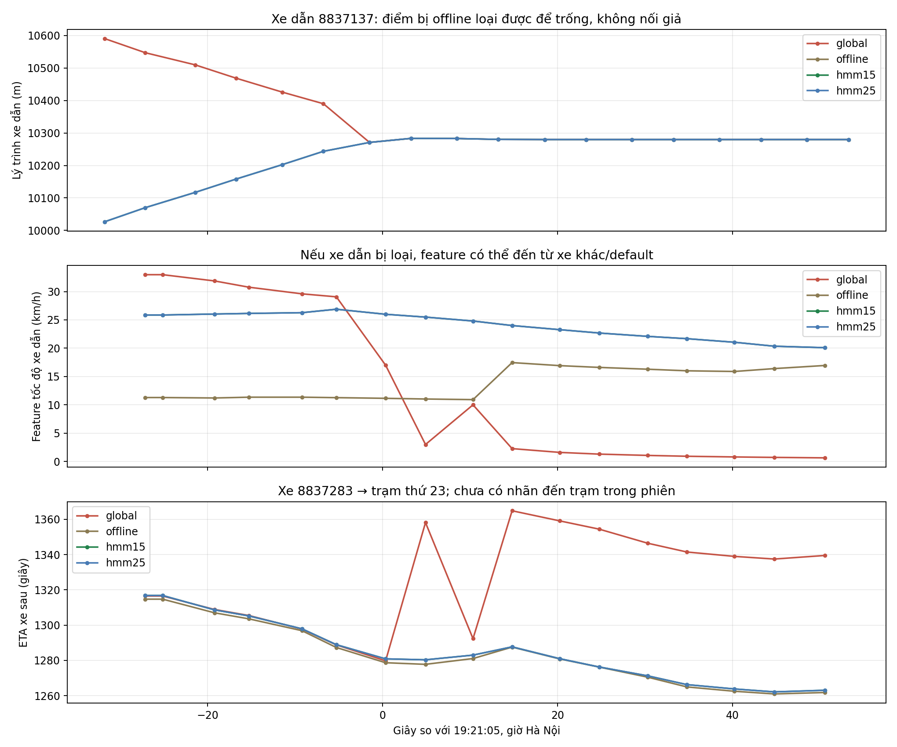

# So sánh phép chiếu trên raw live để chuẩn bị cài đặt chung

Ngày 18/11/2026. **Kết luận lựa chọn: ưu tiên HMM theo tuyến, Online Viterbi với lịch sử hiệu chỉnh bị giới hạn. Chưa nghiệm thu để thay serving.** Lý do là giữ được thông tin xe qua đoạn mơ hồ với chi phí tăng vừa phải; không phải vì MAE giảm hoặc số test xanh.

## 1. Đầu vào và cách so sánh

Dùng phiên live đã thu `runtime/eta_live_session_20261117_raw`, không thu phiên mới. Có 3.600 snapshot fleet, chuẩn hóa theo thứ tự nhận thành **5.266 quan sát timestamp mới / 45 luồng xe–tuyến–chiều**, và đối chiếu 4.990 dự báo HTTP đã ghi. Có 27.964 lần đọc lặp/muộn không được coi là bằng chứng GPS mới. Timestamp TimBus vẫn là fetch time, chưa khẳng định đó là heartbeat thiết bị.

Ba họ phương pháp:

| Tên | Cách thực thi |
|---|---|
| `global` | Phép chiếu serving hiện tại, nearest segment từng điểm. |
| `offline` | Gọi đúng `project_points_to_shape` của module 1 trên cùng chuỗi: cửa sổ lịch sử, chặn bước lùi, global fallback và terminal reset. Hàm chạy tuần tự, không nhìn điểm sau để sửa điểm trước. |
| `hmm15` / `hmm25` | Prototype HMM trên cùng geometry, hai mức sigma giả định 15/25 m để xem độ nhạy. Không dùng nhãn ETA để chọn nhánh hoặc huấn luyện. |

HMM giữ tối đa 10 ứng viên khác nhau về lý trình, không đếm các đỉnh sát nhau như giả thuyết độc lập. Điểm số gồm khoảng cách GPS, hướng dịch chuyển khi đủ lớn, đường đi có hướng và khoảng thời gian giữa hai điểm. Lịch sử truy vết tối đa 24 điểm, cắt phần quá 120 giây khi còn hơn hai điểm; quá gap cấu hình hiện hành thì khởi tạo lại. Cùng tọa độ lặp không cộng thêm emission khoảng cách như quan sát độc lập. Margin là chênh điểm mô hình, **không phải xác suất chính xác đã hiệu chỉnh**.

Khi đường đi tốt nhất thay đổi, replay tính lại lịch sử tốc độ trong cửa sổ từ vị trí vừa sửa. Nếu chỉ đổi s hiện tại mà giữ ring sai trước đó, phép so sẽ không kiểm tra đầy đủ tác động của phương án.

## 2. Ca 172/174: HMM giữ được xe, offline loại xe



Đường đen là GPS raw theo thời gian; các mũi tên xám là chiều geometry. Các điểm GPS liên tiếp dịch về phía bắc–đông. Nhánh 172 có hướng phù hợp, nhánh 174 gần GPS nhưng có hướng đối lập. HMM giữ chuỗi 172 qua vùng này; nearest từng điểm bám nhánh đối lập rồi đổi sang 172. Đây là kiểm tra tính nhất quán với chuỗi GPS/chiều tuyến, chưa phải xác nhận vị trí làn đường bằng đo ngoại nghiệp.

| Timestamp xe dẫn | Global: s | Offline hiện tại | HMM: s |
|---|---:|---|---:|
| 19:20:58 | 10.390,1 m | Loại điểm | 10.243,5 m |
| 19:21:03 | 10.270,9 m | Loại điểm | 10.270,9 m |
| 19:21:08 | 10.283,3 m | Loại điểm | 10.283,3 m |



**Ý nghĩa khác nhau:** offline cũng làm mất cú nhảy, nhưng vì xe dẫn bị loại; feature xe dẫn có thể chuyển sang xe khác/default. HMM giữ xe và lịch sử dịch chuyển. Không được gọi cả hai kết quả là cùng “sửa được”.

Ở xe sau `8837283` tới trạm thứ 23:

- Global: ETA 1.279,75 → 1.358,13 giây ở hai gói đã biết; trong phút 19:21 có cú nhảy lớn nhất +78,38 giây.
- HMM cả hai sigma: 1.280,88 → 1.280,34 giây; mức tăng lớn nhất trong phút đó khoảng **4,69 giây**, không tái xuất hiện cú nhảy 80 giây như phương án giữ tốc độ trước đây.
- Offline: mức tăng lớn nhất trong phút khoảng 6,48 giây, nhưng mất các điểm xe dẫn đang xét.

Tốc độ rolling HMM giảm từ từ, không nhất thiết bằng tốc độ tức thời raw 3 km/h. Điều này phù hợp ý nghĩa cửa sổ tốc độ; không được kết luận xe hiện đang chạy 20–26 km/h chỉ từ rolling. Xe sau chưa có nhãn đến trạm trong phiên, nên chưa kết luận nhánh/ETA mới tốt hơn về sai số thực ở riêng ca này.

Đã kiểm tra tiếp **toàn bộ 69 forecast từ 19:21 tới hết phiên**, thay vì dừng ở phút sự kiện: mức tăng ETA lớn nhất global **78,38 giây**, offline **82,04 giây**, HMM cả hai sigma **6,85 giây**. Offline tái xuất hiện bước nhảy lúc 19:24:20 → 19:24:25, matrix gần như giữ nguyên (1.226,13 → 1.226,08 giây) nhưng feature tốc độ xe dẫn đổi 13,95 → 2,53 km/h. Vì thế không chọn phương án offline chỉ vì nó loại được cú nhảy ban đầu. Trong phạm vi phần phiên còn lại, HMM không đơn thuần đẩy cú nhảy sang vài gói sau.

## 3. Mức phủ và ảnh hưởng toàn phiên

| Phương pháp | Dòng dự báo cũ còn đủ đầu vào | Dự báo có nhãn còn dùng được | Cú nhảy ETA ≥30 giây | MAE trên cùng 1.086 nhãn |
|---|---:|---:|---:|---:|
| Global | 4.990 | 1.145 | 10 | 33,614 s |
| Offline | 4.918 | 1.088 | 8 | 33,664 s |
| HMM sigma 15 | 4.976 | 1.143 | 6 | 33,635 s |
| HMM sigma 25 | 4.977 | 1.143 | 6 | 33,634 s |

Tập 1.086 là giao các nhãn còn sử dụng được ở mọi phương pháp. Report giữ cả metric trên tập riêng và số loại, không so những trung bình có mẫu số khác nhau như thể cùng một tập.

**Không có bằng chứng MAE được cải thiện.** Chênh lệch rất nhỏ; các nhãn này vốn dựng từ phép chiếu cũ, không phải ground truth độc lập cho lựa chọn nhánh mới. Chọn HMM dựa vào khả năng bảo toàn chuỗi xe trong vùng mơ hồ, mức phủ và chi phí xử lý, chưa chọn sigma bằng chênh MAE nhỏ này.

Hai sigma cùng khớp được 5.106 timestamp; chỉ 9 vị trí khác nhau quá 0,1 m, không vị trí nào khác quá 50 m. Ca 172/174 giống nhau ở cả hai cấu hình. Đây là kiểm tra độ nhạy hạn chế, không phải hiệu chỉnh sai số GPS hay bảo đảm tham số đúng trên toàn Hà Nội.

## 4. Chi phí xử lý đo được

Một lượt chạy tuần tự trên cùng máy, cùng dữ liệu, không gọi network. Không phải benchmark HTTP hay cam kết SLA.

| Phương pháp | P95 chiếu / quan sát mới | P95 cập nhật toàn snapshot fleet | Tổng cập nhật state + dựng feature |
|---|---:|---:|---:|
| Global | 0,0122 ms | 0,5025 ms | 6.796,5 ms |
| HMM sigma 15 | 0,1171 ms | 2,2377 ms | 7.554,2 ms |
| HMM sigma 25 | 0,0989 ms | 2,1682 ms | 7.465,1 ms |

Phép chiếu riêng tăng nhiều lần nhưng thời gian tuyệt đối nhỏ; phần state + feature tăng khoảng **11,1% / 9,8%** trên workload này. Chưa gồm mạng, XGBoost và render HTTP. Không cộng các P95 riêng thành P95 endpoint.

Offline chạy batch hàm thật mất 72.89 ms ở lượt v3. Thời gian lookup kết quả offline trong replay không được báo như chi phí tính phép chiếu. Chưa đo cold cache, nhiều client đồng thời hay 2.000 xe.

## 5. Các điểm phải giải quyết trước khi cài vào hai luồng

HMM vẫn từ chối điểm; không tuyên bố nó khớp đúng toàn bộ:

- Sigma 15: 121 quan sát ngoài corridor 35 m và 39 quan sát không có chuyển tiếp hợp lý. Sigma 25 có cùng 121 điểm ngoài corridor và 36 điểm chuyển tiếp không hợp lý.
- Có chuỗi 16 điểm / khoảng 74 giây của xe 231970 bị từ chối chuyển tiếp. Trước đó xe đã tới s≈17.402,5 m, sát cuối tuyến 02 chiều 1, rồi GPS xuất hiện ở s≈17.285 m. Đây là vùng bến/đổi chiều cần xử lý lifecycle, không thể coi tất cả là nhiễu và ép khớp vào chiều cũ.
- Một số xe nằm ngoài corridor cả phiên. Chưa biết chắc do xe ngoài tuyến/depot, sai chiều nguồn hay geometry. Không dùng việc loại chúng như bằng chứng độ chính xác tăng.
- HMM hiện có reset gap và terminal wrap, nhưng chưa hoàn thiện việc bàn giao giữa hai chiều/lượt và chính sách phục hồi sau chuỗi không khớp. Các ca trên phải có quyết định rõ trước rollout.

**Hướng cài đặt đã đủ rõ, nghiệm thu chưa đủ:** dùng một kernel HMM cập nhật từng xe cho offline và serving; tách adapter nguồn; offline replay cùng thứ tự thông tin như live. Các consumer tính tốc độ, khoảng cách, lọc xe qua trạm phải dùng cùng trạng thái chiếu; cập nhật lại ring khi sửa nhánh. Không chỉ thay hàm `project_point` ở một chỗ.

Trình tự chuẩn bị:

1. Chốt trạng thái `matched / ambiguous / unmatched`, timestamp nguồn và vòng đời lượt xe; dùng ca near-terminal 231970 để định nghĩa bàn giao chiều/phục hồi, không chỉ ca 172/174.
2. Tách kernel thử thành module dùng chung, checkpoint state qua batch; test prefix causal, phân chia batch, duplicate/late, gap và đổi lượt thật. Giữ raw, lý do loại và phiên bản policy.
3. Nối đồng bộ mọi consumer, replay lại endpoint cùng phạm vi xe, không chỉ tập HTTP cũ. Kiểm tra những xe mới được đưa vào/loại ra sau sửa.
4. Chọn mẫu xác nhận nhánh ngoài ca đã dùng phát triển; đo thêm HTTP và tài nguyên. Mới quyết định activate, rebuild Silver/feature hoặc train lại phần bị ảnh hưởng; không ghi đè dữ liệu/model hiện hữu.

## 6. Tính trung thực của bằng chứng

Code thử chỉ nằm trong `scripts/`; chưa thay thuật toán sản phẩm. Bản global replay khớp 54 feature của toàn bộ 4.990 forecast, ETA trong sai số làm tròn. Có các kiểm tra geometry biết trước về chọn lại nhánh, không đọc tương lai, gói lặp/muộn, off-route, giới hạn cửa sổ và terminal wrap; các fixture đó được ghi là tổng hợp, không phải raw live.

Đã chạy cùng acceptance feature đang thiếu: **1 failed, 16 passed**, lỗi vẫn là producer probe xe trước chưa triển khai. Không skip/xfail để làm xanh và không dùng thí nghiệm chiếu này để nghiệm thu 54 feature. Incident live vẫn chưa được chứng minh cập nhật.

[Report máy đọc](projection_methods_report.json). Output đầy đủ, feature/dự báo từng phương án, lý do loại, source đóng băng tại `runtime/projection_methods_20261118_v3/`. Giữ cả các lần thử trước; không xóa raw.

```powershell
python scripts/compare_live_projection_methods.py --session runtime/eta_live_session_20261117_raw --analysis runtime/eta_live_analysis_20261117_raw --output runtime/projection_recheck
python scripts/plot_live_projection_comparison.py --result runtime/projection_recheck --session runtime/eta_live_session_20261117_raw --output runtime/projection_figures_recheck
```
