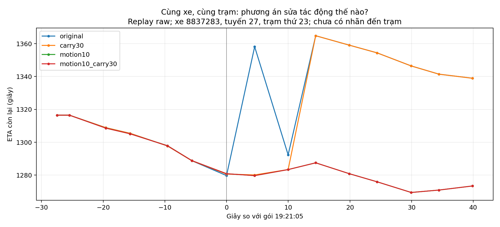
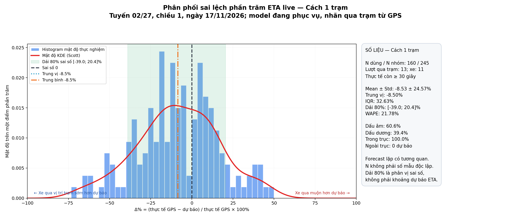
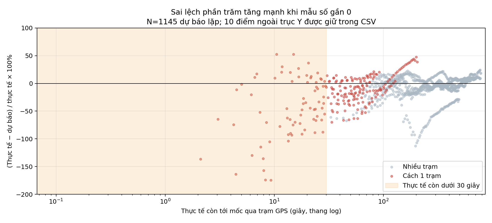
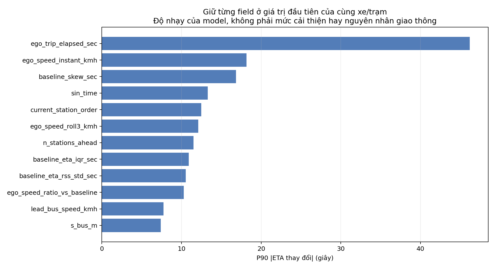

# Thử phương án sửa bằng raw, phân phối % lỗi và tác động feature

Ngày 17/11/2026. Dùng lại phiên raw 15 phút của tuyến 02/27 chiều 1; không thu phiên mới, không đổi model, không bật phương án thử vào serving. Đây là kết quả tiếp theo của [phân tích reset tốc độ](BEHAVIOR_PROBES_AND_SPEED_RESET.md).

## 1. Thiết kế thử và điều kiện chấp nhận

Replay tuần tự 3.600 snapshot fleet đã ghi; tính lại 4.990 dự báo bằng model/metadata/SQLite/incidents đóng băng cùng phiên. Bản gốc phải khớp đủ 54 feature và ETA HTTP trong sai số làm tròn. Phương án không đọc quan sát tương lai, không dùng nhãn để chọn nhánh, không ghi đè raw/model.

Một phương án chưa được đưa vào serving chỉ vì làm biến mất một cú nhảy: phải xem phần chuỗi tiếp theo, tác dụng ở xe khác, nhận dạng nhánh/quay đầu và chất lượng trên dữ liệu xác nhận khác. Các ngưỡng dưới đây là giả thuyết kỹ thuật để thử, chưa phải tham số được nghiệm thu.

| Phương án | Cách thử |
|---|---|
| `original` | Code serving hiện tại. |
| `carry30` | Khi reset do lý trình lùi, tạm giữ tốc độ fleet trước reset; bỏ giữ khi có ≥10 giây lịch sử mới hoặc quá 30 giây. Không sửa vị trí chiếu. Tốc độ cũ có thể đã sai; tên carry không bảo đảm nó đúng. |
| `motion10` | Khi GPS dịch ít nhất 8 m trong tối đa 30 giây, xét đoạn có tiếp tuyến cùng hướng dịch chuyển và khoảng cách ngang không quá nearest +10 m. Khi dịch ít, giữ nhánh trước nếu còn thỏa điều kiện khoảng cách. Sau gap dài thì chọn lại; không ép lý trình luôn tăng. |
| `motion10_carry30` | Kết hợp hai cách trên. |

Đây là các extractor thử nghiệm riêng trong `scripts/experiment_eta_streaming.py`, không phải sửa lặng thuật toán sản phẩm.

## 2. Ca đã thấy: chữa được gói đầu chưa có nghĩa chữa được chuỗi



Xe `8837283`, tuyến 27, trạm thứ 23. Đường gốc nhảy +78,38 giây giữa 19:21:05 và 19:21:09. Tại đúng cặp đó:

| Phương án | Thay đổi ETA giữa hai gói |
|---|---:|
| Gốc | +78,38 giây |
| Giữ tốc độ | −0,54 giây |
| Chọn nhánh theo chuyển động | −1,16 giây |
| Kết hợp | −1,16 giây |

Nhưng nhìn tiếp **19:21:15 → 19:21:19**, `carry30` lại nhảy **+81,40 giây**. Khi lịch sử mới đủ ngưỡng, tốc độ cửa sổ thay thế tốc độ giữ; phản ứng model vẫn xuất hiện. Kết luận: **giữ tốc độ chỉ trì hoãn cú nhảy trong ca này**, không sửa nguyên nhân chọn nhánh/reset.

`motion10` tránh cú nhảy lớn ở đoạn đang xét; trong phút 19:21, mức tăng lớn nhất khoảng 6,31 giây. Điều này chứng minh một hành vi khác, chưa chứng minh dự báo tốt hơn: xe này chưa có nhãn đến trạm hợp lệ trong phiên. Có thể một thay đổi dự báo nhanh phản ánh giảm tốc thật, nên không dùng “đường mượt hơn” thay cho độ đúng.

## 3. Toàn phiên: phải ghi cả kết quả không cải thiện

| Phương án | Reset lùi lý trình | Số lần ETA tăng ≥30 giây | MAE trên 1.145 nhãn cố định | P90 sai số tuyệt đối |
|---|---:|---:|---:|---:|
| Gốc | 12 | 10 | 33,654 giây | 75,471 giây |
| Giữ tốc độ | 12 | 8 | 33,609 giây | 74,924 giây |
| Chọn nhánh theo chuyển động | 11 | 7 | 33,672 giây | 73,908 giây |
| Kết hợp | 11 | 7 | 33,672 giây | 73,908 giây |

Reset đếm trên cập nhật trạng thái xe; cú nhảy đếm theo cùng xe/tuyến/chiều/trạm, cặp cách nhau tối đa 15 giây, có thể nhiều trạm của cùng xe. Không coi đó là số sự cố độc lập. Phương án motion đổi 96 phép chiếu trong replay; đây không phải 96 lần chọn nhánh đã được xác nhận đúng.

Bản gốc khớp đủ 54 feature ở **4.990/4.990** forecast; chênh ETA tối đa **0,049995 giây**, phù hợp làm tròn HTTP. Không phương án nào tạo khoảng cách còn lại âm trên tập dòng cố định này.

**Giới hạn:** giữ nguyên nhãn GPS gốc để tránh thay cả dự báo lẫn mục tiêu so sánh. Nhãn đó được dựng bằng geometry/projection cũ, nên metric chỉ là phân tích độ nhạy, chưa phải phán quyết phương án chiếu mới đúng hơn. Chỉ replay các dòng HTTP đã có, chưa tái dựng trọn bộ lọc xe/HTTP và các xe mới có thể được đưa vào hoặc loại ra sau sửa. Chênh MAE vài phần trăm giây không phải bằng chứng cải thiện có ý nghĩa. Các phương án đều được xem trên cùng dữ liệu, không gọi đây là tập nghiệm thu độc lập.

**Quyết định:** chưa promote phương án nào; giữ để thử tiếp, ưu tiên chất lượng chọn nhánh và xác định đổi lượt. Không thêm làm mượt để che đầu vào sai.

## 4. Giả lập streaming: phân biệt mất lần đọc với mất mẫu GPS

Đã thực hiện thêm:

| Phép thử | Cách tác động | Kết quả |
|---|---|---|
| Gửi trùng | Mỗi snapshot được nạp hai lần, giữ timestamp gốc. | Mọi dự báo trùng bản gốc trong kiểm tra số học; không tăng số mẫu lịch sử giả. |
| Bỏ mỗi lần cập nhật thứ 5 | Bỏ 720/3.600 lần gọi cập nhật. | Dự báo không đổi trên phiên này, do các lần khác vẫn có cùng timestamp/quan sát. Không được suy ra chịu mất 20% GPS. |
| Bỏ mẫu riêng biệt | Phân biệt bằng tuyến/chiều/xe/timestamp; bỏ mỗi mẫu thứ 5 sau khi đã seed xe, mọi bản lặp của mẫu đó đều bị bỏ. Giữ DTO cuối đã nhận, không lấy lại từ packet tương lai. | Bỏ **1.047/5.275** mẫu riêng biệt; MAE **34,058 giây**, số cú nhảy ≥30 giây tăng **10 → 15**. |

Phép mất mẫu làm thay đổi cả lịch sử tốc độ lẫn ngữ cảnh fleet. Đây là lỗi được chèn nhân tạo vào nguồn observed đã thu; không gọi các dòng chèn/bỏ là quan sát thực mới. Timestamp trong bộ dữ liệu TimBus vẫn là fetch time, chưa chứng minh mỗi timestamp riêng là một heartbeat thiết bị riêng.

Kiểm thử bổ sung xác nhận gói muộn/trùng không thay trạng thái nhánh trong hàm thử; giữ tốc độ hết hạn; nhánh quay về thật trên fixture không bị ép tiến. Đây là fixture tổng hợp kiểm tra quy tắc, chưa thay một chiến dịch thu raw quay đầu/giao cắt thực. Chưa giả lập đầy đủ mọi lỗi mạng, độ trễ và chuỗi mất dữ liệu liên tục.

## 5. Biểu đồ % lỗi theo bố cục ảnh tham khảo

Công thức giữ giống ảnh mẫu: **Δ% = (thực tế từ GPS − dự báo) / thực tế từ GPS × 100%**. Dấu âm: xe qua vị trí trạm sớm hơn giờ đã dự báo; dấu dương: qua muộn hơn. Đây là dấu ngược với trường `error_sec = predicted − actual` của các report trước.



Hai bản đều được giữ:

| Nhóm cách 1 trạm | Số forecast | Lượt qua trạm / xe | Trung vị Δ% | Trung bình Δ% | Dải 80% sai số |
|---|---:|---|---:|---:|---|
| [Mọi thời gian thực còn dương](../../figures/ml_evaluation/live_raw_20261117/k01_all_positive.png) | 245 | 14 / 11 | −13,02% | −57,63% | [−88,25%; +18,91%] |
| [Thực tế còn ≥30 giây](../../figures/ml_evaluation/live_raw_20261117/k01_actual_ge30.png) | 160 | 13 / 11 | −8,50% | −8,53% | [−39,03%; +20,44%] |

Bản đầy đủ có 20/245 điểm ngoài trục [−100%; +100%], vẫn nằm trong CSV và mọi thống kê. Histogram chia cho tổng số mẫu, không chuẩn hóa lại riêng phần nhìn thấy. KDE chỉ giúp đọc hình dạng, không phải khẳng định phân phối chuẩn hay độ tin cậy của model. Dải 80% là phân vị sai số quan sát, không phải P10–P90 ETA của từng forecast.



Mẫu số nhỏ nhất ở nhóm một trạm chỉ khoảng **0,084 giây**, trong khi bracket GPS kéo dài nhiều giây. Vì vậy % lỗi của các gói sát mốc nội suy có thể cực lớn và rất nhạy với bất định nhãn. Không dùng mean −57,63% để kết luận ETA toàn hệ thống lệch đúng tỷ lệ ấy; cũng không xóa các mẫu đó để làm biểu đồ đẹp. Cần xem đồng thời sai số giây, bracket và bản ≥30 giây.

Đã tạo thêm biểu đồ mọi khoảng cách và các mức 2/5/10 khi đủ mẫu. Mức 15 trạm không đủ mẫu trong phiên raw này: index ghi `insufficient_rows`, không lấy dữ liệu phiên khác ghép vào. [Index và thống kê từng hình](../../figures/ml_evaluation/live_raw_20261117/index.json); [CSV toàn bộ 1.145 sai số](../../figures/ml_evaluation/live_raw_20261117/signed_percent_errors.csv).

## 6. Field nào đang làm model thay đổi?

Thử giữ từng field tại giá trị đầu tiên của cùng xe/trạm, để các field còn lại theo trace. Có 33 field thay đổi trong phạm vi này. Đây là đầu vào can thiệp nhân tạo; nhiều feature phụ thuộc nhau nên phép thử không chứng minh nguyên nhân vật lý hay xếp hạng đóng góp độc lập.



- `baseline_eta_p50_sec`: P90 thay đổi tuyệt đối khoảng **708,16 giây** nếu cố giữ ở giá trị đầu. Điều này phù hợp kiến trúc residual: matrix được cộng trực tiếp vào kết quả. Không được diễn giải như một phát hiện feature importance mới.
- `ego_trip_elapsed_sec`: P90 tác động khoảng **46,19 giây**, lớn nhất trong các field còn lại được vẽ. Trong serving trường này suy từ baseline, trong builder là thời gian trajectory. Sai nghĩa có khả năng tác động đáng kể, chưa thể coi là một khác biệt tên gọi vô hại.
- `ego_speed_instant_kmh`: P90 tác động khoảng **18,16 giây**. Nhóm ego motion được giữ đồng thời có P90 tác động **28,61 giây**.
- Giữ đồng thời nhóm fleet: P90 tác động khoảng **15,06 giây**, lớn nhất khoảng **70,77 giây**. Fleet có ảnh hưởng thật tới dự báo, nhưng độ nhạy không tự chứng minh thông tin fleet đúng hoặc làm dự báo tốt hơn.
- Probe/delay/incidents mặc định không thay đổi trong phiên; không thể suy ra model không dùng các field đó chỉ vì thí nghiệm giữ nguyên không tạo khác biệt.

Mỗi field có request/xe tác động lớn nhất, giá trị gốc/giá trị giữ và hai dự báo trong [field_effects.json](streaming_field_effects.json). Có thể truy tiếp đúng packet thay vì giải thích chung chung.

## 7. Bằng chứng và lệnh chạy lại

[Report tổng hợp](streaming_report.json). Tất cả feature Parquet của từng phương án, dự báo từng gói, danh sách cú nhảy và source đóng băng giữ tại `runtime/eta_streaming_experiment_20261117_v4/`; giữ cả các lần thử trước. Raw/model gốc không bị ghi đè.

```powershell
python scripts/experiment_eta_streaming.py --session runtime/eta_live_session_20261117_raw --analysis runtime/eta_live_analysis_20261117_raw --output runtime/streaming_recheck
python scripts/plot_eta_live_percent_errors.py --analysis runtime/eta_live_analysis_20261117_raw --output runtime/live_percent_recheck
python scripts/plot_eta_streaming_experiments.py --experiment runtime/streaming_recheck --output runtime/streaming_figures_recheck
```

**35 test focused đạt**: quy tắc thử, validation/trace và hồi quy serving TimBus/release. Log `runtime/eta_streaming_and_serving_tests_20261117.log`. Đã kiểm tra dấu/công thức CSV, mẫu số 245/160, xác suất histogram ngoài trục và xem ảnh xuất ra. Chưa coi đó là nghiệm thu trọn SPEC-41 hay xác nhận độ đúng các phương án sửa trên nhiều ngày.
